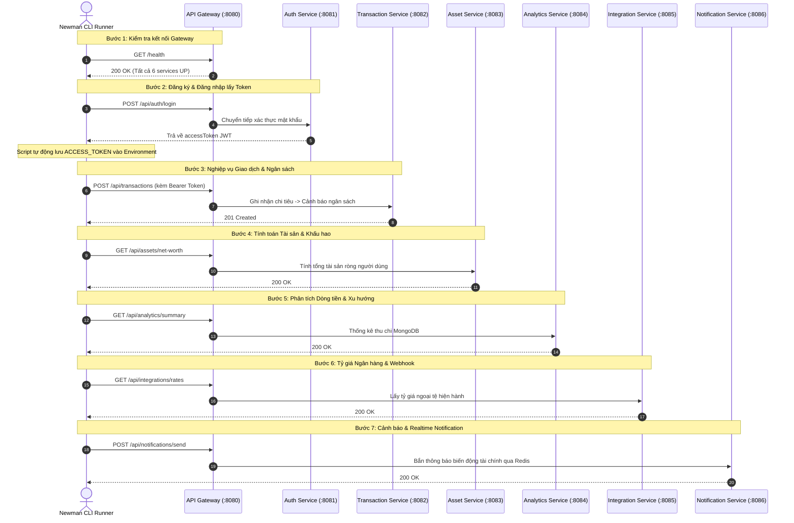

# 🏦 SOA CashFlow - Multi-Language Microservices Architecture

Dự án môn học **Kiến trúc hướng Dịch vụ (Service-Oriented Architecture - SOA)**: Hệ thống quản trị dòng tiền và phân tích tài chính cá nhân/doanh nghiệp (`SOA-CashFlow`).

Hệ thống được thiết kế theo kiến trúc Microservices gồm **6 services độc lập xây dựng bằng 6 ngôn ngữ lập trình khác nhau**, điều phối tập trung qua **API Gateway**, lưu trữ trên **4 MySQL, 1 MongoDB và 1 Redis** độc lập.

---

## 🏗️ Kiến trúc & Bảng Phân công Công nghệ

| Service | Thành viên | Công nghệ (Giữa kỳ - Native) | Công nghệ (Cuối kỳ - Framework) | Database / Broker | Cổng Host |
| :--- | :--- | :--- | :--- | :--- | :--- |
| **API Gateway** | Nhóm trưởng | **Node.js** (Native `http`, `events`) | Express / Fastify Gateway | - | `8080` |
| **Auth Service** | Thành viên 1 | **Java** (Native `com.sun.net.httpserver`) | Spring Boot 3 | MySQL (`auth_db`) | `8081` |
| **Transaction Service** | Thành viên 2 | **PHP** (Native PDO, CLI server) | Laravel 11 | MySQL (`transaction_db`) | `8082` |
| **Asset Service** | Thành viên 3 | **C#** (Native `HttpListener`) | ASP.NET Core Web API | MySQL (`asset_db`) | `8083` |
| **Analytics Service** | Thành viên 4 | **Python** (Native `http.server`, math) | FastAPI | MongoDB (`analytics_db`) | `8084` |
| **Integration Service** | Thành viên 5 | **Go** (Native `net/http` Go 1.22) | Gin Web Framework | MySQL (`integration_db`) | `8085` |
| **Notification Service** | Nhóm trưởng | **Node.js** (Native SSE, Redis Pub/Sub) | NestJS / Socket.io | Redis (`redis:6379`) | `8086` |

---

## 📁 Cấu trúc Thư mục Dự án

```text
SOA-CashFlow/
├── gateway/                       # API Gateway điều phối routing và xác thực
│   └── midterm/                   # Gateway Native Node.js thuần
├── services/                      # Thư mục chứa 6 Microservices (6 ngôn ngữ)
│   ├── auth-service/midterm/      # Java 17 Native HttpServer
│   ├── transaction-service/midterm/# PHP 8.2 Native PDO
│   ├── asset-service/midterm/     # C# .NET 8 Native HttpListener
│   ├── analytics-service/midterm/ # Python 3.11 Native http.server
│   ├── integration-service/midterm/# Go 1.22 Native net/http
│   └── notification-service/midterm/# Node.js 20 Native SSE & Redis
├── docs/                          # Tài liệu kỹ thuật, Postman & Báo cáo
│   ├── api-docs/                  # Postman Collection & Environment JSON
│   │   ├── Postman_Collection_All_Services.json
│   │   └── Postman_Environment.json
│   ├── diagrams/                  # Sơ đồ kiến trúc & ERD
│   └── reports/                   # Slide & Báo cáo Giữa kỳ
├── scripts/                       # Scripts kiểm thử Concurrency (k6) & Seed dữ liệu
├── docker-compose.midterm.yml     # Compose Giữa kỳ: 13 containers (6 services + gateway + 6 DB)
├── docker-compose.yml             # Compose bản hoàn chỉnh chuẩn
├── .env.example                   # Biến môi trường mẫu
└── README.md                      # Hướng dẫn cài đặt & kiểm thử tự động
```

---

## 🚀 Hướng dẫn Triển khai Hệ thống bằng Docker

### 1. Yêu cầu Tiền đề (Prerequisites)
* **Docker Desktop** (>= 24.x) & **Docker Compose** (>= v2.20)
* **Git** (để clone và cập nhật repository)
* **Node.js** (>= 18.x) & **npm** *(chỉ cần nếu muốn chạy Newman trực tiếp trên máy host)*

### 2. Thiết lập Biến Môi trường
Sao chép file `.env.example` thành `.env` tại thư mục gốc của dự án:
```bash
cp .env.example .env
```
*(Trên Windows PowerShell: `Copy-Item .env.example .env`)*

### 3. Khởi chạy Hệ thống Microservices

#### Cách A: Chạy bản Giữa kỳ (Code Native/Thuần - 13 Containers)
Bản Giữa kỳ khởi chạy 6 services viết thuần không framework, 1 Gateway native và 6 database riêng:
```bash
docker-compose -f docker-compose.midterm.yml up -d --build
```

#### Cách B: Chạy bản Hoàn chỉnh (Chuẩn chung)
```bash
docker-compose up -d --build
```

### 4. Kiểm tra Trạng thái Khởi động
Kiểm tra xem toàn bộ các container đã ở trạng thái `healthy` hoặc `Up`:
```bash
docker-compose -f docker-compose.midterm.yml ps
```

Kiểm tra Gateway Health Check trực tiếp qua trình duyệt hoặc cURL:
```bash
curl http://localhost:8080/health
```
Kết quả trả về chuẩn:
```json
{
  "service": "api-gateway",
  "status": "UP",
  "environment": "midterm",
  "services": {
    "auth": "UP",
    "transaction": "UP",
    "asset": "UP",
    "analytics": "UP",
    "integration": "UP",
    "notification": "UP"
  }
}
```

Xem logs thời gian thực nếu cần chẩn đoán:
```bash
docker-compose -f docker-compose.midterm.yml logs -f gateway
```

---

## 🧪 Hướng dẫn Kiểm thử Toàn diện bằng Newman CLI

Hệ thống cung cấp sẵn file Postman Collection tích hợp trọn vẹn kịch bản kiểm thử End-to-End cho cả 6 dịch vụ qua API Gateway:
* Collection: [`docs/api-docs/Postman_Collection_All_Services.json`](docs/api-docs/Postman_Collection_All_Services.json)
* Environment: [`docs/api-docs/Postman_Environment.json`](docs/api-docs/Postman_Environment.json)

---

### Cách 1: Chạy Newman bằng Docker (Khuyên dùng - Không cần cài Node.js/npm)

Bạn có thể sử dụng trực tiếp Docker Image chính thức của Postman/Newman để chạy test tự động trong container mà không cần cài thêm bất kỳ phần mềm nào:

#### 1. Chạy test trên Linux / macOS / Git Bash:
```bash
docker run --rm --network="host" \
  -v "$(pwd)/docs/api-docs:/etc/newman" \
  postman/newman:alpine run /etc/newman/Postman_Collection_All_Services.json \
  -e /etc/newman/Postman_Environment.json \
  --reporters cli
```

#### 2. Chạy test trên Windows (PowerShell):
```powershell
docker run --rm --network="host" `
  -v "${PWD}/docs/api-docs:/etc/newman" `
  postman/newman:alpine run /etc/newman/Postman_Collection_All_Services.json `
  -e /etc/newman/Postman_Environment.json `
  --reporters cli
```

> **Lưu ý trên Docker Desktop Windows:** Nếu cờ `--network="host"` không kết nối được `localhost:8080`, hãy sử dụng mạng container chung hoặc đổi `GATEWAY_URL` thành `http://host.docker.internal:8080` bằng tham số:
> ```powershell
> docker run --rm `
>   -v "${PWD}/docs/api-docs:/etc/newman" `
>   postman/newman:alpine run /etc/newman/Postman_Collection_All_Services.json `
>   -e /etc/newman/Postman_Environment.json `
>   --global-var "GATEWAY_URL=http://host.docker.internal:8080" `
>   --reporters cli
> ```

---

### Cách 2: Chạy Newman CLI cục bộ qua npm

Nếu máy bạn đã cài sẵn Node.js và npm:

#### 1. Cài đặt Newman CLI và Reporter HTML:
```bash
npm install -g newman newman-reporter-htmlextra
```

#### 2. Thực thi kiểm thử xuất kết quả ra màn hình Console:
```bash
newman run docs/api-docs/Postman_Collection_All_Services.json \
  -e docs/api-docs/Postman_Environment.json \
  --color on
```

#### 3. Chạy kiểm thử và Xuất Báo cáo HTML chuyên nghiệp (Phục vụ Nộp bài):
```bash
newman run docs/api-docs/Postman_Collection_All_Services.json \
  -e docs/api-docs/Postman_Environment.json \
  --reporters cli,htmlextra \
  --reporter-htmlextra-export docs/reports/Newman_API_Test_Report.html \
  --reporter-htmlextra-title "SOA CashFlow - Kết Quả Kiểm Thử Toàn Diện 6 Microservices"
```
Sau khi chạy xong, mở file `docs/reports/Newman_API_Test_Report.html` trên trình duyệt để xem dashboard trực quan với biểu đồ tỷ lệ Pass/Fail, thời gian phản hồi (Latency) và chi tiết từng request.

---

### ⚙️ Các Tham số Hữu ích khi chạy Newman

| Cờ (Flag) | Mô tả công dụng |
| :--- | :--- |
| `--bail` | Tự động dừng phiên test ngay khi gặp request đầu tiên bị lỗi (Fail assertion). |
| `--delay-request 300` | Tạm dừng 300ms giữa các request để mô phỏng tải thực tế và tránh làm nghẽn DB. |
| `--timeout-request 5000` | Giới hạn thời gian chờ tối đa 5000ms cho mỗi API call. |
| `--color on` | Bật định dạng màu cho console output trên Windows Terminal. |
| `--global-var "KEY=VAL"` | Ghi đè nhanh biến môi trường mà không cần chỉnh sửa file JSON. |

---

## 🔄 Luồng Kiểm thử Tự động (End-to-End Test Workflow)

Bộ kịch bản Newman được thiết kế tự động hóa chuỗi xác thực liên dịch vụ:



---

## ⚡ Kiểm thử Tải & Tương tranh (Concurrency Test)

Ngoài Newman kiểm tra tính đúng đắn của API, dự án cung cấp script k6 để kiểm tra độ chịu tải và chống Race Condition:
```bash
k6 run scripts/concurrency-test-k6.js
```

---

## 🛠️ Hướng dẫn Xử lý Sự cố Thường gặp (Troubleshooting)

1. **Lỗi xung đột cổng (Port already allocated):**
   * Kiểm tra các ứng dụng đang chiếm cổng `8080` -> `8086`, `3306`, `27017`, `6379`.
   * Thay đổi cổng mapping trong file `.env` nếu cần thiết.

2. **Dịch vụ trả về 502/503 Service Unavailable khi vừa khởi động:**
   * Các container MySQL cần từ 15-30 giây để khởi tạo database và phân quyền người dùng trong lần đầu tiên chạy.
   * Chờ khoảng 20 giây rồi chạy lại `curl http://localhost:8080/health` để xác nhận trạng thái `UP`.

3. **Newman báo lỗi "connect ECONNREFUSED 127.0.0.1:8080" khi chạy Docker:**
   * Thay thế biến `GATEWAY_URL` thành `http://host.docker.internal:8080` khi chạy lệnh Docker trên Windows/macOS.

4. **Dừng và dọn dẹp toàn bộ hệ thống:**
   ```bash
   # Dừng các container
   docker-compose -f docker-compose.midterm.yml down

   # Dừng và xóa toàn bộ dữ liệu database volume để chạy lại từ đầu:
   docker-compose -f docker-compose.midterm.yml down -v
   ```
