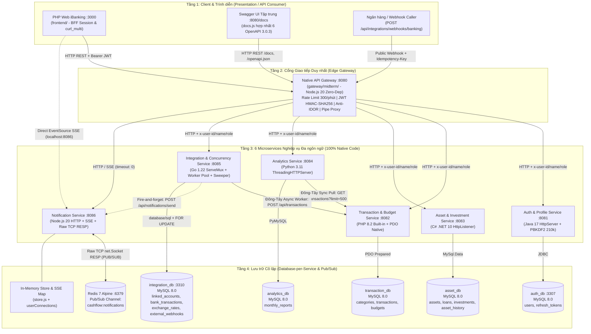
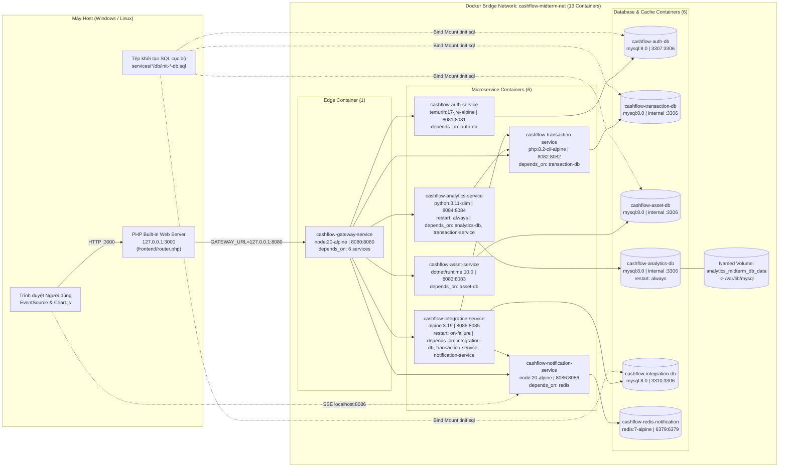

# Sơ đồ Kiến trúc Tổng thể & Triển khai Docker Compose (Midterm — 100% Native Code)

Tài liệu này cung cấp mã nguồn Mermaid chuẩn hóa cho hai sơ đồ nền tảng của hệ thống **SOA CashFlow (Phiên bản Giữa kỳ)**:
- **Hình 1-1:** Kiến trúc Tổng thể Hệ thống SOA CashFlow (4 tầng: Client → Native API Gateway → 6 Microservices đa ngôn ngữ → 5 CSDL MySQL 8.0 + Redis 7).
- **Hình 3-1:** Biểu đồ Triển khai Vật lý Docker Compose (`cashflow-midterm-net` với 13 containers và máy chủ Host chạy Frontend PHP `:3000`).

---

## Hình 1-1: Kiến trúc Tổng thể Hệ thống SOA CashFlow (Phiên bản Giữa kỳ)

---

## Hình 3-1: Biểu đồ Triển khai Vật lý Docker Compose (`cashflow-midterm-net`)

