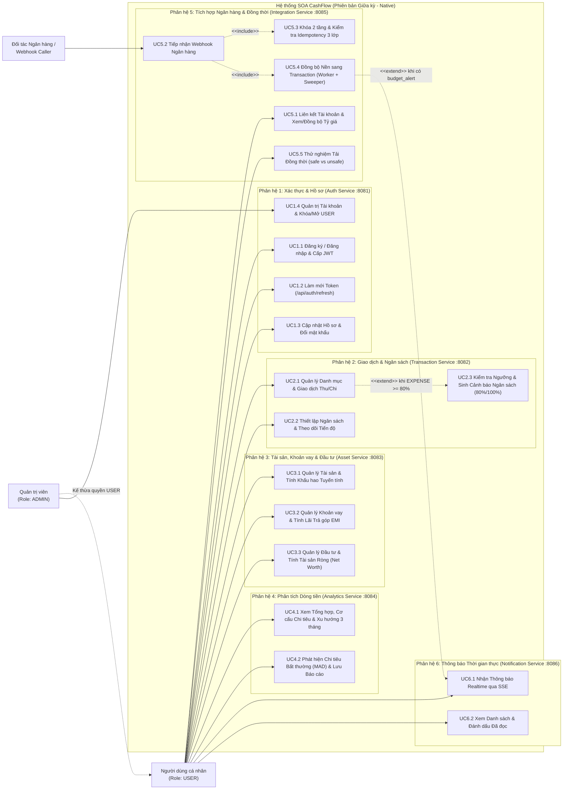
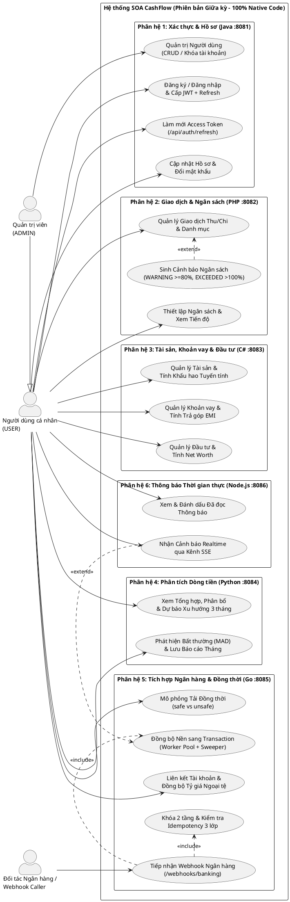

# Biểu đồ Use Case Tổng quát Hệ thống SOA CashFlow (Phiên bản Giữa kỳ)

Tài liệu này cung cấp cả hai định dạng mã nguồn cho **Hình 1-2: Biểu đồ Use Case Tổng quát Hệ thống SOA CashFlow (Giữa kỳ)**:
1. **Mermaid (`flowchart LR`)** để nhúng trực tiếp trong `Bao-Cao-Giua-Ky.md`.
2. **PlantUML (`.puml`)** chuẩn UML Use Case (đồng bộ với tệp độc lập [02-usecase-overall.puml](./02-usecase-overall.puml)) để xuất ảnh vector sắc nét khi biên tập Word/PDF.

---

## 1. Mã nguồn Mermaid (Hình 1-2)

---

## 2. Mã nguồn PlantUML (Đồng bộ với `02-usecase-overall.puml`)

