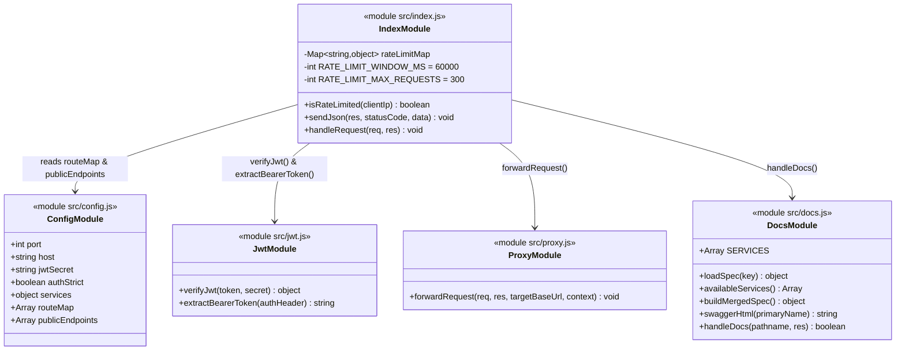
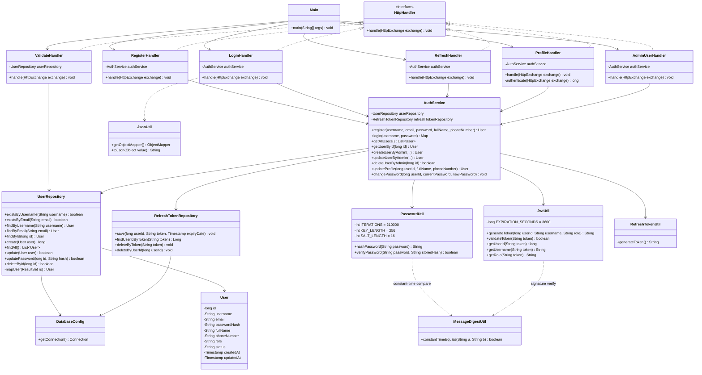
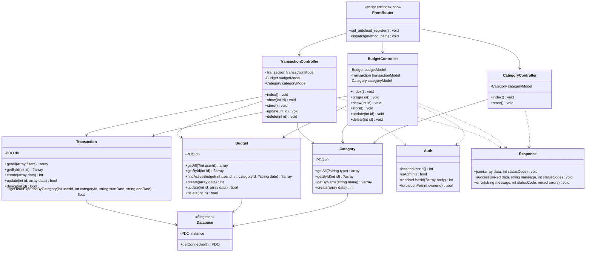
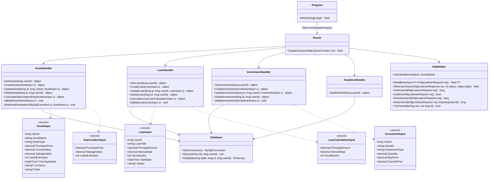
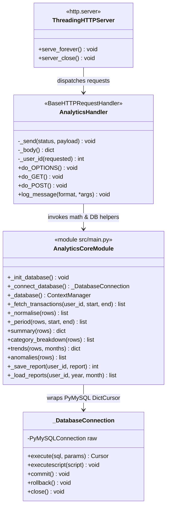
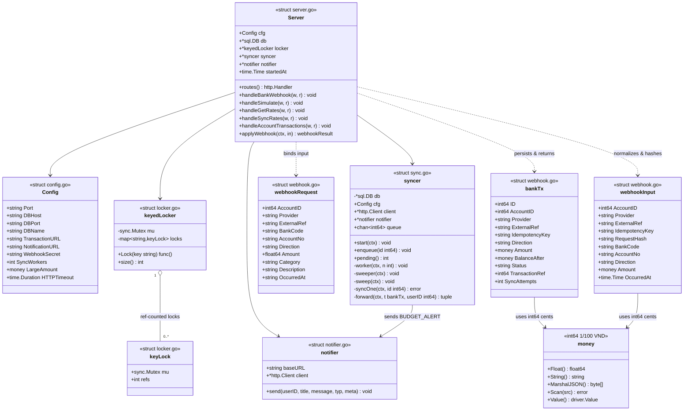
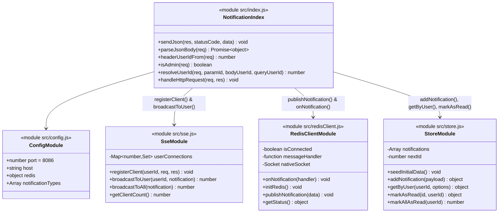

# Bộ Biểu đồ Lớp & Cấu trúc Mô-đun Thiết kế (Midterm — 100% Native Code)

Tài liệu này tổng hợp 7 biểu đồ lớp / mô-đun (`Hình 2-2` → `Hình 2-8`) phản ánh chính xác các lớp, struct, mô-đun, record DTO và phương thức thực tế trong mã nguồn `gateway/midterm/` và `services/*/midterm/`.

---

## Hình 2-2: Biểu đồ Mô-đun Thiết kế API Gateway (Node.js 20 Native)

---

## Hình 2-3: Biểu đồ Lớp Auth & Profile Service (Java 17 Native)

---

## Hình 2-4: Biểu đồ Lớp Transaction & Budget Service (PHP 8.2 Native PSR-4 OOP)

---

## Hình 2-5: Biểu đồ Lớp Asset & Investment Service (C# .NET 10 Native)

---

## Hình 2-6: Biểu đồ Lớp & Mô-đun Analytics Service (Python 3.11 Native)

---

## Hình 2-7: Biểu đồ Cấu trúc & Mô-đun Integration & Concurrency Service (Go 1.22 Native)

---

## Hình 2-8: Biểu đồ Mô-đun Notification Service (Node.js 20 Native)

