# Mô hình ERD Chuẩn hóa Kiến trúc Database-per-Service (Midterm — 5 CSDL MySQL 8.0, 14 Bảng)

Tài liệu này mô tả **Hình 2-9: Mô hình Thực thể – Quan hệ (ERD) Toàn hệ thống SOA CashFlow (Phiên bản Giữa kỳ)** dựa trên 5 tệp SQL khởi tạo thực tế (`services/*/db/init-*-db.sql`).

## Nguyên tắc Cô lập Dữ liệu (Database-per-Service)
- Mỗi dịch vụ nghiệp vụ sở hữu một cơ sở dữ liệu **MySQL 8.0 (InnoDB, `utf8mb4_unicode_ci`)** tách biệt hoàn toàn: `auth_db` (2 bảng), `transaction_db` (3 bảng), `asset_db` (4 bảng), `analytics_db` (1 bảng), `integration_db` (4 bảng). Tổng cộng **14 bảng vật lý**.
- **Notification Service** không sử dụng bảng SQL; dữ liệu thông báo lưu trong bộ nhớ (`store.js`) và phát đồng bộ qua kênh **Redis 7 Pub/Sub (`cashflow:notifications`)**.
- **Không tồn tại khóa ngoại (`FOREIGN KEY`) vật lý xuyên CSDL**. Liên kết giữa các dịch vụ chỉ mang tính **logic** thông qua `user_id` (tham chiếu `auth_db.users.id`) và `bank_transactions.transaction_ref` (tham chiếu `transaction_db.transactions.id`).

---

## Hình 2-9: Mô hình ERD Chuẩn hóa Database-per-Service (14 Bảng trên 5 CSDL MySQL 8.0)

```mermaid
erDiagram
    %% ===== DB 1: auth_db (2 bảng) =====
    users {
        BIGINT id PK "AUTO_INCREMENT"
        VARCHAR_50 username UK "NOT NULL"
        VARCHAR_100 email UK "NOT NULL"
        VARCHAR_255 password_hash "PBKDF2 210k"
        VARCHAR_100 full_name "NULL"
        VARCHAR_20 phone_number "NULL"
        VARCHAR_20 role "USER | ADMIN"
        VARCHAR_20 status "ACTIVE | BLOCKED"
        TIMESTAMP created_at "DEFAULT CURRENT_TIMESTAMP"
        TIMESTAMP updated_at "ON UPDATE CURRENT_TIMESTAMP"
    }

    refresh_tokens {
        BIGINT id PK "AUTO_INCREMENT"
        BIGINT user_id FK "REFERENCES users(id) ON DELETE CASCADE"
        VARCHAR_255 token UK "48-byte Base64URL"
        TIMESTAMP expiry_date "NOT NULL (7 days)"
        TIMESTAMP created_at "DEFAULT CURRENT_TIMESTAMP"
    }

    users ||--o{ refresh_tokens : "sở hữu (FK ON DELETE CASCADE)"

    %% ===== DB 2: transaction_db (3 bảng) =====
    categories {
        INT id PK "AUTO_INCREMENT"
        VARCHAR_100 name "NOT NULL"
        ENUM type "INCOME | EXPENSE"
        VARCHAR_100 icon "FontAwesome class"
    }

    transactions {
        BIGINT id PK "AUTO_INCREMENT"
        BIGINT user_id "Logical ref -> auth_db.users.id"
        INT category_id FK "REFERENCES categories(id) ON DELETE SET NULL"
        VARCHAR_100 category "Denormalized name"
        DECIMAL_15_2 amount "NOT NULL"
        ENUM type "INCOME | EXPENSE | TRANSFER"
        TEXT description "NULL"
        DATETIME transaction_date "INDEX idx_user_trans"
        TIMESTAMP created_at "DEFAULT CURRENT_TIMESTAMP"
        TIMESTAMP updated_at "ON UPDATE CURRENT_TIMESTAMP"
    }

    budgets {
        INT id PK "AUTO_INCREMENT"
        BIGINT user_id "Logical ref -> auth_db.users.id"
        INT category_id FK "REFERENCES categories(id) ON DELETE CASCADE"
        DECIMAL_15_2 amount_limit "NOT NULL"
        ENUM period "MONTHLY | YEARLY"
        DATE start_date "INDEX idx_user_budget"
        DATE end_date "INDEX idx_user_budget"
        TIMESTAMP created_at "DEFAULT CURRENT_TIMESTAMP"
        TIMESTAMP updated_at "ON UPDATE CURRENT_TIMESTAMP"
    }

    categories ||--o{ transactions : "phân loại (FK ON DELETE SET NULL)"
    categories ||--o{ budgets : "áp dụng (FK ON DELETE CASCADE)"

    %% ===== DB 3: asset_db (4 bảng) =====
    assets {
        BIGINT id PK "AUTO_INCREMENT"
        BIGINT user_id "Logical ref -> auth_db.users.id"
        VARCHAR_100 asset_name "NOT NULL"
        VARCHAR_50 asset_type "BANK_ACCOUNT | CASH | DEVICE..."
        DECIMAL_18_2 purchase_price "DEFAULT 0.00"
        DECIMAL_18_2 current_value "DEFAULT 0.00"
        DECIMAL_18_2 salvage_value "DEFAULT 0.00"
        INT useful_life_years "DEFAULT 0"
        DATE purchase_date "NULL"
        VARCHAR_10 currency "DEFAULT VND"
        TEXT note "NULL"
        TIMESTAMP created_at "DEFAULT CURRENT_TIMESTAMP"
        TIMESTAMP updated_at "ON UPDATE CURRENT_TIMESTAMP"
    }

    asset_history {
        BIGINT id PK "AUTO_INCREMENT"
        BIGINT asset_id FK "REFERENCES assets(id) ON DELETE CASCADE (Midterm chưa dùng)"
        DECIMAL_18_2 value "NOT NULL"
        TIMESTAMP recorded_at "DEFAULT CURRENT_TIMESTAMP"
    }

    loans {
        BIGINT id PK "AUTO_INCREMENT"
        BIGINT user_id "Logical ref -> auth_db.users.id"
        VARCHAR_150 loan_title "NOT NULL"
        DECIMAL_18_2 principal_amount "NOT NULL"
        DECIMAL_5_2 interest_rate "%/năm"
        INT term_months "NOT NULL"
        DATE start_date "NOT NULL"
        VARCHAR_20 status "ACTIVE | CLOSED"
        TIMESTAMP created_at "DEFAULT CURRENT_TIMESTAMP"
        TIMESTAMP updated_at "ON UPDATE CURRENT_TIMESTAMP"
    }

    investments {
        BIGINT id PK "AUTO_INCREMENT"
        BIGINT user_id "Logical ref -> auth_db.users.id"
        VARCHAR_20 symbol "FPT | BTC..."
        VARCHAR_50 investment_type "STOCK | CRYPTO | GOLD | BOND"
        DECIMAL_18_4 quantity "NOT NULL"
        DECIMAL_18_2 buy_price "NOT NULL"
        DECIMAL_18_2 current_price "NOT NULL"
        TIMESTAMP created_at "DEFAULT CURRENT_TIMESTAMP"
        TIMESTAMP updated_at "ON UPDATE CURRENT_TIMESTAMP"
    }

    assets ||--o{ asset_history : "lịch sử định giá (FK ON DELETE CASCADE)"

    %% ===== DB 4: analytics_db (1 bảng) =====
    monthly_reports {
        BIGINT_UNSIGNED report_id PK "AUTO_INCREMENT"
        BIGINT user_id UK "uq_monthly_reports_user_period"
        SMALLINT year UK "CHECK 2000..2100"
        TINYINT month UK "CHECK 1..12"
        JSON report_json "summary, category_breakdown, anomalies"
        DATETIME generated_at "NOT NULL"
        TIMESTAMP created_at "DEFAULT CURRENT_TIMESTAMP"
        TIMESTAMP updated_at "ON UPDATE CURRENT_TIMESTAMP"
    }

    %% ===== DB 5: integration_db (4 bảng) =====
    exchange_rates {
        INT id PK "AUTO_INCREMENT"
        VARCHAR_10 currency_code UK "USD | EUR | GBP | JPY | SGD | CNY"
        DECIMAL_15_4 rate_to_vnd "CHECK rate_to_vnd > 0"
        TIMESTAMP updated_at "ON UPDATE CURRENT_TIMESTAMP"
    }

    linked_accounts {
        BIGINT id PK "AUTO_INCREMENT"
        BIGINT user_id "Logical ref -> auth_db.users.id"
        VARCHAR_20 bank_code UK "uq_bank_account"
        VARCHAR_30 account_no UK "uq_bank_account"
        VARCHAR_100 holder_name "NOT NULL"
        DECIMAL_18_2 balance "CHECK balance >= 0"
        BIGINT version "Optimistic/audit counter"
        TIMESTAMP created_at "DEFAULT CURRENT_TIMESTAMP"
        TIMESTAMP updated_at "ON UPDATE CURRENT_TIMESTAMP"
    }

    bank_transactions {
        BIGINT id PK "AUTO_INCREMENT"
        BIGINT account_id FK "REFERENCES linked_accounts(id) ON DELETE CASCADE"
        VARCHAR_20 provider UK "uq_provider_ref"
        VARCHAR_100 external_ref UK "uq_provider_ref"
        VARCHAR_150 idempotency_key UK "uq_idempotency_key"
        CHAR_64 request_hash "SHA-256 hex"
        ENUM direction "CREDIT | DEBIT"
        DECIMAL_18_2 amount "CHECK amount > 0"
        DECIMAL_18_2 balance_after "NOT NULL"
        VARCHAR_100 category "DEFAULT ''"
        VARCHAR_255 description "DEFAULT ''"
        DATETIME occurred_at "NOT NULL"
        ENUM status "RECEIVED | SYNCING | SYNCED | FAILED | REJECTED"
        BIGINT transaction_ref "Logical ref -> transaction_db.transactions.id"
        INT sync_attempts "DEFAULT 0 (max 5)"
        VARCHAR_255 last_error "NULL"
        TIMESTAMP created_at "DEFAULT CURRENT_TIMESTAMP"
        TIMESTAMP updated_at "ON UPDATE CURRENT_TIMESTAMP"
    }

    external_webhooks {
        BIGINT id PK "AUTO_INCREMENT"
        VARCHAR_50 provider_name "INDEX idx_webhook_provider"
        VARCHAR_50 event_type "BANK_TRANSACTION"
        JSON payload "Raw audit JSON"
        TIMESTAMP received_at "DEFAULT CURRENT_TIMESTAMP"
    }

    linked_accounts ||--o{ bank_transactions : "phát sinh (FK ON DELETE CASCADE)"

    %% ===== Liên kết Logic Xuyên Dịch vụ (Không tạo FK vật lý) =====
    users ||..o{ transactions : "logic: user_id"
    users ||..o{ budgets : "logic: user_id"
    users ||..o{ assets : "logic: user_id"
    users ||..o{ loans : "logic: user_id"
    users ||..o{ investments : "logic: user_id"
    users ||..o{ monthly_reports : "logic: user_id"
    users ||..o{ linked_accounts : "logic: user_id"
    bank_transactions |o..o| transactions : "logic: transaction_ref"
```

