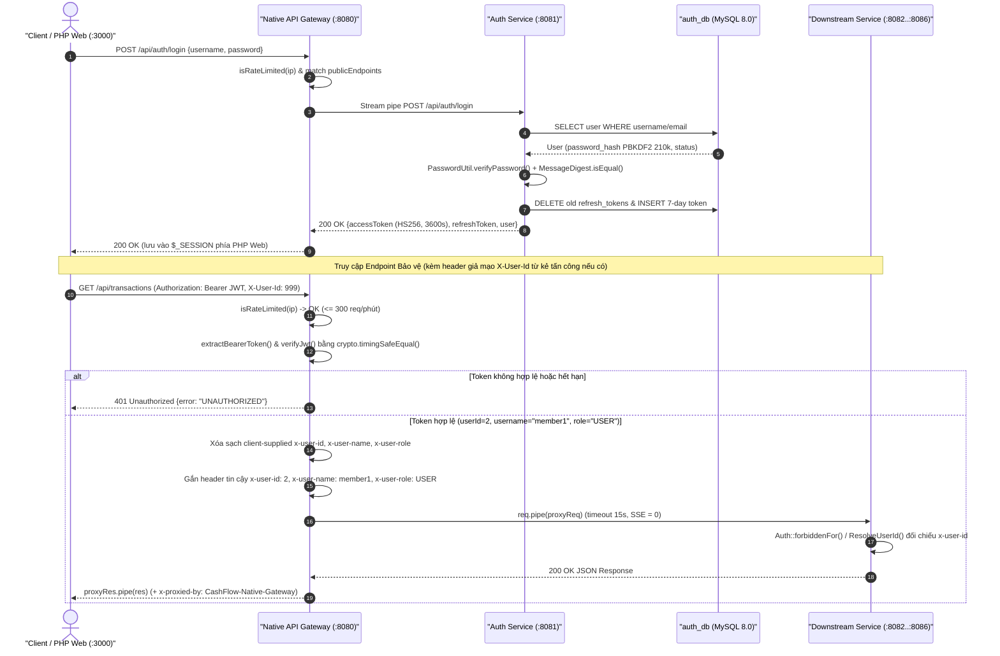
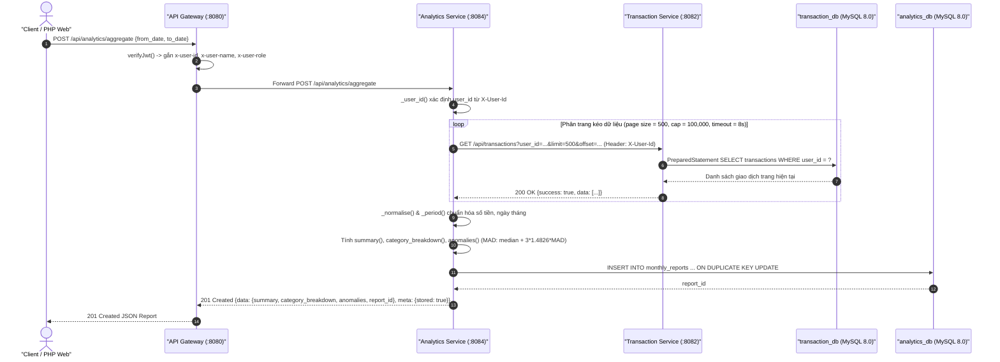
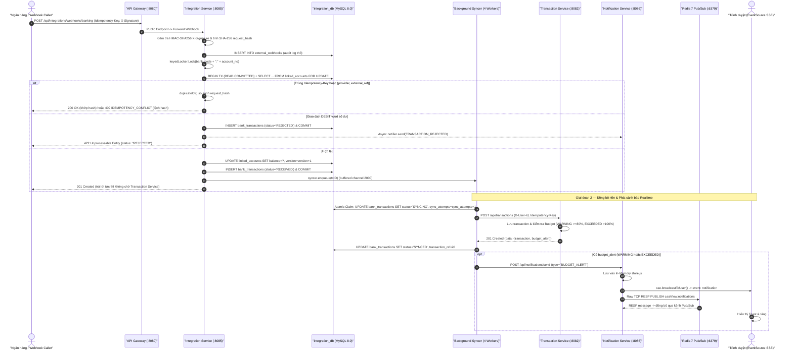
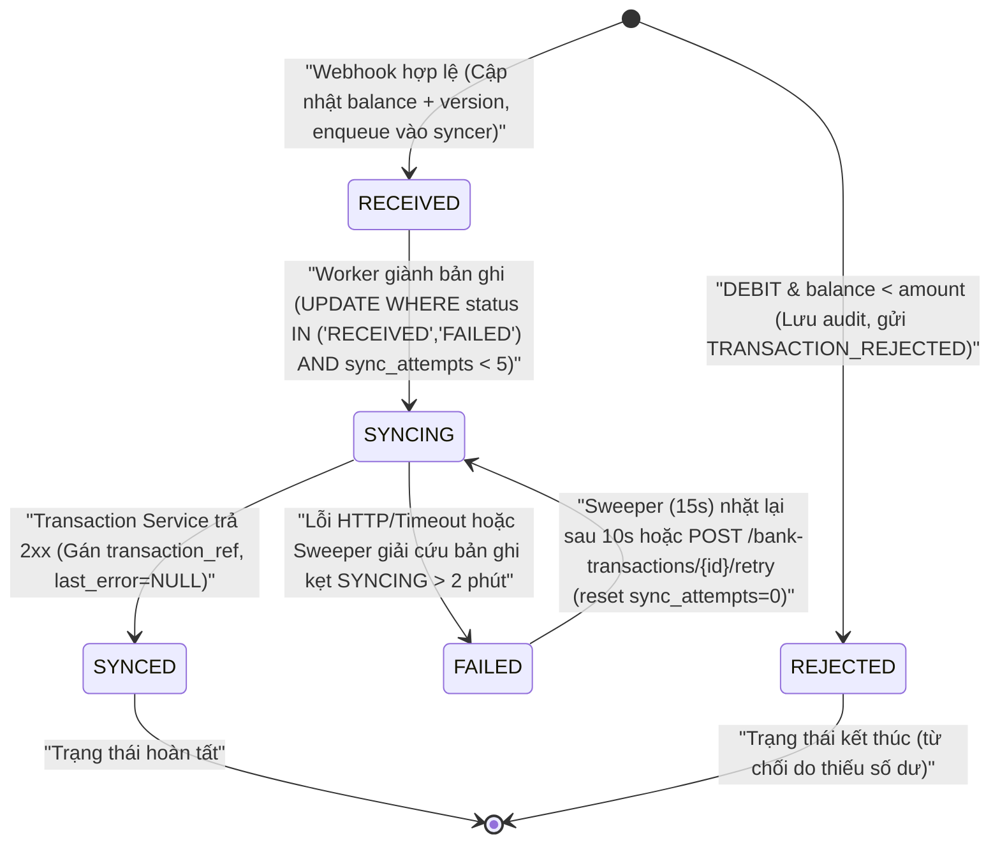

# Bộ Biểu đồ Tuần tự Đa tầng & Máy trạng thái (Midterm — 100% Native Code)

Tài liệu này chứa 4 sơ đồ hành vi trọng tâm của phiên bản Giữa kỳ:
- **Hình 2-1:** Luồng Xác thực JWT & Chống Giả mạo Header (Anti-IDOR) tại API Gateway.
- **Hình 2-10:** Luồng Kéo Dữ liệu Phân tích Liên dịch vụ (Analytics → Transaction → `analytics_db`).
- **Hình 2-11:** Luồng Webhook Đồng thời, Đồng bộ Nền & Cảnh báo Ngân sách Realtime SSE.
- **Hình 2-12:** Biểu đồ Máy trạng thái (`State Diagram`) của thực thể `bank_transactions.status`.

---

## Hình 2-1: Biểu đồ Tuần tự Luồng Xác thực JWT & Chống Giả mạo Header (Anti-IDOR)

---

## Hình 2-10: Biểu đồ Tuần tự Luồng Kéo Dữ liệu Phân tích Liên dịch vụ

---

## Hình 2-11: Biểu đồ Tuần tự Luồng Webhook Đồng thời, Đồng bộ Nền & Cảnh báo Realtime SSE

---

## Hình 2-12: Biểu đồ Máy trạng thái Vòng đời Giao dịch Ngân hàng (`bank_transactions.status`)

