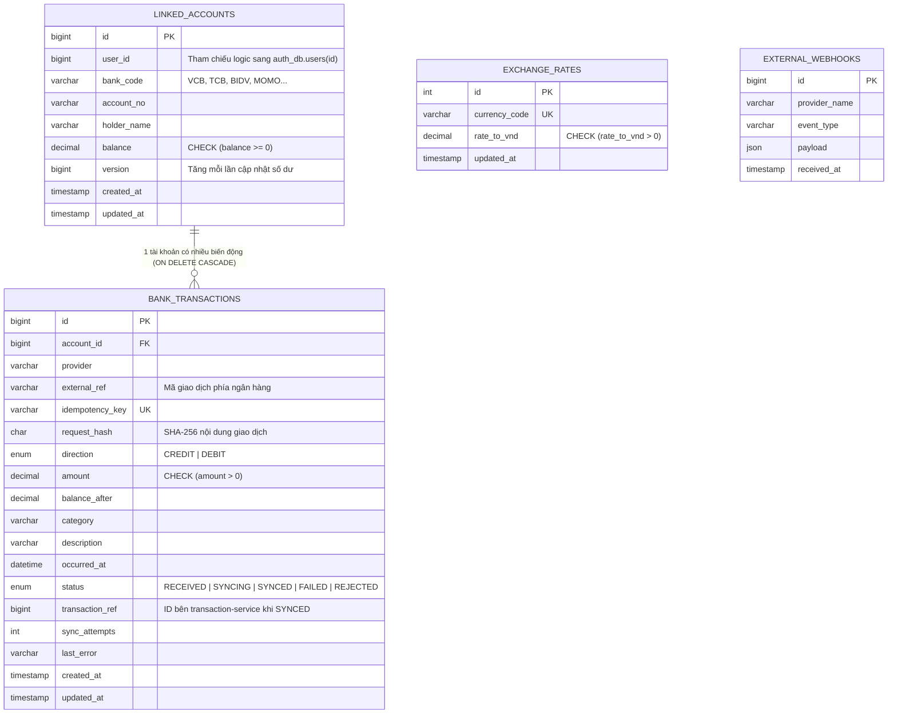

# Sơ đồ Thực thể Liên kết (ERD) & Use Case — Integration Service (Go)

Cơ sở dữ liệu: `integration_db` (MySQL 8.0 - InnoDB - utf8mb4), chỉ `integration-service` (:8085) được đọc/ghi trực tiếp.

- **Sơ đồ ERD (Ảnh PNG/SVG & PlantUML):** [`erd-integration.png`](./erd-integration.png) | [`erd-integration.svg`](./erd-integration.svg) | [`erd-integration.puml`](./erd-integration.puml)
- **Sơ đồ Use Case (Ảnh PNG/SVG & PlantUML):** [`usecase-integration.png`](./usecase-integration.png) | [`usecase-integration.svg`](./usecase-integration.svg) | [`usecase-integration.puml`](./usecase-integration.puml)

## 1. Sơ đồ ERD (Mermaid)

## 2. Ràng buộc toàn vẹn dữ liệu

| Bảng | Ràng buộc | Mục đích |
|---|---|---|
| `linked_accounts` | `UNIQUE (bank_code, account_no)` | Mỗi số tài khoản tại 1 ngân hàng chỉ được liên kết 1 lần |
| `linked_accounts` | `CHECK (balance >= 0)` | CSDL chặn âm số dư ở tầng cuối cùng |
| `bank_transactions` | `UNIQUE (idempotency_key)` | Chống ghi trùng biến động theo `Idempotency-Key` |
| `bank_transactions` | `UNIQUE (provider, external_ref)` | Chống ghi trùng theo mã giao dịch ngân hàng, kể cả khi đổi key |
| `bank_transactions` | `FK account_id -> linked_accounts(id) ON DELETE CASCADE` | Khi hủy liên kết tài khoản (`DELETE /accounts/{id}`), tự động xóa lịch sử biến động thuộc tài khoản đó |
| `bank_transactions` | `INDEX (status, updated_at)` | Hỗ trợ Sweeper tìm nhanh các giao dịch `RECEIVED`/`FAILED` cần đồng bộ lại |
| `bank_transactions` | `INDEX (account_id, occurred_at)` | Tối ưu truy vấn & lọc lịch sử biến động theo tài khoản |

## 3. Liên kết với các Service khác trong hệ thống

- `linked_accounts.user_id` → tham chiếu logic sang `users.id` của **Auth Service** (`auth_db`).
- `bank_transactions.transaction_ref` → tham chiếu logic sang `transactions.id` của **Transaction Service** (`transaction_db`), có giá trị sau khi Worker đồng bộ thành công (`status = SYNCED`).
- `exchange_rates` và `external_webhooks` là 2 bảng độc lập phục vụ tra cứu tỷ giá và lưu log đối soát Webhook.
