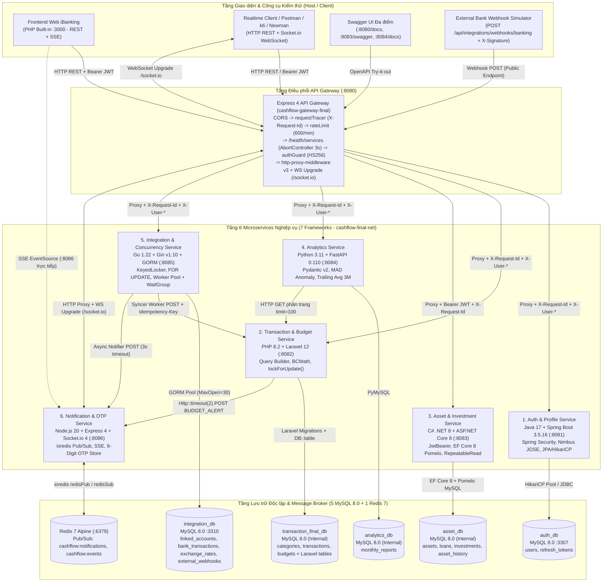
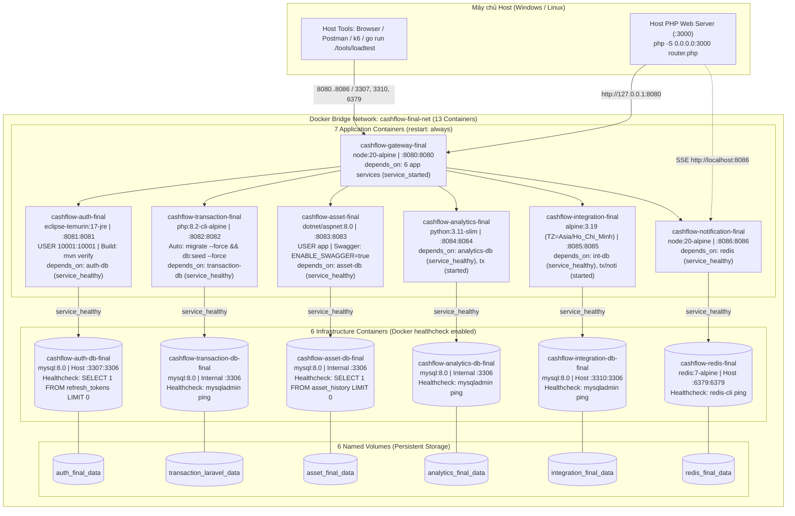

# Bộ Sơ đồ Kiến trúc & Triển khai Hạ tầng — Phiên bản Cuối kỳ (Full Frameworks)

Tài liệu này mô tả hai sơ đồ kiến trúc và triển khai cấp hệ thống của phiên bản Cuối kỳ **SOA-CashFlow**, bám sát mã nguồn thực tế trong `gateway/final/`, `services/*/final/`, `frontend/` và `docker-compose.final.yml`.

---

## 1. Hình 1-1: Kiến trúc Tổng thể Hệ thống SOA CashFlow Bản Cuối kỳ (Full Frameworks)

*Hình 1-1: Kiến trúc Tổng thể Hệ thống SOA CashFlow Bản Cuối kỳ (Full Frameworks)*

### Phân tích chi tiết Hình 1-1:
1. **Tầng Giao diện & Khách hàng (Client Tier):**
   - Giao diện Web iBanking viết bằng PHP thuần (`frontend/`, cổng `:3000`) tiếp tục giao tiếp REST với API Gateway (`http://127.0.0.1:8080`) và giữ kết nối SSE trực tiếp tới Notification Service (`http://localhost:8086/api/notifications/stream?user_id=...`), chứng minh khả năng tương thích ngược 100% khi toàn bộ Backend được nâng cấp lên 7 Frameworks.
   - Các client hiện đại, Swagger UI đa điểm (`:8080/docs`, `:8083/swagger`, `:8084/docs`), Newman, Go `tools/loadtest` và `k6` tương tác qua HTTP REST và kênh WebSocket `/socket.io` thông qua Gateway.
2. **Tầng Điều phối Express API Gateway (`gateway/final`, `:8080`):**
   - Thực thi chuỗi 10 bước chuẩn hóa: CORS toàn cục, `requestTracer` gắn `X-Request-Id` và ghi log JSON đo bằng `process.hrtime.bigint()`, `express-rate-limit` (600 req/phút, miễn trừ `/health` và `/api/notifications/stream`), tổng hợp sức khỏe `GET /health/services` (`AbortController` timeout 3.000ms), Swagger UI tổng hợp, `authGuard` kiểm tra JWT `HS256` và xóa các header giả mạo (`X-User-Id`, `X-User-Name`, `X-User-Role`), cùng `http-proxy-middleware` v3 stream nguyên vẹn payload và xử lý sự kiện `server.on('upgrade')` cho `/socket.io`.
3. **Tầng 6 Microservices Nghiệp vụ (Polyglot 6 Ngôn ngữ — 6 Frameworks):**
   - Mỗi service sử dụng framework chính thống tương ứng: **Spring Boot 3.5.16** (`:8081`), **Laravel 12** (`:8082`), **ASP.NET Core 8** (`:8083`), **FastAPI 0.110.0** (`:8084`), **Go Gin + GORM** (`:8085`), và **Express 4 + Socket.io 4 + ioredis** (`:8086`).
   - Áp dụng **Defense-in-Depth**: ngoài Gateway, Auth Service (`JwtAuthenticationFilter`) và Asset Service (`JwtBearer`) tự xác thực lại chữ ký JWT `HS256` độc lập và kiểm tra quyền sở hữu tài nguyên.
4. **Tầng Dữ liệu Độc lập (Database-per-Service) & Giao tiếp Liên dịch vụ:**
   - 5 cơ sở dữ liệu MySQL 8.0 tách biệt (`auth_db`, `transaction_final_db`, `asset_db`, `analytics_db`, `integration_db`), tuyệt đối không có khóa ngoại liên CSDL.
   - **Đồng bộ kéo (Sync Pull):** FastAPI Analytics phân trang `GET /api/transactions?limit=100` từ Laravel Transaction.
   - **Bất đồng bộ đẩy (Async Push):** Go Integration `Syncer` (4 workers) đẩy giao dịch đã chốt sang Laravel Transaction kèm `Idempotency-Key`; cả Laravel Transaction (`Http::timeout(2)`) và Go Integration (`Notifier` goroutine timeout 3s) đều đẩy cảnh báo về Notification Service, nơi phát sóng qua Redis Pub/Sub (`cashflow:notifications`, `cashflow:events`) ra cả Socket.io Room `user:<id>` và SSE.

---

## 2. Hình 3-1: Biểu đồ Triển khai Hạ tầng Docker Compose Production (`docker-compose.final.yml`)

*Hình 3-1: Biểu đồ Triển khai Hạ tầng Docker Compose Production (`cashflow-final-net`)*

### Phân tích chi tiết Hình 3-1:
1. **Cô lập mạng và Volume bền vững (`cashflow-final-net`):** Toàn bộ 13 container vận hành trên mạng bridge riêng `cashflow-final-net` tách biệt hoàn toàn với mạng giữa kỳ (`cashflow-midterm-net`). Dữ liệu của 5 MySQL 8.0 (`utf8mb4_unicode_ci`) và Redis 7 được lưu trên 6 Named Volumes riêng (`auth_final_data`, `transaction_laravel_data`, `asset_final_data`, `analytics_final_data`, `integration_final_data`, `redis_final_data`), tránh ghi đè dữ liệu cũ khi chuyển đổi giữa 2 phiên bản.
2. **Cơ chế Healthcheck thực tế (`condition: service_healthy`):** Trong `docker-compose.final.yml`, cả 5 container MySQL và Redis đều khai báo `healthcheck:` (đặc biệt `auth-db` kiểm tra `SELECT 1 FROM refresh_tokens LIMIT 0` và `asset-db` kiểm tra `SELECT 1 FROM asset_history LIMIT 0` để chắc chắn script `init.sql` đã nạp bảng xong trước khi ứng dụng kết nối). Ngược lại, 7 container ứng dụng không khai báo Docker `healthcheck:` riêng mà được giám sát tập trung qua HTTP tại `GET /health/services` của Gateway (`gateway` và các liên kết `analytics`/`integration -> transaction/notification` dùng `service_started`).
3. **Bảo mật & Tự động hóa trong Dockerfile:**
   - **Kiểm thử lúc Build:** `services/auth-service/final/Dockerfile` chạy `RUN mvn -B -ntp verify`, ngăn chặn đóng gói image nếu unit/integration test thất bại.
   - **Nguyên tắc Đặc quyền Tối thiểu (Least Privilege):** `auth-service` thực thi dưới `USER 10001:10001` và `asset-service` thực thi dưới `USER app` (2 trên 7 Dockerfile cấu hình non-root; 5 Dockerfile còn lại chạy mặc định `root` trên Alpine/Slim).
   - **Tự động hóa Schema:** `transaction-service` thực thi `php artisan migrate --force && php artisan db:seed --force` khi khởi động container vào `transaction_final_db`; `analytics-service` nạp schema `/app/db/init-analytics-db.sql` trong FastAPI `lifespan` với cơ chế retry.
4. **Cổng ánh xạ ra Host:** 7 dịch vụ ứng dụng mở cổng `8080..8086`, Redis mở `6379`, riêng `auth-db` mở `3307:3306` và `integration-db` mở `3310:3306` phục vụ kiểm tra trực tiếp và công cụ test, trong khi `transaction-db`, `asset-db` và `analytics-db` chỉ lắng nghe nội bộ trên cổng `3306` của `cashflow-final-net`.
