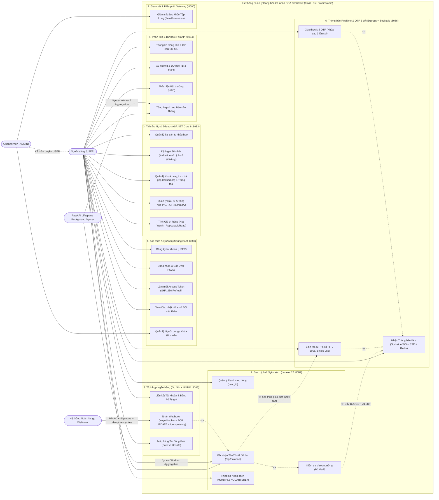
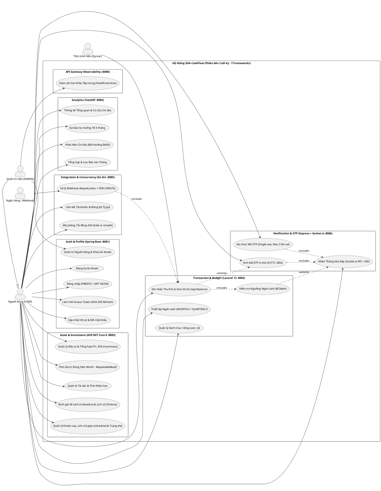

# Biểu đồ Use Case Tổng quát & Quy trình OTP — Phiên bản Cuối kỳ

Tài liệu này trình bày Biểu đồ Use Case Tổng quát của **SOA-CashFlow Bản Cuối kỳ (`Hình 1-2`)** dưới hai định dạng: **Mermaid** (hiển thị trực tiếp trong Markdown) và **PlantUML** (đồng bộ 1-1 với tệp độc lập [final-02-usecase-and-otp.puml](./final-02-usecase-and-otp.puml)).

---

## 1. Hình 1-2: Biểu đồ Use Case Tổng quát Bản Cuối kỳ (Mermaid)

*Hình 1-2: Biểu đồ Use Case Tổng quát Hệ thống SOA CashFlow Bản Cuối kỳ (Mermaid)*

---

## 2. Biểu đồ Use Case Tổng quát (PlantUML — Đồng bộ với `final-02-usecase-and-otp.puml`)

### Phân tích chi tiết Hình 1-2:
1. **Phân cấp Tác nhân (Actors & RBAC):**
   - `USER` là tác nhân trung tâm sở hữu toàn bộ nghiệp vụ cá nhân (Auth, Thu/Chi, Ngân sách, Tài sản/Vay/Đầu tư, Phân tích, Liên kết ngân hàng, Sinh/Xác thực OTP và nhận thông báo realtime).
   - `ADMIN` kế thừa toàn bộ quyền của `USER` và được bổ sung quyền quản trị người dùng (`/api/admin/users/**` với `ROLE_ADMIN`) cùng quyền giám sát trạng thái tập trung toàn cụm microservice qua `GET /health/services`.
   - Hai tác nhân hệ thống bên ngoài là **Ngân hàng / Webhook** (gửi biến động số dư kèm chữ ký HMAC `X-Signature` và khóa `Idempotency-Key`) và **Tiến trình Nền (`Syncer`)** tự động chuyển tiếp giao dịch ngân hàng sang Transaction Service.
2. **Các Ca sử dụng Mở rộng Đặc trưng của Bản Cuối kỳ:**
   - **Xác thực Giao dịch bằng OTP 6 số (`POST /api/notifications/otp/generate` & `/verify`):** Cho phép sinh mã mật mã học 6 chữ số (hiệu lực 300s), phát tức thời tới Socket.io Room `user:<id>`, SSE và Redis Pub/Sub; khi xác thực sẽ kiểm tra hạn dùng, giới hạn tối đa 3 lần nhập sai và tiêu hủy ngay lập tức (Single-use).
   - **Nghiệp vụ Tài sản Chuyên sâu (ASP.NET Core 8):** Bổ sung ca sử dụng định giá sổ sách theo số ngày thực tế (`/valuation`), xem lịch sử biến động giá trị (`/history`), xuất lịch khấu trừ gốc & lãi từng tháng (`/schedule`), chuyển trạng thái khoản vay (`/status`) và tổng hợp P/L, ROI danh mục đầu tư (`/summary`).
   - **Giám sát & Bảo mật Tài khoản:** Bổ sung làm mới Access Token bằng `refreshToken` băm `SHA-256` và theo dõi sức khỏe 6 dịch vụ qua `GET /health/services`.
3. **Quan hệ `<<include>>` và `<<extend>>`:**
   - Mỗi lần ghi nhận giao dịch (`UC_TX`) đều `<<include>>` kiểm tra ngưỡng ngân sách bằng số học `BCMath` (`UC_ALERT`), và chỉ `<<extend>>` đẩy cảnh báo `BUDGET_ALERT` qua kênh realtime (`UC_RT`) khi mức chi tiêu chạm `>= 80%` (`WARNING`) hoặc `>= 100%` (`EXCEEDED`). Tương tự, quy trình sinh/xác thực OTP `<<include>>` đẩy sự kiện realtime (`otp:received`, `otp:verified`, SSE `notification`) tới người dùng sở hữu.
