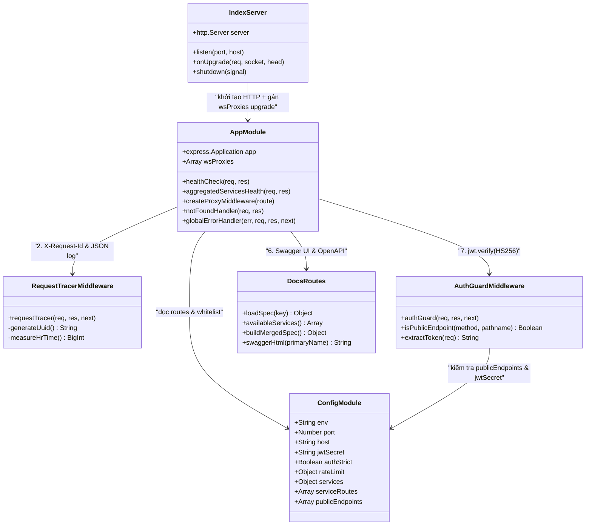
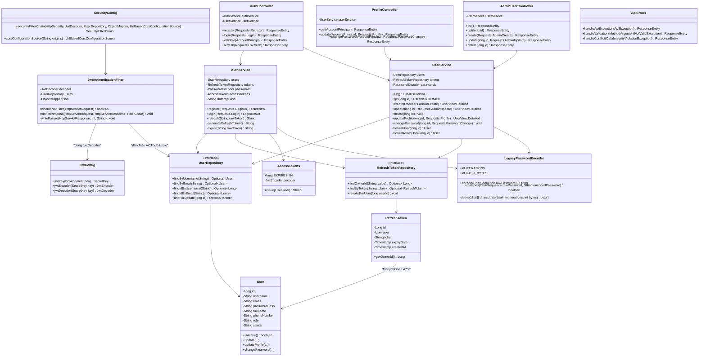
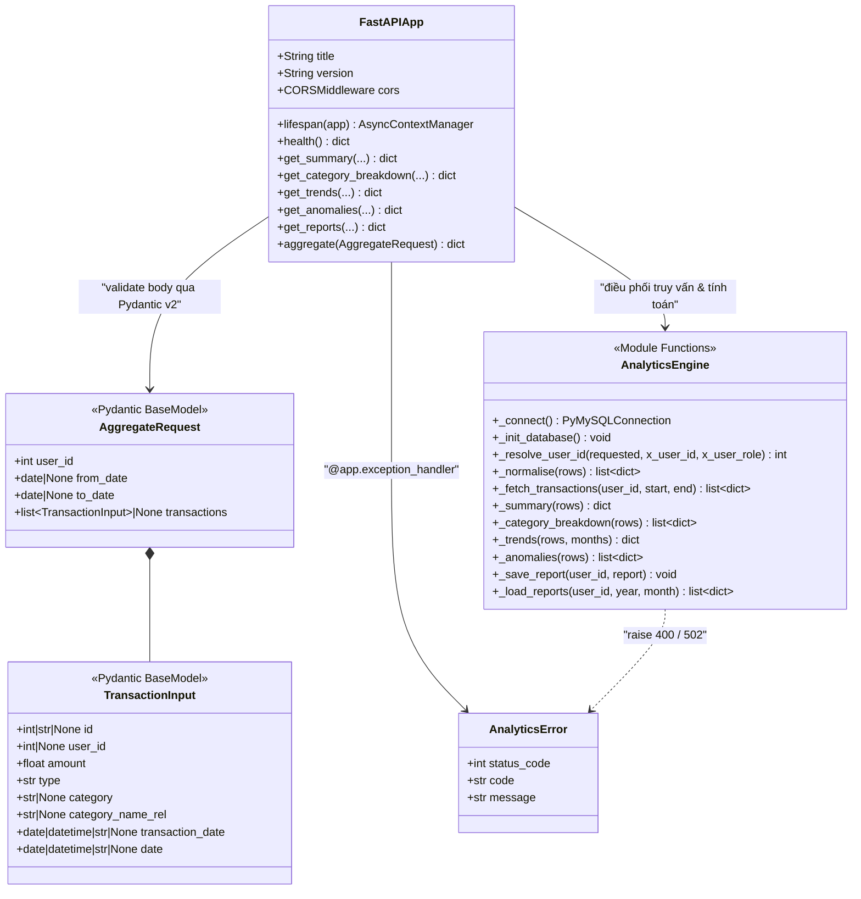
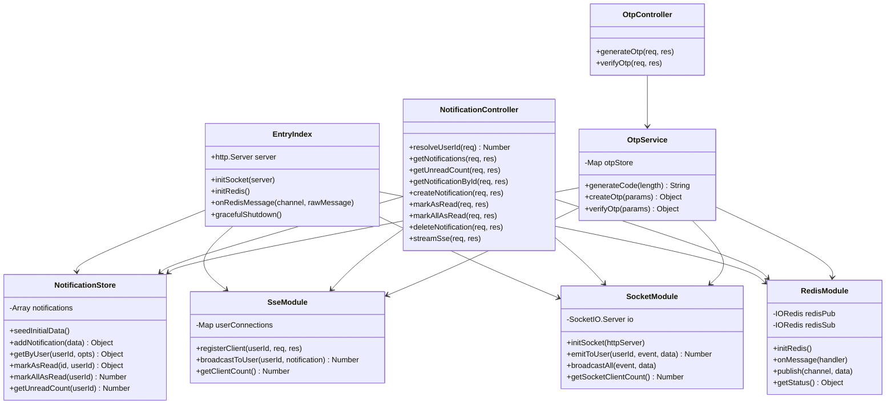

# Bộ 7 Biểu đồ Lớp & Thành phần theo Frameworks — Phiên bản Cuối kỳ

Tài liệu này tổng hợp 7 biểu đồ lớp và kiến trúc thành phần tương ứng với **Express API Gateway** (`Hình 2-2`) và **6 Microservices Nghiệp vụ** (`Hình 2-3` → `Hình 2-8`), phản ánh chính xác tên lớp, struct, controller, service, middleware, repository và DTO trong mã nguồn `gateway/final/` và `services/*/final/`.

---

## 1. Hình 2-2: Express API Gateway (`gateway/final/`)



*Hình 2-2: Biểu đồ Thành phần / Lớp Express API Gateway (`gateway/final`)*

---

## 2. Hình 2-3: Auth & Profile Service (`com.cashflow.auth` — Spring Boot 3.5.16)



*Hình 2-3: Biểu đồ Lớp Auth & Profile Service (`Spring Boot 3.5.16`)*

---

## 3. Hình 2-4: Transaction & Budget Service (`App\Http` — Laravel 12)

```mermaid
classDiagram
    class ResolveUser {
        +handle(Request request, Closure next) Response
    }

    class Controller {
        <<abstract>>
    }

    class CashflowController {
        <<abstract>>
        #userId(Request request) int
        #owned(string table, Request request) Builder
        #record(string table, Request request, int id) object
        #ok(mixed data, int status) JsonResponse
        #category(Request request, int id, string type) object
        #moneyRule() array
    }

    class CategoryController {
        +index(Request request) JsonResponse
        +show(Request request, int category) JsonResponse
        +store(Request request) JsonResponse
        +update(Request request, int category) JsonResponse
        +destroy(Request request, int category) JsonResponse
        -save(Request request, int? id) JsonResponse
    }

    class TransactionController {
        +index(Request request) JsonResponse
        +show(Request request, int transaction) JsonResponse
        +totals(Request request) array
        +balance(Request request) JsonResponse
        +store(Request request) JsonResponse
        +update(Request request, int transaction) JsonResponse
        +destroy(Request request, int transaction) JsonResponse
        -save(Request request, int? id) JsonResponse
    }

    class BudgetController {
        +index(Request request) JsonResponse
        +show(Request request, int budget) JsonResponse
        +report(Request request) array
        +progress(Request request) JsonResponse
        +store(Request request) JsonResponse
        +update(Request request, int budget) JsonResponse
        +destroy(Request request, int budget) JsonResponse
        -save(Request request, int? id) JsonResponse
    }

    class DatabaseSeeder {
        +run() void
    }

    class DBQueryBuilder {
        <<Laravel Facade>>
        +table(string name) Builder
        +transaction(Closure callback) mixed
        +lockForUpdate() Builder
    }

    Controller <|-- CashflowController
    CashflowController <|-- CategoryController
    CashflowController <|-- TransactionController
    CashflowController <|-- BudgetController
    ResolveUser ..> CashflowController : "gắn user_id vào request attributes"
    TransactionController ..> BudgetController : "gọi report() tính budget_alerts"
    CategoryController --> DBQueryBuilder : "DB::table('categories') + lockForUpdate"
    TransactionController --> DBQueryBuilder : "DB::table('transactions') + BCMath"
    BudgetController --> DBQueryBuilder : "DB::table('budgets') + CarbonImmutable"
    DatabaseSeeder --> DBQueryBuilder : "seed idempotent transaction_final_db"
```

*Hình 2-4: Biểu đồ Lớp Transaction & Budget Service (`Laravel 12`)*

---

## 4. Hình 2-5: Asset & Investment Service (`AssetService.Final` — ASP.NET Core 8 + EF Core 8)

```mermaid
classDiagram
    class ExceptionMiddleware {
        -RequestDelegate _next
        +InvokeAsync(HttpContext context) Task
    }

    class CurrentUser {
        -IHttpContextAccessor _accessor
        +TryReadId(ClaimsPrincipal? principal, out long userId)$ bool
        +Resolve(long? queryId, long? bodyId) long
    }

    class AssetsController {
        -AssetManager _manager
        -NetWorthService _netWorth
        -CurrentUser _currentUser
        +List(long? user_id, CancellationToken ct) Task
        +Get(long id, CancellationToken ct) Task
        +Create(AssetInput input, CancellationToken ct) Task
        +Update(long id, AssetInput input, CancellationToken ct) Task
        +Delete(long id, CancellationToken ct) Task
        +Depreciation(DepreciationInput input) IActionResult
        +NetWorth(long? user_id, CancellationToken ct) Task
        +History(long id, CancellationToken ct) Task
        +Valuation(long id, DateTime? as_of, CancellationToken ct) Task
    }

    class LoansController {
        -LoanService _service
        -CurrentUser _currentUser
        +List(long? user_id, CancellationToken ct) Task
        +Get(long id, CancellationToken ct) Task
        +Create(LoanInput input, CancellationToken ct) Task
        +Update(long id, LoanInput input, CancellationToken ct) Task
        +Delete(long id, CancellationToken ct) Task
        +Calculate(LoanCalculationInput input) IActionResult
        +Schedule(long id, CancellationToken ct) Task
        +SetStatus(long id, LoanStatusInput input, CancellationToken ct) Task
    }

    class InvestmentsController {
        -InvestmentService _service
        -CurrentUser _currentUser
        +List(long? user_id, CancellationToken ct) Task
        +Get(long id, CancellationToken ct) Task
        +Create(InvestmentInput input, CancellationToken ct) Task
        +Update(long id, InvestmentInput input, CancellationToken ct) Task
        +Delete(long id, CancellationToken ct) Task
        +Summary(long? user_id, CancellationToken ct) Task
    }

    class HealthController {
        -AssetDbContext _db
        +Health() IActionResult
        +Ready(CancellationToken ct) Task
    }

    class AssetManager {
        -AssetDbContext _db
        +List(long user, CancellationToken ct) Task
        +Get(long user, long id, CancellationToken ct) Task
        +Create(long user, AssetInput x, CancellationToken ct) Task
        +Update(long user, long id, AssetInput x, CancellationToken ct) Task
        +Delete(long user, long id, CancellationToken ct) Task
        +History(long user, long id, CancellationToken ct) Task
        +Valuation(long user, long id, DateTime? asOf, CancellationToken ct) Task
    }

    class LoanService {
        -AssetDbContext _db
        +List(long user, CancellationToken ct) Task
        +Get(long user, long id, CancellationToken ct) Task
        +Create(long user, LoanInput x, CancellationToken ct) Task
        +Update(long user, long id, LoanInput x, CancellationToken ct) Task
        +Delete(long user, long id, CancellationToken ct) Task
        +SetStatus(long user, long id, string status, CancellationToken ct) Task
        +Schedule(long user, long id, CancellationToken ct) Task
    }

    class InvestmentService {
        -AssetDbContext _db
        +List(long user, CancellationToken ct) Task
        +Get(long user, long id, CancellationToken ct) Task
        +Create(long user, InvestmentInput x, CancellationToken ct) Task
        +Update(long user, long id, InvestmentInput x, CancellationToken ct) Task
        +Delete(long user, long id, CancellationToken ct) Task
        +Summary(long user, CancellationToken ct) Task
    }

    class NetWorthService {
        -AssetDbContext _db
        +Get(long user, CancellationToken ct) Task~NetWorthResponse~
    }

    class FinanceMath {
        <<static>>
        +decimal MaxMoney
        +int MaxTerm
        +Money(decimal value, string name)$ decimal
        +Depreciation(DepreciationInput x)$ DepreciationResult
        +CalculateLoan(LoanCalculationInput x)$ LoanCalculationResult
        +Schedule(decimal principal, decimal rate, int months, DateTime start)$ List~LoanInstallment~
        +BookValue(decimal purchase, decimal salvage, int life, decimal elapsedYears)$ decimal
    }

    class AssetDbContext {
        +DbSet~Asset~ Assets
        +DbSet~Loan~ Loans
        +DbSet~Investment~ Investments
        +DbSet~AssetHistory~ AssetHistory
        #OnModelCreating(ModelBuilder) void
    }

    class Asset {
        +long Id
        +long UserId
        +decimal CurrentValue
        +List~AssetHistory~ History
    }

    class AssetHistory {
        +long Id
        +long AssetId
        +decimal Value
        +DateTime RecordedAt
    }

    AssetsController --> AssetManager
    AssetsController --> NetWorthService
    AssetsController --> CurrentUser
    AssetsController --> FinanceMath
    LoansController --> LoanService
    LoansController --> CurrentUser
    LoansController --> FinanceMath
    InvestmentsController --> InvestmentService
    InvestmentsController --> CurrentUser
    HealthController --> AssetDbContext
    AssetManager --> AssetDbContext
    AssetManager --> FinanceMath
    LoanService --> AssetDbContext
    LoanService --> FinanceMath
    InvestmentService --> AssetDbContext
    NetWorthService --> AssetDbContext : "RepeatableRead"
    AssetDbContext --> Asset
    AssetDbContext --> AssetHistory
    Asset "1" *-- "0..*" AssetHistory
```



*Hình 2-5: Biểu đồ Lớp Asset & Investment Service (`ASP.NET Core 8 + EF Core 8`)*

---

## 5. Hình 2-6: Analytics Service (`services/analytics-service/final/src/main.py` — FastAPI 0.110.0)



*Hình 2-6: Biểu đồ Thành phần Analytics Service (`FastAPI 0.110.0 + Pydantic v2`)*

---

## 6. Hình 2-7: Integration & Concurrency Service (`internal/` — Go 1.22 Gin + GORM)

```mermaid
classDiagram
    class Server {
        -gorm.DB db
        -config.Config cfg
        -locker.KeyedLocker locker
        -services.Syncer syncer
        -services.Notifier notifier
        -http.Client httpClient
        +SetupRouter() gin.Engine
        +HandleHealth(c *gin.Context)
        +HandleStats(c *gin.Context)
        +HandleGetRates(c *gin.Context)
        +HandleSyncRates(c *gin.Context)
        +HandleListAccounts(c *gin.Context)
        +HandleCreateAccount(c *gin.Context)
        +HandleGetAccount(c *gin.Context)
        +HandleDeleteAccount(c *gin.Context)
        +HandleAccountTransactions(c *gin.Context)
        +HandleBankWebhook(c *gin.Context)
        +HandleRetrySync(c *gin.Context)
        +HandleSimulate(c *gin.Context)
    }

    class KeyedLocker {
        -sync.Mutex mu
        -map~string, lockEntry~ locks
        +Lock(key string) func()
        +Size() int
    }

    class Syncer {
        -gorm.DB db
        -config.Config cfg
        -http.Client client
        -Notifier notifier
        -chan int64 queue
        -sync.WaitGroup wg
        +Start(ctx context.Context)
        +Wait()
        +Enqueue(id int64)
        +Pending() int
        -worker(ctx context.Context, n int)
        -sweeper(ctx context.Context)
        -sweep(ctx context.Context)
        -syncOne(ctx context.Context, id int64)
        -forward(ctx context.Context, t BankTransaction, userID int64)
    }

    class Notifier {
        -string baseURL
        -http.Client client
        +Send(userID int64, title string, message string, typ string, meta map)
    }

    class DatabaseModule {
        <<package database>>
        +Open(cfg config.Config) gorm.DB
        +MySQLErrNo(err error) uint16
        +IsDuplicateKey(err error) bool
        +IsRetryable(err error) bool
    }

    class Money {
        <<int64 fixed-point 1/100 VND>>
        +Float() float64
        +String() string
        +MarshalJSON() byte[]
        +Scan(src any) error
        +Value() driver.Value
    }

    class LinkedAccount {
        +int64 ID
        +int64 UserID
        +string BankCode
        +string AccountNo
        +Money Balance
        +int64 Version
    }

    class BankTransaction {
        +int64 ID
        +int64 AccountID
        +string Provider
        +string ExternalRef
        +string IdempotencyKey
        +string RequestHash
        +string Direction
        +Money Amount
        +Money BalanceAfter
        +string Status
        +int64 TransactionRef
        +int SyncAttempts
    }

    Server --> KeyedLocker : "khóa theo BankCode:AccountNo"
    Server --> Syncer : "đẩy job sync nền"
    Server --> Notifier : "cảnh báo LARGE_TRANSACTION / REJECTED"
    Server --> DatabaseModule : "GORM READ COMMITTED + FOR UPDATE"
    Syncer --> Notifier : "cảnh báo BUDGET_ALERT"
    Syncer --> BankTransaction : "claim SYNCING -> SYNCED/FAILED"
    LinkedAccount "1" -- "0..*" BankTransaction
    LinkedAccount --> Money
    BankTransaction --> Money
```

*Hình 2-7: Biểu đồ Lớp Integration & Concurrency Service (`Go 1.22 Gin + GORM`)*

---

## 7. Hình 2-8: Notification & OTP Service (`Express 4 + Socket.io 4 + ioredis`)



*Hình 2-8: Biểu đồ Thành phần Notification & OTP Service (`Express 4 + Socket.io 4 + ioredis`)*
