# Mô hình Thực thể Kết hợp (ERD) & Lưu trữ Độc lập — Phiên bản Cuối kỳ

Tài liệu này mô tả mô hình dữ liệu chuẩn hóa bản Cuối kỳ (`Hình 2-9`) tuân thủ nghiêm ngặt nguyên tắc **Database-per-Service** trên **5 cơ sở dữ liệu MySQL 8.0 InnoDB** độc lập (`auth_db`, `transaction_final_db`, `asset_db`, `analytics_db`, `integration_db`), kèm cấu trúc kênh **Redis 7 Pub/Sub** và kho lưu tạm **In-Memory (`otpStore`, `store`)** của Notification & OTP Service.

---

## 1. Hình 2-9: Mô hình ERD Toàn hệ thống Bản Cuối kỳ

```mermaid
erDiagram
    AUTH_USERS {
        bigint id PK "AUTO_INCREMENT"
        varchar username UK "NOT NULL, UNIQUE(50)"
        varchar email UK "NOT NULL, UNIQUE(100)"
        varchar password_hash "PBKDF2 210k"
        varchar full_name "NULL"
        varchar phone_number "NULL"
        varchar role "DEFAULT USER"
        varchar status "DEFAULT ACTIVE"
        timestamp created_at
        timestamp updated_at
    }

    AUTH_REFRESH_TOKENS {
        bigint id PK "AUTO_INCREMENT"
        bigint user_id FK "ON DELETE CASCADE"
        varchar token UK "sha256:hex (hoac legacy 64-char)"
        timestamp expiry_date "NOT NULL"
        timestamp created_at
    }

    TX_CATEGORIES {
        bigint id PK "UNSIGNED AUTO_INCREMENT"
        bigint user_id "INDEX, logical -> auth_db.users"
        varchar name "UNIQUE(user_id, name, type)"
        enum type "INCOME | EXPENSE"
        varchar icon "NULL"
        timestamp created_at
        timestamp updated_at
    }

    TX_TRANSACTIONS {
        bigint id PK "UNSIGNED AUTO_INCREMENT"
        bigint user_id "INDEX(user_id, transaction_date)"
        bigint category_id FK "ON DELETE RESTRICT"
        decimal amount "DECIMAL(15,2)"
        enum type "INCOME | EXPENSE"
        text description "NULL"
        datetime transaction_date "NOT NULL"
        timestamp created_at
        timestamp updated_at
    }

    TX_BUDGETS {
        bigint id PK "UNSIGNED AUTO_INCREMENT"
        bigint user_id "UNIQUE(user_id, category_id, period, start_date)"
        bigint category_id FK "ON DELETE RESTRICT"
        decimal amount_limit "DECIMAL(15,2)"
        enum period "MONTHLY | QUARTERLY"
        date start_date "NOT NULL"
        date end_date "NOT NULL"
        timestamp created_at
        timestamp updated_at
    }

    ASSET_ASSETS {
        bigint id PK "AUTO_INCREMENT"
        bigint user_id "INDEX, CHECK user_id > 0"
        varchar asset_name "NOT NULL"
        varchar asset_type "NOT NULL"
        decimal purchase_price "DECIMAL(18,2) CHECK >= 0"
        decimal current_value "DECIMAL(18,2) ConcurrencyToken"
        decimal salvage_value "DECIMAL(18,2) CHECK <= purchase_price"
        int useful_life_years "CHECK 0..1000"
        date purchase_date "NULL"
        varchar currency "DEFAULT VND"
        text note "NULL"
        timestamp created_at
        timestamp updated_at
    }

    ASSET_HISTORY {
        bigint id PK "AUTO_INCREMENT"
        bigint asset_id FK "ON DELETE CASCADE"
        decimal value "DECIMAL(18,2) CHECK >= 0"
        timestamp recorded_at "INDEX(asset_id, recorded_at)"
    }

    ASSET_LOANS {
        bigint id PK "AUTO_INCREMENT"
        bigint user_id "INDEX, CHECK user_id > 0"
        varchar loan_title "NOT NULL"
        decimal principal_amount "DECIMAL(18,2) CHECK > 0"
        decimal interest_rate "DECIMAL(5,2) CHECK 0..999.99"
        int term_months "CHECK 1..1200"
        date start_date "NOT NULL"
        varchar status "CHECK ACTIVE | CLOSED"
        timestamp created_at
        timestamp updated_at
    }

    ASSET_INVESTMENTS {
        bigint id PK "AUTO_INCREMENT"
        bigint user_id "INDEX, CHECK user_id > 0"
        varchar symbol "NOT NULL"
        varchar investment_type "NOT NULL"
        decimal quantity "DECIMAL(18,4) CHECK > 0"
        decimal buy_price "DECIMAL(18,2) CHECK >= 0"
        decimal current_price "DECIMAL(18,2) CHECK >= 0"
        timestamp created_at
        timestamp updated_at
    }

    ANA_MONTHLY_REPORTS {
        bigint report_id PK "UNSIGNED AUTO_INCREMENT"
        bigint user_id "UNIQUE(user_id, year, month)"
        smallint year "CHECK 2000..2100"
        tinyint month "CHECK 1..12"
        json report_json "NOT NULL"
        datetime generated_at "NOT NULL"
        timestamp created_at
        timestamp updated_at
    }

    INT_EXCHANGE_RATES {
        int id PK "AUTO_INCREMENT"
        varchar currency_code UK "UNIQUE(10)"
        decimal rate_to_vnd "DECIMAL(15,4) CHECK > 0"
        timestamp updated_at
    }

    INT_LINKED_ACCOUNTS {
        bigint id PK "AUTO_INCREMENT"
        bigint user_id "INDEX idx_linked_user"
        varchar bank_code "UNIQUE(bank_code, account_no)"
        varchar account_no "UNIQUE(bank_code, account_no)"
        varchar holder_name "NOT NULL"
        decimal balance "DECIMAL(18,2) CHECK >= 0"
        bigint version "Optimistic version"
        timestamp created_at
        timestamp updated_at
    }

    INT_BANK_TRANSACTIONS {
        bigint id PK "AUTO_INCREMENT"
        bigint account_id FK "ON DELETE CASCADE"
        varchar provider "UNIQUE(provider, external_ref)"
        varchar external_ref "UNIQUE(provider, external_ref)"
        varchar idempotency_key UK "UNIQUE(150)"
        char request_hash "SHA-256 CHAR(64)"
        enum direction "CREDIT | DEBIT"
        decimal amount "DECIMAL(18,2) CHECK > 0"
        decimal balance_after "DECIMAL(18,2)"
        varchar category "DEFAULT ''"
        varchar description "DEFAULT ''"
        datetime occurred_at "NOT NULL"
        enum status "RECEIVED|SYNCING|SYNCED|FAILED|REJECTED"
        bigint transaction_ref "Logical -> tx.id"
        int sync_attempts "DEFAULT 0"
        varchar last_error "NULL"
        timestamp created_at
        timestamp updated_at
    }

    INT_EXTERNAL_WEBHOOKS {
        bigint id PK "AUTO_INCREMENT"
        varchar provider_name "INDEX(provider_name, received_at)"
        varchar event_type "NOT NULL"
        json payload "NULL"
        timestamp received_at
    }

    NOTI_OTP_STORE_IN_MEMORY {
        string otpKey PK "userId:(transactionId|action)"
        string otpId "otp_ts_hex"
        number userId "Logical -> auth_db.users"
        string action "DEFAULT PAYMENT"
        number transactionId "NULL"
        number amount "VND"
        string email "userN@cashflow.local"
        string code "6 digits crypto.randomInt(100000,999999)"
        number attempts "0..3"
        number maxAttempts "3"
        boolean isUsed "Single-use flag"
        number expiresAtMs "now + 300000ms"
    }

    AUTH_USERS ||--o{ AUTH_REFRESH_TOKENS : "so huu (FK CASCADE)"
    TX_CATEGORIES ||--o{ TX_TRANSACTIONS : "phan loai (FK RESTRICT)"
    TX_CATEGORIES ||--o{ TX_BUDGETS : "gioi han (FK RESTRICT)"
    ASSET_ASSETS ||--o{ ASSET_HISTORY : "ghi nhan snapshot (FK CASCADE)"
    INT_LINKED_ACCOUNTS ||--o{ INT_BANK_TRANSACTIONS : "chua bien dong (FK CASCADE)"

    AUTH_USERS ||..o{ TX_CATEGORIES : "logical user_id"
    AUTH_USERS ||..o{ ASSET_ASSETS : "logical user_id"
    AUTH_USERS ||..o{ ANA_MONTHLY_REPORTS : "logical user_id"
    AUTH_USERS ||..o{ INT_LINKED_ACCOUNTS : "logical user_id"
    AUTH_USERS ||..o{ NOTI_OTP_STORE_IN_MEMORY : "logical userId"
    INT_BANK_TRANSACTIONS ||..o| TX_TRANSACTIONS : "logical transaction_ref"
```

*Hình 2-9: Mô hình Thực thể Kết hợp (ERD) Toàn hệ thống Bản Cuối kỳ*

### Phân tích chi tiết Hình 2-9:
1. **Cô lập Database-per-Service tuyệt đối:** 5 cơ sở dữ liệu MySQL 8.0 (`auth_db`, `transaction_final_db`, `asset_db`, `analytics_db`, `integration_db`) nằm trên 5 container độc lập. Mọi ràng buộc khóa ngoại vật lý (`FOREIGN KEY`) chỉ tồn tại trong nội bộ từng DB; liên kết giữa các microservice sử dụng định danh logic (`user_id`, `transaction_ref`) được truyền qua Header `X-User-Id` đã xác thực hoặc qua HTTP API.
2. **Nâng cấp Schema trọng yếu ở Bản Cuối kỳ:**
   - **`transaction_final_db` (Laravel Migrations):** Đổi tên DB tách biệt khỏi giữa kỳ (`transaction_db`); bảng `categories` bổ sung `user_id` và `UNIQUE (user_id, name, type)` giúp mỗi người dùng tự tạo danh mục riêng không va chạm nhau; bảng `budgets` bổ sung chu kỳ `QUARTERLY` (`ENUM('MONTHLY', 'QUARTERLY')`), khóa `UNIQUE (user_id, category_id, period, start_date)` và ràng buộc `ON DELETE RESTRICT` bảo vệ toàn vẹn lịch sử giao dịch/ngân sách. Ngoài 3 bảng nghiệp vụ trên, `php artisan migrate` còn khởi tạo 8 bảng khung mặc định của Laravel (`users`, `password_reset_tokens`, `sessions`, `cache`, `cache_locks`, `jobs`, `job_batches`, `failed_jobs`) cùng bảng `migrations`.
   - **`asset_db` (`services/asset-service/final/db/init-asset-db.sql`):** Bổ sung đầy đủ hệ thống `CHECK CONSTRAINT` ở tầng MySQL (`ck_assets_values`, `ck_loans_values`, `ck_investments_values`, `ck_history_value`), kết hợp `.IsConcurrencyToken()` trên `assets.current_value` của EF Core 8 và tự động chèn bản ghi vào `asset_history` mỗi khi tạo mới hoặc thay đổi giá trị tài sản.
   - **`auth_db` (`refresh_tokens`):** Trường `token` lưu giá trị băm `"sha256:" + 64-char hex` sinh bởi `AuthService.digest()`, vẫn tương thích đọc token giữa kỳ 64 ký tự để chuyển tiếp mượt mà.
   - **Redis 7 & In-Memory Stores:** Redis 7 (`cashflow-redis-final:6379`) đóng vai trò thuần túy là **Pub/Sub Message Broker** trên 2 kênh `cashflow:notifications` và `cashflow:events` (không lưu key-value bền vững). Kho `otpStore` (`Map<otpKey, otpRecord>`) và `store` (`notifications[]`) nằm trong RAM tiến trình Notification Service.
