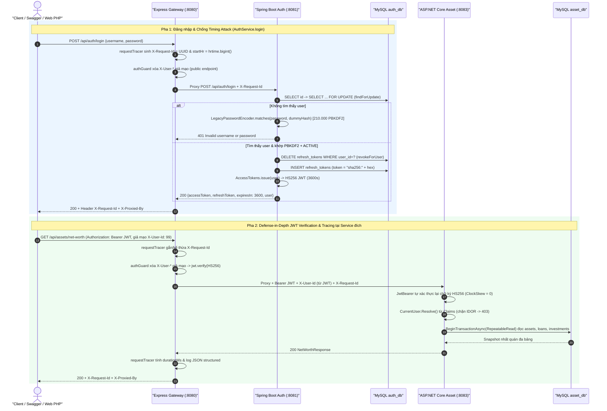
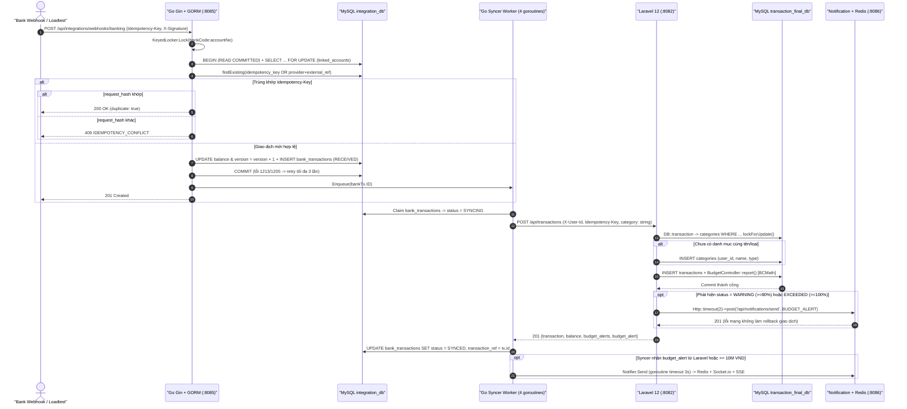
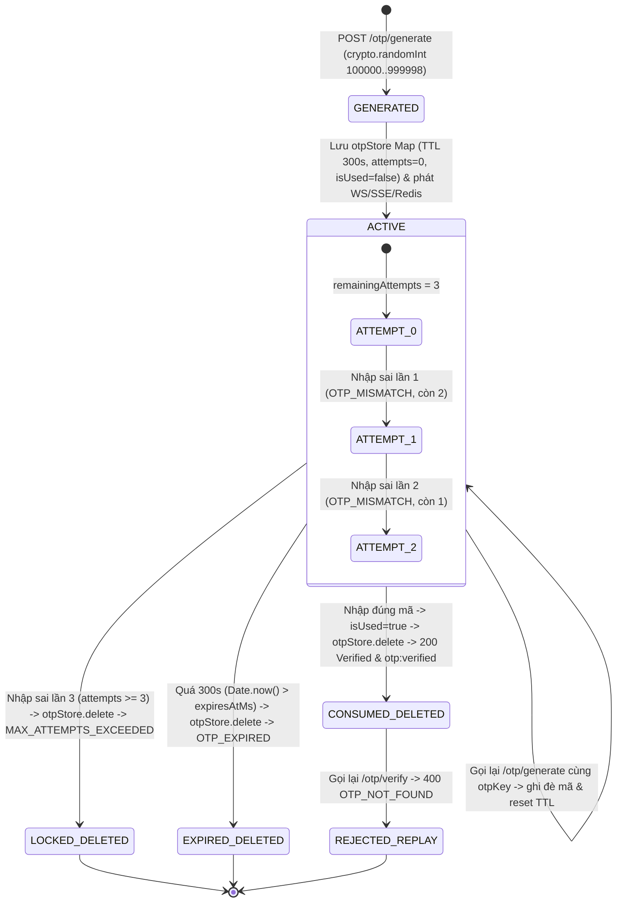

# Bộ Biểu đồ Tuần tự Nâng cao & Máy trạng thái OTP — Phiên bản Cuối kỳ

Tài liệu này mô tả 3 biểu đồ tuần tự liên dịch vụ (`Hình 2-1`, `Hình 2-10`, `Hình 2-11`) và 1 biểu đồ máy trạng thái vòng đời OTP (`Hình 2-12`) bám sát mã nguồn thực tế trong `gateway/final/`, `services/auth-service/final/`, `services/asset-service/final/`, `services/integration-service/final/`, `services/transaction-service/final/` và `services/notification-service/final/`.

---

## 1. Hình 2-1: Biểu đồ Tuần tự Bảo mật Chiều sâu (Defense-in-Depth) & Truy vết `X-Request-Id`



*Hình 2-1: Biểu đồ Tuần tự Bảo mật Chiều sâu & Truy vết `X-Request-Id` qua Express Gateway*

### Phân tích chi tiết Hình 2-1:
1. **Truy vết Phân tán (`X-Request-Id`) tại Biên Gateway:** Mọi request đi qua `requestTracer.js` đều được gán mã `UUID` (hoặc kế thừa từ header `X-Request-Id`), gắn ngược lên response header và chuyển tiếp vào `proxyReq`. Khi kết thúc, Gateway ghi JSON log có `requestId`, `durationMs` (độ phân giải nanosecond từ `process.hrtime.bigint()`) và `userId`.
2. **Bảo vệ Luồng Đăng nhập tại Spring Boot:** `AuthService.login()` dùng khóa bi quan `findForUpdate` trên bảng `users`, luôn thực thi `210.000` vòng lặp PBKDF2 với `dummyHash` ngay cả khi username không tồn tại để chống *Timing Attack*, thu hồi token cũ (`revokeForUser`) và lưu Refresh Token mới dưới dạng băm `"sha256:" + hex`.
3. **Defense-in-Depth (Kiểm tra 2 lớp độc lập):** `authGuard` ở Express Gateway xóa sạch mọi `X-User-Id`/`X-User-Role` giả mạo trước khi giải mã JWT. Khi request đi tới ASP.NET Core Asset Service (hoặc Spring Boot Auth), tầng `JwtBearer` / `JwtAuthenticationFilter` tiếp tục xác thực lại chữ ký `HS256` độc lập (`ClockSkew = 0`, Spring Boot còn đối chiếu trạng thái `ACTIVE` & `role` trực tiếp từ MySQL) rồi mới cấp quyền truy xuất dữ liệu.

---

## 2. Hình 2-10: Biểu đồ Tuần tự Quy trình OTP 6 Chữ số & Phát sóng Realtime Kép

```mermaid
sequenceDiagram
    autonumber
    actor User as "Client / WebSocket / SSE"
    participant GW as "Express Gateway (:8080)"
    participant Noti as "Notification & OTP (:8086)"
    participant OtpSvc as "otpService (otpStore Map)"
    participant Redis as "Redis 7 Pub/Sub"

    rect rgb(255, 248, 232)
        Note over User,Redis: Pha 1: Sinh mã OTP 6 chữ số & Phát sóng Kép (POST /api/notifications/otp/generate)
        User->>GW: POST /api/notifications/otp/generate {userId, action, transactionId, amount}
        GW->>Noti: Proxy + X-Request-Id + X-User-Id
        Noti->>OtpSvc: createOtp({userId, action, transactionId, amount})
        OtpSvc->>OtpSvc: crypto.randomInt(100000, 999999) -> code 6 chữ số
        OtpSvc->>OtpSvc: otpStore.set("uid:txOrAction", {code, attempts:0, maxAttempts:3, isUsed:false, expiresAtMs: now+300s})
        OtpSvc->>Noti: store.addNotification(type: OTP_VERIFICATION)
        par Phát sóng Realtime đa kênh
            OtpSvc->>User: SSE event: notification (nếu client đang mở stream)
            OtpSvc->>User: Socket.io emit("otp:received") tới Room "user:uid"
            OtpSvc->>Redis: redisPub.publish("cashflow:notifications", notif)
        end
        Redis-->>Noti: redisSub nhận loopback -> store.addNotification + SSE + Socket.io "notification:new"
        Noti-->>GW: 201 Created {otpId, expiresIn: 300, expiresAt, debugOtp}
        GW-->>User: 201 Created + X-Request-Id
    end

    rect rgb(235, 245, 255)
        Note over User,Redis: Pha 2: Xác thực OTP & Hủy mã Single-use (POST /api/notifications/otp/verify)
        User->>GW: POST /api/notifications/otp/verify {userId, action, transactionId, otp}
        GW->>Noti: Proxy POST /api/notifications/otp/verify
        Noti->>OtpSvc: verifyOtp({userId, action, transactionId, otp})
        OtpSvc->>OtpSvc: otpStore.get(otpKey)
        alt Không tồn tại hoặc đã bị xóa sau lần dùng/khóa trước
            OtpSvc-->>User: 400 OTP_NOT_FOUND
        else Quá hạn Date.now() > expiresAtMs
            OtpSvc->>OtpSvc: otpStore.delete(otpKey)
            OtpSvc-->>User: 400 OTP_EXPIRED
        else Sai mã OTP (record.attempts += 1)
            alt attempts >= 3
                OtpSvc->>OtpSvc: otpStore.delete(otpKey)
                OtpSvc-->>User: 400 MAX_ATTEMPTS_EXCEEDED
            else attempts < 3
                OtpSvc-->>User: 400 OTP_MISMATCH (remainingAttempts = 3 - attempts)
            end
        else Khớp mã OTP hợp lệ
            OtpSvc->>OtpSvc: record.isUsed = true; otpStore.delete(otpKey) [Single-use]
            OtpSvc->>Noti: store.addNotification(type: SYSTEM, "Xác thực OTP thành công")
            OtpSvc->>User: SSE event: notification & Socket.io emit("otp:verified")
            Noti-->>GW: 200 OK {success: true, verified: true, data}
            GW-->>User: 200 OK
        end
    end
```

*Hình 2-10: Biểu đồ Tuần tự Quy trình Xác thực OTP 6 Chữ số & Phát sóng Realtime Kép*

### Phân tích chi tiết Hình 2-10:
1. **Sinh mã an toàn mật mã & Phát sóng kép:** `otpService.createOtp()` dùng `crypto.randomInt(100000, 999999)` (giá trị sinh thực tế nằm trong `[100000, 999998]`), lưu vào `otpStore` theo khóa `${uid}:${transactionId || action}` với thời hạn `300s`, sau đó đẩy đồng thời ra **SSE**, **Socket.io Room `user:${uid}`** (sự kiện `otp:received`) và **Redis Pub/Sub** (`cashflow:notifications`). Cần lưu ý chi tiết kỹ thuật thực tế: vì `index.js` đăng ký `redis.onMessage` trên cùng kênh `cashflow:notifications`, thông điệp publish từ `createOtp` sẽ vòng lại qua Redis để ghi thêm một bản sao vào `store` và phát thêm sự kiện `notification:new`.
2. **Xác thực Single-use & Khóa 3 lần sai:** Khi gọi `/verify`, hệ thống kiểm tra tồn tại, hạn dùng 5 phút, tăng bộ đếm `attempts`. Nếu nhập sai ở lần thứ 3 (`attempts >= 3`), bản ghi bị xóa ngay và trả về `400 MAX_ATTEMPTS_EXCEEDED`. Nếu khớp mã, `verifyOtp()` gán `record.isUsed = true` rồi gọi ngay `otpStore.delete(otpKey)` để ngăn phát lại (*Replay Attack*); do phần tử đã bị xóa khỏi `Map`, mọi lần gọi xác thực lặp lại cho cùng giao dịch sẽ trả về `400 OTP_NOT_FOUND` (nhánh `if (record.isUsed)` trả `OTP_ALREADY_USED` ở dòng 106–112 hiện là nhánh phòng thủ không thể chạm tới).

---

## 3. Hình 2-11: Biểu đồ Tuần tự Đồng bộ Ngân hàng `Gin/GORM` → `Laravel lockForUpdate` → Cảnh báo Ngân sách Kép



*Hình 2-11: Biểu đồ Tuần tự Đồng bộ Ngân hàng `Gin/GORM` → `Laravel lockForUpdate` → Cảnh báo Ngân sách Kép*

### Phân tích chi tiết Hình 2-11:
1. **Khóa 3 lớp & Lũy đẳng tại Go Integration:** Mỗi webhook đi vào được tuần tự hóa theo từng tài khoản bằng `KeyedLocker` trong bộ nhớ, sau đó mở giao dịch GORM `READ COMMITTED` kèm `SELECT ... FOR UPDATE` (`clause.Locking{Strength: "UPDATE"}`), tăng `version = gorm.Expr("version + 1")`, và có 2 chốt chặn `UNIQUE` dưới MySQL (`uq_idempotency_key`, `uq_provider_ref`) phòng trường hợp nhiều instance chạy song song. Nếu gặp deadlock (`1213`) hoặc lock wait timeout (`1205`), `processWebhook` tự thử lại tối đa 3 lần với backoff `25ms * attempt`.
2. **Giao dịch nguyên tử & Số học `BCMath` tại Laravel 12:** Khi `Syncer` gọi `POST /api/transactions` kèm tên `category` dạng chuỗi, `TransactionController::save()` mở `DB::transaction`, dùng `lockForUpdate()` khóa bản ghi danh mục (hoặc tự tạo danh mục mới cho riêng `user_id` nếu chưa có), tính số dư và tỷ lệ ngân sách bằng `BCMath` chính xác 2 chữ số thập phân.
3. **Graceful Degradation ở Cả Hai Đầu:** Cả Laravel (`Http::timeout(2)` bọc `try/catch (\Throwable)`) và Go `Notifier` (goroutine riêng timeout 3s) đều tách bạch việc gửi cảnh báo `BUDGET_ALERT` khỏi giao dịch tài chính cốt lõi, đảm bảo Notification Service gián đoạn không bao giờ làm hỏng giao dịch thu/chi.

---

## 4. Hình 2-12: Biểu đồ Máy trạng thái Vòng đời Mã OTP (`otpService.js`)



*Hình 2-12: Biểu đồ Máy trạng thái Vòng đời Mã OTP (`services/notification-service/final/src/services/otpService.js`)*

### Phân tích chi tiết Hình 2-12:
1. **Trạng thái `ACTIVE` & Đếm số lần thử:** Sau khi `createOtp()` tạo khóa `otpKey = "${uid}:${transactionId || action}"` với `attempts = 0` và `maxAttempts = 3`, mã OTP nằm ở trạng thái hoạt động trong vòng `300` giây (`OTP_TTL_SECONDS`). Hai lần nhập sai đầu tiên giữ mã ở trạng thái `ACTIVE` và trả về `400 OTP_MISMATCH` cùng `remainingAttempts` (`2`, rồi `1`).
2. **Ba nhánh kết thúc hủy mã tức thời:**
   - **Khóa hủy do sai quá ngưỡng (`LOCKED_DELETED`):** Ở lần nhập sai thứ 3 (`record.attempts >= 3`), `otpStore.delete(otpKey)` xóa ngay bản ghi khỏi RAM và trả về `MAX_ATTEMPTS_EXCEEDED`.
   - **Hết hạn (`EXPIRED_DELETED`):** Khi `Date.now() > record.expiresAtMs`, bản ghi bị xóa và trả về `OTP_EXPIRED`.
   - **Tiêu hủy Single-use (`CONSUMED_DELETED`):** Khi nhập đúng mã, `record.isUsed` được đặt `true` và `otpStore.delete(otpKey)` xóa khóa ngay lập tức, đồng thời phát sự kiện thành công ra SSE và Socket.io `otp:verified`. Mọi nỗ lực gửi lại (Replay) sau thời điểm này tra cứu `otpStore.get(otpKey)` sẽ nhận `undefined` và bị từ chối với `OTP_NOT_FOUND`.
