# TÓM TẮT BÁO CÁO CUỐI KỲ

Báo cáo Cuối kỳ trình bày toàn bộ quá trình nâng cấp hệ thống quản lý dòng tiền cá nhân theo kiến trúc hướng dịch vụ **SOA-CashFlow** từ phiên bản **Code thuần (100% Native Code)** ở giai đoạn Giữa kỳ sang kiến trúc **Microservices Công nghiệp trên 7 Frameworks (Full Frameworks)**. Kế thừa ranh giới nghiệp vụ đa ngôn ngữ của 6 thành viên, giai đoạn Cuối kỳ chuẩn hóa toàn bộ tầng điều phối và xử lý nghiệp vụ bằng các framework tiêu chuẩn: **Express 4** (`gateway/final`), **Spring Boot 3.5.16** (`auth-service/final`), **Laravel 12** (`transaction-service/final`), **ASP.NET Core 8 + EF Core 8** (`asset-service/final`), **FastAPI 0.110.0 + Pydantic v2** (`analytics-service/final`), **Go 1.22 Gin + GORM** (`integration-service/final`) và **Express 4 + Socket.io 4 + ioredis** (`notification-service/final`), đồng thời giữ nguyên **100% tính tương thích ngược** với giao diện Web iBanking PHP (`frontend/`). Bên cạnh đó, báo cáo phân tích sâu các cơ chế đáp ứng mức điểm xuất sắc của Rubric Cuối kỳ gồm: quy trình xác thực **OTP 6 chữ số** kết hợp kênh phát sóng kép (**Socket.io WebSocket + SSE + Redis Pub/Sub**), xử lý **Concurrency & Idempotency đa tầng**, **Defense-in-Depth JWT**, truy vết phân tán **`X-Request-Id`**, điều phối **Docker Production Healthcheck**, quy trình **CI/CD** và hệ thống **Kiểm thử Tự động Đa tầng**.

- **Chương 1 — Tổng quan Nâng cấp Hệ thống & Kiến trúc Cuối kỳ:** Phân tích các nút thắt kỹ thuật của phiên bản Native Giữa kỳ, trình bày kiến trúc tổng thể bản Cuối kỳ (`Hình 1-1`), biểu đồ Use Case mở rộng có OTP và các nghiệp vụ tài chính nâng cao (`Hình 1-2`), mô hình **Database-per-Service** với `transaction_final_db`, bảng đối chiếu công nghệ Giữa kỳ → Cuối kỳ, quy chuẩn biến môi trường Production và phân công nhiệm vụ 6 thành viên.
- **Chương 2 — Thiết kế & Hiện thực Chi tiết các Dịch vụ bằng Frameworks:** Đi sâu vào chuỗi Middleware 10 bước của Express Gateway (`X-Request-Id`, Rate Limit 600 req/phút, `/health/services`, WS Upgrade), kiến trúc lớp của 6 Microservices Frameworks (`Hình 2-2` → `Hình 2-8`), thiết kế CSDL & Từ điển Dữ liệu nâng cấp (`Hình 2-9`), cơ chế **Concurrency / Locking / Idempotency / BCMath / PBKDF2 / SHA-256** và luồng tuần tự **OTP 6 chữ số**, đồng bộ ngân hàng kèm máy trạng thái vòng đời OTP (`Hình 2-10` → `Hình 2-12`).
- **Chương 3 — Đóng gói Docker Production, CI/CD & Kiểm thử Toàn diện:** Phân tích 7 `Dockerfile` nâng cao (`mvn verify`, tài khoản phi đặc quyền `USER 10001:10001` / `USER app`, tự động chạy Laravel Migrations & Seeder), điều phối 13 container qua `docker-compose.final.yml` (`Hình 3-1`), `.github/workflows/ci.yml`, 6 bài học xử lý sự cố tích hợp đa Framework thực tế và kịch bản kiểm thử 3 tầng (`JUnit 5`, `PHPUnit`, `Go Race & Loadtest`, `Swagger UI` đa điểm, `Newman`, `k6`, `Web iBanking`).
- **Chương 4 — Đánh giá Tổng kết Đồ án & Hướng Phát triển:** Đối chiếu chi tiết hệ thống với toàn bộ tiêu chí và điều kiện giới hạn điểm của **Rubric 10.0 Cuối kỳ** (`Bảng 4.1`), đánh giá trung thực các ưu điểm kỹ thuật cùng những giới hạn thiết kế hiện hữu (lưu trữ OTP/Notification trên RAM, khóa tiến trình `KeyedLocker`) và đề xuất lộ trình nâng cấp lên **Cloud-Native** (Redis Atomic Lua Script, BullMQ/RabbitMQ, OpenTelemetry/Prometheus/Grafana/ELK, Kubernetes + Helm + HPA).

---

# DANH MỤC HÌNH ẢNH

- **Hình 1-1:** Kiến trúc Tổng thể Hệ thống SOA CashFlow Bản Cuối kỳ (Full Frameworks)
- **Hình 1-2:** Biểu đồ Use Case Tổng quát Hệ thống SOA CashFlow Bản Cuối kỳ (Mermaid & PlantUML)
- **Hình 2-1:** Biểu đồ Tuần tự Bảo mật Chiều sâu (Defense-in-Depth) & Truy vết `X-Request-Id` qua Express Gateway
- **Hình 2-2:** Biểu đồ Thành phần / Lớp Express API Gateway (`gateway/final`)
- **Hình 2-3:** Biểu đồ Lớp Auth & Profile Service (`Spring Boot 3.5.16`)
- **Hình 2-4:** Biểu đồ Lớp Transaction & Budget Service (`Laravel 12`)
- **Hình 2-5:** Biểu đồ Lớp Asset & Investment Service (`ASP.NET Core 8 + EF Core 8`)
- **Hình 2-6:** Biểu đồ Thành phần Analytics Service (`FastAPI 0.110.0 + Pydantic v2`)
- **Hình 2-7:** Biểu đồ Lớp Integration & Concurrency Service (`Go 1.22 Gin + GORM`)
- **Hình 2-8:** Biểu đồ Thành phần Notification & OTP Service (`Express 4 + Socket.io 4 + ioredis`)
- **Hình 2-9:** Mô hình Thực thể Kết hợp (ERD) Toàn hệ thống Bản Cuối kỳ (5 MySQL 8.0 + Redis Pub/Sub & OTP Store)
- **Hình 2-10:** Biểu đồ Tuần tự Quy trình Xác thực OTP 6 Chữ số & Phát sóng Realtime Kép (`Socket.io` + `SSE` + `Redis`)
- **Hình 2-11:** Biểu đồ Tuần tự Đồng bộ Ngân hàng `Gin/GORM` → `Laravel lockForUpdate` → Cảnh báo Ngân sách Kép
- **Hình 2-12:** Biểu đồ Máy trạng thái Vòng đời Mã OTP (`otpService.js`)
- **Hình 3-1:** Biểu đồ Triển khai Hạ tầng Docker Compose Production (`cashflow-final-net`)
- **Hình 3-2:** Ảnh chụp màn hình `docker compose ps` — Trạng thái 13 container bản Final (`(healthy)` trên 5 MySQL & Redis) *(Vị trí chèn ảnh thực nghiệm)*
- **Hình 3-3:** Ảnh chụp màn hình GitHub Actions CI (`lint-and-validate`) & quá trình build Auth Service (`mvn -B -ntp verify`) *(Vị trí chèn ảnh thực nghiệm)*
- **Hình 3-4:** Ảnh chụp màn hình Kết quả Kiểm thử Đơn vị & Tích hợp Tầng 1 (`JUnit 5`, `PHPUnit`, `go test -race`) *(Vị trí chèn ảnh thực nghiệm)*
- **Hình 3-5:** Ảnh chụp màn hình Swagger UI Tổng hợp (`:8080/docs`) & Kết quả `GET /health/services` (`ALL_SERVICES_UP`) *(Vị trí chèn ảnh thực nghiệm)*
- **Hình 3-6:** Ảnh chụp màn hình Đăng nhập JWT, Header `X-Request-Id` & Bảng `auth_db.refresh_tokens` (`sha256:`) *(Vị trí chèn ảnh thực nghiệm)*
- **Hình 3-7:** Ảnh chụp màn hình Thực nghiệm Trọn vẹn Quy trình OTP 6 số (`generate`, Realtime Push, `verify`, Replay & `MAX_ATTEMPTS_EXCEEDED`) *(Vị trí chèn ảnh thực nghiệm)*
- **Hình 3-8:** Ảnh chụp màn hình Thực nghiệm các API Asset Final trên `:8083/swagger` (`/valuation`, `/history`, `/schedule`, `/investments/summary`) *(Vị trí chèn ảnh thực nghiệm)*
- **Hình 3-9:** Ảnh chụp màn hình Kiểm thử Tải Đồng thời Go `tools/loadtest` (`600` requests, `50` workers, sai lệch `0` đồng), `k6` & Newman Report *(Vị trí chèn ảnh thực nghiệm)*
- **Hình 3-10:** Ảnh chụp màn hình Giao diện Web iBanking (`:3000`) — Dashboard & Sổ Giao dịch vận hành trên Backend Laravel 12 + ASP.NET Core 8 *(Vị trí chèn ảnh thực nghiệm)*
- **Hình 3-11:** Ảnh chụp màn hình Giao diện Web iBanking (`:3000`) — Kênh Thông báo SSE Realtime & Đồng bộ Ngân hàng *(Vị trí chèn ảnh thực nghiệm)*
- **Hình 3-12:** Ảnh chụp màn hình Đối chiếu Dữ liệu Thực tế trên các Database Container (`transaction_final_db`, `asset_db.asset_history`, `integration_db`) *(Vị trí chèn ảnh thực nghiệm)*
- **Hình 3-13:** Ảnh chụp màn hình Nhật ký JSON Structured Logging (`X-Request-Id`) tại Express Gateway & Graceful Shutdown trên Go Integration *(Vị trí chèn ảnh thực nghiệm)*

---

# DANH MỤC BẢNG BIỂU

- **Bảng 1.1:** Đối chiếu Toàn diện Kiến trúc & Công nghệ Giữa kỳ (Native) vs Cuối kỳ (Full Frameworks)
- **Bảng 1.2:** Quy chuẩn Biến môi trường Production & Bảo mật (`docker-compose.final.yml`)
- **Bảng 1.3:** Phân công Nhiệm vụ Giai đoạn Cuối kỳ (6 Thành viên)
- **Bảng 2.1:** Chuỗi Middleware 10 bước & Bảng định tuyến của Express API Gateway (`gateway/final`)
- **Bảng 2.2:** Danh mục API Endpoints — Auth & Profile Service (`Spring Boot 3.5.16`)
- **Bảng 2.3:** Danh mục API Endpoints — Transaction & Budget Service (`Laravel 12`)
- **Bảng 2.4:** Danh mục API Endpoints — Asset & Investment Service (`ASP.NET Core 8`)
- **Bảng 2.5:** Danh mục API Endpoints — Analytics Service (`FastAPI 0.110.0`)
- **Bảng 2.6:** Danh mục API Endpoints — Integration & Concurrency Service (`Go Gin + GORM`)
- **Bảng 2.7:** Danh mục API Endpoints & Sự kiện Socket.io — Notification & OTP Service (`Express 4 + Socket.io 4 + ioredis`)
- **Bảng 2.8:** Từ điển Dữ liệu — Bảng `refresh_tokens` (`auth_db`, nâng cấp lưu digest `sha256:`)
- **Bảng 2.9:** Từ điển Dữ liệu — Bảng `categories` (`transaction_final_db`, bổ sung `user_id` & `UNIQUE (user_id, name, type)`)
- **Bảng 2.10:** Từ điển Dữ liệu — Bảng `transactions` (`transaction_final_db`, Laravel Migration)
- **Bảng 2.11:** Từ điển Dữ liệu — Bảng `budgets` (`transaction_final_db`, hỗ trợ `MONTHLY`/`QUARTERLY` & `RESTRICT ON DELETE`)
- **Bảng 2.12:** Từ điển Dữ liệu — Bảng `asset_history` (`asset_db`, lịch sử biến động giá trị & `ck_history_value`)
- **Bảng 2.13:** Tổng hợp Ràng buộc `CHECK` nâng cấp trong `asset_db` (`assets`, `loans`, `investments`) & `monthly_reports` (`analytics_db`)
- **Bảng 2.14:** Cấu trúc Dữ liệu `otpRecord` (`otpStore` In-Memory) & Kênh Redis Pub/Sub
- **Bảng 2.15:** Tổng hợp Cơ chế Xử lý Đồng thời (Concurrency) & Lũy đẳng (Idempotency) Đa dịch vụ
- **Bảng 3.1:** Ma trận 13 Container Production, Cổng, Healthcheck & Phân quyền Thực thi (`docker-compose.final.yml`)
- **Bảng 3.2:** Tổng hợp 6 Sự cố Tích hợp Đa Framework & Giải pháp Khắc phục Thực tế
- **Bảng 3.3:** Tổng hợp Bộ Kiểm thử Tự động Đa tầng (`JUnit 5`, `PHPUnit`, `Go Race`, `Loadtest`, `Newman`, `k6`, `CI`)
- **Bảng 4.1:** Ma trận Đối chiếu Tiêu chí Chấm điểm Cuối kỳ (Rubric 10.0 & Ngưỡng Giới hạn Điểm CS504070)
- **Bảng 4.2:** Lộ trình Nâng cấp Hệ thống lên Kiến trúc Cloud-Native

---

# CHƯƠNG 1: TỔNG QUAN NÂNG CẤP HỆ THỐNG & KIẾN TRÚC CUỐI KỲ

## 1.1. Động lực chuyển đổi từ Code thuần (Giữa kỳ) sang Frameworks (Cuối kỳ)

Ở giai đoạn Giữa kỳ, toàn bộ hệ thống **SOA-CashFlow** được xây dựng hoàn toàn bằng thư viện chuẩn (*100% Native Code*) trên 6 ngôn ngữ nhằm làm chủ nguyên lý tầng thấp của giao thức HTTP, TCP Socket, JDBC/PDO và cơ chế đồng thời. Tuy nhiên, khi chuyển sang yêu cầu vận hành tiệm cận môi trường Production ở giai đoạn Cuối kỳ, kiến trúc thuần bộc lộ năm nút thắt kỹ thuật rõ rệt:

1. **Quản lý kết nối CSDL và giao dịch thủ công:** Các dịch vụ Native phải tự khởi tạo kết nối đơn lẻ hoặc viết lớp bao PDO/JDBC thủ công, thiếu cơ chế bể kết nối (*Connection Pooling*) tự động thu hồi kết nối treo như **HikariCP** hay **GORM Pool**, cũng như thiếu lớp trừu tượng giao dịch an toàn khi gặp deadlock MySQL.
2. **Chi phí lặp lại của Routing, Validation và Error Handling:** Viết `HttpListener` (C#), `BaseHTTPRequestHandler` (Python) hay `http.createServer` (Node.js) khiến mã nguồn phình to ở phần phân tích URL, kiểm tra kiểu dữ liệu đầu vào và chuẩn hóa mã lỗi JSON, đồng thời khó sinh tài liệu OpenAPI tự động.
3. **Thiếu phiên bản hóa lược đồ CSDL (Schema Migrations) và phân tách danh mục:** Ở bản giữa kỳ, lược đồ chỉ nạp một lần qua `init.sql` trong Docker; riêng bảng `categories` dùng chung toàn hệ thống nên người dùng không thể tùy biến danh mục riêng mà không ảnh hưởng người dùng khác.
4. **Xác thực biên (Edge-only Security) và thiếu kênh WebSocket hai chiều / OTP:** Bản giữa kỳ chỉ kiểm tra JWT tại API Gateway và tin tưởng hoàn toàn vào header `X-User-Id` truyền xuống nội bộ; thông báo chỉ hỗ trợ một chiều qua SSE và chưa có quy trình xác thực **OTP 6 chữ số** cho giao dịch thanh toán nhạy cảm.
5. **Thiếu đồng bộ khởi động Container và bộ kiểm thử tự động:** Phiên bản giữa kỳ chưa có `healthcheck` tầng hạ tầng khiến các ứng dụng có thể khởi động trước khi MySQL 8.0 kịp chạy xong `init.sql`, và chưa có các bộ test tự động gắn vào vòng đời đóng gói (`JUnit 5`, `PHPUnit`, `Go Race Test`).

Mục tiêu trọng tâm của giai đoạn Cuối kỳ là **chuyển đổi đồng bộ cả API Gateway và 6 Microservices sang 7 Framework công nghiệp tiêu chuẩn**, bổ sung trọn vẹn quy trình **OTP 6 chữ số**, **Defense-in-Depth JWT**, **Distributed Tracing (`X-Request-Id`)**, **Docker Healthcheck** và **Automated Testing**, nhưng **vẫn bảo toàn 100% hợp đồng API tương thích ngược (*Backward-compatible API Contract*)** để giao diện Web iBanking PHP (`frontend/`, `:3000`) vận hành thông suốt mà không phải thiết kế lại giao thức cốt lõi.

---

## 1.2. Kiến trúc tổng thể phiên bản Cuối kỳ (Final Architecture Overview)

### 1.2.1. Sơ đồ Kiến trúc Tổng thể (`Hình 1-1`)

Sơ đồ dưới đây minh họa toàn cảnh kiến trúc 4 tầng của hệ thống **SOA-CashFlow Phiên bản Cuối kỳ**, thể hiện rõ vai trò điều phối của **Express 4 API Gateway** (`:8080`), 6 Microservices chạy trên 6 Framework độc lập (`:8081` → `:8086`), 5 cơ sở dữ liệu MySQL 8.0 tách biệt cùng **Redis 7 Pub/Sub**.

*(Mã nguồn sơ đồ: [docs/diagrams/final-01-architecture-and-deployment.md](../diagrams/final-01-architecture-and-deployment.md))*

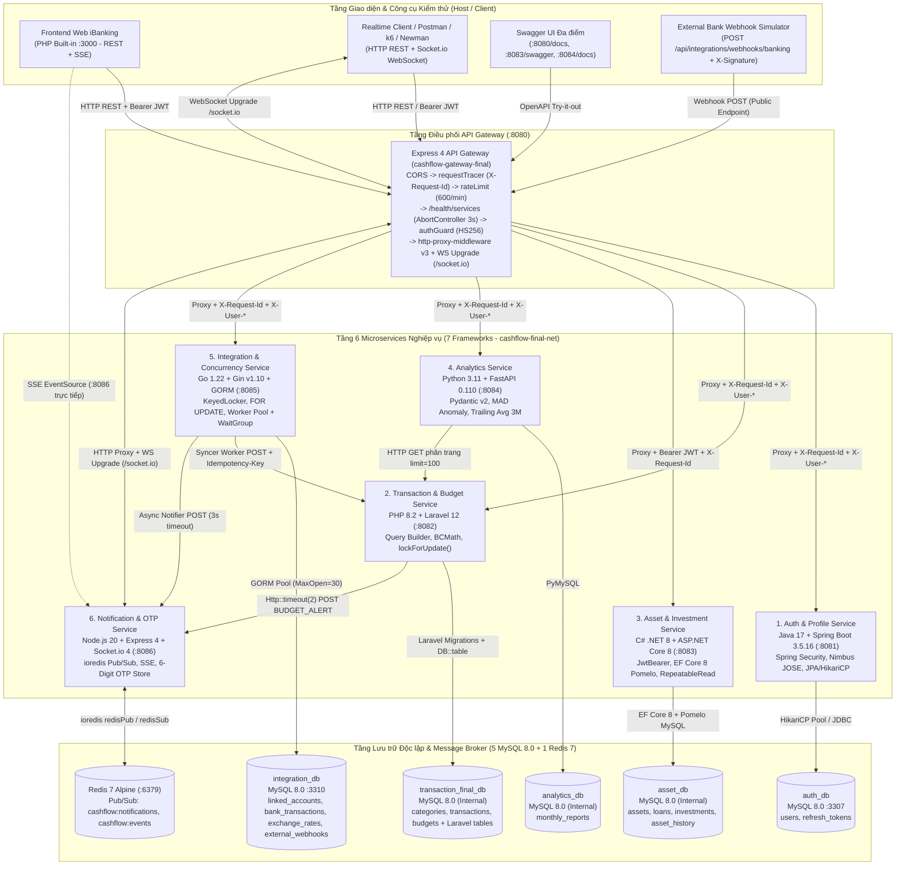

*Hình 1-1: Kiến trúc Tổng thể Hệ thống SOA CashFlow Bản Cuối kỳ (Full Frameworks)*

**Phân tích chi tiết Hình 1-1:**
1. **Tầng Giao diện & Công cụ Kiểm thử (Client Tier):** Giao diện Web iBanking PHP (`frontend/`, cổng `:3000`) gọi các API REST qua Express Gateway (`127.0.0.1:8080`) và duy trì luồng nhận thông báo **SSE (`EventSource`)** trực tiếp tới Notification Service (`localhost:8086/api/notifications/stream?user_id=...`). Cần ghi nhận trung thực rằng giao diện Web PHP hiện hữu không tích hợp thư viện Socket.io client hay biểu mẫu nhập OTP; các tính năng **WebSocket Socket.io (`/socket.io`)** và **OTP 6 chữ số** được cung cấp đầy đủ qua API Gateway và Notification Service để phục vụ ứng dụng di động/SPA hiện đại cũng như kiểm thử trực tiếp qua Postman, Swagger UI và tập lệnh kiểm thử.
2. **Tầng Điều phối Express API Gateway (`:8080`):** Hoạt động tại cửa ngõ duy nhất, thực thi `requestTracer` (sinh `X-Request-Id` chuẩn UUID v4), giới hạn tốc độ 600 request/phút (`express-rate-limit`), tổng hợp trạng thái sống của 6 dịch vụ tại `GET /health/services`, kiểm chứng JWT `HS256` và định tuyến bằng `http-proxy-middleware` v3 kèm bắt sự kiện `upgrade` cho kết nối WebSocket `/socket.io`.
3. **Tầng 6 Microservices & Bảo mật Chiều sâu:** Mỗi dịch vụ sở hữu một cổng và một công nghệ framework chuyên biệt (`8081` Spring Boot, `8082` Laravel 12, `8083` ASP.NET Core 8, `8084` FastAPI, `8085` Go Gin + GORM, `8086` Express + Socket.io). Ngoài hàng rào `authGuard` tại Gateway, **Spring Boot Auth** và **ASP.NET Core Asset** tự thực thi xác thực lại chữ ký JWT `HS256` độc lập (*Defense-in-Depth*) ngay tại tầng ứng dụng, loại bỏ rủi ro nếu mạng nội bộ bị xâm nhập.
4. **Mô hình Database-per-Service & Ma trận Giao tiếp Đa giao thức:**
   - **5 MySQL 8.0 tách biệt (`utf8mb4_unicode_ci`):** `auth_db`, `transaction_final_db`, `asset_db`, `analytics_db`, `integration_db` tuyệt đối không dùng chung schema hoặc tạo khóa ngoại chéo CSDL.
   - **Ma trận giao tiếp liên dịch vụ:** (i) *Đồng bộ REST + `X-Request-Id`* từ Gateway tới 6 dịch vụ và từ Analytics Service gọi `GET /api/transactions?limit=100` sang Laravel; (ii) *Bất đồng bộ Worker Pool* từ Go `Syncer` (`SYNC_WORKERS=4`) đẩy giao dịch đã nhận sang Laravel kèm `Idempotency-Key`; (iii) *Bất đồng bộ đẩy cảnh báo* từ cả Laravel Transaction (`Http::timeout(2)`) và Go Integration (`Notifier` goroutine timeout 3s) tới `POST /api/notifications/send`; (iv) *Event-Driven & Dual Realtime* qua **Redis 7 Pub/Sub** (`cashflow:notifications`, `cashflow:events`) dùng thư viện `ioredis` để phân phối tới cả **Socket.io Room `user:<id>`** và **SSE**.

### 1.2.2. Biểu đồ Use Case Tổng quát Bản Cuối kỳ (`Hình 1-2`)

So với phiên bản Giữa kỳ, Biểu đồ Use Case Cuối kỳ mở rộng thêm phân hệ **OTP 6 chữ số** (`generate`/`verify`), các ca sử dụng **Định giá sổ sách (`/valuation`)**, **Lịch sử biến động tài sản (`/history`)**, **Lịch trả góp khoản vay (`/schedule`)**, **Chuyển trạng thái khoản vay (`/status`)**, **Tổng hợp hiệu suất đầu tư (`/summary`)** và **Giám sát sức khỏe tập trung (`/health/services`)**. Biểu đồ được đồng bộ giữa định dạng Mermaid dưới đây và mã nguồn PlantUML độc lập.

*(Mã nguồn sơ đồ: [docs/diagrams/final-02-usecase-and-otp.md](../diagrams/final-02-usecase-and-otp.md) và [docs/diagrams/final-02-usecase-and-otp.puml](../diagrams/final-02-usecase-and-otp.puml))*

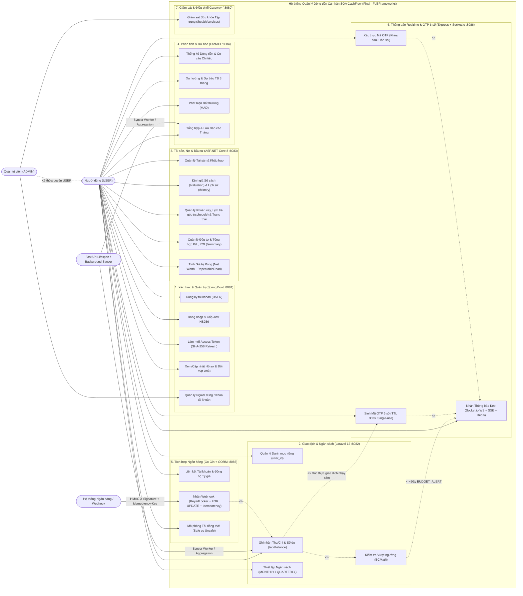

*Hình 1-2: Biểu đồ Use Case Tổng quát Hệ thống SOA CashFlow Bản Cuối kỳ*

**Phân tích chi tiết Hình 1-2:**
1. **Hệ thống tác nhân & phân quyền RBAC:** Tác nhân `USER` thực hiện toàn bộ nghiệp vụ quản lý dòng tiền cá nhân từ xác thực, giao dịch/ngân sách, định giá tài sản, phân tích thống kê đến yêu cầu và xác thực OTP. Tác nhân `ADMIN` kế thừa toàn bộ quyền của `USER` và có thêm quyền quản trị tài khoản (`ROLE_ADMIN` trên Spring Boot) cùng giám sát trạng thái hệ thống (`/health/services`). Hai tác nhân hệ thống là **Ngân hàng / Webhook** (gửi giao dịch kèm chữ ký `X-Signature` và `Idempotency-Key`) và **Tiến trình nền (`Syncer` / `FastAPI Lifespan`)** chịu trách nhiệm đồng bộ dữ liệu tự động.
2. **Các Use Case nâng cao ở bản Cuối kỳ:** So với giữa kỳ, `UC_CAT` chuyển sang mô hình cô lập danh mục riêng theo `user_id`; `UC_BUDGET` hỗ trợ thêm chu kỳ theo Quý (`QUARTERLY`); nhóm Asset bổ sung đầy đủ `UC_VAL`, `UC_LOAN` (`/schedule`, `/status`), `UC_INV` (`/summary`); và phân hệ Notification bổ sung cặp `UC_OTP_GEN` — `UC_OTP_VER` phát sóng đồng thời qua Socket.io và SSE.
3. **Quan hệ phụ thuộc `<<include>>` và `<<extend>>`:** Mọi giao dịch chi tiêu (`UC_TX`) đều `<<include>>` bước tính toán ngưỡng ngân sách bằng `BCMath` (`UC_ALERT`), và `<<extend>>` kích hoạt gửi thông báo `BUDGET_ALERT` (`UC_RT`) khi chi tiêu đạt `>= 80%` hoặc `>= 100%`. Tương tự, các giao dịch cần bảo vệ bổ sung có thể `<<extend>>` sang quy trình sinh OTP (`UC_OTP_GEN`), còn bản thân `UC_OTP_GEN` và `UC_OTP_VER` luôn `<<include>>` bước đẩy thông báo tức thời (`UC_RT`) về thiết bị của người dùng.

---

## 1.3. Đối chiếu Công nghệ Giữa kỳ → Cuối kỳ, Cấu hình Bảo mật & Phân công Nhiệm vụ

Bảng `1.1` dưới đây tổng hợp toàn bộ sự nâng cấp về nền tảng kỹ thuật, thư viện truy xuất dữ liệu, cơ chế bảo mật và kiểm thử tự động giữa hai giai đoạn.

**Bảng 1.1: Đối chiếu Toàn diện Kiến trúc & Công nghệ Giữa kỳ (Native) vs Cuối kỳ (Full Frameworks)**

| Thành phần | Phiên bản Giữa kỳ (100% Native) | Phiên bản Cuối kỳ (Full Frameworks) | Cải tiến Cốt lõi (ORM/Pool, Bảo mật, Kiểm thử) |
|---|---|---|---|
| **API Gateway (`:8080`)** | Node.js `http`, `crypto`, tự viết proxy & rate limit | **Express `^4.19.2`**, `http-proxy-middleware` `^3.0.3`, `express-rate-limit` `^7.4.1`, `jsonwebtoken` `^9.0.2`, `cors` | Truy vết `X-Request-Id` + `hrtime.bigint()`, tổng hợp `/health/services` (`AbortController` 3s), hỗ trợ WS Upgrade `/socket.io`, stream body không qua `express.json()`. |
| **Auth Service (`:8081`)** | Java 17 `com.sun.net.httpserver`, JDBC thuần | **Spring Boot `3.5.16`**, Spring Security, Nimbus JOSE (`oauth2-jose`), Spring Data JPA + **HikariCP** | Stateless `SecurityFilterChain`, xác thực lại DB `ACTIVE`/`role`, `dummyHash` chống Timing Attack, băm `SHA-256` Refresh Token + `findForUpdate`, **JUnit 5 + MockMvc + H2** (`mvn verify` trong Docker). |
| **Transaction Service (`:8082`)** | PHP 8.2 built-in server, `PDO` Singleton, `init.sql` | **Laravel `^12.0` (`v12.73.0`)**, `CarbonImmutable`, **Query Builder (`DB::table`)**, **Laravel Migrations & Seeder**, `BCMath` | DB riêng `transaction_final_db`, cô lập `categories` theo `user_id`, ngân sách `QUARTERLY`, `DB::transaction` + `lockForUpdate()`, đẩy `BUDGET_ALERT` qua `Http::timeout(2)`, **PHPUnit `^11.5.3`**. |
| **Asset Service (`:8083`)** | C# .NET 10 `HttpListener`, `MySqlConnector` thuần | **ASP.NET Core 8 (`net8.0`)**, **EF Core 8 + Pomelo `8.0.3`**, `JwtBearer` `8.0.11`, **Swashbuckle `6.6.2`** | Defense-in-Depth JWT (`ClockSkew=0`), `.IsConcurrencyToken()` trên `CurrentValue`, ghi `asset_history` nguyên tử, `RepeatableRead` Net Worth, 5 API tài chính mới + Swagger `:8083/swagger`. |
| **Analytics Service (`:8084`)** | Python 3.11 `ThreadingHTTPServer`, `PyMySQL` | **FastAPI `0.110.0`**, **Uvicorn `0.28.0`**, **Pydantic `2.6.4`**, `PyMySQL` `1.1.1` | `lifespan` retry 30×2s nạp schema, tự động validate bằng Pydantic v2, chuẩn hóa JSON lỗi qua `@app.exception_handler`, phân trang `limit=100`, tự sinh OpenAPI tại `:8084/docs`. |
| **Integration Service (`:8085`)** | Go 1.22 `net/http`, `database/sql` | **Go 1.22 + Gin `v1.10.0` + GORM `v1.25.12`** | Pool GORM (`MaxOpen=30, MaxIdle=10`), `KeyedLocker` + `clause.Locking{Strength:"UPDATE"}` + retry lỗi `1213`/`1205`, `WaitGroup` Graceful Shutdown, **Go `-race` test** & **`tools/loadtest`**. |
| **Notification & OTP (`:8086`)** | Node.js `http`, SSE, Raw TCP `RESP` | **Express `^4.19.2` + Socket.io `^4.7.5` + `ioredis` `^5.3.2`** | Kênh kép **Socket.io Room `user:<id>` + SSE**, `ioredis` Pub/Sub 2 kênh kèm In-Memory fallback, quy trình **OTP 6 chữ số** (`crypto.randomInt`, TTL 300s, Single-use, khóa 3 lần sai). |
| **Hạ tầng & CI/CD** | `docker-compose.midterm.yml` (`depends_on` cơ bản) | **`docker-compose.final.yml`** (`cashflow-final-net`, 6 Named Volumes) + **`.github/workflows/ci.yml`** | `healthcheck` + `condition: service_healthy` trên 5 MySQL & Redis, non-root `USER 10001`/`USER app` (Auth & Asset), GitHub Actions kiểm tra `docker compose config`. |

Để đảm bảo an toàn trong môi trường Production và khắc phục lỗi cấu hình khóa bí mật ở giai đoạn chuyển giao, hệ thống chuẩn hóa danh mục biến môi trường tại `Bảng 1.2`.

**Bảng 1.2: Quy chuẩn Biến môi trường Production & Bảo mật (`docker-compose.final.yml`)**

| Biến môi trường | Dịch vụ sử dụng | Giá trị mặc định / Quy chuẩn trong `docker-compose.final.yml` | Vai trò Kỹ thuật & Bảo mật |
|---|---|---|---|
| `JWT_SECRET` | `gateway`, `auth-service`, `asset-service` | `${JWT_SECRET:-cashflow-final-production-jwt-secret-key-2026-tdtu}` (**50 ký tự / 50 UTF-8 bytes**) | Đạt ngưỡng bắt buộc `>= 32 bytes` của `JwtConfig.java` (profile `prod`) và `Program.cs` (ASP.NET Core); đồng bộ khóa ký `HS256` xuyên suốt 3 tầng. |
| `SPRING_PROFILES_ACTIVE` | `auth-service` | `${SPRING_PROFILES_ACTIVE:-prod}` | Kích hoạt kiểm tra nghiêm ngặt độ dài `JWT_SECRET` và từ chối khóa phát triển giữa kỳ trong `JwtConfig.java`. |
| `DB_ALLOW_PUBLIC_KEY_RETRIEVAL` | `auth-service` | `true` | Cho phép JDBC MySQL Connector/J bắt tay `caching_sha2_password` của MySQL 8.0 trong mạng nội bộ không SSL. |
| `APP_KEY` (`LARAVEL_APP_KEY`) | `transaction-service` | `${LARAVEL_APP_KEY:-base64:Q2FzaEZsb3dGaW5hbExhcmF2ZWxBcHBLZXkyMDI2ISE=}` | Khóa mã hóa ứng dụng bắt buộc của Laravel 12 khi khởi chạy `APP_ENV=production`. |
| `DB_DATABASE` | `transaction-service`, `transaction-db` | `transaction_final_db` | Tách biệt hoàn toàn CSDL Laravel Migrations khỏi CSDL giữa kỳ (`transaction_db`). |
| `ENABLE_SWAGGER` | `asset-service` | `true` | Mở cổng Swagger UI riêng của ASP.NET Core tại `:8083/swagger` ngay trong môi trường Production demo. |
| `ANALYTICS_DB_SCHEMA` | `analytics-service` | `/app/db/init-analytics-db.sql` | Đường dẫn file SQL nạp trong FastAPI `lifespan` giúp tự khôi phục bảng `monthly_reports`. |
| `SYNC_WORKERS` / `LARGE_AMOUNT_ALERT` | `integration-service` | `4` / `10000000` (10 triệu VND) | Số goroutine worker nền đồng bộ giao dịch sang Laravel và ngưỡng tiền tệ kích hoạt cảnh báo `LARGE_TRANSACTION`. |
| `OTP_TTL_SECONDS` | `notification-service` | `300` (5 phút) | Thời hạn hiệu lực của mã OTP 6 chữ số trong `otpService.js` (`config.otp.ttlSeconds`). |
| `REDIS_CHANNEL` / `REDIS_EVENTS_CHANNEL` | `notification-service` | `cashflow:notifications` / `cashflow:events` | Hai kênh Pub/Sub trên Redis 7 qua `ioredis` để đồng bộ sự kiện và phát sóng realtime. |

Cơ cấu phân công nhiệm vụ giai đoạn Cuối kỳ giữa 6 thành viên được thống nhất theo từng dịch vụ và hạng mục tích hợp tại `Bảng 1.3`.

**Bảng 1.3: Phân công Nhiệm vụ Giai đoạn Cuối kỳ (6 Thành viên)**

| STT | Họ và Tên | MSSV | Vai trò & Dịch vụ Phụ trách | Trọng tâm Hiện thực Cuối kỳ |
|---|---|---|---|---|
| 1 | **Nguyễn Văn Duy** | `52400010` | **Nhóm trưởng** — Express API Gateway, Notification & OTP Service (Node.js), DevOps & Frontend Web | Xây dựng Express Gateway (`requestTracer`, `authGuard`, `/health/services`, WS Upgrade), Notification `Socket.io + ioredis + OTP 6 số`, `docker-compose.final.yml`, `ci.yml`, kiểm thử tương thích PHP Web `:3000`. |
| 2 | **Nguyễn Trọng Phúc** | `52400028` | Auth & Profile Service (**Java 17 + Spring Boot 3.5.16**) | Thiết kế `SecurityConfig`, `JwtAuthenticationFilter` đối chiếu DB, `LegacyPasswordEncoder` + `dummyHash`, băm `SHA-256` Refresh Token + `findForUpdate`, viết `AuthApiTest` & `ApiErrorsTest` (JUnit 5). |
| 3 | **Lê Văn Quý** | `52400153` | Transaction & Budget Service (**PHP 8.2 + Laravel 12**) | Xây dựng Migrations (`transaction_final_db`), `DatabaseSeeder`, `ResolveUser`, `CashflowController::owned()`, tính toán `BCMath` + `lockForUpdate()`, đẩy `BUDGET_ALERT` và viết `CashflowTest` (PHPUnit). |
| 4 | **Lê Tiến Đạt** | `52400105` | Asset & Investment Service (**C# .NET 8 + ASP.NET Core 8**) | Hiện thực `JwtBearer` Defense-in-Depth, EF Core 8 (`IsConcurrencyToken`), `AssetHistory`, `RepeatableRead` Net Worth, 5 API tài chính (`/valuation`, `/history`, `/schedule`, `/status`, `/summary`), `CHECK` constraints & `Asset-Final.postman_collection.json`. |
| 5 | **Lê Khải Hoàn** | `52400114` | Analytics Service (**Python 3.11 + FastAPI 0.110.0**) | Chuyển đổi sang FastAPI `lifespan`, chuẩn hóa validation với Pydantic v2, chuẩn hóa JSON lỗi `@app.exception_handler`, phân trang `limit=100` tương thích Laravel, thuật toán MAD & dự báo 3 tháng. |
| 6 | **Trần Hữu Long** | `52400138` | Integration & Concurrency Service (**Go 1.22 + Gin + GORM**) | Tái cấu trúc gói `internal/`, `KeyedLocker` + GORM `READ COMMITTED` `FOR UPDATE` + retry `1213`/`1205`, kiểu `Money int64`, Graceful Shutdown `WaitGroup`, viết `integration_test.go` (`-race`) & `tools/loadtest`. |

---

# CHƯƠNG 2: THIẾT KẾ & HIỆN THỰC CHI TIẾT CÁC DỊCH VỤ BẰNG FRAMEWORKS

## 2.1. API Gateway nâng cao với Express.js (`gateway/final/`)

Ở giai đoạn Cuối kỳ, API Gateway (`cashflow-gateway-final`, cổng `:8080`) được viết lại trên nền tảng **Express `^4.19.2`** (`express@4.22.3`) kết hợp **`http-proxy-middleware` `^3.0.3`**, **`express-rate-limit` `^7.4.1`** và **`jsonwebtoken` `^9.0.2`**. Kiến trúc chuỗi Middleware 10 bước trong `gateway/final/src/app.js` được thiết kế cẩn trọng nhằm vừa bảo đảm khả năng quan sát (*Observability*), vừa giữ nguyên luồng dữ liệu nhị phân/JSON và hỗ trợ nâng cấp kết nối **WebSocket `/socket.io`**.

**Bảng 2.1: Chuỗi Middleware 10 bước & Bảng định tuyến của Express API Gateway (`gateway/final/src/app.js`)**

| Thứ tự | Thành phần (`app.js`) | Cơ chế & Cấu hình Thực tế | Vai trò Kiến trúc |
|---:|---|---|---|
| 1 | `app.set('trust proxy', 1)` + `cors(...)` | Cho phép `GET, POST, PUT, DELETE, PATCH, OPTIONS`; mở `allowedHeaders` (`Authorization`, `X-Request-Id`, `Idempotency-Key`, `X-Signature`); `exposedHeaders: ['X-Request-Id', 'X-Proxied-By']` | Tin cậy 1 tầng proxy phía trước và đảm bảo trình duyệt đọc được header truy vết. |
| 2 | `requestTracer` (`middleware/requestTracer.js`) | Sinh `crypto.randomUUID()` nếu thiếu `X-Request-Id`; đo thời gian bằng `process.hrtime.bigint()`; ghi JSON log khi `res.on('finish')` (bỏ qua `/health`) | Truy vết phân tán (*Distributed Tracing*) xuyên suốt Gateway → Services. |
| 3 | `rateLimit` (`express-rate-limit`) | Giới hạn `600` requests / `60.000 ms`; `skip` cho `/health` và `/api/notifications/stream`; trả `429 RATE_LIMIT_EXCEEDED` kèm `requestId` | Bảo vệ tài nguyên khỏi tấn công làm tràn băng thông mà không ngắt luồng SSE dài hạn. |
| 4 | `GET /`, `GET /health` | Trả về metadata phiên bản `2.0.0-final`, `uptimeSeconds` và danh sách prefix định tuyến | Kiểm tra sống nhanh bản thân API Gateway. |
| 5 | `GET /health/services` | Gọi song song (`Promise.all`) tới `/actuator/health` (Auth), `/api/health` (Transaction), `/health` (4 dịch vụ còn lại) với `AbortController` `3000ms` | Tổng hợp trạng thái toàn cụm (`200 ALL_SERVICES_UP` hoặc `503 DEGRADED`). |
| 6 | `docsRoutes` (`routes/docsRoutes.js`) | Phục vụ `/docs`, `/swagger`, `/docs/:service`, `/openapi.json`, `/openapi/:service.json` từ `src/openapi/*.json` | Cung cấp Swagger UI tổng hợp kèm thanh đăng nhập nhanh Bearer JWT. |
| 7 | `authGuard` (`middleware/authGuard.js`) | Xóa `x-user-id`, `x-user-name`, `x-user-role` từ client; xác thực `HS256` JWT (hỗ trợ `?access_token=`/`?token=` riêng cho SSE `/api/notifications/stream`); tiêm lại `X-User-*` | Chặn giả mạo danh tính (Anti-IDOR) ngay tại biên Gateway. |
| 8 | `createProxyMiddleware` (6 routes) | Không đặt `express.json()` trước proxy; `proxyTimeout: route.ws ? 0 : 20000`; gắn `X-Request-Id`, `X-User-*` ở `proxyReq` và `X-Proxied-By` ở `proxyRes`; trả `502 BAD_GATEWAY` khi lỗi | Chuyển tiếp luồng stream nguyên vẹn tới 6 dịch vụ và thu thập `wsProxies` cho `server.on('upgrade')`. |
| 9 | Fallback `404` | Trả JSON `404 ROUTE_NOT_FOUND` kèm `availablePrefixes` và `requestId` | Chuẩn hóa phản hồi khi đường dẫn không khớp prefix nào. |
| 10 | Global Error Handler `(err, req, res, next)` | Bắt ngoại lệ tầng Express và trả `500 INTERNAL_SERVER_ERROR` kèm `requestId` | Ngăn rò rỉ stack trace ra ngoài client. |

Trích đoạn từ `gateway/final/src/middleware/requestTracer.js` (dòng 7–34) minh họa cách Gateway bảo đảm tính nhất quán của mã truy vết `X-Request-Id` và độ chính xác đo độ trễ dưới mili-giây:

```javascript
function requestTracer(req, res, next) {
  const requestId = req.headers['x-request-id'] || crypto.randomUUID();
  const startHr = process.hrtime.bigint();

  req.requestId = requestId;
  req.headers['x-request-id'] = requestId;
  res.setHeader('X-Request-Id', requestId);

  res.on('finish', () => {
    if (req.path === '/health') return;
    const durationMs = Number(process.hrtime.bigint() - startHr) / 1e6;
    const uid = req.authContext?.userId || '-';
    console.log(JSON.stringify({
      ts: new Date().toISOString(),
      level: res.statusCode >= 500 ? 'ERROR' : res.statusCode >= 400 ? 'WARN' : 'INFO',
      requestId, method: req.method, path: req.originalUrl,
      status: res.statusCode, durationMs: Number(durationMs.toFixed(2)), userId: uid,
    }));
  });
  next();
}
```

- **Tránh treo request Proxy (`express.json()`):** Một điểm kỹ thuật tối quan trọng trong `gateway/final/src/app.js` (dòng 116) là Gateway **cố ý không gắn `express.json()` trước `createProxyMiddleware`**. Nếu `express.json()` tiêu thụ luồng `req` trước khi proxy chạy, `http-proxy-middleware` v3 sẽ chờ luồng body đã đọc cạn dẫn đến treo (*hang*) các yêu cầu `POST`/`PUT` cho tới khi hết `20.000 ms` timeout. Ngoài ra, tại `gateway/final/src/index.js` (dòng 12–16), HTTP server đăng ký sự kiện `server.on('upgrade', proxy.upgrade)` cho danh sách `wsProxies` (`ws: true` trên tuyến `/socket.io`) để nâng cấp kết nối WebSocket sang Notification Service.

Luồng bảo mật chiều sâu và truy vết xuyên tầng được mô tả chi tiết trong `Hình 2-1` và cấu trúc thành phần Gateway trong `Hình 2-2`.

*(Mã nguồn sơ đồ: [docs/diagrams/final-05-sequence-and-state-final.md](../diagrams/final-05-sequence-and-state-final.md))*

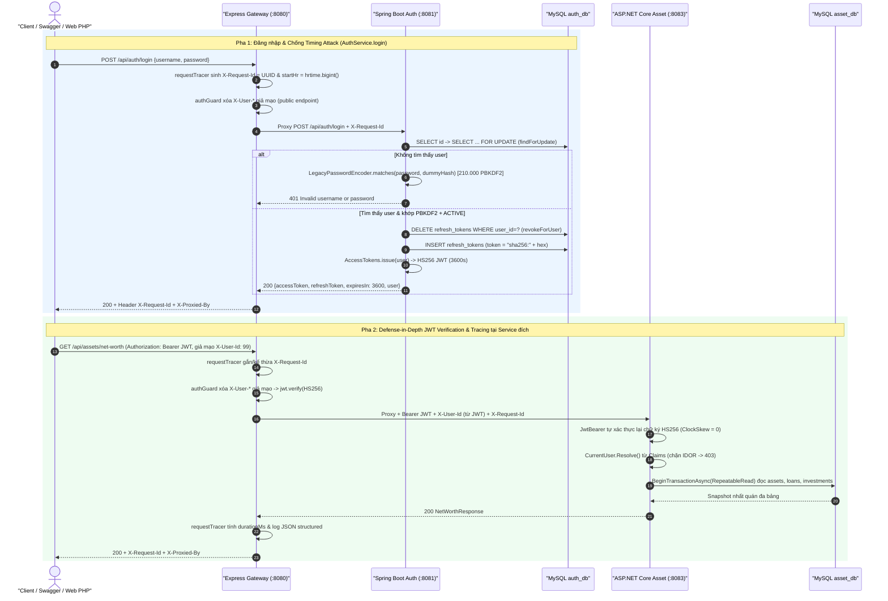

*Hình 2-1: Biểu đồ Tuần tự Bảo mật Chiều sâu (Defense-in-Depth) & Truy vết `X-Request-Id` qua Express Gateway*

**Phân tích chi tiết Hình 2-1:**
1. **Pha 1 — Chống dò tài khoản và cấp phát token:** Khi client gửi `POST /api/auth/login`, `requestTracer` tạo `X-Request-Id` và `authGuard` bỏ qua yêu cầu JWT vì đây là public endpoint (nhưng vẫn xóa các header `X-User-*` nếu có). Tại Spring Boot, `AuthService.login()` dùng khóa bi quan `findForUpdate` và luôn chạy thuật toán băm `PBKDF2WithHmacSHA256` (`210.000` vòng) với chuỗi `dummyHash` ngay cả khi username không tồn tại, giúp thời gian phản hồi đồng nhất và vô hiệu hóa *Timing Attack*. Khi đăng nhập thành công, refresh token cũ bị thu hồi và token mới được lưu dưới dạng `"sha256:" + hex`.
2. **Pha 2 — Bảo mật chiều sâu 2 lớp (Gateway + Downstream):** Khi client gọi API được bảo vệ kèm header giả mạo `X-User-Id: 99`, `authGuard` xóa sạch header giả mạo, giải mã chữ ký `HS256` và chỉ tin tưởng `userId` bên trong JWT. Khi yêu cầu tới ASP.NET Core Asset Service, middleware `JwtBearer` tiếp tục xác thực lại chữ ký `HS256` (`ClockSkew = TimeSpan.Zero`) và `CurrentUser.Resolve()` chỉ đọc danh tính từ `ClaimsPrincipal` đã ký, bảo đảm an toàn ngay cả khi có truy cập trực tiếp vào cổng nội bộ `:8083` bỏ qua Gateway.

*(Mã nguồn sơ đồ: [docs/diagrams/final-03-class-diagrams-frameworks.md](../diagrams/final-03-class-diagrams-frameworks.md))*

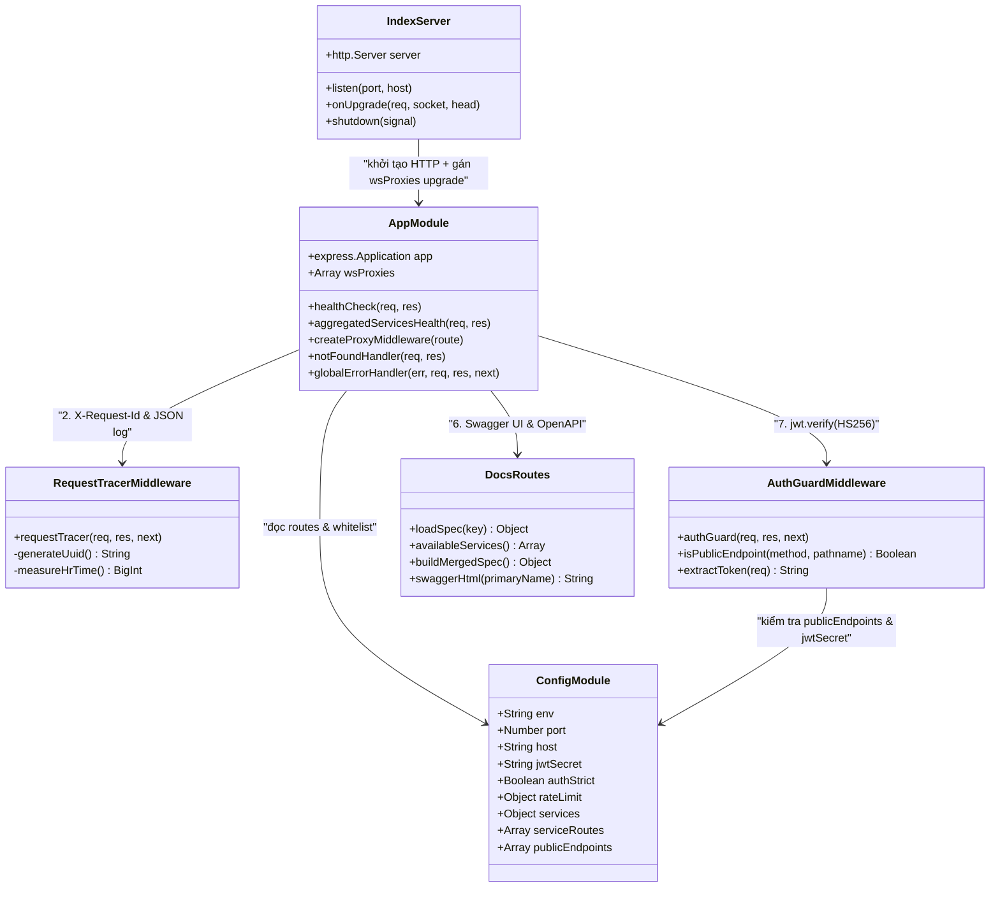

*Hình 2-2: Biểu đồ Thành phần / Lớp Express API Gateway (`gateway/final`)*

**Phân tích chi tiết Hình 2-2:**
1. **Tách biệt tầng khởi động (`IndexServer`) và tầng ứng dụng (`AppModule`):** `index.js` giữ trách nhiệm vòng đời HTTP server, gắn lắng nghe `upgrade` cho `wsProxies` và xử lý tắt an toàn (`SIGTERM`/`SIGINT`), trong khi `app.js` tập trung toàn bộ cấu hình chuỗi Middleware và xuất `{ app, wsProxies }` phục vụ cả thực thi lẫn kiểm thử.
2. **Định hướng cấu hình tập trung (`ConfigModule`):** `config.js` khai báo tập trung danh sách `serviceRoutes` (prefix định tuyến, `healthPath`, cờ `ws: true`) và `publicEndpoints`, giúp `authGuard` và `AppModule` phối hợp nhất quán mà không phân tán quy tắc bảo mật ở nhiều tệp.

---

## 2.2. Chi tiết Hiện thực 6 Microservices Nghiệp vụ trên nền tảng Frameworks

### 2.2.1. Auth & Profile Service — Java 17 + Spring Boot 3.5.16

**(a) Kiến trúc lớp trên nền tảng Spring Boot (`Hình 2-3`):**

*(Mã nguồn sơ đồ: [docs/diagrams/final-03-class-diagrams-frameworks.md](../diagrams/final-03-class-diagrams-frameworks.md))*

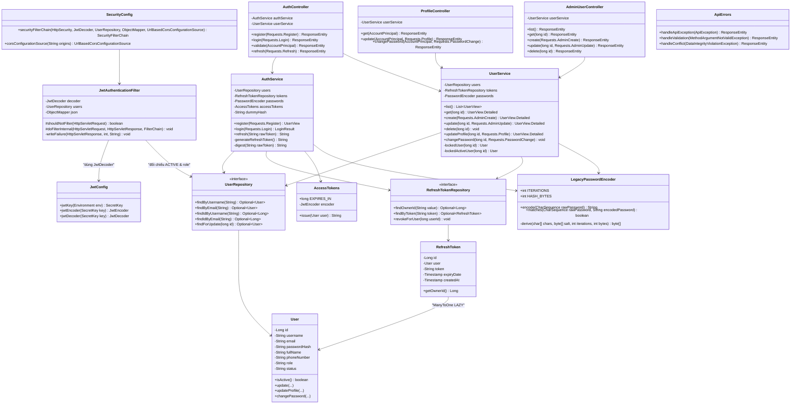

*Hình 2-3: Biểu đồ Lớp Auth & Profile Service (`Spring Boot 3.5.16`)*

**Phân tích chi tiết Hình 2-3:**
1. **Chuỗi bảo mật Stateless & Bộ lọc đối chiếu DB:** `SecurityConfig` cấu hình `SessionCreationPolicy.STATELESS`, vô hiệu hóa form login/CSRF và chèn `JwtAuthenticationFilter` trước `UsernamePasswordAuthenticationFilter`. Điểm vượt trội so với xác thực JWT thuần túy là `JwtAuthenticationFilter` giải mã token bằng `NimbusJwtDecoder`, sau đó truy vấn `users.findById(userId)` để kiểm tra tài khoản còn trạng thái `ACTIVE` và `role` trong DB có khớp claim `role` trong JWT hay không; nếu quản trị viên vừa khóa tài khoản hoặc hạ quyền, token hiện hữu bị từ chối ngay (`401`) mà không cần chờ hết hạn 3.600 giây.
2. **Tách lớp DTO & Xử lý lỗi tập trung:** Các lớp `Requests` (hỗ trợ `@JsonAlias("full_name")`, `@JsonAlias("phone_number")`, `@JsonAlias("refresh_token")` tương thích cả camelCase lẫn snake_case từ frontend) và `UserView` tách biệt hoàn toàn với Entity JPA `User` (`passwordHash` không bao giờ bị tuần tự hóa ra JSON), trong khi `@RestControllerAdvice ApiErrors` ánh xạ thống nhất lỗi validation (`400`), trùng khóa duy nhất `1062`/`23505` (`409`) và mất kết nối CSDL (`503`).

**(b) Danh mục API Endpoints (`Bảng 2.2`):**

**Bảng 2.2: Danh mục API Endpoints — Auth & Profile Service (`Spring Boot 3.5.16`, `:8081`)**

| Method | Endpoint | Phân quyền | Mô tả Nghiệp vụ & Mã trạng thái |
|---|---|---|---|
| `GET` | `/actuator/health` | Công khai | Spring Boot Actuator (`show-details: never`) phục vụ Gateway polling (`200`). |
| `POST` | `/api/auth/register` | Công khai | Chuẩn hóa `email` chữ thường, ép quyền `USER` + `ACTIVE`, băm PBKDF2 210k (`201`, `400`, `409`). |
| `POST` | `/api/auth/login` | Công khai | Đăng nhập bằng `username` hoặc `email`; cấp `accessToken` (`3600s`) + `refreshToken` (`200`, `401`). |
| `GET` | `/api/auth/validate` | Bearer JWT | Xác thực JWT + kiểm tra DB `ACTIVE` & `role`, trả thông tin `AccountPrincipal` (`200`, `401`). |
| `POST` | `/api/auth/refresh` | Công khai (Refresh) | Kiểm tra `refreshToken` (băm `sha256:` hoặc token 64 ký tự giữa kỳ) dưới khóa bi quan `findForUpdate`, trả `accessToken` mới (`200`, `401`). |
| `GET` / `PUT` | `/api/profile` | Bearer JWT | Xem hoặc cập nhật `fullName`, `phoneNumber` của chính tài khoản (`200`, `400`). |
| `PUT` | `/api/profile/password` | Bearer JWT | Xác minh mật khẩu cũ, từ chối trùng mật khẩu cũ, cập nhật PBKDF2 & thu hồi mọi `refresh_tokens` (`200`, `400`). |
| `GET` / `POST` / `PUT` / `DELETE` | `/api/admin/users`, `/api/admin/users/{id}` | Bearer + `ROLE_ADMIN` | Quản trị toàn bộ tài khoản; thu hồi `refresh_tokens` tức thì nếu chuyển sang `BLOCKED` (`200`/`201`/`400`/`403`/`409`). |

**(c) Thiết kế Persistence (Spring Data JPA + HikariCP):**
- Hai thực thể `User` (`users`) và `RefreshToken` (`refresh_tokens`, quan hệ `@ManyToOne(fetch = FetchType.LAZY)`) ánh xạ chính xác vào `auth_db` (`ddl-auto: validate` trong `application.yml`). `UserRepository` định nghĩa `@Lock(LockModeType.PESSIMISTIC_WRITE) findForUpdate(long id)` dùng `SELECT ... FOR UPDATE`, còn kết nối được quản lý qua bể **HikariCP** tích hợp sẵn của Spring Boot.

**(d) Giải thuật Bảo mật Cốt lõi (`AuthService.java`):**
- Trích đoạn `AuthService.refresh()` (`services/auth-service/final/src/main/java/com/cashflow/auth/service/AuthService.java`, dòng 89–114) cho thấy rõ cơ chế khóa bi quan và lưu giữ Refresh Token băm `SHA-256` (lưu ý chính xác theo mã nguồn: `login()`, đổi mật khẩu và khóa tài khoản thu hồi/xoay vòng `refreshToken`, còn `refresh()` giữ nguyên `refreshToken` hiện tại và cấp phát `accessToken` mới):

```java
@Transactional(isolation = Isolation.READ_COMMITTED)
public String refresh(String rawToken) {
    String storedValue = digest(rawToken);
    var ownerId = tokens.findOwnerId(storedValue);
    if (ownerId.isEmpty() && rawToken.matches("[A-Za-z0-9_-]{64}")) {
        storedValue = rawToken;
        ownerId = tokens.findOwnerId(storedValue);
    }

    User user = ownerId.flatMap(users::findForUpdate)
            .orElseThrow(() -> new ApiException(HttpStatus.UNAUTHORIZED, INVALID_REFRESH));
    RefreshToken token = tokens.findByToken(storedValue)
            .orElseThrow(() -> new ApiException(HttpStatus.UNAUTHORIZED, INVALID_REFRESH));
    if (!MessageDigest.isEqual(token.getToken().getBytes(StandardCharsets.UTF_8),
            storedValue.getBytes(StandardCharsets.UTF_8))
            || !user.getId().equals(token.getOwnerId())
            || !token.getExpiryDate().toInstant().isAfter(Instant.now())) {
        throw new ApiException(HttpStatus.UNAUTHORIZED, INVALID_REFRESH);
    }
    if (!user.isActive()) {
        throw new ApiException(HttpStatus.UNAUTHORIZED, "User is not active");
    }
    return accessTokens.issue(user);
}
```

- **Chống hồi sinh token bị thu hồi (*Race Condition Prevention*):** Bằng cách khóa hàng `users` bằng `findForUpdate` trước khi đọc lại `tokens.findByToken(storedValue)` và so sánh hằng thời gian `MessageDigest.isEqual`, một luồng `refresh()` đồng thời không thể cấp phát `accessToken` nếu luồng `login()` hoặc `changePassword()` khác vừa thu hồi token đó.

---

### 2.2.2. Transaction & Budget Service — PHP 8.2 + Laravel 12

**(a) Kiến trúc lớp trên nền tảng Laravel 12 (`Hình 2-4`):**

*(Mã nguồn sơ đồ: [docs/diagrams/final-03-class-diagrams-frameworks.md](../diagrams/final-03-class-diagrams-frameworks.md))*

```mermaid
classDiagram
    class ResolveUser {
        +handle(Request request, Closure next) Response
    }

    class Controller {
        <<abstract>>
    }

    class CashflowController {
        <<abstract>>
        #userId(Request request) int
        #owned(string table, Request request) Builder
        #record(string table, Request request, int id) object
        #ok(mixed data, int status) JsonResponse
        #category(Request request, int id, string type) object
        #moneyRule() array
    }

    class CategoryController {
        +index(Request request) JsonResponse
        +show(Request request, int category) JsonResponse
        +store(Request request) JsonResponse
        +update(Request request, int category) JsonResponse
        +destroy(Request request, int category) JsonResponse
        -save(Request request, int? id) JsonResponse
    }

    class TransactionController {
        +index(Request request) JsonResponse
        +show(Request request, int transaction) JsonResponse
        +totals(Request request) array
        +balance(Request request) JsonResponse
        +store(Request request) JsonResponse
        +update(Request request, int transaction) JsonResponse
        +destroy(Request request, int transaction) JsonResponse
        -save(Request request, int? id) JsonResponse
    }

    class BudgetController {
        +index(Request request) JsonResponse
        +show(Request request, int budget) JsonResponse
        +report(Request request) array
        +progress(Request request) JsonResponse
        +store(Request request) JsonResponse
        +update(Request request, int budget) JsonResponse
        +destroy(Request request, int budget) JsonResponse
        -save(Request request, int? id) JsonResponse
    }

    class DatabaseSeeder {
        +run() void
    }

    class DBQueryBuilder {
        <<Laravel Facade>>
        +table(string name) Builder
        +transaction(Closure callback) mixed
        +lockForUpdate() Builder
    }

    Controller <|-- CashflowController
    CashflowController <|-- CategoryController
    CashflowController <|-- TransactionController
    CashflowController <|-- BudgetController
    ResolveUser ..> CashflowController : "gắn user_id vào request attributes"
    TransactionController ..> BudgetController : "gọi report() tính budget_alerts"
    CategoryController --> DBQueryBuilder : "DB::table('categories') + lockForUpdate"
    TransactionController --> DBQueryBuilder : "DB::table('transactions') + BCMath"
    BudgetController --> DBQueryBuilder : "DB::table('budgets') + CarbonImmutable"
    DatabaseSeeder --> DBQueryBuilder : "seed idempotent transaction_final_db"
```

*Hình 2-4: Biểu đồ Lớp Transaction & Budget Service (`Laravel 12`)*

**Phân tích chi tiết Hình 2-4:**
1. **Middleware & Lớp cơ sở chống IDOR (`ResolveUser` + `CashflowController`):** Toàn bộ route nghiệp vụ trong `routes/api.php` đi qua middleware `ResolveUser` (kiểm tra `X-User-Id` là số nguyên dương bằng `FILTER_VALIDATE_INT`, trả `401` nếu thiếu). Các controller đều kế thừa `CashflowController` và dùng phương thức `owned($table, $request)` để tự động gắn điều kiện `where('user_id', ...)`, loại bỏ nguy cơ truy cập chéo dữ liệu (IDOR).
2. **Sử dụng `DB::table(...)` Query Builder thay vì Eloquent Model nghiệp vụ:** Kiểm chứng trực tiếp trong `services/transaction-service/final/app/Models/` cho thấy chỉ tồn tại `User.php` mặc định của Laravel; toàn bộ nghiệp vụ `Category`, `Transaction`, `Budget` thao tác trực tiếp qua `Illuminate\Support\Facades\DB` Query Builder kết hợp `DB::transaction()` và `lockForUpdate()`, giúp giảm chi phí khởi tạo đối tượng Model khi tính tổng số tiền lớn và kiểm soát câu lệnh SQL chặt chẽ.

**(b) Danh mục API Endpoints (`Bảng 2.3`):**

**Bảng 2.3: Danh mục API Endpoints — Transaction & Budget Service (`Laravel 12`, `:8082`)**

| Method | Endpoint | Controller Action | Mô tả Nghiệp vụ & Mã trạng thái |
|---|---|---|---|
| `GET` | `/health`, `/api/health` | Laravel Health / Closure | Kiểm tra sức khỏe service (`200` `{"framework":"Laravel"}`). |
| `GET` / `POST` / `PUT` / `DELETE` | `/api/categories`, `/api/categories/{id}` | `CategoryController` | CRUD danh mục riêng theo `user_id`; trả `409` nếu đổi loại hoặc xóa danh mục đang có giao dịch/ngân sách tham chiếu. |
| `GET` | `/api/transactions` | `TransactionController@index` | Lọc theo `type`, `category_id`, `from_date`, `to_date`, phân trang `limit` (`1..500`, mặc định `100`), `offset`. |
| `POST` / `PUT` / `DELETE` | `/api/transactions`, `/api/transactions/{id}` | `TransactionController` | Chấp nhận `category_id` hoặc chuỗi `category` (tự tạo danh mục nếu chưa có); tính lại `balance`, `budget_alerts`, đẩy `BUDGET_ALERT` (`201`/`200`). |
| `GET` | `/api/balance`, `/api/transactions/balance` | `TransactionController@balance` | Tính tổng `income`, `expense`, `balance` chính xác 2 chữ số thập phân bằng `BCMath`. |
| `GET` / `POST` / `PUT` / `DELETE` | `/api/budgets`, `/api/budgets/{id}` | `BudgetController` | Hỗ trợ `MONTHLY` và `QUARTERLY`; chuẩn hóa `start_date`/`end_date` bằng `CarbonImmutable`; chặn trùng bằng `lockForUpdate()`. |
| `GET` | `/api/budgets/progress` | `BudgetController@progress` | Tính `spent`, `remaining`, `over_amount`, `percentage`, trạng thái `SAFE` / `WARNING` (`>= 80%`) / `EXCEEDED` (`>= 100%`). |

**(c) Thiết kế Persistence (Laravel Migrations & Idempotent Seeder):**
- Tệp `database/migrations/2026_11_24_000000_create_cashflow_tables.php` quản lý 3 bảng nghiệp vụ cốt lõi (`categories`, `transactions`, `budgets`) trong `transaction_final_db`, đi kèm 3 migration khung mặc định của Laravel (`users`, `password_reset_tokens`, `sessions`, `cache`, `cache_locks`, `jobs`, `job_batches`, `failed_jobs`) và bảng `migrations`. Lớp `DatabaseSeeder` nạp dữ liệu mẫu idempotent gồm 7 danh mục (5 cho user 1, 2 cho user 2), 2 ngân sách tháng cho user 1 và 15 giao dịch trải rộng 3 tháng gần nhất.

**(d) Giải thuật Số học Chính xác & Khóa Đồng thời (`TransactionController.php` & `BudgetController.php`):**
- Trích đoạn `TransactionController::save()` (`services/transaction-service/final/app/Http/Controllers/TransactionController.php`, dòng 91–107 & 168–182) thể hiện ba kỹ thuật cốt lõi: khóa hàng danh mục bằng `lockForUpdate()`, hỗ trợ chuỗi `category` từ Integration Service, và đẩy cảnh báo bất đồng bộ có ngưỡng timeout 2 giây:

```php
$result = DB::transaction(function () use ($request, $id, $old, $data) {
    $userId = $this->userId($request);
    $categoryId = $data['category_id'] ?? null;
    $categoryName = isset($data['category']) ? trim((string) $data['category']) : '';

    if ($categoryId !== null) {
        $this->owned('categories', $request)->where('id', $categoryId)->lockForUpdate()->first();
        $this->category($request, (int) $categoryId, $data['type']);
    } else {
        $catName = $categoryName !== '' ? $categoryName : ($data['type'] === 'INCOME' ? 'Thu nhập khác' : 'Chi tiêu khác');
        $existingCat = $this->owned('categories', $request)
            ->where('name', $catName)->where('type', $data['type'])
            ->lockForUpdate()->first();
        // ... tạo mới nếu chưa có và chèn giao dịch ...
    }
    // ... tính totals() và BudgetController::report() bằng BCMath ...
});

$alert = $result['body']['budget_alert'] ?? null;
$notifUrl = env('NOTIFICATION_SERVICE_URL');
if ($alert && $notifUrl && ! app()->runningUnitTests()) {
    try {
        Http::timeout(2)->post(rtrim($notifUrl, '/').'/api/notifications/send', [
            'userId' => $result['user_id'],
            'type' => 'BUDGET_ALERT',
            'title' => $alert['status'] === 'EXCEEDED' ? 'Cảnh báo vượt hạn mức ngân sách' : 'Chú ý sắp chạm ngưỡng ngân sách',
            'message' => $alert['message'],
            'metadata' => $alert,
        ]);
    } catch (\Throwable) { }
}
```

- **Số học tĩnh `BCMath` & `CarbonImmutable`:** Trong `TransactionController::totals()` (`bcadd`, `bcsub` scale `2`) và `BudgetController::report()` (`bcadd`, `bcsub`, `bccomp`, `bcmul`, `bcdiv`), toàn bộ phép tính tiền tệ dùng chuỗi thập phân thay vì số thực `float`, loại bỏ hoàn toàn sai số làm tròn IEEE-754. Tại `BudgetController::save()`, `CarbonImmutable::startOfMonth()`/`endOfMonth()` và `startOfQuarter()`/`endOfQuarter()` tính chính xác ngày cuối tháng kể cả năm nhuận (được kiểm chứng bằng test case `2028-02-29` trong `CashflowTest.php`).

---

### 2.2.3. Asset & Investment Service — C# .NET 8 + ASP.NET Core 8 & EF Core 8

**(a) Kiến trúc lớp trên nền tảng ASP.NET Core 8 (`Hình 2-5`):**

*(Mã nguồn sơ đồ: [docs/diagrams/final-03-class-diagrams-frameworks.md](../diagrams/final-03-class-diagrams-frameworks.md))*

```mermaid
classDiagram
    class ExceptionMiddleware {
        -RequestDelegate _next
        +InvokeAsync(HttpContext context) Task
    }

    class CurrentUser {
        -IHttpContextAccessor _accessor
        +TryReadId(ClaimsPrincipal? principal, out long userId)$ bool
        +Resolve(long? queryId, long? bodyId) long
    }

    class AssetsController {
        -AssetManager _manager
        -NetWorthService _netWorth
        -CurrentUser _currentUser
        +List(long? user_id, CancellationToken ct) Task
        +Get(long id, CancellationToken ct) Task
        +Create(AssetInput input, CancellationToken ct) Task
        +Update(long id, AssetInput input, CancellationToken ct) Task
        +Delete(long id, CancellationToken ct) Task
        +Depreciation(DepreciationInput input) IActionResult
        +NetWorth(long? user_id, CancellationToken ct) Task
        +History(long id, CancellationToken ct) Task
        +Valuation(long id, DateTime? as_of, CancellationToken ct) Task
    }

    class LoansController {
        -LoanService _service
        -CurrentUser _currentUser
        +List(long? user_id, CancellationToken ct) Task
        +Get(long id, CancellationToken ct) Task
        +Create(LoanInput input, CancellationToken ct) Task
        +Update(long id, LoanInput input, CancellationToken ct) Task
        +Delete(long id, CancellationToken ct) Task
        +Calculate(LoanCalculationInput input) IActionResult
        +Schedule(long id, CancellationToken ct) Task
        +SetStatus(long id, LoanStatusInput input, CancellationToken ct) Task
    }

    class InvestmentsController {
        -InvestmentService _service
        -CurrentUser _currentUser
        +List(long? user_id, CancellationToken ct) Task
        +Get(long id, CancellationToken ct) Task
        +Create(InvestmentInput input, CancellationToken ct) Task
        +Update(long id, InvestmentInput input, CancellationToken ct) Task
        +Delete(long id, CancellationToken ct) Task
        +Summary(long? user_id, CancellationToken ct) Task
    }

    class HealthController {
        -AssetDbContext _db
        +Health() IActionResult
        +Ready(CancellationToken ct) Task
    }

    class AssetManager {
        -AssetDbContext _db
        +List(long user, CancellationToken ct) Task
        +Get(long user, long id, CancellationToken ct) Task
        +Create(long user, AssetInput x, CancellationToken ct) Task
        +Update(long user, long id, AssetInput x, CancellationToken ct) Task
        +Delete(long user, long id, CancellationToken ct) Task
        +History(long user, long id, CancellationToken ct) Task
        +Valuation(long user, long id, DateTime? asOf, CancellationToken ct) Task
    }

    class LoanService {
        -AssetDbContext _db
        +List(long user, CancellationToken ct) Task
        +Get(long user, long id, CancellationToken ct) Task
        +Create(long user, LoanInput x, CancellationToken ct) Task
        +Update(long user, long id, LoanInput x, CancellationToken ct) Task
        +Delete(long user, long id, CancellationToken ct) Task
        +SetStatus(long user, long id, string status, CancellationToken ct) Task
        +Schedule(long user, long id, CancellationToken ct) Task
    }

    class InvestmentService {
        -AssetDbContext _db
        +List(long user, CancellationToken ct) Task
        +Get(long user, long id, CancellationToken ct) Task
        +Create(long user, InvestmentInput x, CancellationToken ct) Task
        +Update(long user, long id, InvestmentInput x, CancellationToken ct) Task
        +Delete(long user, long id, CancellationToken ct) Task
        +Summary(long user, CancellationToken ct) Task
    }

    class NetWorthService {
        -AssetDbContext _db
        +Get(long user, CancellationToken ct) Task~NetWorthResponse~
    }

    class FinanceMath {
        <<static>>
        +decimal MaxMoney
        +int MaxTerm
        +Money(decimal value, string name)$ decimal
        +Depreciation(DepreciationInput x)$ DepreciationResult
        +CalculateLoan(LoanCalculationInput x)$ LoanCalculationResult
        +Schedule(decimal principal, decimal rate, int months, DateTime start)$ List~LoanInstallment~
        +BookValue(decimal purchase, decimal salvage, int life, decimal elapsedYears)$ decimal
    }

    class AssetDbContext {
        +DbSet~Asset~ Assets
        +DbSet~Loan~ Loans
        +DbSet~Investment~ Investments
        +DbSet~AssetHistory~ AssetHistory
        #OnModelCreating(ModelBuilder) void
    }

    class Asset {
        +long Id
        +long UserId
        +decimal CurrentValue
        +List~AssetHistory~ History
    }

    class AssetHistory {
        +long Id
        +long AssetId
        +decimal Value
        +DateTime RecordedAt
    }

    AssetsController --> AssetManager
    AssetsController --> NetWorthService
    AssetsController --> CurrentUser
    AssetsController --> FinanceMath
    LoansController --> LoanService
    LoansController --> CurrentUser
    LoansController --> FinanceMath
    InvestmentsController --> InvestmentService
    InvestmentsController --> CurrentUser
    HealthController --> AssetDbContext
    AssetManager --> AssetDbContext
    AssetManager --> FinanceMath
    LoanService --> AssetDbContext
    LoanService --> FinanceMath
    InvestmentService --> AssetDbContext
    NetWorthService --> AssetDbContext : "RepeatableRead"
    AssetDbContext --> Asset
    AssetDbContext --> AssetHistory
    Asset "1" *-- "0..*" AssetHistory
```

*Hình 2-5: Biểu đồ Lớp Asset & Investment Service (`ASP.NET Core 8 + EF Core 8`)*

**Phân tích chi tiết Hình 2-5:**
1. **Phân tầng Controller → Scoped Services → DbContext:** Toàn bộ 4 Controller (`AssetsController`, `LoansController`, `InvestmentsController`, `HealthController`) sử dụng Dependency Injection của ASP.NET Core để nhận các dịch vụ nghiệp vụ `Scoped` (`AssetManager`, `LoanService`, `InvestmentService`, `NetWorthService`) và lớp xác thực danh tính `CurrentUser`.
2. **Chuẩn hóa ngoại lệ & Bảo mật JWT độc lập:** `ExceptionMiddleware` ánh xạ thống nhất `ArgumentException -> 400`, `KeyNotFoundException -> 404`, `UnauthorizedAccessException -> 401`, `ForbiddenException -> 403` và đặc biệt là `DbUpdateConcurrencyException -> 409 Conflict` khi xảy ra xung đột cập nhật lạc quan trên `Asset.CurrentValue`. `Program.cs` cấu hình `JwtBearer` với `MapInboundClaims = false` và `ClockSkew = TimeSpan.Zero` cùng chính sách đặt tên JSON `JsonNamingPolicy.SnakeCaseLower`.

**(b) Danh mục API Endpoints (`Bảng 2.4`):**

**Bảng 2.4: Danh mục API Endpoints — Asset & Investment Service (`ASP.NET Core 8`, `:8083`)**

| Method | Endpoint | Action | Mô tả Nghiệp vụ & Điểm mới Cuối kỳ |
|---|---|---|---|
| `GET` | `/`, `/health`, `/health/ready` | `HealthController` | Công khai (`[AllowAnonymous]`); `/health/ready` kiểm tra kết nối MySQL qua `CanConnectAsync()` (`200`/`503`). |
| `GET` | `/swagger` | Swashbuckle `6.6.2` | Tài liệu OpenAPI riêng cho toàn bộ 23 endpoint của Asset Final (`ENABLE_SWAGGER=true`). |
| `GET`/`POST`/`PUT`/`DELETE` | `/api/assets`, `/api/assets/{id}` | `AssetsController` | CRUD tài sản; tự động ghi `asset_history` trong cùng transaction khi tạo hoặc đổi `current_value`. |
| `GET` | `/api/assets/{id}/history` | `AssetsController.History` | **[Mới Final]** Truy xuất chuỗi lịch sử biến động giá trị tài sản từ bảng `asset_history`. |
| `GET` | `/api/assets/{id}/valuation` | `AssetsController.Valuation` | **[Mới Final]** Định giá giá trị sổ sách theo số ngày thực tế (`TotalDays / 365.2425m`) tại ngày `?as_of=`. |
| `POST` / `GET` | `/api/assets/depreciation`, `/api/assets/net-worth` | `AssetsController` | Tính khấu hao đường thẳng và tổng hợp Giá trị ròng (tài sản VND trừ nợ `ACTIVE`, tách riêng `investment_value`). |
| `GET`/`POST`/`PUT`/`DELETE` | `/api/loans`, `/api/loans/{id}` | `LoansController` | CRUD khoản vay; `POST /api/loans/calculate` tính tiền góp hàng tháng EMI. |
| `GET` / `PATCH` | `/api/loans/{id}/schedule`, `/api/loans/{id}/status` | `LoansController` | **[Mới Final]** Xuất bảng khấu trừ gốc & lãi từng kỳ (cân bằng kỳ cuối) và chuyển trạng thái `ACTIVE`/`CLOSED`. |
| `GET`/`POST`/`PUT`/`DELETE` | `/api/investments`, `/api/investments/{id}` | `InvestmentsController` | CRUD đầu tư kèm tính tức thời `cost_basis`, `market_value`, `profit_loss`, `roi`. |
| `GET` | `/api/investments/summary` | `InvestmentsController.Summary` | **[Mới Final]** Tổng hợp danh mục đầu tư toàn tài khoản (`PortfolioResponse`). |

**(c) Thiết kế Persistence (EF Core 8 + Pomelo MySQL 8.0):**
- `AssetDbContext` cấu hình `Asset`, `Loan`, `Investment`, `AssetHistory`. Thuộc tính `Asset.CurrentValue` được đánh dấu `.IsConcurrencyToken()` để EF Core phát hiện xung đột ghi đồng thời. Khi gọi `AssetManager.Create()` hoặc `Update()`, bản ghi `AssetHistory` mới được thêm vào `a.History` và lưu nguyên tử trong cùng một `SaveChangesAsync()`.

**(d) Giải thuật Snapshot Nhất quán `RepeatableRead` (`NetWorthService.cs`):**
- Trích đoạn từ `services/asset-service/final/Services/NetWorthService.cs` (dòng 8–20) minh họa cách đọc nhất quán xuyên 3 bảng `assets`, `loans`, `investments` dưới mức cô lập `IsolationLevel.RepeatableRead`:

```csharp
public async Task<NetWorthResponse> Get(long user, CancellationToken ct)
{
    await using var tx = await db.Database.BeginTransactionAsync(System.Data.IsolationLevel.RepeatableRead, ct);
    var assets = await db.Assets.AsNoTracking().Where(a => a.UserId == user)
        .Select(a => new { a.Currency, a.CurrentValue }).ToListAsync(ct);
    var vnd = assets.Where(a => string.IsNullOrEmpty(a.Currency)
        || string.Equals(a.Currency, "VND", StringComparison.OrdinalIgnoreCase)).ToList();
    var total = vnd.Sum(a => a.CurrentValue);
    var debt = await db.Loans.Where(a => a.UserId == user && a.Status == "ACTIVE")
        .SumAsync(a => (decimal?)a.PrincipalAmount, ct) ?? 0m;
    var inv = await db.Investments.AsNoTracking().Where(a => a.UserId == user)
        .Select(a => new { a.Quantity, a.CurrentPrice }).ToListAsync(ct);
    await tx.CommitAsync(ct);
    return new(user, total - debt, "VND", total, debt,
        decimal.Round(inv.Sum(a => a.Quantity * a.CurrentPrice), 2), assets.Count - vnd.Count,
        "VND assets minus active loan principal; investment value reported separately to avoid double counting; no FX or payment ledger");
}
```

---

### 2.2.4. Analytics Service — Python 3.11 + FastAPI 0.110.0, Uvicorn & Pydantic v2

**(a) Kiến trúc Thành phần trên nền tảng FastAPI (`Hình 2-6`):**

*(Mã nguồn sơ đồ: [docs/diagrams/final-03-class-diagrams-frameworks.md](../diagrams/final-03-class-diagrams-frameworks.md))*

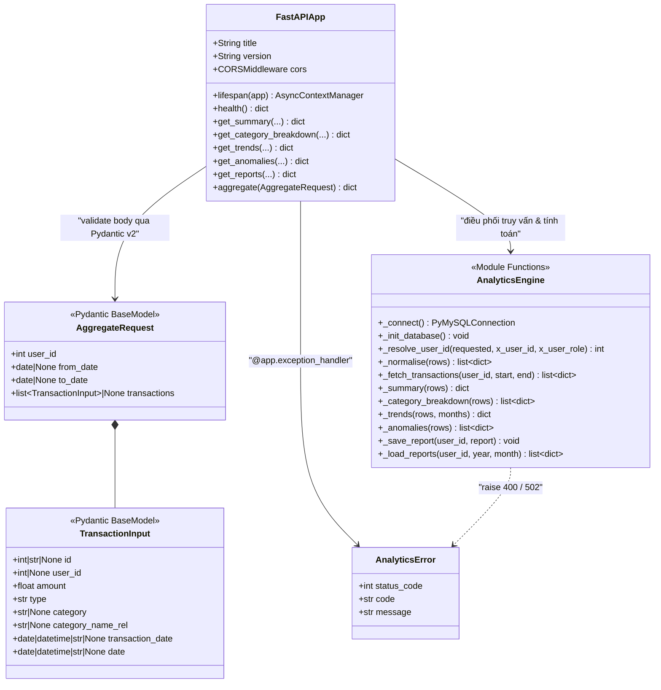

*Hình 2-6: Biểu đồ Thành phần Analytics Service (`FastAPI 0.110.0 + Pydantic v2`)*

**Phân tích chi tiết Hình 2-6:**
1. **Khởi tạo an toàn qua `lifespan` & Tự sinh OpenAPI:** Thay vì xử lý socket/HTTP thủ công bằng `ThreadingHTTPServer`, `main.py` khai báo `@asynccontextmanager async def lifespan(_: FastAPI)` để chạy `_init_database()` (thử lại tối đa 30 lần, mỗi lần cách 2 giây để nạp `/app/db/init-analytics-db.sql`) trước khi mở cổng nhận request. FastAPI đồng thời tự động sinh giao diện Swagger tương tác tại `/docs` (`:8084/docs`) và đặc tả `/openapi.json`.
2. **Kiểm tra dữ liệu & Chuẩn hóa lỗi bằng Pydantic v2:** Các lược đồ `TransactionInput` (`extra="ignore"`, `amount >= 0`) và `AggregateRequest` (`user_id >= 1`) do Pydantic v2 kiểm tra tự động; mọi ngoại lệ `RequestValidationError` và `AnalyticsError` đều được hai hàm `@app.exception_handler` chuyển về định dạng JSON thống nhất `{"error": ..., "message": ...}` (mã `400 VALIDATION_ERROR` hoặc `502 UPSTREAM_ERROR`).

**(b) Danh mục API Endpoints (`Bảng 2.5`):**

**Bảng 2.5: Danh mục API Endpoints — Analytics Service (`FastAPI 0.110.0`, `:8084`)**

| Method | Endpoint | Hàm xử lý | Mô tả Nghiệp vụ & Đặc điểm |
|---|---|---|---|
| `GET` | `/`, `/health` | `health()` | Trả trạng thái `{"service":"analytics-service","status":"UP","version":"2.0.0-final"}`. |
| `GET` | `/docs`, `/openapi.json` | FastAPI OpenAPI | Tài liệu Swagger UI riêng của Analytics Service. |
| `GET` | `/api/analytics/summary` | `get_summary()` | Tổng hợp `income`, `expense`, `net_cashflow`, `transaction_count` theo khoảng ngày. |
| `GET` | `/api/analytics/category-breakdown` | `get_category_breakdown()` | Phân rã tổng chi tiêu `EXPENSE` và tỷ trọng phần trăm theo từng danh mục. |
| `GET` | `/api/analytics/trends` | `get_trends()` | Thống kê lịch sử theo tháng + dự báo tháng kế tiếp (`trailing_average_3_months`) + danh sách bất thường. |
| `GET` | `/api/analytics/anomalies` | `get_anomalies()` | Phát hiện chi tiêu bất thường theo từng danh mục bằng thuật toán **MAD**. |
| `GET` | `/api/analytics/reports` | `get_reports()` | Đọc danh sách báo cáo tháng đã lưu trong `analytics_db.monthly_reports` (`LIMIT 100`). |
| `POST` | `/api/analytics/aggregate` | `aggregate()` | Nhận danh sách giao dịch hoặc kéo từ Transaction Service, tổng hợp và lưu/cập nhật (`ON DUPLICATE KEY UPDATE`) vào `monthly_reports` (`201`). |

**(c) Thiết kế Persistence & Giao tiếp Liên dịch vụ (`PyMySQL` + `requests`):**
- Analytics Service sở hữu độc lập CSDL `analytics_db` (bảng `monthly_reports` lưu `report_json` kiểu `JSON` kèm khóa duy nhất `uq_monthly_reports_user_period (user_id, year, month)`). Khi thiếu payload giao dịch truyền vào trực tiếp, `_fetch_transactions()` gửi HTTP `GET` tới Laravel Transaction Service với header `X-User-Id` và kích thước trang **`limit = 100`** (tuân thủ giới hạn hợp lệ của cả bản giữa kỳ lẫn Laravel 12, chặn tối đa `100.000` bản ghi nhằm tránh tràn bộ nhớ).

**(d) Giải thuật Phát hiện Bất thường MAD & Lưu Idempotent (`main.py`):**
- Trích đoạn hàm `_anomalies()` (`services/analytics-service/final/src/main.py`, dòng 244–263) thể hiện cách tính ngưỡng kháng nhiễu *Median Absolute Deviation (MAD)* cho các danh mục có tối thiểu 4 mẫu chi tiêu:

```python
def _anomalies(rows: list[dict[str, Any]]) -> list[dict[str, Any]]:
    by_category: dict[str, list[float]] = defaultdict(list)
    for row in rows:
        if row["type"] == "EXPENSE":
            by_category[row["category"]].append(row["amount"])
    flagged = []
    for row in rows:
        if row["type"] != "EXPENSE":
            continue
        amounts = by_category[row["category"]]
        if len(amounts) < 4:
            continue
        median = statistics.median(amounts)
        mad = statistics.median([abs(value - median) for value in amounts])
        threshold = median + 3 * 1.4826 * mad if mad else median * 2
        if row["amount"] > threshold and row["amount"] > median:
            flagged.append({"transaction_id": row["id"], "category": row["category"],
                            "amount": row["amount"], "category_median": round(median, 2),
                            "threshold": round(threshold, 2), "transaction_date": row["transaction_date"]})
    return flagged
```

---

### 2.2.5. Integration & Concurrency Service — Go 1.22 + Gin v1.10 & GORM v1.25

**(a) Kiến trúc gói & Lớp trên nền tảng Go Gin + GORM (`Hình 2-7`):**

*(Mã nguồn sơ đồ: [docs/diagrams/final-03-class-diagrams-frameworks.md](../diagrams/final-03-class-diagrams-frameworks.md))*

```mermaid
classDiagram
    class Server {
        -gorm.DB db
        -config.Config cfg
        -locker.KeyedLocker locker
        -services.Syncer syncer
        -services.Notifier notifier
        -http.Client httpClient
        +SetupRouter() gin.Engine
        +HandleHealth(c *gin.Context)
        +HandleStats(c *gin.Context)
        +HandleGetRates(c *gin.Context)
        +HandleSyncRates(c *gin.Context)
        +HandleListAccounts(c *gin.Context)
        +HandleCreateAccount(c *gin.Context)
        +HandleGetAccount(c *gin.Context)
        +HandleDeleteAccount(c *gin.Context)
        +HandleAccountTransactions(c *gin.Context)
        +HandleBankWebhook(c *gin.Context)
        +HandleRetrySync(c *gin.Context)
        +HandleSimulate(c *gin.Context)
    }

    class KeyedLocker {
        -sync.Mutex mu
        -map~string, lockEntry~ locks
        +Lock(key string) func()
        +Size() int
    }

    class Syncer {
        -gorm.DB db
        -config.Config cfg
        -http.Client client
        -Notifier notifier
        -chan int64 queue
        -sync.WaitGroup wg
        +Start(ctx context.Context)
        +Wait()
        +Enqueue(id int64)
        +Pending() int
        -worker(ctx context.Context, n int)
        -sweeper(ctx context.Context)
        -sweep(ctx context.Context)
        -syncOne(ctx context.Context, id int64)
        -forward(ctx context.Context, t BankTransaction, userID int64)
    }

    class Notifier {
        -string baseURL
        -http.Client client
        +Send(userID int64, title string, message string, typ string, meta map)
    }

    class DatabaseModule {
        <<package database>>
        +Open(cfg config.Config) gorm.DB
        +MySQLErrNo(err error) uint16
        +IsDuplicateKey(err error) bool
        +IsRetryable(err error) bool
    }

    class Money {
        <<int64 fixed-point 1/100 VND>>
        +Float() float64
        +String() string
        +MarshalJSON() byte[]
        +Scan(src any) error
        +Value() driver.Value
    }

    class LinkedAccount {
        +int64 ID
        +int64 UserID
        +string BankCode
        +string AccountNo
        +Money Balance
        +int64 Version
    }

    class BankTransaction {
        +int64 ID
        +int64 AccountID
        +string Provider
        +string ExternalRef
        +string IdempotencyKey
        +string RequestHash
        +string Direction
        +Money Amount
        +Money BalanceAfter
        +string Status
        +int64 TransactionRef
        +int SyncAttempts
    }

    Server --> KeyedLocker : "khóa theo BankCode:AccountNo"
    Server --> Syncer : "đẩy job sync nền"
    Server --> Notifier : "cảnh báo LARGE_TRANSACTION / REJECTED"
    Server --> DatabaseModule : "GORM READ COMMITTED + FOR UPDATE"
    Syncer --> Notifier : "cảnh báo BUDGET_ALERT"
    Syncer --> BankTransaction : "claim SYNCING -> SYNCED/FAILED"
    LinkedAccount "1" -- "0..*" BankTransaction
    LinkedAccount --> Money
    BankTransaction --> Money
```

*Hình 2-7: Biểu đồ Lớp Integration & Concurrency Service (`Go 1.22 Gin + GORM`)*

**Phân tích chi tiết Hình 2-7:**
1. **Tổ chức mã nguồn chuẩn Go (`cmd/server`, `internal/`):** Tách biệt điểm khởi chạy (`cmd/server/main.go`) khỏi tầng định tuyến/handler (`internal/handlers`), cấu hình (`internal/config`), kết nối GORM (`internal/database`), thực thể (`internal/models`), dịch vụ nền (`internal/services`) và tiện ích đồng thời (`internal/pkg/locker`, `internal/pkg/httpx`).
2. **Pool GORM & Tiện ích `Money int64`:** `database.Open()` mở bể kết nối `MaxOpenConns=30`, `MaxIdleConns=10`, `ConnMaxLifetime=5m`, đồng thời cung cấp các hàm nhận diện mã lỗi MySQL `1062` (*Duplicate Key*), `1213` (*Deadlock*) và `1205` (*Lock Wait Timeout*). Kiểu tiền tệ `models.Money` lưu nội bộ bằng `int64` ở đơn vị `1/100 VND`, cài đặt `sql.Scanner`, `driver.Valuer` và `json.Marshaler` để triệt tiêu sai số dấu phẩy động.

**(b) Danh mục API Endpoints (`Bảng 2.6`):**

**Bảng 2.6: Danh mục API Endpoints — Integration & Concurrency Service (`Go Gin + GORM`, `:8085`)**

| Method | Endpoint | Handler | Mô tả Nghiệp vụ & Đặc điểm |
|---|---|---|---|
| `GET` | `/`, `/health` | `HandleHealth` | Kiểm tra DB ping, độ dài `sync_queue`, số khóa `active_locks` đang giữ và `uptime` (`200`/`503`). |
| `GET` | `/api/integrations/stats` | `HandleStats` | Thống kê số lượng tài khoản liên kết, webhook logs và biến động theo từng trạng thái. |
| `GET` / `POST` | `/api/integrations/rates`, `/sync-rates` | `HandleGetRates`, `HandleSyncRates` | Công khai tỷ giá; `/sync-rates` lấy tỷ giá song song từ `VCB`, `TCB`, `BIDV` (timeout `1200ms`) và upsert bằng GORM `clause.OnConflict`. |
| `GET`/`POST`/`DELETE` | `/api/integrations/accounts`, `/accounts/:id` | `Handle*Account` | Quản lý tài khoản ngân hàng liên kết; `HandleDeleteAccount` dùng `KeyedLocker` chống xung đột với webhook đang chạy. |
| `GET` | `/api/integrations/accounts/:id/transactions` | `HandleAccountTransactions` | Liệt kê biến động số dư của tài khoản (lọc `status`, `limit` mặc định `50`, tối đa `200`). |
| `POST` | `/api/integrations/webhooks/banking` | `HandleBankWebhook` | **Trọng tâm Concurrency & Idempotency:** Public endpoint, xác thực tùy chọn HMAC `X-Signature`, khóa 3 lớp (`201`/`200`/`409`/`422`). |
| `GET`/`DELETE`/`POST` | `/api/integrations/webhooks`, `/bank-transactions/*` | `Handle*` | Tra cứu raw log `external_webhooks`, xóa đơn/hàng loạt (tối đa 500) hoặc đẩy lại job `FAILED` (`/retry` → `202`). |
| `POST` | `/api/integrations/simulate` | `HandleSimulate` | Mô phỏng thực nghiệm `safe` (có khóa & idempotency) vs `unsafe` (`processUnsafe`), tối đa 2000 sự kiện / 200 workers. |

**(c) Thiết kế Persistence (`integration_db` + GORM):**
- Toàn bộ 4 bảng `exchange_rates`, `linked_accounts`, `bank_transactions`, `external_webhooks` được ánh xạ qua struct GORM. Bảng `linked_accounts` duy trì cột `version BIGINT DEFAULT 0` tăng nguyên tử qua `gorm.Expr("version + 1")`, còn bảng `bank_transactions` đặt 2 ràng buộc duy nhất `uq_idempotency_key` và `uq_provider_ref` làm chốt chặn tầng CSDL cuối cùng.

**(d) Giải thuật Khóa 3 lớp & Graceful Shutdown (`webhook.go`, `main.go`):**
- Trích đoạn `applyWebhook()` (`services/integration-service/final/internal/handlers/webhook.go`, dòng 170–240) cho thấy sự phối hợp chặt chẽ giữa **Layer 1 (`KeyedLocker`)**, **Layer 2 (GORM `READ COMMITTED` + `SELECT ... FOR UPDATE`)** và **Layer 3 (Idempotency)**:

```go
func (s *Server) applyWebhook(ctx context.Context, in WebhookInput) (webhookResult, error) {
	unlock := s.locker.Lock(in.BankCode + ":" + in.AccountNo)
	defer unlock()

	var result webhookResult
	err := s.db.WithContext(ctx).Transaction(func(tx *gorm.DB) error {
		var acc models.LinkedAccount
		if err := tx.Clauses(clause.Locking{Strength: "UPDATE"}).
			Where("bank_code = ? AND account_no = ?", in.BankCode, in.AccountNo).
			First(&acc).Error; err != nil {
			// ... trả errAccountNotFound nếu không tồn tại ...
		}
		existing, err := findExisting(tx, in)
		if err == nil {
			return duplicateOf(existing, in, acc.UserID) // 200 duplicate hoặc 409 conflict
		}
		// ... cập nhật balance và version = gorm.Expr("version + 1") ...
		return tx.Create(&newTx).Error
	}, &sql.TxOptions{Isolation: sql.LevelReadCommitted})
	// ... xử lý fallback lỗi 1062 (IsDuplicateKey) ...
}
```

- **Tắt dịch vụ không rớt tác vụ (`Graceful Shutdown`):** Trong `cmd/server/main.go` (dòng 58–67), khi nhận `SIGTERM`/`SIGINT`, dịch vụ gọi `httpSrv.Shutdown(shutdownCtx)` để ngừng nhận kết nối mới (tối đa 10s), sau đó hủy context của worker và gọi `syncer.Wait()` (`sync.WaitGroup`) nhằm bảo đảm 4 worker và tiến trình `sweeper` hoàn tất dứt điểm mọi giao dịch đang đồng bộ sang Laravel trước khi tiến trình thoát.

---

### 2.2.6. Notification & OTP Service — Node.js 20 + Express 4, Socket.io 4 & `ioredis`

**(a) Kiến trúc Thành phần trên nền tảng Express + Socket.io + `ioredis` (`Hình 2-8`):**

*(Mã nguồn sơ đồ: [docs/diagrams/final-03-class-diagrams-frameworks.md](../diagrams/final-03-class-diagrams-frameworks.md))*

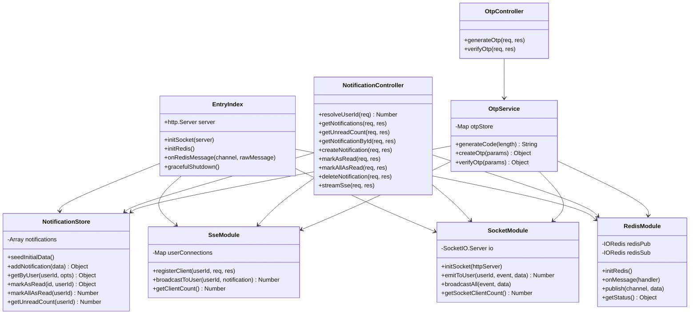

*Hình 2-8: Biểu đồ Thành phần Notification & OTP Service (`Express 4 + Socket.io 4 + ioredis`)*

**Phân tích chi tiết Hình 2-8:**
1. **Phát sóng thời gian thực kép (`Socket.io 4` + `SSE`) & `ioredis`:** Module `socket.js` khởi tạo Socket.io Server v4 (`transports: ['websocket', 'polling']`) gắn lên `http.Server`, tự động đưa client vào phòng `user:${userId}` thông qua handshake `query.userId`/`auth.userId` hoặc sự kiện `'join'`. Song song đó, `sse.js` duy trì kênh `text/event-stream` kèm heartbeat `: keep-alive ping` mỗi `25` giây cho Web PHP `:3000`. Module `redis.js` thay thế hoàn toàn bộ phân tích RESP thô bằng hai kết nối **`ioredis`** tách biệt (`redisPub` và `redisSub`), lắng nghe 2 kênh `cashflow:notifications` và `cashflow:events`, hỗ trợ backoff tối đa 5 giây và tự động fallback sang chế độ In-Memory khi mất Redis.
2. **Tách biệt `otpController` / `otpService`:** Nhờ nâng cấp lên Express Router, phân hệ OTP được tách thành router riêng (`otpRoutes.js`), controller riêng (`otpController.js`) và service xử lý trạng thái `otpStore` (`otpService.js`).

**(b) Danh mục API Endpoints & Sự kiện Socket.io (`Bảng 2.7`):**

**Bảng 2.7: Danh mục API Endpoints & Sự kiện Socket.io — Notification & OTP Service (`:8086`)**

| Kênh / Method | Đường dẫn / Sự kiện | Mô tả Chức năng & Tải trọng |
|---|---|---|
| `GET` | `/`, `/health` | Trả trạng thái Redis (`redis.getStatus()`), số kết nối `sseClients` và `socketClients`. |
| `GET` | `/api/notifications/stream` | Mở kết nối SSE (`event: connected`, `event: notification`, ping 25s). |
| `GET` / `POST` / `PUT` / `DELETE` | `/api/notifications`, `/send`, `/unread-count`, `/:id/read`, `/read-all` | Quản lý hộp thư thông báo (6 loại: `BUDGET_ALERT`, `CASHFLOW_ANOMALY`, `LOAN_REMINDER`, `LARGE_TRANSACTION`, `OTP_VERIFICATION`, `SYSTEM`). |
| `POST` | `/api/notifications/otp/generate`, `/api/otp/generate` | Sinh mã OTP 6 số, hiệu lực `300s`, phát SSE + Socket.io `otp:received` + Redis (`201`, trả `debugOtp` phục vụ test). |
| `POST` | `/api/notifications/otp/verify`, `/api/otp/verify` | Xác thực OTP: kiểm tra tồn tại, TTL `300s`, tối đa `3` lần thử, tiêu hủy ngay sau khi khớp (`200` / `400`). |
| **Socket.io C→S** | `connection` (handshake `userId`), `join` `{ userId }` | Tham gia phòng `user:${userId}` và nhận phản hồi `'joined'`. |
| **Socket.io S→C** | `notification:new`, `notification:read`, `notification:read_all`, `otp:received`, `otp:verified` | Đẩy tức thời thông báo mới, trạng thái đã đọc và vòng đời OTP theo từng phòng `user:${userId}`. |

**(c) Thiết kế Lưu trữ (`otpStore` & `store` In-Memory + Redis Pub/Sub):**
- Khác với 5 dịch vụ còn lại dùng MySQL 8.0, Notification & OTP Service sử dụng cấu trúc `Map` (`otpStore`) và mảng `notifications` (`store`, khởi tạo sẵn 5 bản ghi mẫu cho User 1 và 2) trên RAM kết hợp **Redis 7 Pub/Sub** làm xương sống truyền thông điệp. Lưu ý chi tiết trong `otpController.js` (dòng 8, 34): controller đọc trực tiếp `userId` từ `req.body` (chưa đối chiếu `X-User-Id`), đây là điểm thuận tiện cho demo/test qua API và cũng được nhóm ghi nhận trong phần đánh giá bảo mật ở Chương 4.

**(d) Hiện thực Quy trình OTP 6 chữ số & Chi tiết Vòng lặp Redis (`otpService.js`):**
- Trích đoạn `otpService.js` (`services/notification-service/final/src/services/otpService.js`, dòng 18–20, 93–145) mô tả chính xác cách sinh mã và xác thực một lần:

```javascript
function generateCode(length = 6) {
  return String(crypto.randomInt(100000, 999999));
}

function verifyOtp({ userId, action = 'PAYMENT', transactionId = null, otp }) {
  const uid = Number(userId);
  const otpKey = `${uid}:${transactionId || action}`;
  const record = otpStore.get(otpKey);
  if (!record) return { valid: false, error: 'OTP_NOT_FOUND', message: 'Không tìm thấy yêu cầu OTP hoặc OTP đã bị hủy.' };
  if (record.isUsed) return { valid: false, error: 'OTP_ALREADY_USED', message: 'Mã OTP này đã được sử dụng trước đó (Chỉ dùng một lần).' };
  if (Date.now() > record.expiresAtMs) {
    otpStore.delete(otpKey);
    return { valid: false, error: 'OTP_EXPIRED', message: 'Mã OTP đã hết thời hạn hiệu lực (5 phút). Vui lòng yêu cầu mã mới.' };
  }
  record.attempts += 1;
  if (record.code !== String(otp).trim()) {
    if (record.attempts >= record.maxAttempts) {
      otpStore.delete(otpKey);
      return { valid: false, error: 'MAX_ATTEMPTS_EXCEEDED', message: 'Bạn đã nhập sai OTP quá 3 lần. Mã OTP đã bị khóa hủy.' };
    }
    return { valid: false, error: 'OTP_MISMATCH', message: `Mã OTP không chính xác. Bạn còn ${record.maxAttempts - record.attempts} lần thử.`, remainingAttempts: record.maxAttempts - record.attempts };
  }
  record.isUsed = true;
  otpStore.delete(otpKey);
  // ... lưu thông báo SYSTEM, phát SSE và Socket.io 'otp:verified' ...
}
```

- **Ba ghi chú kỹ thuật trung thực từ mã nguồn `otpService.js` & `index.js`:**
  1. *Biên trên loại trừ của `crypto.randomInt(100000, 999999)`:* Trong Node.js, tham số `max` mang tính *exclusive*, do đó giá trị sinh thực tế nằm trong dải `100000`–`999998` (đều là 6 chữ số an toàn mật mã CSPRNG).
  2. *Hành vi thực tế khi phát lại (Replay Attack):* Ngay khi xác thực thành công ở dòng 143–144, hệ thống đặt `record.isUsed = true` rồi gọi ngay `otpStore.delete(otpKey)`. Vì phần tử đã bị xóa khỏi `Map`, khi gọi `POST /api/notifications/otp/verify` lần thứ 2 cho cùng giao dịch, dòng 96 nhận `record === undefined` và trả về `400 OTP_NOT_FOUND` (ngăn chặn hoàn toàn Replay Attack; nhánh phòng thủ `if (record.isUsed)` trả `OTP_ALREADY_USED` tại dòng 106–112 trên thực tế không thể chạm tới).
  3. *Hiệu ứng lặp thông báo khi có Redis:* Khi `createOtp()` chạy (dòng 54–77), hàm vừa tự thêm thông báo vào `store` + phát SSE/Socket.io `otp:received`, vừa gọi `redis.publish('cashflow:notifications', notif)`. Do `index.js` (dòng 23–40) lắng nghe chính kênh `cashflow:notifications`, thông điệp sẽ vòng lại qua `redis.onMessage` để thêm tiếp vào `store` và phát sự kiện `notification:new` + SSE `notification` cho client.

---

## 2.3. Thiết kế CSDL Toàn hệ thống (ERD & Data Dictionary), Giao tiếp Liên dịch vụ & Tính nhất quán

### 2.3.1. Mô hình ERD Chuẩn hóa Bản Cuối kỳ (`Hình 2-9`)

Mô hình ERD dưới đây tổng hợp toàn bộ các bảng vật lý trên 5 CSDL MySQL 8.0 độc lập cùng cấu trúc bản ghi OTP trong bộ nhớ `otpStore`, làm nổi bật những nâng cấp schema ở bản Cuối kỳ.

*(Mã nguồn sơ đồ: [docs/diagrams/final-04-erd-database-per-service.md](../diagrams/final-04-erd-database-per-service.md))*

```mermaid
erDiagram
    AUTH_USERS {
        bigint id PK "AUTO_INCREMENT"
        varchar username UK "NOT NULL, UNIQUE(50)"
        varchar email UK "NOT NULL, UNIQUE(100)"
        varchar password_hash "PBKDF2 210k"
        varchar full_name "NULL"
        varchar phone_number "NULL"
        varchar role "DEFAULT USER"
        varchar status "DEFAULT ACTIVE"
        timestamp created_at
        timestamp updated_at
    }

    AUTH_REFRESH_TOKENS {
        bigint id PK "AUTO_INCREMENT"
        bigint user_id FK "ON DELETE CASCADE"
        varchar token UK "sha256:hex (hoac legacy 64-char)"
        timestamp expiry_date "NOT NULL"
        timestamp created_at
    }

    TX_CATEGORIES {
        bigint id PK "UNSIGNED AUTO_INCREMENT"
        bigint user_id "INDEX, logical -> auth_db.users"
        varchar name "UNIQUE(user_id, name, type)"
        enum type "INCOME | EXPENSE"
        varchar icon "NULL"
        timestamp created_at
        timestamp updated_at
    }

    TX_TRANSACTIONS {
        bigint id PK "UNSIGNED AUTO_INCREMENT"
        bigint user_id "INDEX(user_id, transaction_date)"
        bigint category_id FK "ON DELETE RESTRICT"
        decimal amount "DECIMAL(15,2)"
        enum type "INCOME | EXPENSE"
        text description "NULL"
        datetime transaction_date "NOT NULL"
        timestamp created_at
        timestamp updated_at
    }

    TX_BUDGETS {
        bigint id PK "UNSIGNED AUTO_INCREMENT"
        bigint user_id "UNIQUE(user_id, category_id, period, start_date)"
        bigint category_id FK "ON DELETE RESTRICT"
        decimal amount_limit "DECIMAL(15,2)"
        enum period "MONTHLY | QUARTERLY"
        date start_date "NOT NULL"
        date end_date "NOT NULL"
        timestamp created_at
        timestamp updated_at
    }

    ASSET_ASSETS {
        bigint id PK "AUTO_INCREMENT"
        bigint user_id "INDEX, CHECK user_id > 0"
        varchar asset_name "NOT NULL"
        varchar asset_type "NOT NULL"
        decimal purchase_price "DECIMAL(18,2) CHECK >= 0"
        decimal current_value "DECIMAL(18,2) ConcurrencyToken"
        decimal salvage_value "DECIMAL(18,2) CHECK <= purchase_price"
        int useful_life_years "CHECK 0..1000"
        date purchase_date "NULL"
        varchar currency "DEFAULT VND"
        text note "NULL"
        timestamp created_at
        timestamp updated_at
    }

    ASSET_HISTORY {
        bigint id PK "AUTO_INCREMENT"
        bigint asset_id FK "ON DELETE CASCADE"
        decimal value "DECIMAL(18,2) CHECK >= 0"
        timestamp recorded_at "INDEX(asset_id, recorded_at)"
    }

    ASSET_LOANS {
        bigint id PK "AUTO_INCREMENT"
        bigint user_id "INDEX, CHECK user_id > 0"
        varchar loan_title "NOT NULL"
        decimal principal_amount "DECIMAL(18,2) CHECK > 0"
        decimal interest_rate "DECIMAL(5,2) CHECK 0..999.99"
        int term_months "CHECK 1..1200"
        date start_date "NOT NULL"
        varchar status "CHECK ACTIVE | CLOSED"
        timestamp created_at
        timestamp updated_at
    }

    ASSET_INVESTMENTS {
        bigint id PK "AUTO_INCREMENT"
        bigint user_id "INDEX, CHECK user_id > 0"
        varchar symbol "NOT NULL"
        varchar investment_type "NOT NULL"
        decimal quantity "DECIMAL(18,4) CHECK > 0"
        decimal buy_price "DECIMAL(18,2) CHECK >= 0"
        decimal current_price "DECIMAL(18,2) CHECK >= 0"
        timestamp created_at
        timestamp updated_at
    }

    ANA_MONTHLY_REPORTS {
        bigint report_id PK "UNSIGNED AUTO_INCREMENT"
        bigint user_id "UNIQUE(user_id, year, month)"
        smallint year "CHECK 2000..2100"
        tinyint month "CHECK 1..12"
        json report_json "NOT NULL"
        datetime generated_at "NOT NULL"
        timestamp created_at
        timestamp updated_at
    }

    INT_EXCHANGE_RATES {
        int id PK "AUTO_INCREMENT"
        varchar currency_code UK "UNIQUE(10)"
        decimal rate_to_vnd "DECIMAL(15,4) CHECK > 0"
        timestamp updated_at
    }

    INT_LINKED_ACCOUNTS {
        bigint id PK "AUTO_INCREMENT"
        bigint user_id "INDEX idx_linked_user"
        varchar bank_code "UNIQUE(bank_code, account_no)"
        varchar account_no "UNIQUE(bank_code, account_no)"
        varchar holder_name "NOT NULL"
        decimal balance "DECIMAL(18,2) CHECK >= 0"
        bigint version "Optimistic version"
        timestamp created_at
        timestamp updated_at
    }

    INT_BANK_TRANSACTIONS {
        bigint id PK "AUTO_INCREMENT"
        bigint account_id FK "ON DELETE CASCADE"
        varchar provider "UNIQUE(provider, external_ref)"
        varchar external_ref "UNIQUE(provider, external_ref)"
        varchar idempotency_key UK "UNIQUE(150)"
        char request_hash "SHA-256 CHAR(64)"
        enum direction "CREDIT | DEBIT"
        decimal amount "DECIMAL(18,2) CHECK > 0"
        decimal balance_after "DECIMAL(18,2)"
        varchar category "DEFAULT ''"
        varchar description "DEFAULT ''"
        datetime occurred_at "NOT NULL"
        enum status "RECEIVED|SYNCING|SYNCED|FAILED|REJECTED"
        bigint transaction_ref "Logical -> tx.id"
        int sync_attempts "DEFAULT 0"
        varchar last_error "NULL"
        timestamp created_at
        timestamp updated_at
    }

    INT_EXTERNAL_WEBHOOKS {
        bigint id PK "AUTO_INCREMENT"
        varchar provider_name "INDEX(provider_name, received_at)"
        varchar event_type "NOT NULL"
        json payload "NULL"
        timestamp received_at
    }

    NOTI_OTP_STORE_IN_MEMORY {
        string otpKey PK "userId:(transactionId|action)"
        string otpId "otp_ts_hex"
        number userId "Logical -> auth_db.users"
        string action "DEFAULT PAYMENT"
        number transactionId "NULL"
        number amount "VND"
        string email "userN@cashflow.local"
        string code "6 digits crypto.randomInt(100000,999999)"
        number attempts "0..3"
        number maxAttempts "3"
        boolean isUsed "Single-use flag"
        number expiresAtMs "now + 300000ms"
    }

    AUTH_USERS ||--o{ AUTH_REFRESH_TOKENS : "so huu (FK CASCADE)"
    TX_CATEGORIES ||--o{ TX_TRANSACTIONS : "phan loai (FK RESTRICT)"
    TX_CATEGORIES ||--o{ TX_BUDGETS : "gioi han (FK RESTRICT)"
    ASSET_ASSETS ||--o{ ASSET_HISTORY : "ghi nhan snapshot (FK CASCADE)"
    INT_LINKED_ACCOUNTS ||--o{ INT_BANK_TRANSACTIONS : "chua bien dong (FK CASCADE)"

    AUTH_USERS ||..o{ TX_CATEGORIES : "logical user_id"
    AUTH_USERS ||..o{ ASSET_ASSETS : "logical user_id"
    AUTH_USERS ||..o{ ANA_MONTHLY_REPORTS : "logical user_id"
    AUTH_USERS ||..o{ INT_LINKED_ACCOUNTS : "logical user_id"
    AUTH_USERS ||..o{ NOTI_OTP_STORE_IN_MEMORY : "logical userId"
    INT_BANK_TRANSACTIONS ||..o| TX_TRANSACTIONS : "logical transaction_ref"
```

*Hình 2-9: Mô hình Thực thể Kết hợp (ERD) Toàn hệ thống Bản Cuối kỳ*

**Phân tích chi tiết Hình 2-9:**
1. **Ranh giới vật lý vs Ranh giới logic:** Toàn bộ 14 bảng nghiệp vụ nằm trên 5 máy chủ MySQL 8.0 riêng biệt (`auth_db`, `transaction_final_db`, `asset_db`, `analytics_db`, `integration_db`). Các khóa ngoại vật lý (`ON DELETE CASCADE` tại `refresh_tokens`, `asset_history`, `bank_transactions` và `ON DELETE RESTRICT` tại `transactions`, `budgets`) chỉ áp dụng trong nội bộ từng DB; liên kết giữa các microservice sử dụng khóa logic (`user_id`, `transaction_ref`).
2. **Mở rộng của Laravel trong `transaction_final_db`:** Ngoài 3 bảng nghiệp vụ được thiết kế trong `2026_11_24_000000_create_cashflow_tables.php`, bộ migration mặc định của Laravel 12 (`0001_01_01_000000..000002`) còn tạo thêm 8 bảng khung hệ thống (`users`, `password_reset_tokens`, `sessions`, `cache`, `cache_locks`, `jobs`, `job_batches`, `failed_jobs`) và bảng `migrations` để quản lý trạng thái phiên bản schema.

### 2.3.2. Từ điển Dữ liệu Chi tiết các Bảng Nâng cấp & Cấu trúc OTP

Các bảng từ điển dữ liệu dưới đây đặc tả chi tiết những bảng có thay đổi cấu trúc, bổ sung ràng buộc hoặc cơ chế lưu trữ mới ở phiên bản Cuối kỳ (hệ quản trị **MySQL 8.0 InnoDB**, bộ mã `utf8mb4_unicode_ci`).

- **CSDL `auth_db`** *(nguồn: `services/auth-service/db/init-auth-db.sql` & `AuthService.java`)*:

**Bảng 2.8: Bảng `refresh_tokens`**

| Cột | Kiểu SQL | Khóa | Cho phép NULL | Khai báo | Ý nghĩa |
|---|---|---|---|---|---|
| `id` | `BIGINT` | `PK` | Không | `AUTO_INCREMENT PRIMARY KEY` | Định danh bản ghi Refresh Token. |
| `user_id` | `BIGINT` | `FK → users(id) ON DELETE CASCADE` | Không | `NOT NULL` | Tham chiếu chủ sở hữu tài khoản. |
| `token` | `VARCHAR(255)` | `UNIQUE` | Không | `NOT NULL UNIQUE` | Bản Final lưu chuỗi băm `"sha256:" + 64-char hex` (tương thích đọc token 64 ký tự giữa kỳ). |
| `expiry_date` | `TIMESTAMP` | `—` | Không | `NOT NULL` | Thời điểm hết hạn (mặc định `+7 ngày`). |
| `created_at` | `TIMESTAMP` | `—` | Có | `DEFAULT CURRENT_TIMESTAMP` | Thời điểm phát hành token. |

Ràng buộc bảng và chỉ mục trong SQL:
```sql
UNIQUE KEY token (token),
FOREIGN KEY (user_id) REFERENCES users(id) ON DELETE CASCADE
```

- **CSDL `transaction_final_db`** *(nguồn: `services/transaction-service/final/database/migrations/2026_11_24_000000_create_cashflow_tables.php`)*:

**Bảng 2.9: Bảng `categories`**

| Cột | Kiểu SQL | Khóa | Cho phép NULL | Khai báo | Ý nghĩa |
|---|---|---|---|---|---|
| `id` | `BIGINT UNSIGNED` | `PK` | Không | `AUTO_INCREMENT PRIMARY KEY` | Định danh danh mục thu/chi. |
| `user_id` | `BIGINT UNSIGNED` | `—` | Không | `NOT NULL` | **[Mới Final]** Cô lập danh mục riêng cho từng người dùng (`auth_db.users.id`). |
| `name` | `VARCHAR(100)` | `UNIQUE` | Không | `NOT NULL` | Tên danh mục (duy nhất trong phạm vi `user_id` và `type`). |
| `type` | `ENUM('INCOME','EXPENSE')` | `UNIQUE` | Không | `NOT NULL` | Phân loại dòng tiền thu hoặc chi. |
| `icon` | `VARCHAR(100)` | `—` | Có | `NULL` | Mã biểu tượng hiển thị giao diện (vd: `fa-wallet`, `fa-receipt`). |
| `created_at` | `TIMESTAMP` | `—` | Có | `NULL` | Thời điểm tạo bản ghi (Laravel timestamps). |
| `updated_at` | `TIMESTAMP` | `—` | Có | `NULL` | Thời điểm cập nhật bản ghi gần nhất. |

Ràng buộc bảng và chỉ mục trong SQL:
```sql
INDEX categories_user_id_index (user_id),
UNIQUE KEY categories_user_id_name_type_unique (user_id, name, type)
```

**Bảng 2.10: Bảng `transactions`**

| Cột | Kiểu SQL | Khóa | Cho phép NULL | Khai báo | Ý nghĩa |
|---|---|---|---|---|---|
| `id` | `BIGINT UNSIGNED` | `PK` | Không | `AUTO_INCREMENT PRIMARY KEY` | Định danh giao dịch tài chính. |
| `user_id` | `BIGINT UNSIGNED` | `—` | Không | `NOT NULL` | Định danh logic chủ sở hữu giao dịch. |
| `category_id` | `BIGINT UNSIGNED` | `FK → categories(id) ON DELETE RESTRICT` | Không | `NOT NULL` | Khóa ngoại tới danh mục (chặn xóa danh mục đang có giao dịch). |
| `amount` | `DECIMAL(15, 2)` | `—` | Không | `NOT NULL` | Số tiền giao dịch chính xác 2 chữ số thập phân (tính bằng `BCMath`). |
| `type` | `ENUM('INCOME','EXPENSE')` | `—` | Không | `NOT NULL` | Loại giao dịch thu hoặc chi. |
| `description` | `TEXT` | `—` | Có | `NULL` | Mô tả chi tiết giao dịch. |
| `transaction_date` | `DATETIME` | `—` | Không | `NOT NULL` | Thời điểm phát sinh giao dịch. |
| `created_at` | `TIMESTAMP` | `—` | Có | `NULL` | Thời điểm tạo bản ghi. |
| `updated_at` | `TIMESTAMP` | `—` | Có | `NULL` | Thời điểm cập nhật bản ghi. |

Ràng buộc bảng và chỉ mục trong SQL:
```sql
INDEX transactions_user_id_transaction_date_index (user_id, transaction_date),
CONSTRAINT transactions_category_id_foreign FOREIGN KEY (category_id) REFERENCES categories(id) ON DELETE RESTRICT
```

**Bảng 2.11: Bảng `budgets`**

| Cột | Kiểu SQL | Khóa | Cho phép NULL | Khai báo | Ý nghĩa |
|---|---|---|---|---|---|
| `id` | `BIGINT UNSIGNED` | `PK` | Không | `AUTO_INCREMENT PRIMARY KEY` | Định danh hạn mức ngân sách. |
| `user_id` | `BIGINT UNSIGNED` | `UNIQUE` | Không | `NOT NULL` | Chủ sở hữu ngân sách. |
| `category_id` | `BIGINT UNSIGNED` | `FK → categories(id) ON DELETE RESTRICT` | Không | `NOT NULL` | Danh mục chi tiêu áp dụng hạn mức. |
| `amount_limit` | `DECIMAL(15, 2)` | `—` | Không | `NOT NULL` | Ngưỡng chi tiêu tối đa trong kỳ. |
| `period` | `ENUM('MONTHLY','QUARTERLY')` | `UNIQUE` | Không | `NOT NULL` | **[Nâng cấp Final]** Chu kỳ theo Tháng hoặc theo Quý (`CarbonImmutable`). |
| `start_date` | `DATE` | `UNIQUE` | Không | `NOT NULL` | Ngày bắt đầu kỳ ngân sách. |
| `end_date` | `DATE` | `—` | Không | `NOT NULL` | Ngày kết thúc kỳ ngân sách (tự chuẩn hóa cuối tháng/cuối quý). |
| `created_at` | `TIMESTAMP` | `—` | Có | `NULL` | Thời điểm tạo bản ghi. |
| `updated_at` | `TIMESTAMP` | `—` | Có | `NULL` | Thời điểm cập nhật bản ghi. |

Ràng buộc bảng và chỉ mục trong SQL:
```sql
UNIQUE KEY budgets_user_id_category_id_period_start_date_unique (user_id, category_id, period, start_date),
CONSTRAINT budgets_category_id_foreign FOREIGN KEY (category_id) REFERENCES categories(id) ON DELETE RESTRICT
```

- **CSDL `asset_db` & `analytics_db`** *(nguồn: `services/asset-service/final/db/init-asset-db.sql`, `services/analytics-service/db/init-analytics-db.sql`)*:

**Bảng 2.12: Bảng `asset_history` (`asset_db`)**

| Cột | Kiểu SQL | Khóa | Cho phép NULL | Khai báo | Ý nghĩa |
|---|---|---|---|---|---|
| `id` | `BIGINT` | `PK` | Không | `AUTO_INCREMENT PRIMARY KEY` | Định danh mốc lịch sử biến động giá trị. |
| `asset_id` | `BIGINT` | `FK → assets(id) ON DELETE CASCADE` | Không | `NOT NULL` | Tài sản được ghi nhận snapshot giá trị. |
| `value` | `DECIMAL(18, 2)` | `—` | Không | `NOT NULL` | Giá trị `current_value` tại thời điểm ghi nhận (`>= 0`). |
| `recorded_at` | `TIMESTAMP` | `—` | Có | `DEFAULT CURRENT_TIMESTAMP` | Dấu thời gian ghi snapshot tự động bởi `AssetManager`. |

Ràng buộc bảng và chỉ mục trong SQL:
```sql
CONSTRAINT ck_history_value CHECK (value >= 0),
INDEX idx_asset_history_date (asset_id, recorded_at),
FOREIGN KEY (asset_id) REFERENCES assets(id) ON DELETE CASCADE
```

**Bảng 2.13: Tổng hợp Ràng buộc `CHECK` nâng cấp trong `asset_db` & `monthly_reports` (`analytics_db`)**

| CSDL | Bảng | Tên Ràng buộc / Chỉ mục | Biểu thức Kiểm tra Dữ liệu Toàn vẹn (SQL) |
|---|---|---|---|
| `asset_db` | `assets` | `ck_assets_values` | `CHECK (user_id > 0 AND purchase_price >= 0 AND current_value >= 0 AND salvage_value >= 0 AND salvage_value <= purchase_price AND useful_life_years BETWEEN 0 AND 1000)` |
| `asset_db` | `loans` | `ck_loans_values` | `CHECK (user_id > 0 AND principal_amount > 0 AND interest_rate BETWEEN 0 AND 999.99 AND term_months BETWEEN 1 AND 1200 AND status IN ('ACTIVE','CLOSED'))` |
| `asset_db` | `investments` | `ck_investments_values` | `CHECK (user_id > 0 AND quantity > 0 AND buy_price >= 0 AND current_price >= 0)` |
| `analytics_db` | `monthly_reports` | `chk_monthly_reports_year`, `chk_monthly_reports_month` | `CHECK (year BETWEEN 2000 AND 2100)`, `CHECK (month BETWEEN 1 AND 12)`, `UNIQUE KEY uq_monthly_reports_user_period (user_id, year, month)` |

- **Kho tạm In-Memory & Redis Broker (`notification-service/final`)**:

**Bảng 2.14: Cấu trúc Dữ liệu `otpRecord` (`otpStore` In-Memory) & Kênh Redis Pub/Sub**

| Thành phần / Trường | Kiểu dữ liệu | Khóa / Kênh | Cho phép NULL | Khai báo / Giá trị | Ý nghĩa |
|---|---|---|---|---|---|
| `otpKey` | `string` | `Key trong Map otpStore` | Không | `` `${uid}:${transactionId \|\| action}` `` | Khóa duy nhất định danh phiên OTP đang hoạt động của user. |
| `otpId` | `string` | `—` | Không | `` `otp_${Date.now()}_${hex8}` `` | Mã định danh duy nhất cho yêu cầu OTP. |
| `userId` | `number` | `—` | Không | `Number(userId)` | Định danh chủ sở hữu mã OTP. |
| `action` / `transactionId` | `string` / `number\|null` | `—` | `transactionId`: Có | `'PAYMENT'` / `Number` hoặc `null` | Ngữ cảnh nghiệp vụ và mã giao dịch gắn kèm (nếu có). |
| `code` | `string` | `—` | Không | `crypto.randomInt(100000, 999999)` | Chuỗi OTP 6 chữ số (`100000`–`999998`). |
| `attempts` / `maxAttempts` | `number` | `—` | Không | `0` khởi tạo / `3` tối đa | Bộ đếm số lần nhập sai; đạt `3` sẽ xóa khóa ngay lập tức. |
| `isUsed` | `boolean` | `—` | Không | `false` → `true` trước khi xóa | Cờ đánh dấu Single-use (xóa `otpStore.delete(otpKey)` ngay khi khớp). |
| `expiresAtMs` | `number` | `—` | Không | `now + (OTP_TTL_SECONDS * 1000)` | Mốc hết hạn Unix ms (mặc định `300.000 ms` = 5 phút). |
| `cashflow:notifications`, `cashflow:events` | `Redis Pub/Sub` | `ioredis` channels | `—` | JSON payload sự kiện | Hai kênh phân phối sự kiện realtime tới Socket.io + SSE. |

### 2.3.3. Giao tiếp Liên dịch vụ, Quy trình OTP & Tính nhất quán Đa dịch vụ

Tổng hợp 4 tầng bảo vệ tính nhất quán và đồng thời xuyên suốt các dịch vụ Cuối kỳ được trình bày ở `Bảng 2.15`, tiếp nối bởi các biểu đồ tuần tự và máy trạng thái `Hình 2-10`, `Hình 2-11` và `Hình 2-12`.

**Bảng 2.15: Tổng hợp Cơ chế Xử lý Đồng thời (Concurrency) & Lũy đẳng (Idempotency) Đa dịch vụ**

| Dịch vụ | Cơ chế Khóa / Cô lập | Số học Chính xác | Chống Trùng lặp / Xung đột |
|---|---|---|---|
| **Go Integration (`:8085`)** | `KeyedLocker` theo `BankCode:AccountNo` + GORM `READ COMMITTED` + `SELECT ... FOR UPDATE` + retry lỗi `1213`/`1205` (3 lần) | `models.Money` (`int64` đơn vị `1/100 VND`) | 3 lớp: `findExisting` + `request_hash` SHA-256 (`200`/`409`) + `uq_idempotency_key` & `uq_provider_ref` (`1062` fallback) |
| **Laravel Transaction (`:8082`)** | `DB::transaction` + `lockForUpdate()` trên bảng `categories` | **`BCMath`** (`bcadd`, `bcsub`, `bcmul`, `bcdiv`, `bccomp` scale `2`) | `UNIQUE (user_id, name, type)` trên `categories`; `UNIQUE (user_id, category_id, period, start_date)` trên `budgets` |
| **Spring Boot Auth (`:8081`)** | `@Transactional(isolation = READ_COMMITTED)` + `findForUpdate` (`PESSIMISTIC_WRITE`) | Băm mật khẩu PBKDF2 `210.000` vòng + `MessageDigest.isEqual` | `revokeForUser` + lưu Refresh Token dạng `sha256:<hex>` (`UNIQUE`) |
| **ASP.NET Core Asset (`:8083`)** | `BeginTransactionAsync(IsolationLevel.RepeatableRead)` cho Net Worth | `decimal` (`DECIMAL(18,2)`) trong `FinanceMath` | `.IsConcurrencyToken()` trên `Asset.CurrentValue` → `DbUpdateConcurrencyException` (`409 Conflict`) |
| **Notification & OTP (`:8086`)** | Single-thread Event Loop Node.js + `otpStore.delete(otpKey)` | `crypto.randomInt(100000, 999999)` | Xóa ngay sau xác thực (Single-use) hoặc sau 3 lần sai (`MAX_ATTEMPTS_EXCEEDED`) |

*(Mã nguồn các sơ đồ `Hình 2-10`, `Hình 2-11`, `Hình 2-12`: [docs/diagrams/final-05-sequence-and-state-final.md](../diagrams/final-05-sequence-and-state-final.md))*

```mermaid
sequenceDiagram
    autonumber
    actor User as "Client / WebSocket / SSE"
    participant GW as "Express Gateway (:8080)"
    participant Noti as "Notification & OTP (:8086)"
    participant OtpSvc as "otpService (otpStore Map)"
    participant Redis as "Redis 7 Pub/Sub"

    rect rgb(255, 248, 232)
        Note over User,Redis: Pha 1: Sinh mã OTP 6 chữ số & Phát sóng Kép (POST /api/notifications/otp/generate)
        User->>GW: POST /api/notifications/otp/generate {userId, action, transactionId, amount}
        GW->>Noti: Proxy + X-Request-Id + X-User-Id
        Noti->>OtpSvc: createOtp({userId, action, transactionId, amount})
        OtpSvc->>OtpSvc: crypto.randomInt(100000, 999999) -> code 6 chữ số
        OtpSvc->>OtpSvc: otpStore.set("uid:txOrAction", {code, attempts:0, maxAttempts:3, isUsed:false, expiresAtMs: now+300s})
        OtpSvc->>Noti: store.addNotification(type: OTP_VERIFICATION)
        par Phát sóng Realtime đa kênh
            OtpSvc->>User: SSE event: notification (nếu client đang mở stream)
            OtpSvc->>User: Socket.io emit("otp:received") tới Room "user:uid"
            OtpSvc->>Redis: redisPub.publish("cashflow:notifications", notif)
        end
        Redis-->>Noti: redisSub nhận loopback -> store.addNotification + SSE + Socket.io "notification:new"
        Noti-->>GW: 201 Created {otpId, expiresIn: 300, expiresAt, debugOtp}
        GW-->>User: 201 Created + X-Request-Id
    end

    rect rgb(235, 245, 255)
        Note over User,Redis: Pha 2: Xác thực OTP & Hủy mã Single-use (POST /api/notifications/otp/verify)
        User->>GW: POST /api/notifications/otp/verify {userId, action, transactionId, otp}
        GW->>Noti: Proxy POST /api/notifications/otp/verify
        Noti->>OtpSvc: verifyOtp({userId, action, transactionId, otp})
        OtpSvc->>OtpSvc: otpStore.get(otpKey)
        alt Không tồn tại hoặc đã bị xóa sau lần dùng/khóa trước
            OtpSvc-->>User: 400 OTP_NOT_FOUND
        else Quá hạn Date.now() > expiresAtMs
            OtpSvc->>OtpSvc: otpStore.delete(otpKey)
            OtpSvc-->>User: 400 OTP_EXPIRED
        else Sai mã OTP (record.attempts += 1)
            alt attempts >= 3
                OtpSvc->>OtpSvc: otpStore.delete(otpKey)
                OtpSvc-->>User: 400 MAX_ATTEMPTS_EXCEEDED
            else attempts < 3
                OtpSvc-->>User: 400 OTP_MISMATCH (remainingAttempts = 3 - attempts)
            end
        else Khớp mã OTP hợp lệ
            OtpSvc->>OtpSvc: record.isUsed = true; otpStore.delete(otpKey) [Single-use]
            OtpSvc->>Noti: store.addNotification(type: SYSTEM, "Xác thực OTP thành công")
            OtpSvc->>User: SSE event: notification & Socket.io emit("otp:verified")
            Noti-->>GW: 200 OK {success: true, verified: true, data}
            GW-->>User: 200 OK
        end
    end
```

*Hình 2-10: Biểu đồ Tuần tự Quy trình Xác thực OTP 6 Chữ số & Phát sóng Realtime Kép*

**Phân tích chi tiết Hình 2-10:**
1. **Pha sinh mã & phát sóng đa kênh (`generate`):** Yêu cầu `POST /api/notifications/otp/generate` đi qua Gateway (gắn `X-Request-Id`) tới `otpController.generateOtp`. Dịch vụ sinh mã 6 chữ số bằng `crypto.randomInt(100000, 999999)`, lưu vào `otpStore` theo khóa `${uid}:${transactionId || action}` với hạn `300s`, phát song song qua **SSE**, **Socket.io Room `user:<id>`** (sự kiện `otp:received`) và **Redis Pub/Sub**. Kết quả trả về `201 Created` kèm trường `debugOtp` hỗ trợ kiểm thử tự động.
2. **Pha xác thực & tiêu hủy Single-use (`verify`):** Khi client gửi `POST /api/notifications/otp/verify`, `otpService.verifyOtp` kiểm tra lần lượt tính tồn tại, thời hạn hiệu lực (`expiresAtMs`) và bộ đếm số lần thử sai (`<= 3`). Khi nhập đúng, mã bị xóa tức thì bằng `otpStore.delete(otpKey)` và phát sự kiện `otp:verified`, đảm bảo mỗi mã chỉ có giá trị phê duyệt đúng một lần duy nhất.

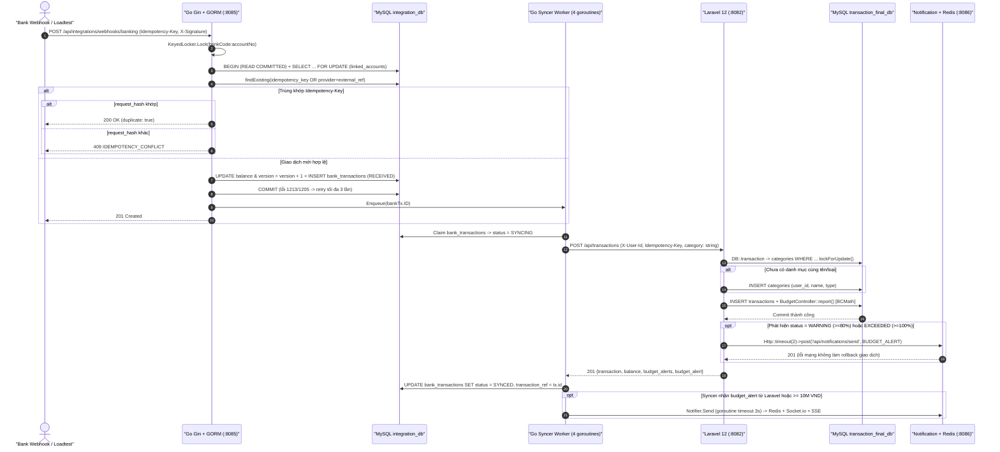

*Hình 2-11: Biểu đồ Tuần tự Đồng bộ Ngân hàng `Gin/GORM` → `Laravel lockForUpdate` → Cảnh báo Ngân sách Kép*

**Phân tích chi tiết Hình 2-11:**
1. **Tiếp nhận đồng thời không sai lệch số dư tại Go Integration:** Giao dịch webhook đi qua `KeyedLocker` (tuần tự hóa theo tài khoản) và giao dịch MySQL `READ COMMITTED` kết hợp `SELECT ... FOR UPDATE`, kiểm tra `request_hash` để trả `200` (trùng lặp hợp lệ) hoặc `409` (xung đột payload), đồng thời cập nhật `balance` và `version = version + 1` trước khi đẩy ID vào hàng đợi `Syncer`.
2. **Đồng bộ sang Laravel 12 & Cảnh báo Ngân sách Kép:** Worker nền gọi `POST /api/transactions` gửi tên `category` dạng chuỗi; Laravel dùng `lockForUpdate()` tạo/lấy đúng danh mục thuộc `user_id`, ghi giao dịch và tính lại hạn mức bằng `BCMath`. Nếu chạm/vượt ngưỡng ngân sách, cả Laravel (`Http::timeout(2)`) và Go `Syncer`/`Notifier` (khi có `budget_alert` hoặc giao dịch `>= 10.000.000 VND`) đều có cơ chế đẩy thông báo không làm nghẽn luồng giao dịch chính.

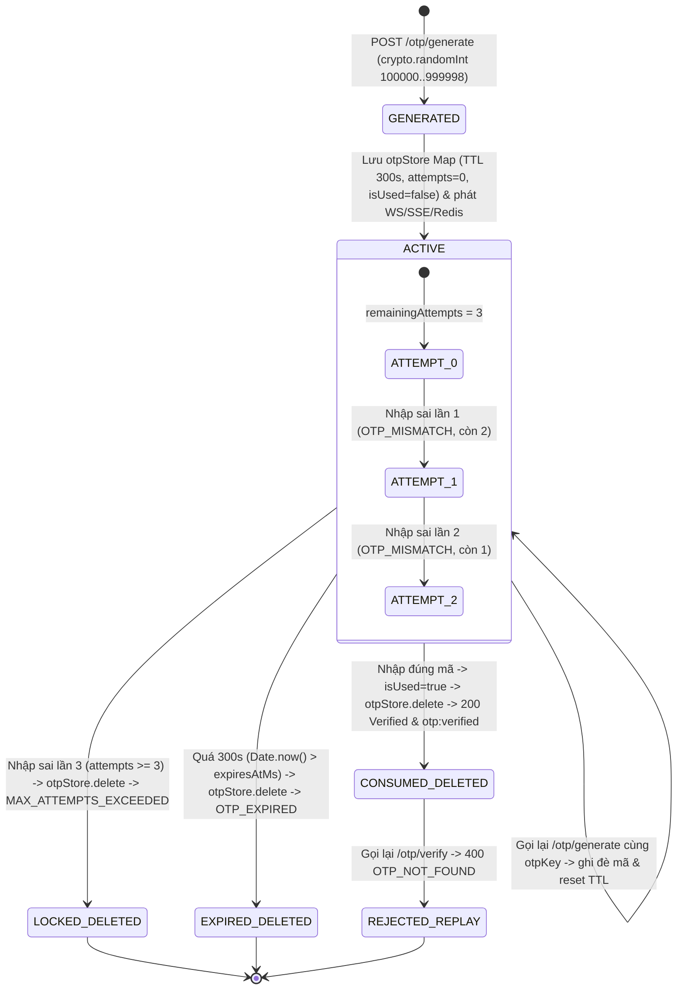

*Hình 2-12: Biểu đồ Máy trạng thái Vòng đời Mã OTP (`otpService.js`)*

**Phân tích chi tiết Hình 2-12:**
1. **Vòng đời hữu hạn & Reset khi sinh mới:** Mã OTP chuyển từ `GENERATED` sang `ACTIVE` trong 300 giây; nếu người dùng yêu cầu sinh lại mã cho cùng `otpKey`, bản ghi mới sẽ ghi đè bản ghi cũ trong `otpStore` và đặt lại bộ đếm `attempts = 0`.
2. **Chuyển tiếp sang 3 trạng thái hủy bỏ:** Mã OTP kết thúc vòng đời bằng lệnh `otpStore.delete(otpKey)` trong ba tình huống: hết hạn 5 phút (`OTP_EXPIRED`), nhập sai lần thứ 3 (`MAX_ATTEMPTS_EXCEEDED`), hoặc xác thực thành công (`CONSUMED_DELETED`). Sau khi bị tiêu hủy, mọi lần gửi lại mã cũ đều trả về `400 OTP_NOT_FOUND` (ngăn phát lại triệt để; nhánh `OTP_ALREADY_USED` trong `otpService.js:106-112` không phát sinh trong luồng thực thi do khóa đã bị xóa ngay ở dòng 144).

**Cơ chế lan truyền `X-Request-Id`:** Khi bất kỳ yêu cầu nào đi qua Express Gateway (`requestTracer.js`), mã `UUID` trong `X-Request-Id` được giữ nguyên ở cả chiều đi (`proxyReq.setHeader('X-Request-Id', req.requestId)`) và chiều về (`res.setHeader('X-Request-Id', requestId)`), đồng thời được in kèm `requestId`, `method`, `path`, `status`, `durationMs` và `userId` vào luồng log JSON chuẩn hóa, cho phép đối chiếu nhanh thời gian xử lý từ biên Gateway tới các microservice phía sau.

---

# CHƯƠNG 3: ĐÓNG GÓI DOCKER PRODUCTION, CI/CD & KIỂM THỬ TOÀN DIỆN

## 3.1. Đóng gói Container chuẩn Production, Điều phối Healthcheck & Pipeline CI/CD

### 3.1.1. Phân tích 7 `Dockerfile` Phiên bản Cuối kỳ

Toàn bộ 7 thành phần ứng dụng đều sử dụng `Dockerfile` chuyên biệt theo chuẩn từng ngôn ngữ và tối ưu kích thước ảnh triển khai:
- **Kiểm thử tự động ngay trong pha Build (`Auth Service`):** `services/auth-service/final/Dockerfile` (dòng 6) sử dụng multi-stage build từ `maven:3.9-eclipse-temurin-17` và thực thi `RUN mvn -B -ntp verify`. Mọi thay đổi mã nguồn làm gãy bộ kiểm thử `AuthApiTest` hoặc `ApiErrorsTest` sẽ chặn đứng quá trình tạo Docker image trước khi xuất xưởng sang runtime `eclipse-temurin:17-jre`.
- **Thực thi với Tài khoản Phi đặc quyền (Non-root User):** Hai dịch vụ xử lý bảo mật nhạy cảm và dữ liệu tài sản áp dụng nguyên tắc đặc quyền tối thiểu (*Least Privilege*): `auth-service` chạy dưới `USER 10001:10001` (`Dockerfile:11`) và `asset-service` chạy dưới `USER app` (`Dockerfile:12`). Ghi nhận trung thực rằng 5 `Dockerfile` còn lại (`gateway`, `transaction`, `analytics`, `integration`, `notification`) hiện vẫn dùng user `root` mặc định của base image Alpine/Slim — đây là hạng mục dễ dàng siết chặt thêm ở bước tối ưu bảo mật hạ tầng.
- **Tự động hóa Migrations & Seeder (`Transaction Service`):** `services/transaction-service/final/Dockerfile` (dòng 10) thực thi chuỗi khởi động `php artisan migrate --force && php artisan db:seed --force && php artisan serve --host=0.0.0.0 --port=8082`, bảo đảm bảng và dữ liệu mẫu trong `transaction_final_db` được khởi tạo nhất quán mỗi khi container khởi chạy trên môi trường mới.
- **Biên dịch nhị phân tĩnh & Thiết lập múi giờ (`Integration Service`):** `services/integration-service/final/Dockerfile` biên dịch tĩnh `CGO_ENABLED=0 GOOS=linux go build -ldflags="-s -w"` trên `golang:1.22-alpine` sang ảnh nhẹ `alpine:3.19` có `tzdata` và `ENV TZ=Asia/Ho_Chi_Minh`.

### 3.1.2. Điều phối 13 Container (`docker-compose.final.yml`), Healthcheck & GitHub Actions CI

Tệp `docker-compose.final.yml` (được tham chiếu bởi entrypoint `docker-compose.yml` qua `include: [docker-compose.final.yml]`) điều phối **13 container** trên mạng bridge **`cashflow-final-net`** và **6 Named Volumes** bền vững.

**Bảng 3.1: Ma trận 13 Container Production, Cổng, Healthcheck & Phân quyền Thực thi (`docker-compose.final.yml`)**

| # | Service Compose | `container_name` | Base / Runtime Image | Cổng Host:Container | `depends_on` | Healthcheck / User |
|---:|---|---|---|---|---|---|
| 1 | `gateway` | `cashflow-gateway-final` | `node:20-alpine` | `8080:8080` | 6 app services (`service_started`) | HTTP `/health/services` |
| 2 | `auth-service` | `cashflow-auth-final` | `eclipse-temurin:17-jre` | `8081:8081` | `auth-db` (`service_healthy`) | `USER 10001:10001` |
| 3 | `transaction-service` | `cashflow-transaction-final` | `php:8.2-cli-alpine` | `8082:8082` | `transaction-db` (`service_healthy`) | `migrate --force && db:seed` |
| 4 | `asset-service` | `cashflow-asset-final` | `dotnet/aspnet:8.0` | `8083:8083` | `asset-db` (`service_healthy`) | `USER app`, `/health/ready` |
| 5 | `analytics-service` | `cashflow-analytics-final` | `python:3.11-slim` | `8084:8084` | `analytics-db` (`service_healthy`), `transaction-service` (`started`) | `lifespan` retry 30×2s |
| 6 | `integration-service` | `cashflow-integration-final` | `alpine:3.19` (`go 1.22`) | `8085:8085` | `integration-db` (`service_healthy`), `tx`/`noti` (`started`) | `TZ=Asia/Ho_Chi_Minh` |
| 7 | `notification-service` | `cashflow-notification-final` | `node:20-alpine` | `8086:8086` | `redis` (`service_healthy`) | Redis Pub/Sub + Fallback |
| 8 | `auth-db` | `cashflow-auth-db-final` | `mysql:8.0` | `3307:3306` | `—` | `SELECT 1 FROM refresh_tokens LIMIT 0` |
| 9 | `transaction-db` | `cashflow-transaction-db-final` | `mysql:8.0` | Internal `:3306` | `—` | `mysqladmin ping` |
| 10 | `asset-db` | `cashflow-asset-db-final` | `mysql:8.0` | Internal `:3306` | `—` | `SELECT 1 FROM asset_history LIMIT 0` |
| 11 | `analytics-db` | `cashflow-analytics-db-final` | `mysql:8.0` | Internal `:3306` | `—` | `mysqladmin ping` |
| 12 | `integration-db` | `cashflow-integration-db-final` | `mysql:8.0` | `3310:3306` | `—` | `mysqladmin ping` |
| 13 | `redis` | `cashflow-redis-final` | `redis:7-alpine` | `6379:6379` | `—` | `redis-cli ping` |

Sơ đồ triển khai vật lý của cụm 13 container và kết nối với PHP Web Host `:3000` được minh họa ở `Hình 3-1`.

*(Mã nguồn sơ đồ: [docs/diagrams/final-01-architecture-and-deployment.md](../diagrams/final-01-architecture-and-deployment.md))*

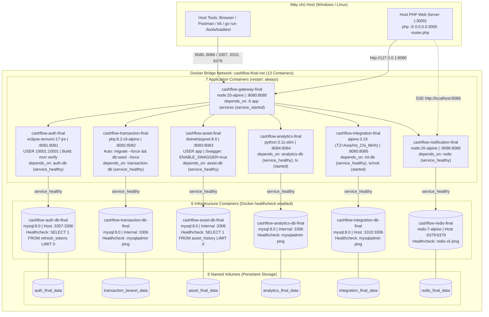

*Hình 3-1: Biểu đồ Triển khai Hạ tầng Docker Compose Production (`cashflow-final-net`)*

**Phân tích chi tiết Hình 3-1:**
1. **Giải quyết triệt để Race Condition khởi động CSDL:** Khác với giai đoạn Giữa kỳ chỉ dùng `depends_on` mặc định, toàn bộ 6 dịch vụ dữ liệu trong `docker-compose.final.yml` đều cấu hình `healthcheck:` kết hợp `condition: service_healthy`. Đặc biệt, `auth-db` và `asset-db` không chỉ kiểm tra `mysqladmin ping` mà truy vấn trực tiếp `SELECT 1 FROM refresh_tokens LIMIT 0` và `SELECT 1 FROM asset_history LIMIT 0`, bảo đảm script `init.sql` đã thực thi hoàn tất trước khi Hibernate (`ddl-auto: validate`) và EF Core khởi động.
2. **Tách biệt phạm vi Healthcheck & Pipeline CI/CD:** Trong `docker-compose.final.yml`, chỉ 6 container hạ tầng có Docker `healthcheck:`, còn 7 container ứng dụng dựa vào `restart: always`, cơ chế retry nội tại (`lifespan` FastAPI / `database.Open` Go) và endpoint tổng hợp `GET /health/services` của Express Gateway. Song song đó, tệp `.github/workflows/ci.yml` định nghĩa workflow `CI/CD Pipeline` (`push` trên `main`/`develop`, `pull_request` trên `main`) chạy job `lint-and-validate` kiểm tra hợp lệ cú pháp cả `docker compose config`, `docker-compose.midterm.yml` và `docker-compose.final.yml`.

> 📸 **[VỊ TRÍ CHÈN HÌNH 3-2: Trạng thái 13 container bản Final (`(healthy)` trên 5 MySQL & Redis)]**
> - **URL / Lệnh thực thi:** `docker compose -f docker-compose.final.yml up -d --build && docker compose -f docker-compose.final.yml ps`
> - **Dữ liệu nhập mẫu / Thao tác:** Chờ khoảng 45–60 giây để 5 MySQL 8.0 và Redis hoàn tất `healthcheck`, sau đó chụp toàn bộ bảng kết quả của lệnh `ps`.
> - **Điểm nhấn cần thấy trên màn hình:** Cả 13 container mang hậu tố `-final` (`cashflow-gateway-final` → `cashflow-redis-final`) ở trạng thái `Up`, trong đó 5 container DB và `cashflow-redis-final` hiển thị nhãn `(healthy)`, kèm các cổng `8080..8086`, `3307`, `3310`, `6379`.

Ảnh chụp `Hình 3-2` chứng minh toàn bộ cụm hạ tầng đa ngôn ngữ khởi động đồng bộ mà không gặp lỗi kết nối sớm tới MySQL 8.0 như giai đoạn trước.

> 📸 **[VỊ TRÍ CHÈN HÌNH 3-3: GitHub Actions CI (`lint-and-validate`) & quá trình build Auth Service (`mvn -B -ntp verify`)]**
> - **URL / Lệnh thực thi:** Tab **Actions** trên GitHub repository (`CI/CD Pipeline`) và output terminal của `docker compose -f docker-compose.final.yml build auth-service`.
> - **Dữ liệu nhập mẫu / Thao tác:** Mở lượt chạy workflow mới nhất cho `.github/workflows/ci.yml` và log biên dịch Maven trong Docker build.
> - **Điểm nhấn cần thấy trên màn hình:** Job `lint-and-validate` đạt dấu tích xanh ở bước `Validate Docker Compose Configuration`, và log Docker build hiển thị `mvn -B -ntp verify` chạy qua các bài test `AuthApiTest`, `ApiErrorsTest` với `0` lỗi trước khi đóng gói `auth-service.jar`.

Ảnh chụp `Hình 3-3` khẳng định quy trình kiểm định cấu hình tự động trên GitHub Actions và chốt chặn kiểm thử ngay trong quá trình đóng gói container Auth.

---

## 3.2. Các vấn đề thực tế khi tích hợp đa Framework & Giải pháp khắc phục

Quá trình nâng cấp đồng loạt 7 thành phần sang các framework công nghiệp phát sinh 6 sự cố tích hợp đặc thù giữa các hệ sinh thái. Bảng `3.2` đúc kết nguyên nhân gốc và giải pháp đã kiểm chứng trực tiếp trong mã nguồn.

**Bảng 3.2: Tổng hợp 6 Sự cố Tích hợp Đa Framework & Giải pháp Khắc phục Thực tế**

| # | Sự cố Thực tế | Nguyên nhân Kỹ thuật | Giải pháp Đã áp dụng trong Mã nguồn Final |
|---:|---|---|---|
| 1 | `auth-service` và `asset-service` từ chối khởi động khi dùng khóa JWT ngắn | `JwtConfig.java` (profile `prod`) và `Program.cs` bắt buộc `JWT_SECRET >= 32` UTF-8 bytes và chặn khóa mặc định giữa kỳ | Chuẩn hóa khóa mặc định **50 ký tự / 50 UTF-8 bytes** (`cashflow-final-production-jwt-secret-key-2026-tdtu`) đồng bộ xuyên suốt Gateway, Auth và Asset trong `docker-compose.final.yml`. |
| 2 | Lỗi `Public Key Retrieval is not allowed` trên Spring Boot HikariCP | Chính sách xác thực mặc định `caching_sha2_password` của MySQL 8.0 từ chối trao đổi khóa công khai qua kết nối không SSL nội bộ | Khai báo tường minh `DB_ALLOW_PUBLIC_KEY_RETRIEVAL=true` trong `docker-compose.final.yml` (dòng 68) truyền vào chuỗi JDBC URL trong `application.yml`. |
| 3 | Treo request `POST`/`PUT` qua Gateway & đứt kết nối WebSocket `/socket.io` | Gắn `express.json()` trước `http-proxy-middleware` làm tiêu thụ hết stream body; kết nối WS cần xử lý bắt tay HTTP `101 Switching Protocols` | Loại bỏ `express.json()` trước proxy trong `gateway/final/src/app.js` (dòng 116) và đăng ký `server.on('upgrade', proxy.upgrade)` trong `index.js` (dòng 12–16). |
| 4 | Bất đồng hợp đồng dữ liệu liên dịch vụ (Go – Laravel – FastAPI) | Analytics gửi `limit` hoặc cần định dạng ngày đồng nhất; Go gửi tên `category` dạng chuỗi thay vì `category_id` và cần đọc `budget_alert` | `TransactionController.php` chấp nhận `limit 1..500` và tự tìm/tạo `category` theo tên chuỗi (`dòng 100-119`), trả cả `budget_alerts` lẫn `budget_alert`; FastAPI dùng phân trang `limit = 100` (`main.py:174`). |
| 5 | Xung đột cổng, tên container và schema cũ khi chuyển từ Midterm sang Final | Laravel 12 dùng cấu trúc `categories` mới (có `user_id`) không tương thích `transaction_db` giữa kỳ | Tách biệt hoàn toàn tên container (`-final`), mạng (`cashflow-final-net`), 6 Named Volumes mới và dùng CSDL riêng `transaction_final_db` cho Laravel. |
| 6 | Rủi ro gãy giao dịch tài chính khi Notification hoặc Redis tạm gián đoạn | Gọi HTTP cảnh báo ngân sách đồng bộ có thể làm rollback `DB::transaction`, hoặc mất Redis làm sập Notification | Laravel bọc `Http::timeout(2)` trong `try/catch (\Throwable)` sau khi commit transaction (`TransactionController.php:170-181`); Go `Notifier` chạy goroutine riêng timeout 3s; `ioredis` tự chuyển về In-Memory fallback. |

---

## 3.3. Kiểm thử Tự động Đa tầng, Swagger UI, OTP Workflow & Concurrency Loadtest

Chiến lược kiểm chứng chất lượng bản Cuối kỳ được triển khai theo **3 tầng độc lập** (`Bảng 3.3`), kết hợp kiểm thử nội bộ ở từng framework, kiểm thử tích hợp qua hệ thống Swagger UI đa điểm và kiểm thử tải đồng thời.

**Bảng 3.3: Tổng hợp Bộ Kiểm thử Tự động Đa tầng (`gateway/final` & `services/*/final`)**

| Tầng | Bộ Kiểm thử / Công cụ | Tệp Nguồn & Lệnh Chạy | Phạm vi & Khẳng định Trọng tâm |
|---:|---|---|---|
| **Tầng 1** | **Spring Boot Unit & Integration** | `AuthApiTest.java` (10 test methods / 14 cases) + `ApiErrorsTest.java` (2 test methods) — `mvn -f services/auth-service/final/pom.xml test` | JUnit 5 + MockMvc + H2 (`MODE=MySQL`): chuẩn hóa email, ép role `USER`, chặn tự nâng quyền, `dummyHash`, `sha256:` refresh token, thu hồi khi đổi mật khẩu/khóa, `ROLE_ADMIN` RBAC (`403`), DB `503` error masking (tổng 18 lượt thực thi ghi nhận trong `MIGRATION_REPORT.md`, 0 lỗi). |
| **Tầng 1** | **Laravel PHPUnit Feature Tests** | `services/transaction-service/final/tests/Feature/CashflowTest.php` (5 test methods) — `php artisan test` | PHPUnit `^11.5.3` + `RefreshDatabase` + SQLite `:memory:`: CRUD giao dịch & số dư `BCMath`, biên ngân sách Quý & năm nhuận (`2028-02-29`), cảnh báo `WARNING`/`EXCEEDED`/`SAFE`, cô lập IDOR giữa 2 user, bảo vệ `409` khi xóa/đổi loại danh mục đang dùng, `401`/`422`. |
| **Tầng 1** | **Go Unit & Race Detection** | `services/integration-service/final/internal/handlers/integration_test.go` (8 hàm `Test*`) — `go test -race ./...` | `TestKeyedLockerSameKey` (500 goroutines), `TestKeyedLockerDifferentKeysRunInParallel`, `TestMoneyPrecision`, `TestNormalizeWebhook`, `TestValidSignature` (HMAC-SHA256), kiểm tra Gin router (`503`/`405`/`404`/`422`/`401`/`400`). |
| **Tầng 2** | **Swagger UI Đa điểm & Postman** | Gateway `:8080/docs`, Asset `:8083/swagger`, Analytics `:8084/docs`, `Asset-Final.postman_collection.json` (33 requests) & `Postman_Collection_All_Services.json` (33 requests) | Kiểm thử tương tác `/health/services`, Auth + `X-Request-Id`, quy trình **OTP 6 số** đầy đủ, và 5 API tài chính mới của Asset Final *(lưu ý: `gateway/final/src/openapi/asset.json` chưa liệt kê 5 API mới nên cần test trực tiếp tại `:8083/swagger` hoặc collection riêng của Asset)*. |
| **Tầng 3** | **Go Concurrency Loadtest, `k6`, Newman** | `go run ./tools/loadtest -url http://localhost:8085 -account 1 -n 200 -dup 3 -c 50`, `k6 run scripts/concurrency-test-k6.js`, `newman run ...` | Bắn `600` webhook xáo trộn trên `50` workers kiểm chứng `balanceAfter == expected && errCount == 0`; `k6` tải 50→200 VUs; Newman xuất báo cáo CLI/HTML. |

> *(Ghi chú trung thực về phạm vi test của Asset Service: tệp `services/asset-service/final/README.md` từng nhắc tới `Tests/AssetService.Tests.csproj`, tuy nhiên thư mục `Tests/` không tồn tại trong repo và `AssetService.csproj` dòng 13 chủ động loại trừ `Tests/**/*.cs`; thay vào đó, toàn bộ 23 endpoint của Asset Service được kiểm chứng bằng bộ 33 requests `Asset-Final.postman_collection.json` và Swagger UI `:8083/swagger`.)*

> 📸 **[VỊ TRÍ CHÈN HÌNH 3-4: Kết quả Kiểm thử Đơn vị & Tích hợp Tầng 1 (`JUnit 5`, `PHPUnit`, `go test -race`)]**
> - **URL / Lệnh thực thi:** Chạy tuần tự 3 lệnh: (1) `mvn -f services/auth-service/final/pom.xml test`, (2) `php services/transaction-service/final/artisan test`, (3) `cd services/integration-service/final && go test -race -v ./...`
> - **Dữ liệu nhập mẫu / Thao tác:** Thực thi trực tiếp trong terminal của từng service mà không cần sửa cấu hình.
> - **Điểm nhấn cần thấy trên màn hình:** Kết quả `Tests run: ..., Failures: 0, Errors: 0` từ Maven/JUnit 5; toàn bộ 5 test methods của `CashflowTest` (`PASS`) trong PHPUnit; và 8 hàm `Test*` (`PASS` dưới cờ `-race`) của Go Integration.

Ảnh chụp `Hình 3-4` xác nhận chất lượng logic nội bộ của cả ba dịch vụ xương sống (xác thực, giao dịch tiền tệ và đồng thời ngân hàng) đều đạt chuẩn không lỗi và không rò rỉ race condition.

> 📸 **[VỊ TRÍ CHÈN HÌNH 3-5: Swagger UI Tổng hợp (`:8080/docs`) & Kết quả `GET /health/services` (`ALL_SERVICES_UP`)]**
> - **URL / Lệnh thực thi:** Trình duyệt mở `http://localhost:8080/docs` và thực thi `GET http://localhost:8080/health/services` (hoặc trên Postman).
> - **Dữ liệu nhập mẫu / Thao tác:** Nhấn **Try it out** trên Gateway hoặc gọi `curl -i http://localhost:8080/health/services`.
> - **Điểm nhấn cần thấy trên màn hình:** Giao diện Swagger UI tổng hợp kèm thanh đăng nhập nhanh Bearer JWT ở đầu trang; phản hồi JSON từ `/health/services` trả HTTP `200 OK`, `"overallStatus": "ALL_SERVICES_UP"` và mảng 6 dịch vụ (`auth`, `transaction`, `asset`, `analytics`, `integration`, `notification`) đều ở trạng thái `"UP"` kèm `latencyMs`.

Ảnh chụp `Hình 3-5` minh chứng điểm quan sát tập trung (*Observability*) tại API Gateway hoạt động chính xác cho toàn bộ 6 microservices phía sau.

> 📸 **[VỊ TRÍ CHÈN HÌNH 3-6: Đăng nhập JWT, Header `X-Request-Id` & Bảng `auth_db.refresh_tokens` (`sha256:`)]**
> - **URL / Lệnh thực thi:** `POST http://localhost:8080/api/auth/login` và truy vấn SQL trên `cashflow-auth-db-final` (`docker exec -it cashflow-auth-db-final mysql -uroot -proot_password auth_db -e "SELECT id, user_id, LEFT(token, 28) AS token_prefix, expiry_date FROM refresh_tokens;"`).
> - **Dữ liệu nhập mẫu / Thao tác:** Đăng nhập tài khoản `member1` / `password123`; dùng `accessToken` trả về gọi `GET http://localhost:8080/api/profile`.
> - **Điểm nhấn cần thấy trên màn hình:** Response header chứa `X-Request-Id` (định dạng UUID) và `X-Proxied-By: CashFlow-Express-Gateway-Final`; bảng `refresh_tokens` hiển thị giá trị bắt đầu bằng tiền tố `sha256:` thay vì chuỗi token thô; log container Gateway in dòng JSON chứa cùng `requestId` và `durationMs`.

Ảnh chụp `Hình 3-6` kiểm chứng cả tính năng truy vết phân tán xuyên tầng lẫn cơ chế băm `SHA-256` bảo vệ Refresh Token dưới CSDL.

> 📸 **[VỊ TRÍ CHÈN HÌNH 3-7: Thực nghiệm Trọn vẹn Quy trình OTP 6 số (`generate`, Realtime Push, `verify`, Replay & `MAX_ATTEMPTS_EXCEEDED`)]**
> - **URL / Lệnh thực thi:** `POST http://localhost:8080/api/notifications/otp/generate` và `POST http://localhost:8080/api/notifications/otp/verify` (kết hợp mở sẵn luồng SSE `/api/notifications/stream?user_id=2` hoặc Socket.io client kết nối `/socket.io` vào phòng `user:2`).
> - **Dữ liệu nhập mẫu / Thao tác:**
>   1. Gửi `{"userId": 2, "action": "PAYMENT", "transactionId": 9001, "amount": 2500000}` tới `/otp/generate` → ghi nhận `debugOtp` và thông báo realtime `otp:received` / SSE.
>   2. Gửi đúng mã `otp` tới `/otp/verify` → nhận `200 OK` (`verified: true`) và sự kiện `otp:verified`.
>   3. Gửi lại chính yêu cầu `/otp/verify` lần 2 (Replay) → nhận `400 OTP_NOT_FOUND` (do mã đã bị `otpStore.delete()` tiêu hủy sau lần đầu).
>   4. Sinh mã mới cho `transactionId: 9002`, gửi sai mã `"000000"` 3 lần liên tiếp → lần 1–2 trả `OTP_MISMATCH` (`remainingAttempts: 2` → `1`), lần 3 trả `400 MAX_ATTEMPTS_EXCEEDED`.
> - **Điểm nhấn cần thấy trên màn hình:** Đầy đủ 4 phản hồi HTTP (`201`, `200`, `400 OTP_NOT_FOUND`, `400 MAX_ATTEMPTS_EXCEEDED`) cùng thông báo `OTP_VERIFICATION` và `Xác thực OTP thành công` trên luồng realtime.

Ảnh chụp `Hình 3-7` chứng minh quy trình OTP 6 chữ số hoạt động đúng đặc tả Single-use, có TTL 300s, khóa sau 3 lần sai và phát sóng tức thời qua kênh kép.

> 📸 **[VỊ TRÍ CHÈN HÌNH 3-8: Thực nghiệm các API Asset Final trên `:8083/swagger` (`/valuation`, `/history`, `/schedule`, `/investments/summary`)]**
> - **URL / Lệnh thực thi:** `http://localhost:8083/swagger` (hoặc chạy collection `services/asset-service/final/docs/Asset-Final.postman_collection.json`).
> - **Dữ liệu nhập mẫu / Thao tác:** Nhập `Bearer <accessToken>` của `admin` (`user_id = 1`), thử nghiệm lần lượt: `GET /api/assets/3/valuation?as_of=2026-12-31`, `GET /api/assets/3/history`, `GET /api/loans/1/schedule` và `GET /api/investments/summary`.
> - **Điểm nhấn cần thấy trên màn hình:** Swashbuckle UI hiển thị đầy đủ 23 endpoint của Asset Final; kết quả `/valuation` trả phương pháp `STRAIGHT_LINE_ACTUAL_DAYS`; `/schedule` trả đủ 12 kỳ trả góp cân bằng dư nợ về `0`; `/investments/summary` trả tổng `profit_loss` và `roi`.

Ảnh chụp `Hình 3-8` xác nhận các nghiệp vụ tính toán tài chính nâng cao bằng ASP.NET Core 8 & EF Core 8 hoạt động chính xác.

> 📸 **[VỊ TRÍ CHÈN HÌNH 3-9: Kiểm thử Tải Đồng thời Go `tools/loadtest` (`600` requests, `50` workers, sai lệch `0` đồng), `k6` & Newman Report]**
> - **URL / Lệnh thực thi:**
>   - `cd services/integration-service/final && go run ./tools/loadtest -url http://localhost:8085 -account 1 -n 200 -dup 3 -c 50`
>   - `newman run docs/api-docs/Postman_Collection_All_Services.json -e docs/api-docs/Postman_Environment.json --color on`
>   - `k6 run scripts/concurrency-test-k6.js` *(lưu ý script `k6` mẫu gửi `/api/transactions` không gắn token nên cần truyền thêm header JWT nếu muốn đo luồng có xác thực thay vì nhánh `401`)*
> - **Dữ liệu nhập mẫu / Thao tác:** Chạy `loadtest` bắn `200` giao dịch × `3` bản sao trùng lặp (`600` requests) với `50` goroutine đồng thời vào tài khoản `id=1`.
> - **Điểm nhấn cần thấy trên màn hình:** Tổng kết của `tools/loadtest` hiển thị `errCount=0`, `balanceAfter == expected` (sai lệch `0` VND), phân bố `201 Created`, `200 Duplicate`, độ trễ `p50`/`p95` và thông lượng req/s; bảng tổng kết Newman hiển thị các assertion đạt chuẩn.

Ảnh chụp `Hình 3-9` là minh chứng định lượng trực tiếp cho yêu cầu xử lý Concurrency và Idempotency mức 9.5–10.0 của Rubric Cuối kỳ.

---

## 3.4. Kiểm thử Tích hợp trên Giao diện Web iBanking (`:3000`) & Đối chiếu CSDL

Một thành tựu kiến trúc quan trọng của giai đoạn Cuối kỳ là **thay thế nóng toàn bộ tầng Backend từ 100% Native sang 7 Frameworks** trong khi giao diện Web PHP (`frontend/`, khởi chạy bằng `run-frontend.bat` tại `http://localhost:3000`) vẫn giữ nguyên cấu hình `GATEWAY_URL = http://127.0.0.1:8080` và `NOTIFICATION_URL = http://localhost:8086` (`frontend/includes/config.php`) mà không phải sửa đổi hợp đồng giao tiếp REST hay SSE.

> 📸 **[VỊ TRÍ CHÈN HÌNH 3-10: Giao diện Web iBanking (`:3000`) — Dashboard & Sổ Giao dịch vận hành trên Backend Laravel 12 + ASP.NET Core 8]**
> - **URL / Lệnh thực thi:** Chạy `run-frontend.bat` và truy cập `http://localhost:3000/login.php` → `index.php` → `transactions.php` → `budgets.php` → `assets.php`.
> - **Dữ liệu nhập mẫu / Thao tác:** Đăng nhập bằng tài khoản `member1` / `password123` (hoặc `admin` / `password123`), tạo mới một khoản chi tiêu vượt ngưỡng ngân sách trên `transactions.php` và thiết lập một ngân sách `QUARTERLY` trên `budgets.php`.
> - **Điểm nhấn cần thấy trên màn hình:** Số dư tổng hợp từ Laravel `BCMath` (`/api/balance`), biểu đồ Chart.js từ FastAPI (`/api/analytics/...`), danh mục riêng của user và dữ liệu tài sản/Net Worth từ ASP.NET Core 8 hiển thị đồng bộ, mượt mà.

> 📸 **[VỊ TRÍ CHÈN HÌNH 3-11: Giao diện Web iBanking (`:3000`) — Kênh Thông báo SSE Realtime & Đồng bộ Ngân hàng]**
> - **URL / Lệnh thực thi:** Mở `http://localhost:3000/banking.php` và `http://localhost:3000/notifications.php` (bật DevTools Network tab theo dõi kết nối `EventStream`).
> - **Dữ liệu nhập mẫu / Thao tác:** Thực hiện kích hoạt mô phỏng Webhook ngân hàng (`POST /api/integrations/webhooks/banking` hoặc nút đồng bộ trên UI) với giao dịch lớn `>= 10.000.000 VND` hoặc giao dịch làm vượt ngưỡng ngân sách.
> - **Điểm nhấn cần thấy trên màn hình:** Kết nối SSE tới `:8086/api/notifications/stream` nhận tức thời sự kiện `BUDGET_ALERT` / `LARGE_TRANSACTION` và chuông thông báo trên thanh điều hướng tự động cập nhật số lượng chưa đọc.

> 📸 **[VỊ TRÍ CHÈN HÌNH 3-12: Đối chiếu Dữ liệu Thực tế trên các Database Container (`transaction_final_db`, `asset_db.asset_history`, `integration_db`)]**
> - **URL / Lệnh thực thi:** Truy vấn CLI vào các container DB bản Final:
>   - `docker exec -it cashflow-transaction-db-final mysql -uroot -proot_password transaction_final_db -e "SHOW TABLES; SELECT id, user_id, name, type FROM categories;"`
>   - `docker exec -it cashflow-asset-db-final mysql -uroot -proot_password asset_db -e "SELECT * FROM asset_history ORDER BY id DESC LIMIT 5;"`
>   - `docker exec -it cashflow-integration-db-final mysql -uroot -proot_password integration_db -e "SELECT id, bank_code, balance, version FROM linked_accounts;"`
> - **Dữ liệu nhập mẫu / Thao tác:** Chụp kết quả truy vấn sau khi thực hiện các kịch bản ở `Hình 3-8`, `Hình 3-9` và `Hình 3-10`.
> - **Điểm nhấn cần thấy trên màn hình:** `transaction_final_db` có đủ 3 bảng nghiệp vụ + các bảng migration Laravel và cột `user_id` trong `categories`; `asset_history` ghi nhận các mốc biến động giá trị tài sản; `linked_accounts.version` tăng tương ứng với số lần cập nhật số dư thành công.

> 📸 **[VỊ TRÍ CHÈN HÌNH 3-13: Nhật ký JSON Structured Logging (`X-Request-Id`) tại Express Gateway & Graceful Shutdown trên Go Integration]**
> - **URL / Lệnh thực thi:** `docker compose -f docker-compose.final.yml logs --tail=30 gateway` và `docker compose -f docker-compose.final.yml stop integration-service && docker compose -f docker-compose.final.yml logs --tail=15 integration-service`.
> - **Dữ liệu nhập mẫu / Thao tác:** Quan sát luồng log sau khi chạy kiểm thử API và khi gửi tín hiệu dừng container `cashflow-integration-final`.
> - **Điểm nhấn cần thấy trên màn hình:** Log Gateway in từng dòng JSON có đủ `"requestId"`, `"method"`, `"path"`, `"status"`, `"durationMs"`, `"userId"`; log Integration xác nhận rút cạn worker an toàn (`syncer.Wait()`) trước khi thoát.

Bốn nhóm ảnh chụp thực nghiệm `Hình 3-10` → `Hình 3-13` khép lại chu trình kiểm chứng từ giao diện người dùng cuối, tầng lưu trữ vật lý trên 5 MySQL 8.0 đến khả năng vận hành bền vững ở tầng log và tắt container an toàn.

---

# CHƯƠNG 4: ĐÁNH GIÁ TỔNG KẾT ĐỒ ÁN & HƯỚNG PHÁT TRIỂN

## 4.1. Tổng kết kết quả đạt được & Đối chiếu Tiêu chí Chấm điểm Cuối kỳ (Rubric 10.0)

Phiên bản Cuối kỳ **SOA-CashFlow** đã hoàn thành chuyển đổi toàn diện 7 thành phần (Express Gateway + 6 Framework Microservices) trên 6 ngôn ngữ lập trình khác nhau, đáp ứng đầy đủ các tiêu chí cốt lõi và tiêu chí nâng cao của học phần CS504070. Bảng `4.1` đối chiếu chi tiết từng tiêu chí chấm điểm và các điều kiện giới hạn điểm theo chuẩn Rubric 10.0.

**Bảng 4.1: Ma trận Đối chiếu Tiêu chí Chấm điểm Cuối kỳ (Rubric 10.0 & Ngưỡng Giới hạn Điểm CS504070)**

| Tiêu chí Rubric / Ngưỡng Giới hạn | Điểm Tối đa | Bằng chứng Hiện thực Thực tế trong `SOA-CashFlow` (Final) | Mức Đạt |
|---|---:|---|---|
| **1. Phân tích nghiệp vụ & UML** (Use Case 6 services + ERD thực thể/khóa/quan hệ) | `1.0đ` | Hoàn chỉnh `final-02-usecase-and-otp.md` (`.puml` kèm Mermaid, có OTP & 5 API Asset mới) và `final-04-erd-database-per-service.md` (5 DB độc lập, không FK chéo DB, Data Dictionary đầy đủ). | **1.0 / 1.0** |
| **2. Kiến trúc Microservices** (Sơ đồ, 6 services + Data Ownership riêng, giao tiếp REST/MQ/Realtime) | `1.5đ` | `final-01-architecture-and-deployment.md`, 5 MySQL 8.0 + Redis 7 (`ioredis`), Express Gateway (`:8080`), giao tiếp đồng bộ (REST + `X-Request-Id`), bất đồng bộ (Go `Syncer` + `BUDGET_ALERT`), WS Socket.io + SSE. | **1.5 / 1.5** |
| **3. Thiết kế REST API** (URI/Method RESTful, Req/Res, Status Codes, Validation & Error Handling) | `1.0đ` | Đầy đủ API 6 dịch vụ; chuẩn hóa lỗi (`ApiErrors`, `ExceptionMiddleware`, `@app.exception_handler`, `httpx.Fail`, Laravel JSON validation `422`/`409`); Swagger UI `:8080/docs`, `:8083/swagger`, `:8084/docs`. | **1.0 / 1.0** |
| **4. Database & Data Persistence** (6 services phù hợp, Constraints & Seed data) | `1.0đ` | 5 CSDL MySQL 8.0 (`utf8mb4_unicode_ci`) + Redis 7; Laravel Migrations & Idempotent `DatabaseSeeder`; `asset_db` có 4 `CHECK CONSTRAINT`; `integration_db` có `UNIQUE KEY` + `CHECK`; `auth_db` có PBKDF2 seed & `sha256:` token. | **1.0 / 1.0** |
| **5. Hiện thực Chức năng & Workflows** (6 ngôn ngữ/frameworks, **OTP 6 số** & Realtime) | `2.0đ` | Đủ 6 frameworks trên 6 ngôn ngữ (Java Spring Boot, PHP Laravel 12, C# ASP.NET Core 8, Python FastAPI, Go Gin+GORM, Node.js Express+Socket.io); quy trình **OTP 6 số** (`crypto.randomInt`, TTL 300s, Single-use, khóa 3 lần sai, phát Socket.io + SSE). | **2.0 / 2.0** |
| **6. Transaction & Concurrency** (Nhất quán thu/chi, xử lý ghi đồng thời, Idempotency đồng bộ bên thứ 3) | `1.5đ` | Laravel `DB::transaction` + `lockForUpdate()` + `BCMath`; Go `KeyedLocker` + GORM `READ COMMITTED` `FOR UPDATE` + retry `1213`/`1205` + Idempotency 3 lớp; Spring Boot `findForUpdate`; ASP.NET `IsConcurrencyToken()` + `RepeatableRead`. | **1.5 / 1.5** |
| **7. Phân chia công việc & Mã nguồn cá nhân** (Làm chủ ngôn ngữ/framework được phân công) | `0.5đ` | Ranh giới thư mục, ngôn ngữ, framework và commit/đóng góp tách bạch rõ cho 6 thành viên (`Bảng 1.3` & Phụ lục 6 thành viên). | **0.5 / 0.5** |
| **8. Documentation, Deployment & Demo** (Docs, Docker Compose, Automated Test & Loadtest) | `1.5đ` | `Bao-Cao-Giua-Ky.md`, `Bao-Cao-Cuoi-Ky.md`, 10 file sơ đồ chuẩn hóa, `docker-compose.final.yml` (13 containers, DB/Redis `service_healthy`), `.github/workflows/ci.yml`, `JUnit 5`, `PHPUnit`, `go test -race`, `tools/loadtest`, `Newman`, `k6`. | **1.5 / 1.5** |
| **Tiêu chí Nâng cao Mức 9.5 – 10.0** (OTP, Integration/E2E, Concurrency Test, Idempotency, API Gateway, Logging/Tracing) | Mức **10.0** | Đạt trọn vẹn toàn bộ giải pháp nâng cao: Express Gateway (`authGuard` + `rateLimit` + `/health/services` + WS Upgrade), Distributed Tracing `X-Request-Id` + JSON Logging, `AuthApiTest`/`CashflowTest`/`integration_test.go`, `tools/loadtest` 600 reqs (`0` đồng sai lệch). | **Đạt trọn vẹn** |
| **Kiểm tra Ngưỡng Giới hạn Điểm** *(Penalty Caps: không chạy được `4.0`, monolithic `6.5`, thiếu 6 ngôn ngữ `7.0`, **thiếu OTP `7.0`**, thiếu Concurrency `7.5`, thiếu sơ đồ Microservices `8.0`)* | Không bị giới hạn | Hệ thống khởi chạy đầy đủ qua Docker Compose + PHP Web, phân rã 6 services + 6 ngôn ngữ + 7 frameworks, có OTP 6 số, có Concurrency/Idempotency 2 tình huống và có đầy đủ bộ sơ đồ Microservices. | **Vượt qua 100%** |

---

## 4.2. Đánh giá Kỹ thuật (Ưu điểm nổi bật & Hạn chế còn tồn tại)

### 4.2.1. Ưu điểm Nổi bật

1. **Kiến trúc Polyglot Microservices chuẩn mực trên 7 Frameworks công nghiệp:** Mỗi dịch vụ phát huy đúng thế mạnh của hệ sinh thái (Spring Security + HikariCP cho Auth, `BCMath` + `DB::transaction` cho Transaction, EF Core 8 `decimal` + `RepeatableRead` cho Asset, Pydantic v2 + FastAPI cho Analytics, Go `KeyedLocker` + GORM `FOR UPDATE` cho Webhook tải cao, Socket.io 4 + `ioredis` cho Realtime & OTP) mà vẫn bảo toàn 100% tương thích với Frontend Web PHP `:3000`.
2. **Bảo mật đa tầng (Defense-in-Depth) & An toàn mật mã:** Kết hợp kiểm tra JWT `HS256` ở biên Gateway (`authGuard` xóa header giả mạo) với xác thực lại độc lập tại Spring Boot Auth (đối chiếu trạng thái `ACTIVE`/`role` trực tiếp từ DB) và ASP.NET Core Asset (`ClockSkew = Zero`, `CurrentUser.Resolve()`), đi kèm PBKDF2 `210.000` vòng + `dummyHash`, Refresh Token băm `SHA-256` và OTP 6 chữ số Single-use.
3. **Độ tin cậy Giao dịch & Khả năng Quan sát cao:** Toàn bộ phép tính tiền tệ tránh hoàn toàn số thực (`BCMath`, `int64 Money`, C# `decimal`), khóa bi quan & khóa lạc quan phối hợp chống Race Condition, truy vết `X-Request-Id` xuyên dịch vụ, `/health/services` giám sát tập trung và 3 tầng kiểm thử tự động thực chất.

### 4.2.2. Hạn chế Còn tồn tại (Ghi nhận Trung thực từ Mã nguồn)

1. **Lưu trữ OTP và Thông báo trên RAM (`otpStore`, `store`):** Notification & OTP Service lưu `otpStore` (`Map`) và mảng `notifications` trong bộ nhớ tiến trình Node.js. Nếu mở rộng ngang (*Scale-out*) nhiều replica Notification Service hoặc khởi động lại container, mã OTP đang chờ xác thực và lịch sử thông báo phát sinh trong phiên sẽ bị mất; đồng thời `otpController.js` hiện đọc `userId` từ `req.body` chứ chưa khóa chặt theo `X-User-Id` từ JWT, và cơ chế publish Redis trong `createOtp()` tạo vòng lặp cộng thêm bản ghi thông báo khi Redis đang kết nối.
2. **Khóa `KeyedLocker` mang phạm vi đơn tiến trình (In-Process):** Dù lớp CSDL phía dưới đã có `SELECT ... FOR UPDATE` (`READ COMMITTED`) và 2 `UNIQUE KEY` (`uq_idempotency_key`, `uq_provider_ref`) bảo vệ tuyệt đối khi chạy đa instance, tầng `KeyedLocker` của Go chỉ điều phối giữa các goroutine trong cùng 1 container; khi scale nhiều replica Go Integration, lượng kết nối chờ lock sẽ dồn trực tiếp xuống MySQL `integration_db`.
3. **Phạm vi Healthcheck, Non-root Container & OpenAPI Gateway:** Trong `docker-compose.final.yml`, mới có 5 MySQL và Redis cấu hình Docker `healthcheck:`, và mới có 2/7 Dockerfile (`auth-service`, `asset-service`) thiết lập non-root `USER`; ngoài ra tệp `gateway/final/src/openapi/asset.json` chưa cập nhật 5 API mới của Asset Final (dù Gateway vẫn proxy bình thường và `:8083/swagger` hiển thị đủ) và `gateway/final/src/openapi/transaction.json` chưa khai báo một số route phụ như `/api/balance`.

---

## 4.3. Hướng phát triển lên Kiến trúc Cloud-Native quy mô lớn

Để đưa **SOA-CashFlow** từ quy mô đồ án Docker Compose đơn máy chủ lên môi trường **Cloud-Native** chịu tải cao và sẵn sàng mở rộng đa node, nhóm đề xuất lộ trình 3 giai đoạn trong `Bảng 4.2`.

**Bảng 4.2: Lộ trình Nâng cấp Hệ thống lên Kiến trúc Cloud-Native**

| Giai đoạn | Hạng mục Nâng cấp | Giải pháp Kỹ thuật Đề xuất | Lợi ích Đạt được |
|---:|---|---|---|
| **1. Bền vững Trạng thái & Hàng đợi** | Phân tán hóa OTP, Notification & Tác vụ nền | Chuyển `otpStore` sang **Redis Atomic Lua Script** (`SET key val EX 300 NX` + đếm sai nguyên tử); lưu lịch sử thông báo xuống **MongoDB/MySQL**; thay kênh giao tiếp Go→Laravel và gửi Email/SMS OTP thật qua **RabbitMQ / BullMQ** có Dead-Letter Queue (DLQ); nâng `KeyedLocker` lên **Redis Redlock** khi chạy nhiều replica Go. | Loại bỏ điểm lỗi đơn (SPOF) trên RAM, hỗ trợ scale ngang đa replica Notification và gửi Email/SMS thực tế. |
| **2. Quan sát Tập trung (Observability)** | Tracing, Metrics & Centralized Logging | Tích hợp chuẩn **OpenTelemetry** (W3C `traceparent` kết hợp `X-Request-Id`) xuất về **Jaeger/Tempo**; thu thập chỉ số HTTP/JVM/Go/DB Pool qua **Prometheus + Grafana**; gom log JSON từ Express Gateway và 6 dịch vụ về **ELK / Grafana Loki**. | Truy vết toàn trình từng request qua nhiều ngôn ngữ và phát hiện nút thắt hiệu năng theo thời gian thực. |
| **3. Bảo mật Hạ tầng & Điều phối Kubernetes** | Hardening Container, CI/CD & K8s | Thiết lập non-root `USER` và Docker `HEALTHCHECK` cho cả 7 service; mở rộng GitHub Actions chạy đủ `mvn verify`, `php artisan test`, `go test -race` và `dotnet build`; đóng gói **Helm Charts** triển khai trên **Kubernetes** với **Horizontal Pod Autoscaler (HPA)**, **Ingress Controller (TLS)** và quản lý khóa bí mật qua **Vault / External Secrets**. | Đáp ứng chuẩn bảo mật container Production, tự động co giãn tải và triển khai Zero-downtime Rolling Update. |

---

# PHỤ LỤC PHÂN CHIA CÔNG VIỆC CHI TIẾT (6 THÀNH VIÊN)

1. **Nguyễn Văn Duy — MSSV: `52400010`** *(Nhóm trưởng)*
   - **Tỷ lệ đóng góp:** `20%`
   - **Kiến trúc Tổng thể & API Gateway (`gateway/final`):** Thiết kế kiến trúc nâng cấp 7 Frameworks; xây dựng Express 4 API Gateway (`app.js`, `index.js`, `config.js`) tích hợp `requestTracer` (`X-Request-Id` + `process.hrtime.bigint()`), `express-rate-limit` (600 req/phút), tổng hợp `GET /health/services` (`AbortController` 3s), `authGuard` (`jsonwebtoken` `HS256`), `docsRoutes` Swagger UI và `http-proxy-middleware` v3 kèm WebSocket Upgrade `/socket.io`.
   - **Notification & OTP Service (`services/notification-service/final`), DevOps & Frontend Compatibility:** Hiện thực Notification Service bằng Express 4 + Socket.io 4 (`user:<id>` rooms) + SSE + `ioredis` Pub/Sub (`cashflow:notifications`, `cashflow:events`); xây dựng quy trình OTP 6 chữ số (`otpService.js`, `otpController.js`, `otpRoutes.js`); hoàn thiện `docker-compose.final.yml`, `.github/workflows/ci.yml` và kiểm thử tương thích ngược toàn diện trên PHP Web `:3000`.
   - **Chữ ký xác nhận:** `Nguyễn Văn Duy`

2. **Nguyễn Trọng Phúc — MSSV: `52400028`**
   - **Tỷ lệ đóng góp:** `16%`
   - **Auth & Profile Service (`services/auth-service/final`):** Chuyển đổi toàn bộ dịch vụ sang **Java 17 + Spring Boot 3.5.16**, Spring Security (`SecurityConfig`, `JwtAuthenticationFilter` đối chiếu trạng thái `ACTIVE` & `role` trực tiếp từ DB), `JwtConfig` (Nimbus JOSE, kiểm tra `JWT_SECRET >= 32 bytes` ở profile `prod`), `LegacyPasswordEncoder` (PBKDF2 `210.000` vòng + `dummyHash` chống Timing Attack), `AuthService` (khóa bi quan `findForUpdate` + lưu Refresh Token dạng `sha256:<hex>`).
   - **Đóng gói & Kiểm thử Tự động:** Cấu hình multi-stage `Dockerfile` chạy `USER 10001:10001` và `RUN mvn -B -ntp verify`; xây dựng bộ kiểm thử `AuthApiTest.java` và `ApiErrorsTest.java` trên JUnit 5 + MockMvc + H2 (`MODE=MySQL`).
   - **Chữ ký xác nhận:** `Nguyễn Trọng Phúc`

3. **Lê Văn Quý — MSSV: `52400153`**
   - **Tỷ lệ đóng góp:** `16%`
   - **Transaction & Budget Service (`services/transaction-service/final`):** Nâng cấp sang **PHP 8.2 + Laravel 12**, thiết kế bộ Migrations (`2026_11_24_000000_create_cashflow_tables.php`) và `DatabaseSeeder` idempotent trên `transaction_final_db` (cô lập `categories` theo `user_id`, bổ sung ngân sách `QUARTERLY` với `CarbonImmutable`, khóa ngoại `ON DELETE RESTRICT`).
   - **Bảo mật, Tính toán Chính xác & Kiểm thử:** Hiện thực middleware `ResolveUser`, lớp cơ sở `CashflowController::owned()` chống IDOR, tính toán `BCMath` (`bcadd`/`bcsub`/`bcmul`/`bcdiv`), `DB::transaction` + `lockForUpdate()`, tự tạo danh mục từ chuỗi `category` cho Go Syncer, đẩy `BUDGET_ALERT` qua `Http::timeout(2)`, và xây dựng bộ kiểm thử `CashflowTest.php` trên PHPUnit 11.
   - **Chữ ký xác nhận:** `Lê Văn Quý`

4. **Lê Tiến Đạt — MSSV: `52400105`**
   - **Tỷ lệ đóng góp:** `16%`
   - **Asset & Investment Service (`services/asset-service/final`):** Phát triển dịch vụ trên **C# .NET 8 + ASP.NET Core 8 + EF Core 8** (Pomelo MySQL), tích hợp Defense-in-Depth `JwtBearer` (`ClockSkew = Zero`) + `CurrentUser.Resolve()`, `ExceptionMiddleware` (`409` khi `DbUpdateConcurrencyException` trên `.IsConcurrencyToken()` `CurrentValue`), và giao dịch `IsolationLevel.RepeatableRead` trong `NetWorthService`.
   - **Nghiệp vụ Tài chính Mở rộng & Bảo mật DB:** Hiện thực 5 nhóm API nâng cao (`/valuation` `STRAIGHT_LINE_ACTUAL_DAYS`, `/history` ghi nhận bảng `asset_history`, `/loans/{id}/schedule` & `/status`, `/investments/summary`), bổ sung đầy đủ `CHECK CONSTRAINT` trong `init-asset-db.sql`, bật `ENABLE_SWAGGER=true`, đóng gói `Dockerfile` chạy `USER app` và hoàn thiện bộ `Asset-Final.postman_collection.json` (33 requests).
   - **Chữ ký xác nhận:** `Lê Tiến Đạt`

5. **Lê Khải Hoàn — MSSV: `52400114`**
   - **Tỷ lệ đóng góp:** `16%`
   - **Analytics Service (`services/analytics-service/final`):** Chuyển đổi dịch vụ phân tích sang **Python 3.11 + FastAPI 0.110.0 + Uvicorn + Pydantic v2**, thiết kế `@asynccontextmanager lifespan` nạp schema `analytics_db.monthly_reports` an toàn (retry 30×2s), kiểm tra kiểu dữ liệu bằng `TransactionInput` & `AggregateRequest`, chuẩn hóa JSON lỗi qua `@app.exception_handler` và cung cấp OpenAPI `/docs`.
   - **Tích hợp & Thuật toán Thống kê:** Đồng bộ phân trang `limit=100` tương thích với Laravel Transaction Service, hoàn thiện thuật toán phát hiện chi tiêu bất thường **MAD (`median + 3 * 1.4826 * mad`)**, dự báo trung bình trượt 3 tháng (`trailing_average_3_months`) và lưu báo cáo idempotent qua `ON DUPLICATE KEY UPDATE`.
   - **Chữ ký xác nhận:** `Lê Khải Hoàn`

6. **Trần Hữu Long — MSSV: `52400138`**
   - **Tỷ lệ đóng góp:** `16%`
   - **Integration & Concurrency Service (`services/integration-service/final`):** Tái cấu trúc dịch vụ sang **Go 1.22 + Gin v1.10.0 + GORM v1.25.12** theo chuẩn `cmd/server` & `internal/`, cấu hình Pool GORM (`MaxOpenConns=30`, `MaxIdleConns=10`), kiểu tiền tệ số nguyên `models.Money` (`int64` `1/100 VND`), `KeyedLocker` kết hợp GORM `READ COMMITTED` + `SELECT ... FOR UPDATE` + `version + 1` + retry lỗi `1213`/`1205`, cùng `WaitGroup` Graceful Shutdown cho 4 workers `Syncer`.
   - **Kiểm thử Race Condition & Tải đồng thời:** Viết bộ unit/handler tests `integration_test.go` (chạy sạch với `go test -race`) và công cụ tải đồng thời `tools/loadtest/main.go` kiểm chứng 600 requests đồng thời với sai lệch số dư bằng `0` đồng.
   - **Chữ ký xác nhận:** `Trần Hữu Long`

---

# TÀI LIỆU THAM KHẢO

| STT | Tài liệu tham khảo |
|---|---|
| [1] | Express.js & `http-proxy-middleware`, *Express 4.x API Reference & `http-proxy-middleware` v3 Documentation*, OpenJS Foundation, https://expressjs.com/ và https://github.com/chimurai/http-proxy-middleware. |
| [2] | VMware Tanzu, *Spring Boot 3.5 & Spring Security Reference Documentation (Stateless JWT & JPA Pessimistic Locking)*, Spring.io, https://docs.spring.io/spring-boot/ và https://docs.spring.io/spring-security/reference/. |
| [3] | Taylor Otwell & Laravel Team, *Laravel 12.x Documentation — Database Query Builder, Migrations, Pessimistic Locking & Testing*, Laravel, https://laravel.com/docs/12.x. |
| [4] | Microsoft Learn, *ASP.NET Core 8 Web API, Entity Framework Core 8 Concurrency Tokens & Isolation Levels*, Microsoft Corporation, https://learn.microsoft.com/en-us/ef/core/saving/concurrency. |
| [5] | Sebastián Ramírez, *FastAPI 0.110 & Pydantic v2 Documentation (Lifespan Events & Validation)*, Tiangolo, https://fastapi.tiangolo.com/ và https://docs.pydantic.dev/. |
| [6] | Gin Web Framework & Jinzhu, *Gin v1.10 & GORM v1.25 Documentation (Transactions & Locking Clauses)*, Go Ecosystem, https://gin-gonic.com/docs/ và https://gorm.io/docs/. |
| [7] | Socket.IO & `ioredis`, *Socket.IO v4 Server API & `ioredis` Pub/Sub Client Documentation*, Open Source, https://socket.io/docs/v4/ và https://github.com/redis/ioredis. |
| [8] | IETF Network Working Group, *RFC 7519: JSON Web Token (JWT)*, IETF, https://datatracker.ietf.org/doc/html/rfc7519. |
| [9] | OWASP Foundation, *Password Storage Cheat Sheet & Authentication Cheat Sheet (PBKDF2 & Timing Attack Mitigation)*, OWASP, https://cheatsheetseries.owasp.org/. |
| [10] | Oracle Corporation, *MySQL 8.0 Reference Manual — InnoDB Locking, Transaction Isolation Levels & Check Constraints*, MySQL, https://dev.mysql.com/doc/refman/8.0/en/innodb-locking.html. |
| [11] | Grafana Labs & Postman, *k6 Load Testing Documentation & Newman CLI Runner*, Grafana / Postman, https://k6.io/docs/ và https://learning.postman.com/docs/collections/using-newman-cli/. |
