# BÁO CÁO ĐỒ ÁN GIỮA KỲ: HỆ THỐNG QUẢN LÝ DÒNG TIỀN CÁ NHÂN THEO KIẾN TRÚC HƯỚNG DỊCH VỤ (SOA CASHFLOW — 100% NATIVE CODE)

---

## TÓM TẮT

Báo cáo trình bày quá trình phân tích, thiết kế, hiện thực và triển khai **Hệ thống Quản lý Dòng tiền Cá nhân theo Kiến trúc Hướng dịch vụ (`SOA CashFlow`) — Phiên bản Giữa kỳ**, được xây dựng hoàn toàn bằng **mã nguồn thuần (100% Native Code / Zero-Framework)** trên sáu ngôn ngữ lập trình khác nhau (Node.js, Java, PHP, C#, Python, Go). Mục tiêu trọng tâm của giai đoạn Giữa kỳ là làm chủ cơ chế giao tiếp mạng tầng thấp, bảo mật biên tại API Gateway, cô lập cơ sở dữ liệu theo mô hình *Database-per-Service* (5 cơ sở dữ liệu MySQL 8.0 độc lập gồm 14 bảng và Redis 7 Pub/Sub), xử lý tương tranh và tính lũy đẳng khi đồng bộ biến động số dư ngân hàng, đồng thời đóng gói điều phối hoàn chỉnh bằng Docker Compose. Nội dung báo cáo được tổ chức thành bốn chương:

- **Chương 1 - Tổng quan Bài toán & Kiến trúc Hệ thống:** Phân tích hiện trạng quản lý tài chính cá nhân rời rạc, đối chiếu mô hình *As-Is* và *To-Be*, trình bày kiến trúc tổng thể 4 tầng, biểu đồ Use Case tổng quát, ma trận công nghệ thuần của 7 dịch vụ cùng Frontend PHP Web và phân công nhiệm vụ 6 thành viên.
- **Chương 2 - Thiết kế & Hiện thực các Dịch vụ:** Đặc tả chi tiết cơ chế xử lý 6 bước tại API Gateway (`gateway/midterm/`), cấu trúc lớp/mô-đun, danh mục API, mô hình ERD, từ điển dữ liệu 14 bảng SQL cùng các giải thuật cốt lõi (PBKDF2 210.000 vòng lặp, cảnh báo ngân sách 80%/100%, khấu hao tuyến tính, trả góp EMI, phát hiện bất thường MAD, khóa 2 tầng `keyedLocker` + `SELECT ... FOR UPDATE`, giao thức TCP `RESP` và SSE), cũng như các luồng giao tiếp liên dịch vụ và máy trạng thái `bank_transactions.status`.
- **Chương 3 - Đóng gói, Triển khai (Docker) & Kiểm thử Hệ thống:** Trình bày chiến lược đóng gói Multi-stage/Alpine cho 13 containers trên mạng `cashflow-midterm-net`, phân tích 6 sự cố thực tế khi triển khai và cách khắc phục triệt để, kịch bản kiểm thử tích hợp qua Swagger UI tập trung (`:8080/docs`), kiểm thử tải đồng thời (`safe` vs `unsafe`, Newman CLI, Go `loadtest`) và kiểm thử trên giao diện Web iBanking (`:3000`).
- **Chương 4 - Đánh giá Kết quả & Kế hoạch Giai đoạn Tiếp theo:** Tổng kết mức độ hoàn thành các mục tiêu Giữa kỳ, chỉ ra thẳng thắn các giới hạn kỹ thuật của mã nguồn thuần và đề xuất lộ trình nâng cấp lên hệ sinh thái 7 Frameworks chuẩn công nghiệp cùng quy trình xác thực OTP 6 số cho giai đoạn Cuối kỳ.

---

## DANH MỤC HÌNH ẢNH

- **Hình 1-1:** Kiến trúc Tổng thể Hệ thống SOA CashFlow (Phiên bản Giữa kỳ) *(Sơ đồ)*
- **Hình 1-2:** Biểu đồ Use Case Tổng quát Hệ thống SOA CashFlow (Giữa kỳ) *(Sơ đồ)*
- **Hình 2-1:** Biểu đồ Tuần tự Luồng Xác thực JWT & Chống Giả mạo Header (Anti-IDOR) tại API Gateway *(Sơ đồ)*
- **Hình 2-2:** Biểu đồ Mô-đun Thiết kế API Gateway (Node.js 20 Native) *(Sơ đồ)*
- **Hình 2-3:** Biểu đồ Lớp Auth & Profile Service (Java 17 Native `HttpServer`) *(Sơ đồ)*
- **Hình 2-4:** Biểu đồ Lớp Transaction & Budget Service (PHP 8.2 Native PSR-4 OOP) *(Sơ đồ)*
- **Hình 2-5:** Biểu đồ Lớp Asset & Investment Service (C# .NET 10 Native `HttpListener`) *(Sơ đồ)*
- **Hình 2-6:** Biểu đồ Lớp & Mô-đun Analytics Service (Python 3.11 Native `ThreadingHTTPServer`) *(Sơ đồ)*
- **Hình 2-7:** Biểu đồ Cấu trúc & Mô-đun Integration & Concurrency Service (Go 1.22 Native) *(Sơ đồ)*
- **Hình 2-8:** Biểu đồ Mô-đun Notification Service (Node.js 20 Native SSE & Raw TCP RESP) *(Sơ đồ)*
- **Hình 2-9:** Mô hình ERD Chuẩn hóa Database-per-Service (14 Bảng trên 5 CSDL MySQL 8.0 & Redis/In-Memory Store) *(Sơ đồ)*
- **Hình 2-10:** Biểu đồ Tuần tự Luồng Kéo Dữ liệu Phân tích Liên dịch vụ (Analytics → Transaction → `analytics_db`) *(Sơ đồ)*
- **Hình 2-11:** Biểu đồ Tuần tự Luồng Webhook Đồng thời, Đồng bộ Nền & Cảnh báo Realtime SSE *(Sơ đồ)*
- **Hình 2-12:** Biểu đồ Máy trạng thái Vòng đời Giao dịch Ngân hàng (`bank_transactions.status`) *(Sơ đồ)*
- **Hình 3-1:** Biểu đồ Triển khai Vật lý Docker Compose (`cashflow-midterm-net` — 13 Containers & Host Web `:3000`) *(Sơ đồ)*
- **Hình 3-2:** Danh sách 13 Containers Docker đang vận hành (`docker ps`) *(Ảnh chụp thực nghiệm)*
- **Hình 3-3:** Giao diện Swagger UI tập trung tại Gateway `:8080/docs` và Thanh Đăng nhập nhanh *(Ảnh chụp thực nghiệm)*
- **Hình 3-4:** Kết quả Luồng 1 — Đăng nhập JWT & Kiểm tra `password_hash` PBKDF2 trong `auth_db` *(Ảnh chụp thực nghiệm)*
- **Hình 3-5:** Kết quả Luồng 2 — Tạo giao dịch chi tiêu kích hoạt `budget_alert` (`WARNING`/`EXCEEDED`) *(Ảnh chụp thực nghiệm)*
- **Hình 3-6:** Kết quả Luồng 3 — Tính toán Khấu hao, Trả góp EMI & Net Worth trên Asset Service *(Ảnh chụp thực nghiệm)*
- **Hình 3-7:** Kết quả Luồng 4 — Chạy Benchmark `/api/integrations/simulate` đối chiếu `safe` và `unsafe` *(Ảnh chụp thực nghiệm)*
- **Hình 3-8:** Kết quả Luồng 5 — Kiểm thử tự động với Newman CLI và công cụ Go `loadtest` *(Ảnh chụp thực nghiệm)*
- **Hình 3-9:** Giao diện Web iBanking: Đăng nhập & Dashboard Tổng hợp (`curl_multi`) *(Ảnh chụp thực nghiệm)*
- **Hình 3-10:** Giao diện Web iBanking: Quản lý Giao dịch, Ngân sách & Tài sản/Khoản vay *(Ảnh chụp thực nghiệm)*
- **Hình 3-11:** Giao diện Web iBanking: Phân tích Dòng tiền, Liên kết Ngân hàng & Thông báo Realtime SSE *(Ảnh chụp thực nghiệm)*

---

## DANH MỤC BẢNG BIỂU

- **Bảng 1.1:** Đối chiếu hiện trạng (As-Is) và Hệ thống mục tiêu (To-Be) của SOA CashFlow
- **Bảng 1.2:** Đặc tả Stack công nghệ thuần (100% Native Code) của 7 dịch vụ và Frontend Web
- **Bảng 1.3:** Ma trận Biến môi trường cấu hình linh hoạt giữa Docker Compose và Local
- **Bảng 1.4:** Bảng phân công nhiệm vụ và sở hữu dịch vụ của 6 thành viên
- **Bảng 2.1:** Quy tắc định tuyến (`routeMap`) và danh sách Endpoint công khai (`publicEndpoints`) tại API Gateway
- **Bảng 2.2:** Danh mục Endpoints của Auth & Profile Service (`:8081`)
- **Bảng 2.3:** Từ điển dữ liệu bảng `users` (`auth_db`)
- **Bảng 2.4:** Từ điển dữ liệu bảng `refresh_tokens` (`auth_db`)
- **Bảng 2.5:** Danh mục Endpoints của Transaction & Budget Service (`:8082`)
- **Bảng 2.6:** Từ điển dữ liệu bảng `categories` (`transaction_db`)
- **Bảng 2.7:** Từ điển dữ liệu bảng `transactions` (`transaction_db`)
- **Bảng 2.8:** Từ điển dữ liệu bảng `budgets` (`transaction_db`)
- **Bảng 2.9:** Danh mục Endpoints của Asset & Investment Service (`:8083`)
- **Bảng 2.10:** Từ điển dữ liệu bảng `assets` (`asset_db`)
- **Bảng 2.11:** Từ điển dữ liệu bảng `loans` (`asset_db`)
- **Bảng 2.12:** Từ điển dữ liệu bảng `investments` (`asset_db`)
- **Bảng 2.13:** Từ điển dữ liệu bảng `asset_history` (`asset_db`)
- **Bảng 2.14:** Danh mục Endpoints của Analytics Service (`:8084`)
- **Bảng 2.15:** Từ điển dữ liệu bảng `monthly_reports` (`analytics_db`)
- **Bảng 2.16:** Danh mục Endpoints của Integration & Concurrency Service (`:8085`)
- **Bảng 2.17:** Từ điển dữ liệu bảng `exchange_rates` (`integration_db`)
- **Bảng 2.18:** Từ điển dữ liệu bảng `linked_accounts` (`integration_db`)
- **Bảng 2.19:** Từ điển dữ liệu bảng `bank_transactions` (`integration_db`)
- **Bảng 2.20:** Từ điển dữ liệu bảng `external_webhooks` (`integration_db`)
- **Bảng 2.21:** Danh mục Endpoints của Notification Service (`:8086`)
- **Bảng 3.1:** Danh mục 13 Containers trong `docker-compose.midterm.yml` và cấu hình cổng/volume/phụ thuộc
- **Bảng 3.2:** Tổng hợp 6 sự cố triển khai thực tế và giải pháp khắc phục
- **Bảng 3.3:** Kịch bản kiểm thử tích hợp 5 luồng nghiệp vụ trọng tâm và kết quả kỳ vọng
- **Bảng 4.1:** Ma trận đánh giá mức độ hoàn thành các mục tiêu Phiên bản Giữa kỳ
- **Bảng 4.2:** Lộ trình nâng cấp từ Phiên bản Giữa kỳ (Native) lên Phiên bản Cuối kỳ (Full Frameworks)

---

# CHƯƠNG 1. TỔNG QUAN BÀI TOÁN & KIẾN TRÚC HỆ THỐNG

## 1.1. Đặt vấn đề & Mục tiêu dự án

Trong bối cảnh thanh toán số phát triển nhanh chóng, một cá nhân thường đồng thời sở hữu nhiều tài khoản ngân hàng, ví điện tử, khoản vay trả góp và danh mục đầu tư tách biệt. Việc theo dõi thu chi thủ công bằng bảng tính hoặc các ứng dụng đơn lẻ dễ phát sinh bốn bất cập cốt lõi:

1. **Phân mảnh dữ liệu tài chính (Data Fragmentation):** Giao dịch thu chi hằng ngày, hạn mức ngân sách tháng, giá trị tài sản cố định, dư nợ vay và danh mục đầu tư nằm rời rạc, khiến người dùng không có cái nhìn tức thời về *giá trị tài sản ròng (Net Worth)* và dòng tiền thực tế.
2. **Thiếu cảnh báo chủ động theo thời gian thực:** Khi giao dịch ngân hàng phát sinh qua các kênh trực tuyến, người dùng thường chỉ phát hiện vượt ngân sách sau khi đã chi tiêu quá mức do thiếu cơ chế kiểm tra ngưỡng và đẩy thông báo tức thời.
3. **Rủi ro sai lệch số dư khi xử lý đồng thời (Concurrency & Duplicate Webhooks):** Các hệ thống webhook từ ngân hàng hoặc ví điện tử thường áp dụng cơ chế thử lại (*retry*) khi mạng chập chờn. Nếu thiếu kiểm soát khóa đồng thời (*concurrency control*) và tính lũy đẳng (*Idempotency*), một biến động số dư có thể bị cộng/trừ lặp lại hoặc gây xung đột ghi dữ liệu (*Lost Update*).
4. **Hạn chế mở rộng của kiến trúc nguyên khối (Monolithic Coupling):** Đóng gói toàn bộ logic định danh, sổ cái giao dịch, tính toán tài chính, phân tích thống kê và đồng bộ ngân hàng vào một khối mã nguồn duy nhất gây khó khăn khi cần tối ưu riêng cho từng miền nghiệp vụ (ví dụ: Go cho xử lý đồng thời, Python cho thống kê, Java cho bảo mật xác thực).

Để giải quyết triệt để các vấn đề trên, nhóm thực hiện xây dựng **Hệ thống SOA CashFlow** theo kiến trúc hướng dịch vụ phân tán (*Microservices Architecture*). Bảng 1.1 đối chiếu sự chuyển dịch từ hiện trạng quản lý thủ công (*As-Is*) sang hệ thống mục tiêu (*To-Be*).

**Bảng 1.1: Đối chiếu hiện trạng (As-Is) và Hệ thống mục tiêu (To-Be) của SOA CashFlow**

| Khía cạnh | Hiện trạng rời rạc (As-Is) | Hệ thống mục tiêu SOA CashFlow (To-Be) |
|---|---|---|
| **Tổ chức dữ liệu** | Dữ liệu thu chi, tài sản, vay nợ lưu phân tán trên Excel hoặc từng app ngân hàng riêng. | Áp dụng mô hình *Database-per-Service* với 5 CSDL MySQL 8.0 độc lập (14 bảng) và Redis 7 Pub/Sub; liên kết logic qua `user_id` và `transaction_ref`. |
| **Điểm truy cập & Bảo mật** | Đăng nhập thủ công nhiều nơi, thiếu kiểm soát truy cập thống nhất. | Tập trung qua một *API Gateway* (`:8080`) kiểm soát Rate Limit, xác thực JWT `HMAC-SHA256` bằng `crypto.timingSafeEqual` và chống giả mạo header (*Anti-IDOR*). |
| **Đồng bộ biến động ngân hàng** | Nhập tay từng giao dịch hoặc đối soát cuối tháng; dễ trùng lặp và sai số. | Tiếp nhận Webhook qua `Integration Service` (Go) với khóa 2 tầng (`keyedLocker` + `SELECT ... FOR UPDATE`), Idempotency 3 lớp và Worker Pool đồng bộ nền. |
| **Kiểm soát ngân sách & Cảnh báo** | Phát hiện vượt chi tiêu muộn sau khi tổng kết tháng. | Tự động tính tỷ lệ chi tiêu mỗi khi phát sinh giao dịch `EXPENSE`, trả `budget_alert` (`WARNING` $\ge 80\%$, `EXCEEDED` $> 100\%$) và đẩy SSE tức thời. |
| **Phân tích & Định giá tài sản** | Tự tính khấu hao, lãi vay trả góp và bất thường chi tiêu bằng công thức thủ công. | `Asset Service` (C#) tự động tính khấu hao tuyến tính, EMI, Net Worth; `Analytics Service` (Python) tính xu hướng 3 tháng và phát hiện bất thường theo ngưỡng MAD. |

**Mục tiêu cốt lõi của Phiên bản Giữa kỳ (100% Native Code / Zero-Framework):**
Khác với việc dùng ngay các framework che giấu chi tiết tầng thấp, giai đoạn Giữa kỳ đặt ra yêu cầu khắt khe là hiện thực toàn bộ 7 dịch vụ (1 API Gateway và 6 Microservices nghiệp vụ) cùng giao diện Web bằng **mã nguồn thuần (Native Code)** trên 6 hệ sinh thái ngôn ngữ khác nhau. Định hướng này giúp đội ngũ nắm vững bản chất kỹ thuật tầng thấp: lập trình HTTP Server thuần, định tuyến URL bằng biểu thức chính quy, băm mật khẩu PBKDF2 và ký JWT chuẩn RFC 7519, thực thi SQL tham số hóa (*Prepared Statements*) chống SQL Injection, thiết kế luồng xử lý song song/khóa tài nguyên ở Go, giao tiếp giao thức Redis `RESP` qua TCP Socket thô và truyền tải `Server-Sent Events (SSE)` không ngắt kết nối.

---

## 1.2. Kiến trúc tổng thể (Architecture Overview)

Kiến trúc tổng thể của hệ thống SOA CashFlow phiên bản Giữa kỳ được phân tách thành bốn tầng rõ rệt nhằm đảm bảo tính tách biệt trách nhiệm (*Separation of Concerns*), khả năng mở rộng độc lập theo từng dịch vụ và bảo mật biên tập trung.

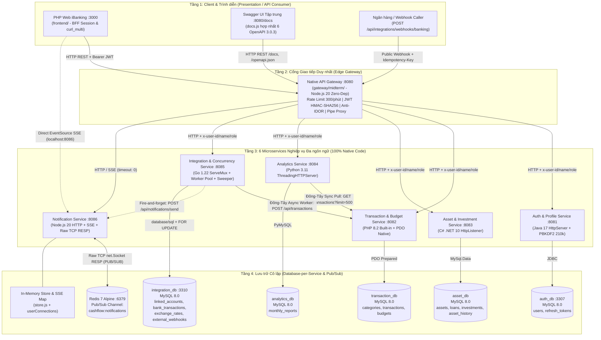

*(Mã nguồn sơ đồ: [docs/diagrams/01-architecture-and-deployment.md](../diagrams/01-architecture-and-deployment.md))*

*Hình 1-1: Kiến trúc Tổng thể Hệ thống SOA CashFlow (Phiên bản Giữa kỳ)*

**Phân tích chi tiết Hình 1-1:**
1. **Tầng 1 (Client & Trình diễn):** Bao gồm ba nhóm tác nhân tiêu thụ API là Giao diện Web iBanking PHP (`frontend/`, cổng `3000`) vận hành theo mô hình *Backend-for-Frontend (BFF)* lưu JWT an toàn trong `$_SESSION`, cổng tài liệu Swagger UI tập trung tại `:8080/docs` và hệ thống ngân hàng bên ngoài gọi Webhook tới `/api/integrations/webhooks/banking`. Riêng kênh nhận sự kiện thời gian thực `EventSource` của trình duyệt kết nối trực tiếp tới `http://localhost:8086/api/notifications/stream?user_id=<uid>` do API `EventSource` chuẩn HTML5 không hỗ trợ gắn header `Authorization: Bearer`.
2. **Tầng 2 (Edge Gateway):** `Native API Gateway` (`gateway/midterm/`, cổng `8080`) đóng vai trò điểm vào duy nhất cho mọi luồng HTTP REST. Tại đây, yêu cầu đi qua bộ giới hạn tần suất theo IP (300 requests/phút), kiểm chứng chữ ký JWT `HMAC-SHA256`, xóa bỏ các header định danh giả mạo từ client trước khi gắn bộ ba header tin cậy (`x-user-id`, `x-user-name`, `x-user-role`) và chuyển tiếp bằng kỹ thuật *Stream Piping* không đệm RAM.
3. **Tầng 3 (6 Microservices Đa ngôn ngữ):** Phân tách theo ranh giới miền nghiệp vụ (*Bounded Contexts*): `Auth Service` (`:8081`, Java 17), `Transaction Service` (`:8082`, PHP 8.2), `Asset Service` (`:8083`, C# .NET 10), `Analytics Service` (`:8084`, Python 3.11), `Integration Service` (`:8085`, Go 1.22) và `Notification Service` (`:8086`, Node.js 20). Luồng giao tiếp **Bắc–Nam (North–South)** đi qua Gateway, trong khi luồng **Đông–Tây (East–West)** diễn ra theo hai mô hình: kéo dữ liệu đồng bộ (`Analytics` phân trang gọi `GET /api/transactions` từ `Transaction`) và đẩy dữ liệu bất đồng bộ (`Integration` Worker Pool gọi `POST /api/transactions` rồi gọi *fire-and-forget* tới `Notification`).
4. **Tầng 4 (Lưu trữ Cô lập Database-per-Service):** Tuân thủ nghiêm ngặt nguyên tắc mỗi dịch vụ sở hữu hoàn toàn dữ liệu của mình trên 5 thực thể MySQL 8.0 tách biệt (`auth_db`, `transaction_db`, `asset_db`, `analytics_db`, `integration_db` với tổng cộng 14 bảng) và 1 nút `Redis 7` phục vụ kênh Pub/Sub `cashflow:notifications` kết hợp kho lưu trữ tạm trong bộ nhớ (`store.js`) của `Notification Service`. Không có bất kỳ dịch vụ nào truy cập trực tiếp vào cơ sở dữ liệu của dịch vụ khác.

Để cụ thể hóa phạm vi chức năng giữa các tác nhân và 6 phân hệ dịch vụ, Hình 1-2 mô tả biểu đồ Use Case tổng quát của phiên bản Giữa kỳ.

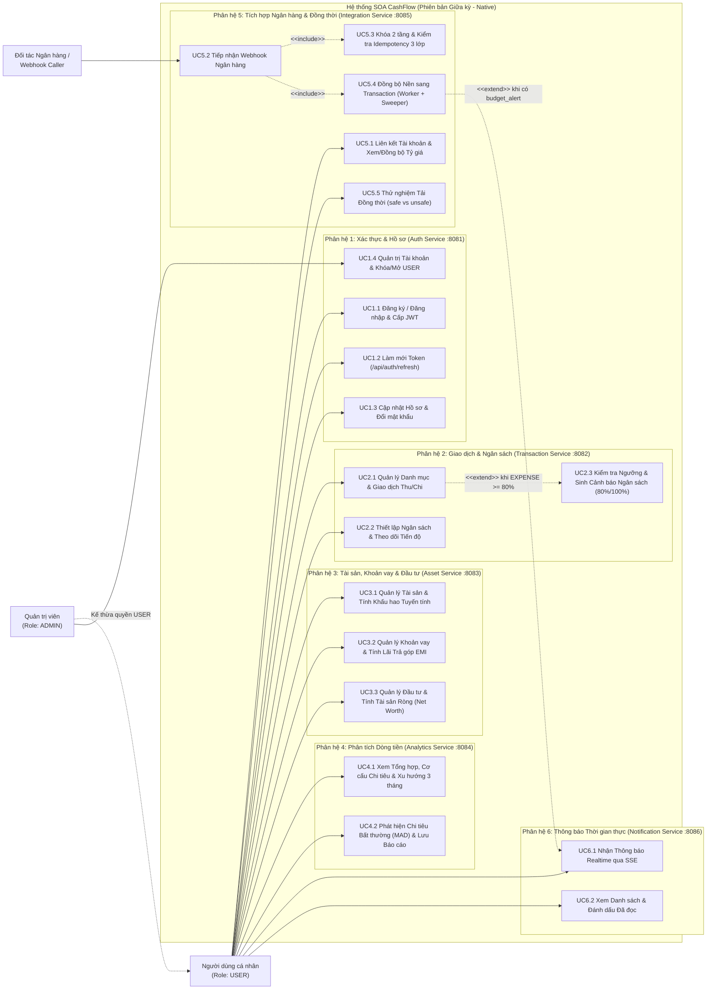

*(Mã nguồn sơ đồ: [docs/diagrams/02-usecase-overall.md](../diagrams/02-usecase-overall.md) và [docs/diagrams/02-usecase-overall.puml](../diagrams/02-usecase-overall.puml))*

*Hình 1-2: Biểu đồ Use Case Tổng quát Hệ thống SOA CashFlow (Giữa kỳ)*

**Phân tích chi tiết Hình 1-2:**
1. **Phân cấp Tác nhân & Phân quyền (RBAC):** Hệ thống xác định hai nhóm tác nhân người dùng có phân cấp kế thừa là `USER` (sử dụng toàn bộ nghiệp vụ tài chính cá nhân, liên kết tài khoản, xem phân tích và nhận cảnh báo của riêng mình) và `ADMIN` (kế thừa quyền `USER` và được phép gọi nhóm API `/api/admin/users` để quản lý danh sách người dùng hoặc khóa/mở khóa tài khoản), cùng tác nhân hệ thống ngoài là `Đối tác Ngân hàng / Webhook Caller`.
2. **Quan hệ phụ thuộc `<<include>>` bắt buộc:** Tại Phân hệ 5, khi `Đối tác Ngân hàng` kích hoạt ca sử dụng *Tiếp nhận Webhook Ngân hàng*, hệ thống bắt buộc thực thi đồng thời ca *Khóa 2 tầng & Kiểm tra Idempotency 3 lớp* (`keyedLocker` + `SELECT ... FOR UPDATE` + kiểm tra `idempotency_key`/`provider, external_ref`/`request_hash`) và đẩy bản ghi hợp lệ vào ca *Đồng bộ Nền sang Transaction* qua kênh hàng đợi nội bộ.
3. **Quan hệ mở rộng `<<extend>>` có điều kiện:** Ca *Quản lý Danh mục & Giao dịch Thu/Chi* mở rộng sang *Kiểm tra Ngưỡng & Sinh Cảnh báo Ngân sách* chỉ khi giao dịch thuộc loại `EXPENSE`, có gắn `category_id` và tổng chi trong kỳ đạt từ 80% hạn mức trở lên (`WARNING` hoặc `EXCEEDED`). Tương tự, luồng đồng bộ nền từ Integration chỉ kích hoạt *Nhận Thông báo Realtime qua SSE* khi nhận được `budget_alert` từ Transaction Service hoặc khi phát sinh giao dịch bị từ chối/giá trị lớn.

---

## 1.3. Công nghệ sử dụng & Phân công nhiệm vụ

Mỗi thành phần trong hệ thống được lựa chọn công nghệ phù hợp với đặc thù tính toán và thế mạnh của ngôn ngữ thuần, trình bày chi tiết tại Bảng 1.2.

**Bảng 1.2: Đặc tả Stack công nghệ thuần (100% Native Code) của 7 dịch vụ và Frontend Web**

| Dịch vụ / Thành phần | Cổng | Ngôn ngữ & Runtime | Thư viện / Thành phần cốt lõi | Lưu trữ dữ liệu | Đường dẫn mã nguồn |
|---|---|---|---|---|---|
| **API Gateway** | `8080` | Node.js `20` (Zero-dependency) | `node:http`, `node:https`, `node:crypto`, `node:url`, `docs.js` | Không trạng thái (In-memory `rateLimitMap`) | `gateway/midterm/` |
| **Auth & Profile Service** | `8081` | Java `17` (JDK `HttpServer`) | `com.sun.net.httpserver.HttpServer`, `javax.crypto`, `mysql-connector-j:8.4.0`, `jackson-databind:2.18.2` | MySQL 8.0 (`auth_db`: 2 bảng) | `services/auth-service/midterm/` |
| **Transaction & Budget Service** | `8082` | PHP `8.2` CLI Built-in Server | PSR-4 `spl_autoload_register`, `PDO` (`pdo_mysql`), không Composer package ngoài | MySQL 8.0 (`transaction_db`: 3 bảng) | `services/transaction-service/midterm/` |
| **Asset & Investment Service** | `8083` | C# `.NET 10.0` | `System.Net.HttpListener`, `System.Text.Json`, `MySql.Data:26.7.0` | MySQL 8.0 (`asset_db`: 4 bảng) | `services/asset-service/midterm/` |
| **Analytics Service** | `8084` | Python `3.11` | `http.server.ThreadingHTTPServer`, `urllib.request`, `statistics`, `PyMySQL==1.1.1` | MySQL 8.0 (`analytics_db`: 1 bảng) | `services/analytics-service/midterm/` |
| **Integration & Concurrency Service** | `8085` | Go `1.22` | `net/http.ServeMux`, `database/sql`, `sync`, `go-sql-driver/mysql v1.7.1` | MySQL 8.0 (`integration_db`: 4 bảng) | `services/integration-service/midterm/` |
| **Notification Service** | `8086` | Node.js `20` (Zero-dependency) | `node:http`, `node:net` (Raw TCP Redis RESP), SSE (`text/event-stream`) | In-Memory (`store.js`) + Redis 7 Pub/Sub | `services/notification-service/midterm/` |
| **Frontend Web iBanking** | `3000` | PHP `8.x` + Vanilla JS + Chart.js | `curl` / `curl_multi`, `$_SESSION`, CSRF `hash_equals`, `EventSource` | Không chạm DB (BFF qua Gateway `:8080`) | `frontend/` |

Để hệ thống vận hành nhất quán cả khi chạy từng tiến trình cục bộ trên Windows (`start-services.ps1` kết nối XAMPP MySQL) lẫn khi triển khai 13 containers trong mạng nội bộ Docker (`docker-compose.midterm.yml`), mọi tham số hạ tầng đều được tham số hóa qua biến môi trường với cơ chế dự phòng mặc định (*fallback*) như tổng hợp tại Bảng 1.3.

**Bảng 1.3: Ma trận Biến môi trường cấu hình linh hoạt giữa Docker Compose và Local**

| Thành phần | Biến môi trường chính | Giá trị mặc định trong Code (Local) | Giá trị trong `docker-compose.midterm.yml` |
|---|---|---|---|
| **API Gateway** | `APP_ENV`, `GATEWAY_PORT`, `GATEWAY_HOST`, `GATEWAY_AUTH_STRICT`, `JWT_SECRET` / `AUTH_JWT_SECRET` | `PORT=8080`, `HOST=0.0.0.0`, `authStrict=true`, `cashflow-auth-midterm-development-secret-key` | `APP_ENV=midterm`, `GATEWAY_PORT=8080`, `AUTH_JWT_SECRET` |
| | `AUTH_SERVICE_URL` .. `NOTIFICATION_SERVICE_URL` | `http://localhost:8081..8086` (khi `APP_ENV` không phải `midterm`) | `http://auth-service:8081` .. `http://notification-service:8086` |
| **Auth Service** | `DB_HOST` / `AUTH_DB_HOST`, `DB_PORT` / `AUTH_DB_PORT`, `DB_NAME`, `DB_USER`, `DB_PASSWORD`, `JWT_SECRET` | `localhost`, `3307`, `auth_db`, `root`, `root_password` | `auth-db`, `3306`, `auth_db`, `root`, `root_password` |
| **Transaction Service** | `DB_HOST`, `DB_PORT`, `DB_NAME`, `DB_USER`, `DB_PASSWORD` | `127.0.0.1` (tự fallback nếu tên host lỗi), `3306`, `transaction_db` | `transaction-db`, `3306`, `transaction_db`, `root`, `root_password` |
| **Asset Service** | `PORT`, `LISTEN_HOST`, `DB_CONNECTION`, `DB_HOST`, `DB_PORT`, `DB_NAME`, `DB_USER`, `DB_PASSWORD` | `8083`, `+` (hoặc `localhost` khi chạy local), `asset_db` | `PORT=8083`, `LISTEN_HOST=*` (`+` trong `Dockerfile`), `DB_HOST=asset-db` |
| **Analytics Service** | `HOST`, `PORT`, `TRANSACTION_SERVICE_URL`, `ANALYTICS_DB_SCHEMA`, `ANALYTICS_DB_{HOST,PORT,NAME,USER,PASSWORD}` | `0.0.0.0`, `8084`, `http://transaction-service:8082`, `analytics-db:3306` | `ANALYTICS_DB_HOST=analytics-db`, `/app/db/init-analytics-db.sql` |
| **Integration Service** | `PORT`, `DB_{HOST,PORT,NAME,USER,PASSWORD}`, `TRANSACTION_SERVICE_URL`, `NOTIFICATION_SERVICE_URL`, `WEBHOOK_SECRET`, `SYNC_WORKERS`, `LARGE_AMOUNT_ALERT` | `8085`, `localhost:3306`, `integration_db`, `SYNC_WORKERS=4`, `LARGE_AMOUNT_ALERT=10000000` | `integration-db`, `http://transaction-service:8082`, `http://notification-service:8086`, `SYNC_WORKERS=4` |
| **Notification Service** | `HOST`, `NOTIFICATION_SERVICE_PORT` / `PORT`, `REDIS_HOST`, `REDIS_PORT`, `REDIS_CHANNEL` | `0.0.0.0`, `8086`, `redis`, `6379`, `cashflow:notifications` | `HOST=0.0.0.0`, `PORT=8086`, `REDIS_HOST=redis`, `REDIS_PORT=6379` |
| **Frontend Web (Host)** | `GATEWAY_URL`, `NOTIFICATION_SSE_URL` | `http://127.0.0.1:8080`, `http://localhost:8086` | Chạy trực tiếp trên Host (`127.0.0.1:3000`) gọi vào cổng public của Docker |

Bảng 1.4 phân định rõ trách nhiệm phát triển, kiểm thử và tài liệu hóa của sáu thành viên trong nhóm.

**Bảng 1.4: Bảng phân công nhiệm vụ và sở hữu dịch vụ của 6 thành viên**

| STT | Họ và Tên | MSSV | Vai trò & Thành phần phụ trách chính |
|---|---|---|---|
| 1 | **Nguyễn Văn Duy** | `52400010` | **Nhóm trưởng:** Thiết kế kiến trúc SOA tổng thể, API Gateway (`Node.js`), Notification Service (`Node.js` SSE & Redis RESP), Docker Compose/DevOps & Frontend Web iBanking (`PHP`). |
| 2 | **Nguyễn Trọng Phúc** | `52400028` | Phát triển **Auth & Profile Service** (`Java 17 HttpServer`), thiết kế `auth_db`, cơ chế `PBKDF2WithHmacSHA256`, JWT `HS256` và Refresh Token. |
| 3 | **Lê Văn Quý** | `52400153` | Phát triển **Transaction & Budget Service** (`PHP 8.2 Native OOP`), thiết kế `transaction_db`, PDO Singleton, kiểm tra quyền sở hữu và logic cảnh báo ngân sách. |
| 4 | **Lê Tiến Đạt** | `52400105` | Phát triển **Asset & Investment Service** (`C# .NET 10 HttpListener`), thiết kế `asset_db`, giải thuật khấu hao tuyến tính, trả góp EMI và tính Net Worth. |
| 5 | **Lê Khải Hoàn** | `52400114` | Phát triển **Analytics Service** (`Python 3.11 ThreadingHTTPServer`), thiết kế `analytics_db`, cơ chế kéo dữ liệu phân trang, dự báo xu hướng 3 tháng và phát hiện bất thường MAD. |
| 6 | **Trần Hữu Long** | `52400138` | Phát triển **Integration & Concurrency Service** (`Go 1.22`), thiết kế `integration_db`, khóa 2 tầng, Idempotency 3 lớp, Worker Pool, Sweeper và công cụ Loadtest. |

---

# CHƯƠNG 2. THIẾT KẾ & HIỆN THỰC CÁC DỊCH VỤ

## 2.1. API Gateway & Cơ chế định tuyến / xác thực

API Gateway (`gateway/midterm/`, cổng `8080`) được viết hoàn toàn bằng **Node.js 20 thuần (Zero-dependency)**, chỉ sử dụng các mô-đun lõi `node:http`, `node:https`, `node:crypto` và `node:url`. Gateway đóng vai trò điểm tiếp nhận duy nhất (*Single Entry Point*) cho mọi lưu lượng từ Frontend Web, Swagger UI và đối tác bên ngoài trước khi chuyển tiếp xuống 6 microservices.

### Pipeline 6 bước xử lý yêu cầu (`gateway/midterm/src/index.js`)
Mỗi HTTP Request đi vào máy chủ Gateway (`http.createServer`) tuần tự đi qua sáu lớp xử lý:
1. **Kiểm soát giới hạn tần suất (Sliding-Window IP Rate Limiting):** Hàm `isRateLimited(clientIp)` duy trì bộ đếm trong `rateLimitMap` (`Map<ip, {count, startTime}>`) với ngưỡng `RATE_LIMIT_MAX_REQUESTS = 300` yêu cầu trong cửa sổ `RATE_LIMIT_WINDOW_MS = 60_000` ms (1 phút). Nếu vượt ngưỡng, Gateway ngắt ngay với mã `429 Too Many Requests` (`RATE_LIMIT_EXCEEDED`). Một bộ đếm dọn rác định kỳ chạy mỗi 5 phút (`setInterval(...).unref()`) nhằm tránh rò rỉ bộ nhớ.
2. **Xử lý CORS Preflight & Tài liệu OpenAPI tích hợp:** Yêu cầu `OPTIONS` nhận ngay phản hồi `204 No Content` kèm tiêu đề CORS; các yêu cầu `GET` tới `/docs`, `/swagger`, `/docs/{service}`, `/openapi.json` hoặc `/openapi/{service}.json` được `handleDocs()` phục vụ trực tiếp.
3. **Kiểm tra sức khỏe tổng quan:** Đường dẫn `/` và `/health` trả về trạng thái Gateway cùng danh sách `routeMap` hiện hành.
4. **Định tuyến theo tiền tố (Prefix Route Matching):** So khớp đường dẫn với `config.routeMap` (12 tiền tố đường dẫn trỏ về 6 dịch vụ). Nếu không khớp trả `404 ROUTE_NOT_FOUND`.
5. **Xác thực JWT & Bảo vệ Anti-IDOR (`gateway/midterm/src/jwt.js`):** Ngoại trừ 7 quy tắc trong `publicEndpoints`, Gateway trích xuất Bearer Token qua `extractBearerToken()`, xác minh chữ ký `HMAC-SHA256` bằng hàm so sánh hằng thời gian `crypto.timingSafeEqual(sigBuffer, expectedBuffer)` (chống tấn công *Timing Attack*) và kiểm tra hạn `payload.exp`. Nếu hợp lệ, Gateway trích xuất `userId`, `username`, `role`; ngược lại trả `401 UNAUTHORIZED` (khi `GATEWAY_AUTH_STRICT !== "false"`).
6. **Chuyển tiếp luồng không đệm RAM (Streaming Reverse Proxy — `gateway/midterm/src/proxy.js`):** Hàm `forwardRequest()` chủ động **xóa bỏ** các tiêu đề hop-by-hop và đặc biệt là các tiêu đề định danh có nguy cơ bị client giả mạo (`x-user-id`, `x-user-name`, `x-user-role`), sau đó chỉ gắn lại ba tiêu đề đã xác thực từ JWT (`x-user-id`, `x-user-name`, `x-user-role`), bổ sung `x-proxied-by: CashFlow-Native-Gateway` và nối trực tiếp luồng dữ liệu `req.pipe(proxyReq)` và `proxyRes.pipe(res)` nhằm tránh đệm toàn bộ payload vào RAM. Đặc biệt, tuyến SSE `/api/notifications/stream` được đặt `timeout: 0` (các tuyến REST khác là `15000` ms) để giữ kết nối đẩy sự kiện lâu dài không bị ngắt.

Bảng 2.1 tổng hợp cấu hình định tuyến và danh sách endpoint công khai tại `gateway/midterm/src/config.js`.

**Bảng 2.1: Quy tắc định tuyến (`routeMap`) và danh sách Endpoint công khai (`publicEndpoints`) tại API Gateway**

| Dịch vụ đích | Cổng | Tiền tố URL (`routeMap`) | Endpoint Công khai (`publicEndpoints` — miễn JWT) |
|---|---|---|---|
| **Auth Service** | `8081` | `/api/auth`, `/api/profile`, `/api/admin` | `POST /api/auth/register`, `POST /api/auth/login`, `POST /api/auth/refresh` |
| **Transaction Service** | `8082` | `/api/transactions`, `/api/budgets`, `/api/categories` | *(Không có — 100% yêu cầu JWT)* |
| **Asset Service** | `8083` | `/api/assets`, `/api/loans`, `/api/investments` | *(Không có — 100% yêu cầu JWT)* |
| **Analytics Service** | `8084` | `/api/analytics` | *(Không có — 100% yêu cầu JWT)* |
| **Integration Service** | `8085` | `/api/integrations` | `GET /api/integrations/rates`, `POST /api/integrations/webhooks/banking` |
| **Notification Service** | `8086` | `/api/notifications` | *(Gateway `/` và `/health` là public trực tiếp tại Gateway)* |

Luồng tuần tự xác thực JWT và cơ chế Anti-IDOR tại API Gateway được minh họa ở Hình 2-1.

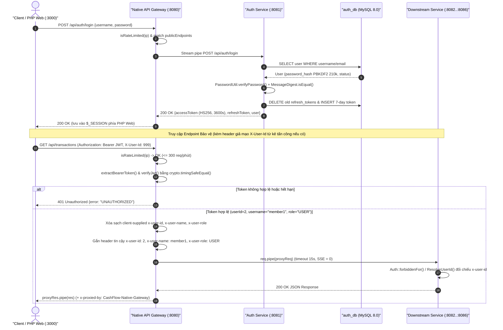

*(Mã nguồn sơ đồ: [docs/diagrams/05-sequence-and-state-diagrams.md](../diagrams/05-sequence-and-state-diagrams.md))*

*Hình 2-1: Biểu đồ Tuần tự Luồng Xác thực JWT & Chống Giả mạo Header (Anti-IDOR) tại API Gateway*

**Phân tích chi tiết Hình 2-1:**
1. **Giai đoạn Đăng nhập (Bước 1–7):** Khi Client gửi yêu cầu `POST /api/auth/login`, Gateway đối chiếu với `publicEndpoints` nên bỏ qua bước kiểm tra JWT và chuyển luồng thẳng xuống `Auth Service`. Tại đây, Java thực hiện xác minh mật khẩu bằng `PBKDF2WithHmacSHA256`, xóa các `refresh_tokens` cũ của người dùng để tránh tích tụ rác và phát hành cặp `accessToken` (`HS256`, hạn 3600 giây) cùng `refreshToken` (hạn 7 ngày).
2. **Giai đoạn Chống Giả mạo Header / Anti-IDOR (Bước 8–16):** Giả sử kẻ tấn công dùng JWT hợp lệ của `userId = 2` (`member1`) nhưng cố tình chèn thêm header HTTP `X-User-Id: 999` để đọc trộm dữ liệu của người dùng khác. Sau khi `verifyJwt()` xác nhận chữ ký hợp lệ bằng `crypto.timingSafeEqual()`, `proxy.js` xóa bỏ toàn bộ `x-user-id`, `x-user-name`, `x-user-role` do client gửi lên rồi ghi đè bằng giá trị giải mã từ JWT (`x-user-id: 2`, `x-user-name: member1`, `x-user-role: USER`). Nhờ đó, dịch vụ phía sau hoàn toàn miễn nhiễm với tấn công giả mạo header khi đi qua Gateway.

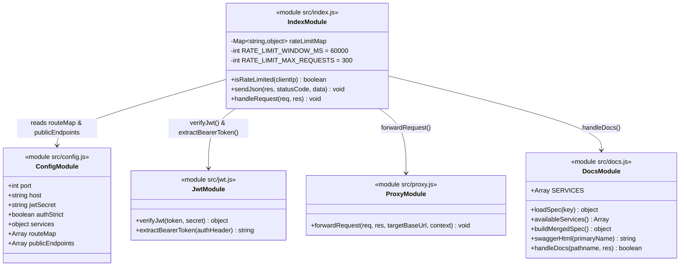

*(Mã nguồn sơ đồ: [docs/diagrams/03-class-diagrams-midterm.md](../diagrams/03-class-diagrams-midterm.md))*

*Hình 2-2: Biểu đồ Mô-đun Thiết kế API Gateway (Node.js 20 Native)*

**Phân tích chi tiết Hình 2-2:**
1. **Tổ chức mô-đun tách biệt theo chức năng (Modular Decomposition):** Toàn bộ mã nguồn Gateway chia thành 5 tệp CommonJS gọn nhẹ (`index.js`, `config.js`, `jwt.js`, `proxy.js`, `docs.js`) không phụ thuộc bất kỳ gói npm bên ngoài nào (`package.json` chỉ khai báo `engines.node >= 18.0.0`).
2. **Trách nhiệm điều phối của `IndexModule`:** Đóng vai trò bộ điều khiển trung tâm (*Front Controller*), giữ `rateLimitMap` trong bộ nhớ và kết nối tuần tự với `DocsModule` (phục vụ Swagger UI), `ConfigModule` (tra cứu `routeMap` và `publicEndpoints`), `JwtModule` (kiểm tra chữ ký HMAC) và `ProxyModule` (chuyển tiếp luồng HTTP/SSE).

Đoạn mã xác thực JWT hằng thời gian tại `gateway/midterm/src/jwt.js`:

```javascript
const expectedSignature = crypto
  .createHmac('sha256', secret)
  .update(`${headerB64}.${payloadB64}`)
  .digest('base64url');

const sigBuffer = Buffer.from(signatureB64, 'utf8');
const expectedBuffer = Buffer.from(expectedSignature, 'utf8');
if (sigBuffer.length !== expectedBuffer.length || !crypto.timingSafeEqual(sigBuffer, expectedBuffer)) {
  return { valid: false, error: 'Chữ ký JWT không hợp lệ' };
}
```

---

## 2.2. Chi tiết 6 Microservices nghiệp vụ

### 2.2.1. Auth & Profile Service (Java 17 Native `HttpServer` — Cổng 8081)

#### (a) Kiến trúc lớp/mô-đun & Biểu đồ Class

Dịch vụ định danh (`services/auth-service/midterm/`) sử dụng máy chủ HTTP tích hợp sẵn của JDK (`com.sun.net.httpserver.HttpServer`) kết hợp bể luồng cố định `Executors.newFixedThreadPool(10)` trong `Main.java`. Tệp `pom.xml` chỉ khai báo đúng hai thư viện nền là `mysql-connector-j` (`8.4.0`) để kết nối MySQL qua JDBC và `jackson-databind` (`2.18.2`) để tuần tự hóa JSON (đóng gói qua lớp singleton `JsonUtil`), hoàn toàn không sử dụng Spring hay bất kỳ Web Framework nào.

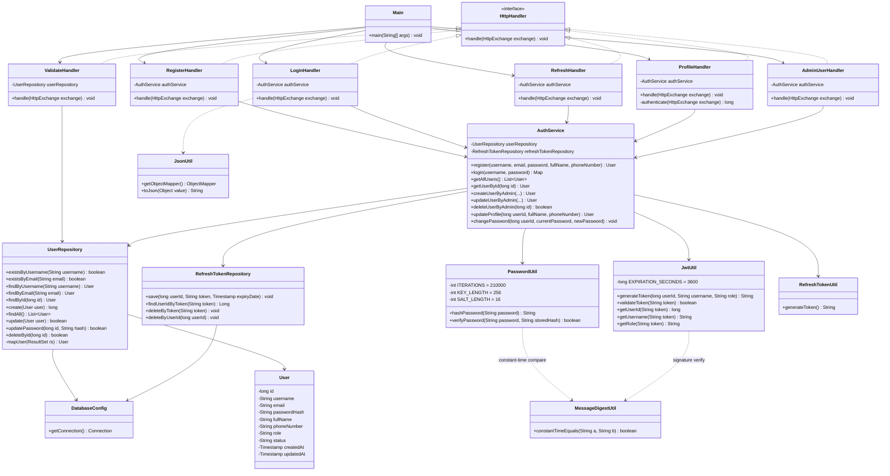

*(Mã nguồn sơ đồ: [docs/diagrams/03-class-diagrams-midterm.md](../diagrams/03-class-diagrams-midterm.md))*

*Hình 2-3: Biểu đồ Lớp Auth & Profile Service (Java 17 Native `HttpServer`)*

**Phân tích chi tiết Hình 2-3:**
1. **Phân tầng kiến trúc OOP 4 lớp (Handler → Service → Repository → Model/Util):** `Main` ánh xạ 7 ngữ cảnh đường dẫn tới 6 lớp Handler cài đặt giao diện `com.sun.net.httpserver.HttpHandler`. Mọi nghiệp vụ kiểm tra định dạng (`USERNAME_PATTERN`, `EMAIL_PATTERN`, `PHONE_PATTERN`), băm mật khẩu và phát hành token được gom tập trung trong `AuthService`.
2. **Bảo vệ đa tầng ở các Handler nhạy cảm:** Khác với các dịch vụ tin cậy header `X-User-Id` từ Gateway, cả `ProfileHandler` và `AdminUserHandler` trong Auth Service đều tự kiểm chứng trực tiếp `Authorization: Bearer <token>` qua `JwtUtil.validateToken()` (và `AdminUserHandler` bắt buộc `role == "ADMIN"`, trả `403` nếu không đủ quyền).
3. **Tầng tiện ích mật mã thuần JDK (`PasswordUtil`, `JwtUtil`, `RefreshTokenUtil`, `MessageDigestUtil`):** Hoàn toàn sử dụng `javax.crypto.SecretKeyFactory`, `javax.crypto.Mac`, `java.security.SecureRandom` và `java.security.MessageDigest.isEqual`.

#### (b) Endpoints tiêu biểu

**Bảng 2.2: Danh mục Endpoints của Auth & Profile Service (`:8081`)**

| Method | Đường dẫn chính xác | Quyền truy cập | Tham số / Payload chính | Mã HTTP & Kết quả |
|---|---|---|---|---|
| `GET` | `/health` | Nội bộ / Trực tiếp | — | `200` `{service:"auth-service", status:"UP", version:"1.0.0-midterm"}` |
| `POST` | `/api/auth/register` | Công khai | `{username, email, password, fullName?, phoneNumber?}` | `201` `{success:true, user}` / `400` / `409` |
| `POST` | `/api/auth/login` | Công khai | `{username (hoặc email), password}` | `200` `{accessToken, refreshToken, tokenType:"Bearer", expiresIn:3600, user}` / `401` |
| `POST` | `/api/auth/refresh` | Công khai | `{refreshToken}` hoặc `{refresh_token}` | `200` `{accessToken, tokenType:"Bearer", expiresIn:3600}` / `401` |
| `GET` | `/api/auth/validate` | JWT Bearer | Header `Authorization: Bearer <token>` | `200` `{valid:true, userId, username, role, status}` / `401` |
| `GET` | `/api/profile` | JWT Bearer | Header `Authorization: Bearer <token>` | `200` `{success:true, profile}` / `401` |
| `PUT` | `/api/profile` | JWT Bearer | `{fullName, phoneNumber}` | `200` `{success:true, profile}` / `400` / `401` |
| `PUT` | `/api/profile/password` | JWT Bearer | `{currentPassword, newPassword}` | `200` `{success:true, message:"Password changed successfully"}` / `400` / `401` |
| `GET` / `POST` | `/api/admin/users` | JWT + `ADMIN` | Query hoặc `{username, email, password, role?, status?}` | `200` / `201` / `403` / `409` |
| `GET` / `PUT` / `DELETE` | `/api/admin/users/{id}` | JWT + `ADMIN` | Path `id`, body cập nhật (`username, email, role, status`) | `200` / `400` / `403` / `409` |

#### (c) Thiết kế CSDL riêng & Bảng từ điển dữ liệu

CSDL **`auth_db`** chạy trên **MySQL 8.0 InnoDB** (bảng mã `utf8mb4_unicode_ci`), khởi tạo từ tệp `services/auth-service/db/init-auth-db.sql`, gồm 2 bảng `users` và `refresh_tokens` (tài khoản mẫu `admin` và `member1` có cùng mật khẩu `password123`).

**Bảng 2.3: Bảng `users` (`auth_db`)**

| Cột | Kiểu SQL | Khóa | Cho phép NULL | Khai báo | Ý nghĩa |
|---|---|---|---|---|---|
| `id` | `BIGINT` | `PK` | Không | `AUTO_INCREMENT PRIMARY KEY` | Khóa chính định danh duy nhất người dùng (`1`: admin, `2`: member1). |
| `username` | `VARCHAR(50)` | `UNIQUE` | Không | `NOT NULL UNIQUE` | Tên đăng nhập duy nhất, kiểm tra định dạng `^[A-Za-z0-9._]{3,50}$`. |
| `email` | `VARCHAR(100)` | `UNIQUE` | Không | `NOT NULL UNIQUE` | Địa chỉ email duy nhất, hỗ trợ đăng nhập thay cho `username`. |
| `password_hash` | `VARCHAR(255)` | `—` | Không | `NOT NULL` | Chuỗi băm PBKDF2 dạng `iterations:base64(salt):base64(hash)`. |
| `full_name` | `VARCHAR(100)` | `—` | Có | `NULL` | Họ và tên hiển thị của người dùng. |
| `phone_number` | `VARCHAR(20)` | `—` | Có | `NULL` | Số điện thoại liên hệ (`^\+?[0-9]{9,15}$`). |
| `role` | `VARCHAR(20)` | `—` | Không | `NOT NULL DEFAULT 'USER'` | Vai trò phân quyền hệ thống (`USER` hoặc `ADMIN`). |
| `status` | `VARCHAR(20)` | `—` | Không | `NOT NULL DEFAULT 'ACTIVE'` | Trạng thái hoạt động tài khoản (`ACTIVE` hoặc `BLOCKED`). |
| `created_at` | `TIMESTAMP` | `—` | Có | `DEFAULT CURRENT_TIMESTAMP` | Thời điểm tạo bản ghi tài khoản. |
| `updated_at` | `TIMESTAMP` | `—` | Có | `DEFAULT CURRENT_TIMESTAMP ON UPDATE CURRENT_TIMESTAMP` | Thời điểm cập nhật thông tin gần nhất. |

Ràng buộc bảng và chỉ mục trong SQL:
```sql
PRIMARY KEY (id),
UNIQUE (username),
UNIQUE (email)
```

**Bảng 2.4: Bảng `refresh_tokens` (`auth_db`)**

| Cột | Kiểu SQL | Khóa | Cho phép NULL | Khai báo | Ý nghĩa |
|---|---|---|---|---|---|
| `id` | `BIGINT` | `PK` | Không | `AUTO_INCREMENT PRIMARY KEY` | Khóa chính bản ghi phiên làm mới. |
| `user_id` | `BIGINT` | `FK → users(id) ON DELETE CASCADE` | Không | `NOT NULL` | Tham chiếu tới chủ sở hữu token trong bảng `users`. |
| `token` | `VARCHAR(255)` | `UNIQUE` | Không | `NOT NULL UNIQUE` | Chuỗi ngẫu nhiên 48 byte mã hóa Base64URL. |
| `expiry_date` | `TIMESTAMP` | `—` | Không | `NOT NULL` | Thời điểm hết hạn của Refresh Token (7 ngày sau khi đăng nhập). |
| `created_at` | `TIMESTAMP` | `—` | Có | `DEFAULT CURRENT_TIMESTAMP` | Thời điểm cấp phát Refresh Token. |

Ràng buộc bảng và chỉ mục trong SQL:
```sql
PRIMARY KEY (id),
UNIQUE (token),
FOREIGN KEY (user_id) REFERENCES users(id) ON DELETE CASCADE
```

#### (d) Giải thuật nghiệp vụ & xử lý kỹ thuật tầng thấp

1. **Băm mật khẩu chuẩn NIST SP 800-132 (`PasswordUtil.java`):** Thay vì thuật toán băm một lần dễ bị bẻ bằng GPU, Auth Service sử dụng `PBKDF2WithHmacSHA256` với **210.000 vòng lặp**, muối (*salt*) 16 byte sinh từ `SecureRandom` và khóa đầu ra 256 bit. Chuỗi lưu trữ có cấu trúc `210000:<base64_salt>:<base64_hash>` (thực tế mã nguồn không dùng BCrypt như một số chú thích giao diện cũ ghi nhận). Khi kiểm tra đăng nhập, hàm `verifyPassword()` dùng `MessageDigest.isEqual(expectedHash, actualHash)` để so sánh hằng thời gian.
2. **Ký JWT `HS256` và tạo Refresh Token (`JwtUtil.java`, `RefreshTokenUtil.java`):** `JwtUtil` tạo JSON payload `{userId, username, role, iat, exp}` với `EXPIRATION_SECONDS = 3600`, ký bằng `HmacSHA256`. Khi đăng nhập thành công, `LoginHandler` gọi `refreshTokenRepository.deleteByUserId()` để thu hồi token cũ trước khi lưu token mới 48 byte sinh bởi `RefreshTokenUtil.generateToken()`.

Trích đoạn từ `services/auth-service/midterm/src/main/java/com/cashflow/auth/util/PasswordUtil.java`:
```java
PBEKeySpec spec = new PBEKeySpec(password, salt, iterations, keyLength);
try {
    SecretKeyFactory factory = SecretKeyFactory.getInstance("PBKDF2WithHmacSHA256");
    return factory.generateSecret(spec).getEncoded();
} finally {
    spec.clearPassword();
}
```
- **Nguyên lý bảo mật bộ nhớ:** Khối `finally` gọi `spec.clearPassword()` ngay sau khi sinh khóa nhằm xóa dữ liệu mật khẩu gốc khỏi mảng `char[]` trong RAM càng sớm càng tốt.

---

### 2.2.2. Transaction & Budget Service (PHP 8.2 Native PSR-4 OOP — Cổng 8082)

#### (a) Kiến trúc lớp/mô-đun & Biểu đồ Class

Dịch vụ Giao dịch & Ngân sách (`services/transaction-service/midterm/`) được viết bằng **PHP 8.2 thuần theo mô hình MVC OOP**, tự cài đặt `spl_autoload_register` chuẩn PSR-4 (`App\<Subdir>\<Class>`) trong `src/index.php` mà không cài bất kỳ thư viện Composer bên ngoài nào.

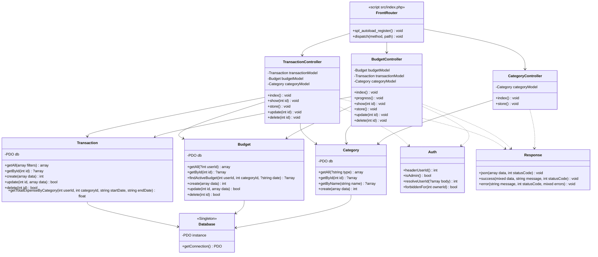

*(Mã nguồn sơ đồ: [docs/diagrams/03-class-diagrams-midterm.md](../diagrams/03-class-diagrams-midterm.md))*

*Hình 2-4: Biểu đồ Lớp Transaction & Budget Service (PHP 8.2 Native PSR-4 OOP)*

**Phân tích chi tiết Hình 2-4:**
1. **Điều phối tập trung qua `FrontRouter` (`src/index.php`):** Phân tách URI bằng biểu thức chính quy (`# ^/api/transactions/(\d+)$ #`, `# ^/api/budgets/(\d+)$ #`) và điều hướng về ba lớp Controller (`TransactionController`, `BudgetController`, `CategoryController`).
2. **Tách biệt tầng Truy xuất Dữ liệu & Trợ giúp (`Model` & `Helper`):** Ba lớp Model (`Transaction`, `Budget`, `Category`) dùng chung kết nối `PDO` từ Singleton `Database::getConnection()`. Lớp tĩnh `Auth` đảm nhận trích xuất `X-User-Id`/`X-User-Role` và kiểm soát quyền sở hữu `forbiddenFor()`, còn `Response` chuẩn hóa khung JSON `{success, message, data}`.

#### (b) Endpoints tiêu biểu

**Bảng 2.5: Danh mục Endpoints của Transaction & Budget Service (`:8082`)**

| Method | Đường dẫn chính xác | Quyền truy cập | Tham số / Payload chính | Mã HTTP & Kết quả |
|---|---|---|---|---|
| `GET` | `/`, `/health` | Nội bộ / Trực tiếp | — | `200` `{success:true, data:{service, status:"UP", version}}` |
| `GET` | `/api/categories` | JWT | `?type=INCOME|EXPENSE` | `200` `{success:true, data:[...]}` |
| `POST` | `/api/categories` | JWT | `{name, type?, icon?}` | `201` `{success:true, data:{id, name, type, icon}}` / `400` |
| `GET` | `/api/transactions` | JWT | `?user_id=&type=&category_id=&from_date=&to_date=&limit=100&offset=0` | `200` `{success:true, data:[...]}` |
| `POST` | `/api/transactions` | JWT | `{amount (>0), type?, category_id?, category?, description?, transaction_date?, user_id?}` | `201` `{success:true, data:{transaction, budget_alert?}}` / `400` |
| `GET` / `PUT` / `DELETE` | `/api/transactions/{id}` | JWT (Owner / `ADMIN`) | Path `id`, body cập nhật từng phần | `200` / `400` / `404` |
| `GET` | `/api/budgets` | JWT | `?user_id=` (chỉ `ADMIN` ghi đè) | `200` `{success:true, data:[...]}` |
| `GET` | `/api/budgets/progress` | JWT | `?user_id=` | `200` danh sách `{budget_id, spent, remaining, percentage, status}` |
| `POST` | `/api/budgets` | JWT | `{category_id, amount_limit, period?, start_date?, end_date?}` | `201` `{success:true, data:{...}}` / `400` |
| `GET` / `PUT` / `DELETE` | `/api/budgets/{id}` | JWT (Owner / `ADMIN`) | Path `id`, body cập nhật từng phần | `200` / `400` / `404` |

#### (c) Thiết kế CSDL riêng & Bảng từ điển dữ liệu

CSDL **`transaction_db`** vận hành trên **MySQL 8.0 InnoDB** (`utf8mb4_unicode_ci`), khởi tạo từ `services/transaction-service/db/init-transaction-db.sql`, gồm 3 bảng `categories`, `transactions` và `budgets`.

**Bảng 2.6: Bảng `categories` (`transaction_db`)**

| Cột | Kiểu SQL | Khóa | Cho phép NULL | Khai báo | Ý nghĩa |
|---|---|---|---|---|---|
| `id` | `INT` | `PK` | Không | `AUTO_INCREMENT PRIMARY KEY` | Khóa chính danh mục (seed 5 danh mục `1..5`). |
| `name` | `VARCHAR(100)` | `—` | Không | `NOT NULL` | Tên danh mục thu hoặc chi (ví dụ: *Ăn uống & Cà phê*). |
| `type` | `ENUM('INCOME','EXPENSE')` | `—` | Không | `NOT NULL` | Phân loại danh mục thu nhập hay chi tiêu. |
| `icon` | `VARCHAR(100)` | `—` | Có | `NULL` | Tên lớp biểu tượng FontAwesome phục vụ giao diện Web. |

Ràng buộc bảng và chỉ mục trong SQL:
```sql
PRIMARY KEY (id)
```

**Bảng 2.7: Bảng `transactions` (`transaction_db`)**

| Cột | Kiểu SQL | Khóa | Cho phép NULL | Khai báo | Ý nghĩa |
|---|---|---|---|---|---|
| `id` | `BIGINT` | `PK` | Không | `AUTO_INCREMENT PRIMARY KEY` | Khóa chính giao dịch tài chính. |
| `user_id` | `BIGINT` | `—` | Không | `NOT NULL` | Tham chiếu logic tới `auth_db.users.id`. |
| `category_id` | `INT` | `FK → categories(id) ON DELETE SET NULL` | Có | `NULL` | Khóa ngoại trỏ tới danh mục chuẩn hóa. |
| `category` | `VARCHAR(100)` | `—` | Không | `NOT NULL` | Tên danh mục phi chuẩn hóa giúp truy vấn/hiển thị nhanh. |
| `amount` | `DECIMAL(15,2)` | `—` | Không | `NOT NULL` | Số tiền giao dịch (VND). |
| `type` | `ENUM('INCOME','EXPENSE','TRANSFER')` | `—` | Không | `NOT NULL` | Loại giao dịch: thu nhập, chi tiêu hoặc chuyển khoản. |
| `description` | `TEXT` | `—` | Có | `NULL` | Diễn giải chi tiết giao dịch (hoặc mã tham chiếu ngân hàng). |
| `transaction_date` | `DATETIME` | `—` | Có | `DEFAULT CURRENT_TIMESTAMP` | Ngày giờ phát sinh giao dịch thực tế. |
| `created_at` | `TIMESTAMP` | `—` | Có | `DEFAULT CURRENT_TIMESTAMP` | Thời điểm ghi nhận bản ghi. |
| `updated_at` | `TIMESTAMP` | `—` | Có | `DEFAULT CURRENT_TIMESTAMP ON UPDATE CURRENT_TIMESTAMP` | Thời điểm chỉnh sửa gần nhất. |

Ràng buộc bảng và chỉ mục trong SQL:
```sql
PRIMARY KEY (id),
INDEX idx_user_trans (user_id, transaction_date),
CONSTRAINT fk_trans_category FOREIGN KEY (category_id) REFERENCES categories (id) ON DELETE SET NULL
```

**Bảng 2.8: Bảng `budgets` (`transaction_db`)**

| Cột | Kiểu SQL | Khóa | Cho phép NULL | Khai báo | Ý nghĩa |
|---|---|---|---|---|---|
| `id` | `INT` | `PK` | Không | `AUTO_INCREMENT PRIMARY KEY` | Khóa chính hạn mức ngân sách. |
| `user_id` | `BIGINT` | `—` | Không | `NOT NULL` | Tham chiếu logic tới `auth_db.users.id`. |
| `category_id` | `INT` | `FK → categories(id) ON DELETE CASCADE` | Không | `NOT NULL` | Danh mục áp dụng ngân sách. |
| `amount_limit` | `DECIMAL(15,2)` | `—` | Không | `NOT NULL` | Hạn mức chi tiêu tối đa trong kỳ. |
| `period` | `ENUM('MONTHLY','YEARLY')` | `—` | Có | `DEFAULT 'MONTHLY'` | Chu kỳ ngân sách theo tháng hoặc năm. |
| `start_date` | `DATE` | `—` | Không | `NOT NULL` | Ngày bắt đầu hiệu lực ngân sách. |
| `end_date` | `DATE` | `—` | Không | `NOT NULL` | Ngày kết thúc hiệu lực ngân sách. |
| `created_at` | `TIMESTAMP` | `—` | Có | `DEFAULT CURRENT_TIMESTAMP` | Thời điểm thiết lập ngân sách. |
| `updated_at` | `TIMESTAMP` | `—` | Có | `DEFAULT CURRENT_TIMESTAMP ON UPDATE CURRENT_TIMESTAMP` | Thời điểm cập nhật hạn mức gần nhất. |

Ràng buộc bảng và chỉ mục trong SQL:
```sql
PRIMARY KEY (id),
INDEX idx_user_budget (user_id, start_date, end_date),
CONSTRAINT fk_budget_category FOREIGN KEY (category_id) REFERENCES categories (id) ON DELETE CASCADE
```

#### (d) Giải thuật nghiệp vụ & xử lý kỹ thuật tầng thấp

1. **Kết nối PDO chuẩn bị sẵn (`Database.php`) & Chống IDOR (`Auth.php`):** Lớp `Database` tắt chế độ giả lập prepared statement (`PDO::ATTR_EMULATE_PREPARES => false`) để MySQL biên dịch truy vấn an toàn tuyệt đối chống SQL Injection, đồng thời tự thử chuyển sang `127.0.0.1` nếu tên miền container không phân giải được khi chạy cục bộ. Về phân quyền, hàm `Auth::forbiddenFor(int $ownerId)` kiểm tra nếu có `X-User-Id > 0`, người gọi không phải chủ sở hữu và không mang vai trò `ADMIN` thì trả `404` ngay để chống lộ thông tin tài nguyên (*Anti-IDOR*).
2. **Đánh giá ngưỡng cảnh báo ngân sách (`TransactionController::store()`):** Ngay sau khi lưu giao dịch `EXPENSE` có gắn `category_id`, controller gọi `Budget::findActiveBudget()` và cộng tổng chi tiêu trong kỳ qua `Transaction::getTotalExpenseByCategory()`. Nếu `totalSpent > limit` thì sinh `budget_alert` trạng thái `EXCEEDED`; nếu `totalSpent >= limit * 0.8` thì sinh trạng thái `WARNING` (tương tự `BudgetController::progress()` phân mức `SAFE` `< 80%`, `WARNING` `>= 80%`, `EXCEEDED` `>= 100%`).

Trích đoạn từ `services/transaction-service/midterm/src/controllers/TransactionController.php`:
```php
if ($totalSpent > $limit) {
    $budgetAlert = [
        'status'       => 'EXCEEDED',
        'category'     => $activeBudget['category_name'],
        'amount_limit' => $limit,
        'total_spent'  => $totalSpent,
        'over_amount'  => round($totalSpent - $limit, 2),
        'message'      => "CẢNH BÁO: Giao dịch này đã làm vượt ngân sách '{$activeBudget['category_name']}'!"
    ];
} elseif ($totalSpent >= ($limit * 0.8)) {
    $budgetAlert = [
        'status'       => 'WARNING',
        'category'     => $activeBudget['category_name'],
        'amount_limit' => $limit,
        'total_spent'  => $totalSpent,
        'remaining'    => round($limit - $totalSpent, 2),
        'message'      => "CHÚ Ý: Đã sử dụng trên 80% ngân sách '{$activeBudget['category_name']}'!"
    ];
}
```
- **Vai trò liên dịch vụ:** Khối `budget_alert` trả về trong HTTP `201` vừa giúp Frontend hiển thị cảnh báo tức thì khi người dùng tự nhập giao dịch, vừa là tín hiệu đầu vào để Worker của Go `Integration Service` kích hoạt thông báo `BUDGET_ALERT` sang `Notification Service`.

---

### 2.2.3. Asset & Investment Service (C# .NET 10 Native `HttpListener` — Cổng 8083)

#### (a) Kiến trúc lớp/mô-đun & Biểu đồ Class

Dịch vụ Tài sản & Đầu tư (`services/asset-service/midterm/`) được viết trên **.NET 10.0 thuần** bằng `System.Net.HttpListener` (không dùng ASP.NET Core / Kestrel hay Entity Framework). Mọi yêu cầu đến được giao cho `Task.Run(() => Router.DispatchAsync(context))` xử lý bất đồng bộ, ánh xạ JSON chuẩn `SnakeCaseLower` qua `System.Text.Json` và truy vấn MySQL trực tiếp qua gói `MySql.Data` (`26.7.0`).

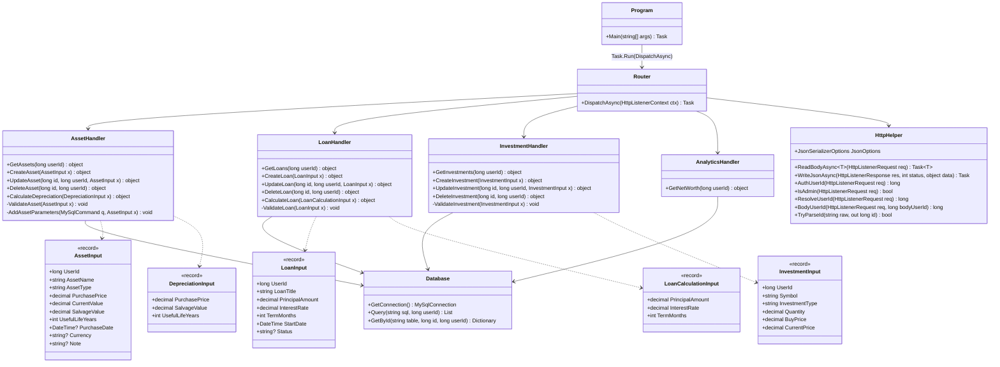

*(Mã nguồn sơ đồ: [docs/diagrams/03-class-diagrams-midterm.md](../diagrams/03-class-diagrams-midterm.md))*

*Hình 2-5: Biểu đồ Lớp Asset & Investment Service (C# .NET 10 Native `HttpListener`)*

**Phân tích chi tiết Hình 2-5:**
1. **Bộ định tuyến thủ công & Ánh xạ ngoại lệ (`Router.DispatchAsync`):** Chuẩn hóa đường dẫn về chữ thường, trích xuất `userId` qua `HttpHelper.ResolveUserId(req)` và bắt tập trung các ngoại lệ nghiệp vụ để trả đúng mã HTTP (`JsonException`/`ArgumentException` → `400`, `KeyNotFoundException` → `404`, lỗi hệ thống → `500`).
2. **Nhóm DTO bất biến dạng C# `record`:** Năm kiểu `sealed record` (`AssetInput`, `DepreciationInput`, `LoanInput`, `LoanCalculationInput`, `InvestmentInput`) kết hợp `JsonNamingPolicy.SnakeCaseLower` giúp chuyển đổi hai chiều giữa tên thuộc tính PascalCase trong C# và JSON `snake_case` của API mà không cần thư viện ngoài.

#### (b) Endpoints tiêu biểu

*(Lưu ý thiết kế: Asset Service phiên bản Giữa kỳ trả về trực tiếp đối tượng hoặc mảng JSON thuần không bọc `{success, data}`; lỗi trả về `{"error": "..."}`.)*

**Bảng 2.9: Danh mục Endpoints của Asset & Investment Service (`:8083`)**

| Method | Đường dẫn chính xác | Quyền truy cập | Tham số / Payload chính | Mã HTTP & Kết quả |
|---|---|---|---|---|
| `GET` | `/`, `/health` | Nội bộ / Trực tiếp | — | `200` `{service:"asset-service", status:"UP", version:"1.0.0-midterm"}` |
| `GET` / `POST` | `/api/assets` | JWT | `?user_id=` (ADMIN) / `AssetInput` JSON | `200` `[Asset]` / `201` `Asset` / `400` |
| `GET` / `PUT` / `DELETE` | `/api/assets/{id}` | JWT (Owner / `ADMIN`) | Path `id`, `?user_id=`, `AssetInput` | `200` `Asset` hoặc `{message, id}` / `404` |
| `GET` | `/api/assets/net-worth` | JWT | `?user_id=` | `200` `{user_id, total_net_worth, currency:"VND"}` |
| `POST` | `/api/assets/depreciation` | JWT | `{purchase_price, salvage_value, useful_life_years}` | `200` `{annual_depreciation, monthly_depreciation, ...}` |
| `GET` / `POST` | `/api/loans` | JWT | `?user_id=` / `LoanInput` JSON | `200` `[Loan]` / `201` `Loan` / `400` |
| `GET` / `PUT` / `DELETE` | `/api/loans/{id}` | JWT (Owner / `ADMIN`) | Path `id`, `LoanInput` JSON | `200` `Loan` hoặc `{message, id}` / `404` |
| `POST` | `/api/loans/calculate` | JWT | `{principal_amount, interest_rate, term_months}` | `200` `{principal_amount, annual_interest_rate, term_months, monthly_payment}` |
| `GET` / `POST` | `/api/investments` | JWT | `?user_id=` / `InvestmentInput` JSON | `200` `[Investment]` / `201` `Investment` / `400` |
| `GET` / `PUT` / `DELETE` | `/api/investments/{id}` | JWT (Owner / `ADMIN`) | Path `id`, `InvestmentInput` JSON | `200` `Investment` hoặc `{message, id}` / `404` |

#### (c) Thiết kế CSDL riêng & Bảng từ điển dữ liệu

CSDL **`asset_db`** trên **MySQL 8.0 InnoDB** (`utf8mb4_unicode_ci`) được định nghĩa trong `services/asset-service/db/init-asset-db.sql`, gồm 4 bảng: `assets`, `loans`, `investments` và `asset_history`.

**Bảng 2.10: Bảng `assets` (`asset_db`)**

| Cột | Kiểu SQL | Khóa | Cho phép NULL | Khai báo | Ý nghĩa |
|---|---|---|---|---|---|
| `id` | `BIGINT` | `PK` | Không | `AUTO_INCREMENT PRIMARY KEY` | Khóa chính tài sản. |
| `user_id` | `BIGINT` | `—` | Không | `NOT NULL` | Tham chiếu logic tới `auth_db.users.id`. |
| `asset_name` | `VARCHAR(100)` | `—` | Không | `NOT NULL` | Tên tài sản (ví dụ: *Tài khoản Tiết kiệm Vietcombank*, *MacBook Pro M3 Max*). |
| `asset_type` | `VARCHAR(50)` | `—` | Không | `NOT NULL` | Phân loại (`BANK_ACCOUNT`, `CASH`, `DEVICE`, `REAL_ESTATE`, ...). |
| `purchase_price` | `DECIMAL(18,2)` | `—` | Không | `NOT NULL DEFAULT 0.00` | Nguyên giá mua ban đầu. |
| `current_value` | `DECIMAL(18,2)` | `—` | Không | `NOT NULL DEFAULT 0.00` | Giá trị định giá hiện tại dùng để tính Net Worth. |
| `salvage_value` | `DECIMAL(18,2)` | `—` | Không | `NOT NULL DEFAULT 0.00` | Giá trị thu hồi thanh lý cuối vòng đời khấu hao. |
| `useful_life_years` | `INT` | `—` | Không | `NOT NULL DEFAULT 0` | Số năm sử dụng hữu ích để tính khấu hao tuyến tính. |
| `purchase_date` | `DATE` | `—` | Có | `NULL` | Ngày mua hoặc ngày ghi nhận tài sản. |
| `currency` | `VARCHAR(10)` | `—` | Có | `DEFAULT 'VND'` | Đơn vị tiền tệ của tài sản. |
| `note` | `TEXT` | `—` | Có | `NULL` | Ghi chú mô tả bổ sung. |
| `created_at` | `TIMESTAMP` | `—` | Có | `DEFAULT CURRENT_TIMESTAMP` | Thời điểm tạo bản ghi. |
| `updated_at` | `TIMESTAMP` | `—` | Có | `DEFAULT CURRENT_TIMESTAMP ON UPDATE CURRENT_TIMESTAMP` | Thời điểm cập nhật gần nhất. |

Ràng buộc bảng và chỉ mục trong SQL:
```sql
PRIMARY KEY (id),
INDEX idx_user_assets (user_id)
```

**Bảng 2.11: Bảng `loans` (`asset_db`)**

| Cột | Kiểu SQL | Khóa | Cho phép NULL | Khai báo | Ý nghĩa |
|---|---|---|---|---|---|
| `id` | `BIGINT` | `PK` | Không | `AUTO_INCREMENT PRIMARY KEY` | Khóa chính khoản vay. |
| `user_id` | `BIGINT` | `—` | Không | `NOT NULL` | Tham chiếu logic tới `auth_db.users.id`. |
| `loan_title` | `VARCHAR(150)` | `—` | Không | `NOT NULL` | Tên khoản vay (ví dụ: *Vay mua xe máy trả góp*). |
| `principal_amount` | `DECIMAL(18,2)` | `—` | Không | `NOT NULL` | Dư nợ gốc khoản vay. |
| `interest_rate` | `DECIMAL(5,2)` | `—` | Không | `NOT NULL` | Lãi suất danh nghĩa tính theo `%/năm`. |
| `term_months` | `INT` | `—` | Không | `NOT NULL` | Thời hạn vay tính theo tháng. |
| `start_date` | `DATE` | `—` | Không | `NOT NULL` | Ngày giải ngân / bắt đầu kỳ trả nợ. |
| `status` | `VARCHAR(20)` | `—` | Không | `NOT NULL DEFAULT 'ACTIVE'` | Trạng thái khoản vay (`ACTIVE` hoặc `CLOSED`). |
| `created_at` | `TIMESTAMP` | `—` | Có | `DEFAULT CURRENT_TIMESTAMP` | Thời điểm tạo bản ghi. |
| `updated_at` | `TIMESTAMP` | `—` | Có | `DEFAULT CURRENT_TIMESTAMP ON UPDATE CURRENT_TIMESTAMP` | Thời điểm cập nhật gần nhất. |

Ràng buộc bảng và chỉ mục trong SQL:
```sql
PRIMARY KEY (id),
INDEX idx_user_loans (user_id)
```

**Bảng 2.12: Bảng `investments` (`asset_db`)**

| Cột | Kiểu SQL | Khóa | Cho phép NULL | Khai báo | Ý nghĩa |
|---|---|---|---|---|---|
| `id` | `BIGINT` | `PK` | Không | `AUTO_INCREMENT PRIMARY KEY` | Khóa chính danh mục đầu tư. |
| `user_id` | `BIGINT` | `—` | Không | `NOT NULL` | Tham chiếu logic tới `auth_db.users.id`. |
| `symbol` | `VARCHAR(20)` | `—` | Không | `NOT NULL` | Mã tài sản đầu tư (ví dụ: `FPT`, `BTC`). |
| `investment_type` | `VARCHAR(50)` | `—` | Không | `NOT NULL` | Loại đầu tư (`STOCK`, `CRYPTO`, `GOLD`, `BOND`). |
| `quantity` | `DECIMAL(18,4)` | `—` | Không | `NOT NULL` | Khối lượng nắm giữ (hỗ trợ 4 chữ số thập phân cho Crypto). |
| `buy_price` | `DECIMAL(18,2)` | `—` | Không | `NOT NULL` | Giá vốn trung bình khi mua vào. |
| `current_price` | `DECIMAL(18,2)` | `—` | Không | `NOT NULL` | Thị giá hiện tại để đánh giá lãi/lỗ. |
| `created_at` | `TIMESTAMP` | `—` | Có | `DEFAULT CURRENT_TIMESTAMP` | Thời điểm tạo bản ghi. |
| `updated_at` | `TIMESTAMP` | `—` | Có | `DEFAULT CURRENT_TIMESTAMP ON UPDATE CURRENT_TIMESTAMP` | Thời điểm cập nhật gần nhất. |

Ràng buộc bảng và chỉ mục trong SQL:
```sql
PRIMARY KEY (id),
INDEX idx_user_investments (user_id)
```

**Bảng 2.13: Bảng `asset_history` (`asset_db`)**

| Cột | Kiểu SQL | Khóa | Cho phép NULL | Khai báo | Ý nghĩa |
|---|---|---|---|---|---|
| `id` | `BIGINT` | `PK` | Không | `AUTO_INCREMENT PRIMARY KEY` | Khóa chính lịch sử biến động giá trị tài sản. |
| `asset_id` | `BIGINT` | `FK → assets(id) ON DELETE CASCADE` | Không | `NOT NULL` | Liên kết tới tài sản tương ứng trong bảng `assets`. |
| `value` | `DECIMAL(18,2)` | `—` | Không | `NOT NULL` | Giá trị tài sản tại thời điểm ghi nhận. |
| `recorded_at` | `TIMESTAMP` | `—` | Có | `DEFAULT CURRENT_TIMESTAMP` | Mốc thời gian lưu vết biến động giá trị. |

Ràng buộc bảng và chỉ mục trong SQL:
```sql
PRIMARY KEY (id),
FOREIGN KEY (asset_id) REFERENCES assets(id) ON DELETE CASCADE
```
*(Ghi chú hiện thực: Bảng `asset_history` đã được thiết kế sẵn trong `init-asset-db.sql` để phục vụ mở rộng ở giai đoạn Cuối kỳ; trong các handler C# phiên bản Giữa kỳ, bảng này chưa được đọc hoặc ghi trực tiếp.)*

#### (d) Giải thuật nghiệp vụ & xử lý kỹ thuật tầng thấp

1. **Khấu hao tuyến tính & Tính Tài sản ròng (`AssetHandler.cs`, `AnalyticsHandler.cs`):**
   - Khấu hao tuyến tính: $\text{AnnualDepreciation} = \frac{\text{PurchasePrice} - \text{SalvageValue}}{\text{UsefulLifeYears}}$, $\text{MonthlyDepreciation} = \frac{\text{AnnualDepreciation}}{12}$, làm tròn 2 chữ số thập phân bằng `decimal.Round(..., 2)`.
   - Tài sản ròng (*Net Worth*): $\text{NetWorth} = \sum \text{assets.current\_value} - \sum \text{loans.principal\_amount (status = 'ACTIVE')}$.
2. **Công thức trả góp đều hằng tháng EMI (`LoanHandler.CalculateLoan()`):** Áp dụng công thức niên kim cố định với lãi suất tháng $r = \frac{\text{InterestRate}}{100 \times 12}$ và số kỳ $n = \text{TermMonths}$: $\text{EMI} = P \cdot \frac{r(1+r)^n}{(1+r)^n - 1}$ (hoặc $P / n$ nếu $r = 0$), kèm kiểm tra `double.IsFinite(payment)` tránh tràn số học.
3. **Vòng lặp thử lại kết nối MySQL (`Database.GetConnection()`):** Khi MySQL khởi động chậm trong Docker, `Database` thử kết nối tối đa 10 lần, mỗi lần chờ `1000ms` trước khi ném ngoại lệ.

Trích đoạn từ `services/asset-service/midterm/src/Handlers/LoanHandler.cs`:
```csharp
var r = (double)(x.InterestRate / 100m / 12m);
var factor = Math.Pow(1 + r, x.TermMonths);
var payment = r == 0 ? (double)x.PrincipalAmount / x.TermMonths
                     : (double)x.PrincipalAmount * r * factor / (factor - 1);
if (!double.IsFinite(payment) || payment > (double)decimal.MaxValue)
    throw new ArgumentException("Loan values exceed supported calculation range");
```
- **Xử lý biên số học:** Nhánh `r == 0` xử lý an toàn trường hợp khoản vay lãi suất `0%` để tránh phép chia cho $0$ tại mẫu số `(factor - 1)`.

---

### 2.2.4. Analytics Service (Python 3.11 Native `ThreadingHTTPServer` — Cổng 8084)

#### (a) Kiến trúc lớp/mô-đun & Biểu đồ Class

Dịch vụ Phân tích Dòng tiền (`services/analytics-service/midterm/src/main.py`) được cài đặt hoàn toàn bằng thư viện chuẩn Python (`http.server.ThreadingHTTPServer`, `BaseHTTPRequestHandler`, `urllib.request`, `statistics`, `json`) kết hợp duy nhất trình điều khiển MySQL là `PyMySQL==1.1.1` (cùng `cryptography` phục vụ bắt tay xác thực `caching_sha2_password` của MySQL 8.0). Trong mã nguồn thực tế, dịch vụ lưu báo cáo tổng hợp vào **MySQL 8.0 (`analytics_db.monthly_reports`)** chứ không dùng MongoDB hay SQLite như một số tài liệu nháp cũ trước đây.

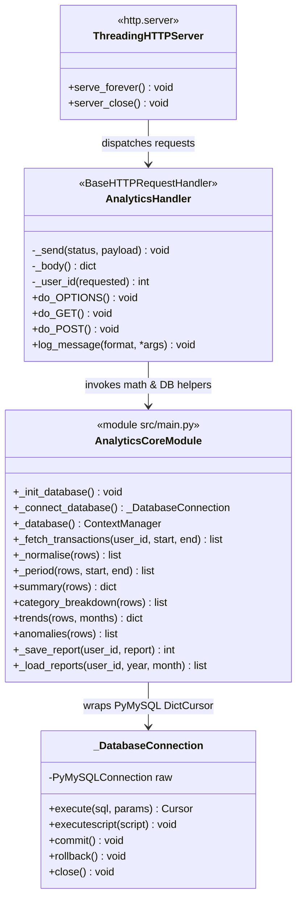

*(Mã nguồn sơ đồ: [docs/diagrams/03-class-diagrams-midterm.md](../diagrams/03-class-diagrams-midterm.md))*

*Hình 2-6: Biểu đồ Lớp & Mô-đun Analytics Service (Python 3.11 Native `ThreadingHTTPServer`)*

**Phân tích chi tiết Hình 2-6:**
1. **Xử lý đa luồng đồng thời (`ThreadingHTTPServer`):** Mỗi yêu cầu HTTP tới cổng `8084` được cấp một luồng riêng để thực thi `AnalyticsHandler` (`do_GET`, `do_POST`), tránh nghẽn toàn cục khi phải chờ gọi HTTP kéo dữ liệu phân trang từ `Transaction Service`.
2. **Tầng trừu tượng kết nối CSDL (`_DatabaseConnection`):** Bọc `PyMySQL` (`DictCursor`) kèm ngữ cảnh `_database()` tự động `commit()` hoặc `rollback()` và `close()`, đồng thời có cơ chế `_init_database()` thử kết nối tối đa 30 lần (mỗi lần cách nhau 2 giây) để tự tạo bảng `monthly_reports` từ `ANALYTICS_DB_SCHEMA` nếu chưa tồn tại.

#### (b) Endpoints tiêu biểu

**Bảng 2.14: Danh mục Endpoints của Analytics Service (`:8084`)**

| Method | Đường dẫn chính xác | Quyền truy cập | Tham số / Payload chính | Mã HTTP & Kết quả |
|---|---|---|---|---|
| `GET` | `/`, `/health` | Nội bộ / Trực tiếp | — | `200` `{service:"analytics-service", status:"UP", version:"1.0.0-midterm"}` |
| `GET` | `/api/analytics/summary` | JWT | `?user_id=&from_date=&to_date=` | `200` `{data:{transaction_count, income, expense, net_cashflow, currency:"VND"}, meta}` |
| `GET` | `/api/analytics/trends` | JWT | `?user_id=&from_date=&to_date=&months=6` (`1..36`) | `200` `{data:{history, forecast:{method:"trailing_average_3_months", ...}, anomalies}, meta}` |
| `GET` | `/api/analytics/category-breakdown` | JWT | `?user_id=&from_date=&to_date=` | `200` `{data:[{category, amount, percentage}], meta}` |
| `GET` | `/api/analytics/anomalies` | JWT | `?user_id=&from_date=&to_date=` | `200` `{data:[{transaction_id, category, amount, category_median, threshold, transaction_date}], meta}` |
| `GET` | `/api/analytics/reports` | JWT | `?user_id=&year=&month=` | `200` `{data:[...], meta:{user_id, limit:100}}` |
| `POST` | `/api/analytics/aggregate` | JWT | `{user_id?, from_date?, to_date?, transactions?[]}` | `201` `{data:{summary, category_breakdown, anomalies, report_id}, meta:{stored:true, database:"mysql"}}` |

*(Ghi chú thực tế từ `main.py`: `POST /api/analytics/aggregate` tính và lưu trữ bộ ba `summary`, `category_breakdown` và `anomalies` vào `monthly_reports`; phép tính `trends` và dự báo trượt 3 tháng được phục vụ tại `GET /api/analytics/trends`.)*

#### (c) Thiết kế CSDL riêng & Bảng từ điển dữ liệu

CSDL **`analytics_db`** chạy trên **MySQL 8.0 InnoDB** (`utf8mb4_unicode_ci`) theo cấu trúc tại `services/analytics-service/db/init-analytics-db.sql`, gồm 1 bảng `monthly_reports` tận dụng kiểu dữ liệu `JSON` gốc của MySQL 8.0.

**Bảng 2.15: Bảng `monthly_reports` (`analytics_db`)**

| Cột | Kiểu SQL | Khóa | Cho phép NULL | Khai báo | Ý nghĩa |
|---|---|---|---|---|---|
| `report_id` | `BIGINT UNSIGNED` | `PK` | Không | `NOT NULL AUTO_INCREMENT PRIMARY KEY` | Khóa chính bản ghi báo cáo tháng. |
| `user_id` | `BIGINT` | `UNIQUE uq_monthly_reports_user_period` | Không | `NOT NULL` | Tham chiếu logic tới `auth_db.users.id`. |
| `year` | `SMALLINT` | `UNIQUE uq_monthly_reports_user_period` | Không | `NOT NULL` | Năm báo cáo (ràng buộc `BETWEEN 2000 AND 2100`). |
| `month` | `TINYINT` | `UNIQUE uq_monthly_reports_user_period` | Không | `NOT NULL` | Tháng báo cáo (ràng buộc `BETWEEN 1 AND 12`). |
| `report_json` | `JSON` | `—` | Không | `NOT NULL` | Nội dung JSON tổng hợp gồm `summary`, `category_breakdown`, `anomalies`. |
| `generated_at` | `DATETIME` | `—` | Không | `NOT NULL` | Thời điểm tổng hợp báo cáo gần nhất. |
| `created_at` | `TIMESTAMP` | `—` | Không | `NOT NULL DEFAULT CURRENT_TIMESTAMP` | Thời điểm tạo bản ghi báo cáo đầu tiên. |
| `updated_at` | `TIMESTAMP` | `—` | Không | `NOT NULL DEFAULT CURRENT_TIMESTAMP ON UPDATE CURRENT_TIMESTAMP` | Thời điểm cập nhật (upsert) báo cáo gần nhất. |

Ràng buộc bảng và chỉ mục trong SQL:
```sql
PRIMARY KEY (report_id),
UNIQUE KEY uq_monthly_reports_user_period (user_id, year, month),
KEY idx_monthly_reports_user_period (user_id, year, month),
CONSTRAINT chk_monthly_reports_year CHECK (year BETWEEN 2000 AND 2100),
CONSTRAINT chk_monthly_reports_month CHECK (month BETWEEN 1 AND 12)
```

#### (d) Giải thuật nghiệp vụ & xử lý kỹ thuật tầng thấp

1. **Kéo dữ liệu phân trang liên dịch vụ (`_fetch_transactions()`):** Khi không nhận danh sách `transactions` truyền trực tiếp trong body, Analytics gọi `GET http://transaction-service:8082/api/transactions` theo từng trang kích thước `500` bản ghi (giới hạn an toàn tối đa `100.000` giao dịch, `timeout = 8s`, đính kèm header `X-User-Id`).
2. **Dự báo dòng tiền trượt 3 tháng (`trends()`):** Nhóm thu/chi theo từng tháng `YYYY-MM`, trích tối đa `months` tháng gần nhất và dự báo dòng tiền ròng tháng kế tiếp bằng trung bình cộng trượt của 3 tháng cuối (`sum(nets[-3:]) / len(nets[-3:])`).
3. **Phát hiện chi tiêu bất thường bằng độ lệch tuyệt đối trung vị (MAD — `anomalies()`):** Với mỗi danh mục có tối thiểu `4` giao dịch `EXPENSE`, thuật toán tính trung vị $M = \text{median}(X)$, độ lệch tuyệt đối trung vị $\text{MAD} = \text{median}(|x_i - M|)$ và ngưỡng cảnh báo $\text{Threshold} = M + 3 \times 1.4826 \times \text{MAD}$ (hoặc $2M$ nếu $\text{MAD} = 0$). Bất kỳ giao dịch nào có `amount > threshold` và `amount > median` đều bị gắn cờ bất thường. Nhờ sử dụng trung vị thay cho trung bình/độ lệch chuẩn thông thường, thuật toán không bị méo bởi chính các giao dịch đột biến (*Outlier Resistance*).

Trích đoạn từ `services/analytics-service/midterm/src/main.py`:
```python
median = statistics.median(values)
deviations = [abs(value - median) for value in values]
mad = statistics.median(deviations)
threshold = median + 3 * 1.4826 * mad if mad else median * 2
if row["amount"] > threshold and row["amount"] > median:
    flagged.append({
        "transaction_id": row["id"], "category": row["category"],
        "amount": row["amount"], "category_median": round(median, 2),
        "threshold": round(threshold, 2), "transaction_date": row["transaction_date"]
    })
```

---

### 2.2.5. Integration & Concurrency Service (Go 1.22 Native — Cổng 8085)

#### (a) Kiến trúc lớp/mô-đun & Biểu đồ Class

Dịch vụ Tích hợp Ngân hàng & Xử lý Đồng thời (`services/integration-service/midterm/`) được viết bằng **Go 1.22 thuần** với bộ định tuyến chuẩn mới `http.NewServeMux` (hỗ trợ cú pháp `METHOD /path/{id}`), thư viện `database/sql` kết nối duy nhất qua `github.com/go-sql-driver/mysql v1.7.1`, không dùng bất kỳ web framework hay ORM nào.

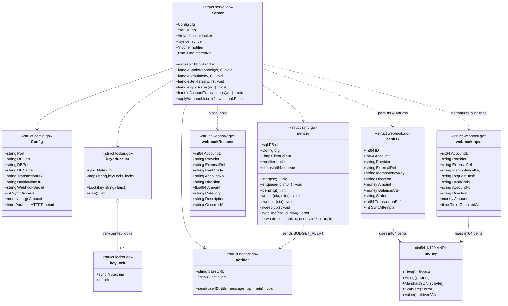

*(Mã nguồn sơ đồ: [docs/diagrams/03-class-diagrams-midterm.md](../diagrams/03-class-diagrams-midterm.md))*

*Hình 2-7: Biểu đồ Cấu trúc & Mô-đun Integration & Concurrency Service (Go 1.22 Native)*

**Phân tích chi tiết Hình 2-7:**
1. **Kiến trúc hướng cấu trúc & đồng thời (`Server`, `keyedLocker`, `syncer`, `notifier`):** `Server` nắm giữ bể kết nối `*sql.DB` (`MaxOpenConns = 30`, `MaxIdleConns = 10`), khóa tinh gọn theo từng tài khoản `keyedLocker` (dùng cơ chế đếm tham chiếu `refs` để tự xóa mục bản đồ khi không còn goroutine chờ, tránh rò rỉ bộ nhớ) và bộ đồng bộ nền `syncer` chạy 4 goroutine `worker` cùng 1 `sweeper`.
2. **Kiểu dữ liệu tiền tệ chính xác `money` (`int64`):** Toàn bộ số dư và số tiền giao dịch được biểu diễn nội bộ bằng số nguyên `int64` theo đơn vị `1/100 VND` (cài đặt giao diện `sql.Scanner`, `driver.Valuer`, `json.Marshaler`), triệt tiêu sai số dấu phẩy động `float64` khi cộng trừ hàng nghìn giao dịch đồng thời.

#### (b) Endpoints tiêu biểu

**Bảng 2.16: Danh mục Endpoints của Integration & Concurrency Service (`:8085`)**

| Method | Đường dẫn chính xác | Quyền truy cập | Tham số / Header / Payload | Mã HTTP & Kết quả |
|---|---|---|---|---|
| `GET` | `/`, `/health` | Nội bộ / Trực tiếp | — | `200` / `503` `{status, database, sync_queue, active_locks, uptime}` |
| `GET` | `/api/integrations/rates` | Công khai | `?currency=USD` | `200` `{data:[{currency_code, rate_to_vnd, updated_at}]}` / `404` |
| `POST` | `/api/integrations/sync-rates` | JWT | — | `200` `{providers_ok, providers, rates}` / `503` |
| `GET` / `POST` | `/api/integrations/accounts` | JWT | `{bank_code, account_no, holder_name, initial_balance}` | `200` / `201` / `409 ACCOUNT_EXISTS` / `422` |
| `GET` / `DELETE` | `/api/integrations/accounts/{id}` | JWT (Owner / `ADMIN`) | Path `id` | `200` / `400` / `404` |
| `GET` | `/api/integrations/accounts/{id}/transactions` | JWT (Owner / `ADMIN`) | `?status=&limit=50` (`1..200`) | `200` `{data:[bankTx]}` / `404` |
| `POST` | `/api/integrations/webhooks/banking` | Công khai | Header `Idempotency-Key`, `X-Signature`; JSON/Form/Query | `201` (mới), `200` (`duplicate:true`), `401`, `409` (`IDEMPOTENCY_CONFLICT`), `422` (`REJECTED`) |
| `GET` / `DELETE` | `/api/integrations/bank-transactions/{id}` | JWT (Owner / `ADMIN`) | Path `id` | `200` / `400` / `404` |
| `DELETE` | `/api/integrations/bank-transactions` | JWT (Owner / `ADMIN`) | `?ids=1,2,3&account_id=&status=` | `200` `{deleted_count, ...}` |
| `POST` | `/api/integrations/bank-transactions/{id}/retry` | JWT (Owner / `ADMIN`) | Path `id` | `202` `{data:{id}}` / `409 NOT_RETRYABLE` |
| `POST` | `/api/integrations/simulate` | JWT (Owner / `ADMIN`) | `{account_id, events<=2000, workers<=200, duplicate_rate, mode:"safe"|"unsafe"}` | `200` `{balance_before, balance_after, expected_balance, difference, consistent}` |

#### (c) Thiết kế CSDL riêng & Bảng từ điển dữ liệu

CSDL **`integration_db`** vận hành trên **MySQL 8.0 InnoDB** (`utf8mb4_unicode_ci`) theo tệp `services/integration-service/db/init-integration-db.sql`, gồm 4 bảng: `exchange_rates`, `linked_accounts`, `bank_transactions` và `external_webhooks`.

**Bảng 2.17: Bảng `exchange_rates` (`integration_db`)**

| Cột | Kiểu SQL | Khóa | Cho phép NULL | Khai báo | Ý nghĩa |
|---|---|---|---|---|---|
| `id` | `INT` | `PK` | Không | `AUTO_INCREMENT PRIMARY KEY` | Khóa chính tỷ giá. |
| `currency_code` | `VARCHAR(10)` | `UNIQUE` | Không | `NOT NULL UNIQUE` | Mã ngoại tệ (`USD`, `EUR`, `GBP`, `JPY`, `SGD`, `CNY`). |
| `rate_to_vnd` | `DECIMAL(15,4)` | `—` | Không | `NOT NULL` | Tỷ giá quy đổi sang VND (ràng buộc `rate_to_vnd > 0`). |
| `updated_at` | `TIMESTAMP` | `—` | Có | `DEFAULT CURRENT_TIMESTAMP ON UPDATE CURRENT_TIMESTAMP` | Thời điểm đồng bộ tỷ giá gần nhất. |

Ràng buộc bảng và chỉ mục trong SQL:
```sql
PRIMARY KEY (id),
UNIQUE (currency_code),
CONSTRAINT chk_rate_positive CHECK (rate_to_vnd > 0)
```

**Bảng 2.18: Bảng `linked_accounts` (`integration_db`)**

| Cột | Kiểu SQL | Khóa | Cho phép NULL | Khai báo | Ý nghĩa |
|---|---|---|---|---|---|
| `id` | `BIGINT` | `PK` | Không | `AUTO_INCREMENT PRIMARY KEY` | Khóa chính tài khoản liên kết (`1..4` được seed sẵn). |
| `user_id` | `BIGINT` | `—` | Không | `NOT NULL` | Tham chiếu logic tới `auth_db.users.id`. |
| `bank_code` | `VARCHAR(20)` | `UNIQUE uq_bank_account` | Không | `NOT NULL` | Mã ngân hàng hoặc ví (`VCB`, `MOMO`, `TCB`, `BIDV`). |
| `account_no` | `VARCHAR(30)` | `UNIQUE uq_bank_account` | Không | `NOT NULL` | Số tài khoản ngân hàng / số ví. |
| `holder_name` | `VARCHAR(100)` | `—` | Không | `NOT NULL` | Tên chủ tài khoản. |
| `balance` | `DECIMAL(18,2)` | `—` | Không | `NOT NULL DEFAULT 0` | Số dư hiện tại (ràng buộc `balance >= 0`). |
| `version` | `BIGINT` | `—` | Không | `NOT NULL DEFAULT 0` | Bộ đếm phiên bản tăng tuần tự mỗi lần cập nhật số dư. |
| `created_at` | `TIMESTAMP` | `—` | Có | `DEFAULT CURRENT_TIMESTAMP` | Thời điểm liên kết tài khoản. |
| `updated_at` | `TIMESTAMP` | `—` | Có | `DEFAULT CURRENT_TIMESTAMP ON UPDATE CURRENT_TIMESTAMP` | Thời điểm biến động số dư gần nhất. |

Ràng buộc bảng và chỉ mục trong SQL:
```sql
PRIMARY KEY (id),
UNIQUE KEY uq_bank_account (bank_code, account_no),
INDEX idx_linked_user (user_id),
CONSTRAINT chk_balance_not_negative CHECK (balance >= 0)
```

**Bảng 2.19: Bảng `bank_transactions` (`integration_db`)**

| Cột | Kiểu SQL | Khóa | Cho phép NULL | Khai báo | Ý nghĩa |
|---|---|---|---|---|---|
| `id` | `BIGINT` | `PK` | Không | `AUTO_INCREMENT PRIMARY KEY` | Khóa chính biến động số dư ngân hàng. |
| `account_id` | `BIGINT` | `FK → linked_accounts(id) ON DELETE CASCADE` | Không | `NOT NULL` | Tài khoản ngân hàng phát sinh biến động. |
| `provider` | `VARCHAR(20)` | `UNIQUE uq_provider_ref` | Không | `NOT NULL` | Nguồn cung cấp webhook (`VCB`, `MOMO`, ...). |
| `external_ref` | `VARCHAR(100)` | `UNIQUE uq_provider_ref` | Không | `NOT NULL` | Mã tham chiếu giao dịch phía ngân hàng. |
| `idempotency_key` | `VARCHAR(150)` | `UNIQUE uq_idempotency_key` | Không | `NOT NULL` | Khóa lũy đẳng duy nhất chống xử lý trùng. |
| `request_hash` | `CHAR(64)` | `—` | Không | `NOT NULL` | Mã băm `SHA-256` phát hiện xung đột payload cùng khóa. |
| `direction` | `ENUM('CREDIT','DEBIT')` | `—` | Không | `NOT NULL` | Chiều giao dịch (`CREDIT` cộng tiền, `DEBIT` trừ tiền). |
| `amount` | `DECIMAL(18,2)` | `—` | Không | `NOT NULL` | Số tiền biến động (ràng buộc `amount > 0`). |
| `balance_after` | `DECIMAL(18,2)` | `—` | Không | `NOT NULL` | Số dư sau giao dịch được ghi nhận tại thời điểm khóa. |
| `category` | `VARCHAR(100)` | `—` | Không | `NOT NULL DEFAULT ''` | Danh mục gợi ý khi đẩy sang Transaction Service. |
| `description` | `VARCHAR(255)` | `—` | Không | `NOT NULL DEFAULT ''` | Nội dung chuyển khoản / diễn giải. |
| `occurred_at` | `DATETIME` | `—` | Không | `NOT NULL` | Thời điểm phát sinh biến động tại ngân hàng. |
| `status` | `ENUM('RECEIVED','SYNCING','SYNCED','FAILED','REJECTED')` | `—` | Không | `NOT NULL DEFAULT 'RECEIVED'` | Trạng thái máy trạng thái đồng bộ sang Transaction Service. |
| `transaction_ref` | `BIGINT` | `—` | Có | `NULL` | Tham chiếu logic tới `transaction_db.transactions.id` sau khi `SYNCED`. |
| `sync_attempts` | `INT` | `—` | Không | `NOT NULL DEFAULT 0` | Số lần Worker đã thử đồng bộ (tối đa `5`). |
| `last_error` | `VARCHAR(255)` | `—` | Có | `NULL` | Thông báo lỗi gần nhất nếu đồng bộ thất bại. |
| `created_at` | `TIMESTAMP` | `—` | Có | `DEFAULT CURRENT_TIMESTAMP` | Thời điểm tiếp nhận webhook. |
| `updated_at` | `TIMESTAMP` | `—` | Có | `DEFAULT CURRENT_TIMESTAMP ON UPDATE CURRENT_TIMESTAMP` | Thời điểm chuyển trạng thái gần nhất (dùng cho `sweeper`). |

Ràng buộc bảng và chỉ mục trong SQL:
```sql
PRIMARY KEY (id),
UNIQUE KEY uq_idempotency_key (idempotency_key),
UNIQUE KEY uq_provider_ref (provider, external_ref),
INDEX idx_bank_tx_account (account_id, occurred_at),
INDEX idx_bank_tx_status (status, updated_at),
CONSTRAINT fk_bank_tx_account FOREIGN KEY (account_id) REFERENCES linked_accounts (id) ON DELETE CASCADE,
CONSTRAINT chk_amount_positive CHECK (amount > 0)
```

**Bảng 2.20: Bảng `external_webhooks` (`integration_db`)**

| Cột | Kiểu SQL | Khóa | Cho phép NULL | Khai báo | Ý nghĩa |
|---|---|---|---|---|---|
| `id` | `BIGINT` | `PK` | Không | `AUTO_INCREMENT PRIMARY KEY` | Khóa chính nhật ký webhook thô. |
| `provider_name` | `VARCHAR(50)` | `—` | Không | `NOT NULL` | Tên đối tác gửi webhook. |
| `event_type` | `VARCHAR(50)` | `—` | Không | `NOT NULL` | Loại sự kiện (mặc định `'BANK_TRANSACTION'` tại `webhook.go`). |
| `payload` | `JSON` | `—` | Có | `NULL` | Toàn văn payload gốc phục vụ đối soát kiểm toán. |
| `received_at` | `TIMESTAMP` | `—` | Có | `DEFAULT CURRENT_TIMESTAMP` | Thời điểm nhận webhook tại dịch vụ. |

Ràng buộc bảng và chỉ mục trong SQL:
```sql
PRIMARY KEY (id),
INDEX idx_webhook_provider (provider_name, received_at)
```

#### (d) Giải thuật nghiệp vụ & xử lý kỹ thuật tầng thấp

1. **Khóa đồng thời 2 tầng (`webhook.go` & `locker.go`):**
   - *Tầng 1 (In-process Per-account Mutex):* `s.locker.Lock(in.BankCode + ":" + in.AccountNo)` sắp xếp tuần tự các goroutine tác động lên cùng một tài khoản ngay trong RAM Go, giảm áp lực tranh chấp lock xuống MySQL.
   - *Tầng 2 (Database Pessimistic Lock):* Mở giao dịch ở mức cô lập `sql.LevelReadCommitted` (tránh *Gap Lock* dễ gây deadlock của `RepeatableRead`) và thực thi `SELECT id, user_id, balance FROM linked_accounts WHERE bank_code = ? AND account_no = ? FOR UPDATE`. Nếu gặp deadlock (`1213`) hoặc hết thời gian chờ lock (`1205`), `processWebhook` tự động thử lại tối đa 3 lần.
2. **Idempotency 3 lớp:** Sau khi giữ khóa dòng tài khoản, hàm `findExisting` kiểm tra trùng theo `idempotency_key` hoặc cặp `(provider, external_ref)`. Nếu đã tồn tại, `duplicateOf()` đối chiếu `SHA-256 request_hash` (`provider|external_ref|bank_code|account_no|direction|amount_cents`) — trùng hash trả `200 OK` (`duplicate: true`), lệch hash trả `409 IDEMPOTENCY_CONFLICT`. Chốt chặn thứ ba là hai ràng buộc `UNIQUE KEY` ở tầng MySQL.

Trích đoạn từ `services/integration-service/midterm/src/webhook.go`:
```go
unlock := s.locker.Lock(in.BankCode + ":" + in.AccountNo)
defer unlock()

tx, err := s.db.BeginTx(ctx, &sql.TxOptions{Isolation: sql.LevelReadCommitted})
if err != nil {
    return webhookResult{}, err
}
defer tx.Rollback()

err = tx.QueryRowContext(ctx,
    "SELECT id, user_id, balance FROM linked_accounts WHERE bank_code = ? AND account_no = ? FOR UPDATE",
    in.BankCode, in.AccountNo).Scan(&accID, &userID, &balance)
```

---

### 2.2.6. Notification Service (Node.js 20 Native SSE & Raw TCP RESP — Cổng 8086)

#### (a) Kiến trúc lớp/mô-đun & Biểu đồ Class

Dịch vụ Thông báo (`services/notification-service/midterm/`) được viết bằng **Node.js 20 thuần (Zero-dependency)**, cài đặt thủ công máy chủ SSE (`text/event-stream`) và giao thức khách **Redis RESP qua Raw TCP Socket (`node:net`)** mà không cài thư viện `redis` hay `socket.io`.

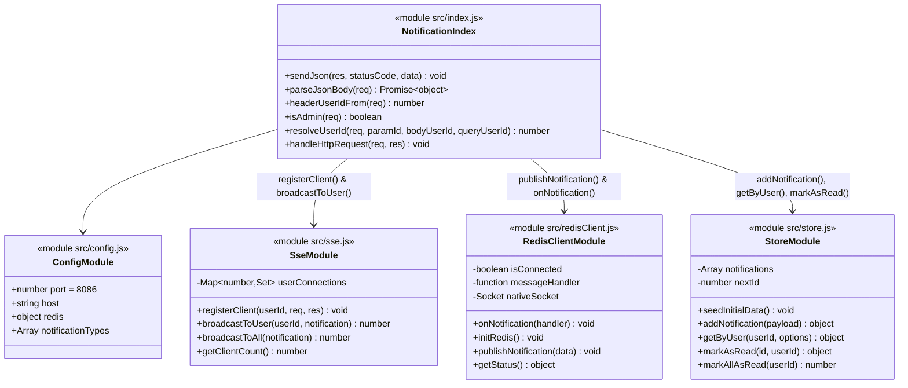

*(Mã nguồn sơ đồ: [docs/diagrams/03-class-diagrams-midterm.md](../diagrams/03-class-diagrams-midterm.md))*

*Hình 2-8: Biểu đồ Mô-đun Notification Service (Node.js 20 Native SSE & Raw TCP RESP)*

**Phân tích chi tiết Hình 2-8:**
1. **Quản lý đa kết nối SSE theo người dùng (`SseModule`):** Dùng cấu trúc `userConnections: Map<userId, Set<ServerResponse>>` cho phép một người dùng mở nhiều tab trình duyệt cùng lúc đều nhận được sự kiện song song; khi đóng tab (`req.on('close')`), hệ thống hủy bộ đếm heartbeat và xóa socket khỏi `Set`.
2. **Bảo vệ Anti-IDOR tại `NotificationIndex`:** Mọi endpoint nhận `userId` đều gọi `resolveUserId(...)`, bỏ qua `{userId}` trên path hoặc query nếu người dùng thường (`USER`) cố tình truy vấn tài khoản khác và bắt buộc dùng `X-User-Id` từ Gateway (chỉ `ADMIN` mới được phép xem thay).

#### (b) Endpoints tiêu biểu

**Bảng 2.21: Danh mục Endpoints của Notification Service (`:8086`)**

| Method | Đường dẫn chính xác | Quyền truy cập | Tham số / Payload chính | Mã HTTP & Kết quả |
|---|---|---|---|---|
| `GET` | `/`, `/health` | Nội bộ / Trực tiếp | — | `200` `{status:"UP", redis:{connected, channel}, activeSseClients}` |
| `GET` | `/api/notifications/stream` | JWT hoặc `?user_id=` (Browser `EventSource`) | `?user_id=` | `200` `text/event-stream` (`event: connected`, `event: notification`, `: keep-alive ping`) |
| `GET` | `/api/notifications` | JWT | `?user_id=&limit=50&offset=0&unread_only=` | `200` `{success:true, userId, items, total, unreadCount}` |
| `GET` | `/api/notifications/user/{userId}` | JWT (Owner / `ADMIN`) | Path `userId`, `?limit=&offset=&unread_only=` | `200` `{success:true, userId, items, total, unreadCount}` |
| `POST` | `/api/notifications/send`, `/api/notifications` | JWT hoặc Nội bộ (Go Integration) | `{userId?, user_id?, title, message, type?, metadata?}` | `201` `{data:notification, realtimeDelivered, activeClients}` / `400` |
| `PUT` | `/api/notifications/{id}/read` | JWT (Owner / `ADMIN`) | Path `id`, `?user_id=` | `200` `{success:true, data:notification}` / `404` |
| `PUT` | `/api/notifications/read-all` | JWT | `?user_id=` | `200` `{success:true, updatedCount}` |

#### (c) Mô hình lưu trữ In-Memory & Redis Pub/Sub

Khác với năm dịch vụ còn lại, Notification Service phiên bản Giữa kỳ **không sở hữu cơ sở dữ liệu MySQL riêng**. Các thông báo được lưu tạm trong mảng bộ nhớ `notifications` của `store.js` (khởi tạo sẵn 3 thông báo mẫu cho `userId: 1` và 1 thông báo cho `userId: 2` qua `seedInitialData()`), kết hợp kênh **Redis 7 Pub/Sub (`cashflow:notifications`)** để phát sự kiện phân tán.

#### (d) Giải thuật nghiệp vụ & xử lý kỹ thuật tầng thấp

1. **Duy trì kênh SSE chống ngắt kết nối (`sse.js`):** Đặt header `Content-Type: text/event-stream; charset=utf-8`, `Cache-Control: no-cache, no-transform` và `X-Accel-Buffering: no`, phát sự kiện chào mừng `event: connected` ngay khi kết nối và gửi gói tin bình luận `: keep-alive ping\n\n` mỗi `25000ms` để trình duyệt hoặc proxy không đóng socket vì nhàn rỗi.
2. **Cài đặt thủ công giao thức Redis RESP trên TCP Socket thô (`redisClient.js`):** Khi khởi động, `initRedis()` mở kết nối `net.createConnection` tới `redis:6379`, gửi chuỗi `SUBSCRIBE cashflow:notifications\r\n` và tự động kết nối lại sau `5000ms` nếu đứt kết nối. Khi phát tin, `publishNotification()` đóng gói khung mảng RESP `*3\r\n$7\r\nPUBLISH\r\n$<len>\r\n<channel>\r\n$<len>\r\n<payload>\r\n` và đẩy qua socket TCP.

Trích đoạn từ `services/notification-service/midterm/src/redisClient.js`:
```javascript
const pubSocket = net.createConnection({ host: config.redis.host, port: config.redis.port }, () => {
  const args = ['PUBLISH', config.redis.channel, payload];
  const resp = `*${args.length}\r\n` + args.map((a) => `$${Buffer.byteLength(a)}\r\n${a}\r\n`).join('');
  pubSocket.write(resp);
  setTimeout(() => pubSocket.end(), 200).unref();
});
```

---

## 2.3. Giao tiếp liên dịch vụ & Xử lý ràng buộc

### Mô hình Dữ liệu Phân tán Toàn hệ thống (Database-per-Service ERD)

Tổng hợp từ thiết kế dữ liệu của cả 6 microservices, Hình 2-9 biểu diễn bức tranh ERD chuẩn hóa trên toàn hệ thống với **14 bảng vật lý nằm trong 5 CSDL MySQL 8.0 độc lập**.

```mermaid
erDiagram
    %% ===== DB 1: auth_db (2 bảng) =====
    users {
        BIGINT id PK "AUTO_INCREMENT"
        VARCHAR_50 username UK "NOT NULL"
        VARCHAR_100 email UK "NOT NULL"
        VARCHAR_255 password_hash "PBKDF2 210k"
        VARCHAR_100 full_name "NULL"
        VARCHAR_20 phone_number "NULL"
        VARCHAR_20 role "USER | ADMIN"
        VARCHAR_20 status "ACTIVE | BLOCKED"
        TIMESTAMP created_at "DEFAULT CURRENT_TIMESTAMP"
        TIMESTAMP updated_at "ON UPDATE CURRENT_TIMESTAMP"
    }

    refresh_tokens {
        BIGINT id PK "AUTO_INCREMENT"
        BIGINT user_id FK "REFERENCES users(id) ON DELETE CASCADE"
        VARCHAR_255 token UK "48-byte Base64URL"
        TIMESTAMP expiry_date "NOT NULL (7 days)"
        TIMESTAMP created_at "DEFAULT CURRENT_TIMESTAMP"
    }

    users ||--o{ refresh_tokens : "sở hữu (FK ON DELETE CASCADE)"

    %% ===== DB 2: transaction_db (3 bảng) =====
    categories {
        INT id PK "AUTO_INCREMENT"
        VARCHAR_100 name "NOT NULL"
        ENUM type "INCOME | EXPENSE"
        VARCHAR_100 icon "FontAwesome class"
    }

    transactions {
        BIGINT id PK "AUTO_INCREMENT"
        BIGINT user_id "Logical ref -> auth_db.users.id"
        INT category_id FK "REFERENCES categories(id) ON DELETE SET NULL"
        VARCHAR_100 category "Denormalized name"
        DECIMAL_15_2 amount "NOT NULL"
        ENUM type "INCOME | EXPENSE | TRANSFER"
        TEXT description "NULL"
        DATETIME transaction_date "INDEX idx_user_trans"
        TIMESTAMP created_at "DEFAULT CURRENT_TIMESTAMP"
        TIMESTAMP updated_at "ON UPDATE CURRENT_TIMESTAMP"
    }

    budgets {
        INT id PK "AUTO_INCREMENT"
        BIGINT user_id "Logical ref -> auth_db.users.id"
        INT category_id FK "REFERENCES categories(id) ON DELETE CASCADE"
        DECIMAL_15_2 amount_limit "NOT NULL"
        ENUM period "MONTHLY | YEARLY"
        DATE start_date "INDEX idx_user_budget"
        DATE end_date "INDEX idx_user_budget"
        TIMESTAMP created_at "DEFAULT CURRENT_TIMESTAMP"
        TIMESTAMP updated_at "ON UPDATE CURRENT_TIMESTAMP"
    }

    categories ||--o{ transactions : "phân loại (FK ON DELETE SET NULL)"
    categories ||--o{ budgets : "áp dụng (FK ON DELETE CASCADE)"

    %% ===== DB 3: asset_db (4 bảng) =====
    assets {
        BIGINT id PK "AUTO_INCREMENT"
        BIGINT user_id "Logical ref -> auth_db.users.id"
        VARCHAR_100 asset_name "NOT NULL"
        VARCHAR_50 asset_type "BANK_ACCOUNT | CASH | DEVICE..."
        DECIMAL_18_2 purchase_price "DEFAULT 0.00"
        DECIMAL_18_2 current_value "DEFAULT 0.00"
        DECIMAL_18_2 salvage_value "DEFAULT 0.00"
        INT useful_life_years "DEFAULT 0"
        DATE purchase_date "NULL"
        VARCHAR_10 currency "DEFAULT VND"
        TEXT note "NULL"
        TIMESTAMP created_at "DEFAULT CURRENT_TIMESTAMP"
        TIMESTAMP updated_at "ON UPDATE CURRENT_TIMESTAMP"
    }

    asset_history {
        BIGINT id PK "AUTO_INCREMENT"
        BIGINT asset_id FK "REFERENCES assets(id) ON DELETE CASCADE (Midterm chưa dùng)"
        DECIMAL_18_2 value "NOT NULL"
        TIMESTAMP recorded_at "DEFAULT CURRENT_TIMESTAMP"
    }

    loans {
        BIGINT id PK "AUTO_INCREMENT"
        BIGINT user_id "Logical ref -> auth_db.users.id"
        VARCHAR_150 loan_title "NOT NULL"
        DECIMAL_18_2 principal_amount "NOT NULL"
        DECIMAL_5_2 interest_rate "%/năm"
        INT term_months "NOT NULL"
        DATE start_date "NOT NULL"
        VARCHAR_20 status "ACTIVE | CLOSED"
        TIMESTAMP created_at "DEFAULT CURRENT_TIMESTAMP"
        TIMESTAMP updated_at "ON UPDATE CURRENT_TIMESTAMP"
    }

    investments {
        BIGINT id PK "AUTO_INCREMENT"
        BIGINT user_id "Logical ref -> auth_db.users.id"
        VARCHAR_20 symbol "FPT | BTC..."
        VARCHAR_50 investment_type "STOCK | CRYPTO | GOLD | BOND"
        DECIMAL_18_4 quantity "NOT NULL"
        DECIMAL_18_2 buy_price "NOT NULL"
        DECIMAL_18_2 current_price "NOT NULL"
        TIMESTAMP created_at "DEFAULT CURRENT_TIMESTAMP"
        TIMESTAMP updated_at "ON UPDATE CURRENT_TIMESTAMP"
    }

    assets ||--o{ asset_history : "lịch sử định giá (FK ON DELETE CASCADE)"

    %% ===== DB 4: analytics_db (1 bảng) =====
    monthly_reports {
        BIGINT_UNSIGNED report_id PK "AUTO_INCREMENT"
        BIGINT user_id UK "uq_monthly_reports_user_period"
        SMALLINT year UK "CHECK 2000..2100"
        TINYINT month UK "CHECK 1..12"
        JSON report_json "summary, category_breakdown, anomalies"
        DATETIME generated_at "NOT NULL"
        TIMESTAMP created_at "DEFAULT CURRENT_TIMESTAMP"
        TIMESTAMP updated_at "ON UPDATE CURRENT_TIMESTAMP"
    }

    %% ===== DB 5: integration_db (4 bảng) =====
    exchange_rates {
        INT id PK "AUTO_INCREMENT"
        VARCHAR_10 currency_code UK "USD | EUR | GBP | JPY | SGD | CNY"
        DECIMAL_15_4 rate_to_vnd "CHECK rate_to_vnd > 0"
        TIMESTAMP updated_at "ON UPDATE CURRENT_TIMESTAMP"
    }

    linked_accounts {
        BIGINT id PK "AUTO_INCREMENT"
        BIGINT user_id "Logical ref -> auth_db.users.id"
        VARCHAR_20 bank_code UK "uq_bank_account"
        VARCHAR_30 account_no UK "uq_bank_account"
        VARCHAR_100 holder_name "NOT NULL"
        DECIMAL_18_2 balance "CHECK balance >= 0"
        BIGINT version "Optimistic/audit counter"
        TIMESTAMP created_at "DEFAULT CURRENT_TIMESTAMP"
        TIMESTAMP updated_at "ON UPDATE CURRENT_TIMESTAMP"
    }

    bank_transactions {
        BIGINT id PK "AUTO_INCREMENT"
        BIGINT account_id FK "REFERENCES linked_accounts(id) ON DELETE CASCADE"
        VARCHAR_20 provider UK "uq_provider_ref"
        VARCHAR_100 external_ref UK "uq_provider_ref"
        VARCHAR_150 idempotency_key UK "uq_idempotency_key"
        CHAR_64 request_hash "SHA-256 hex"
        ENUM direction "CREDIT | DEBIT"
        DECIMAL_18_2 amount "CHECK amount > 0"
        DECIMAL_18_2 balance_after "NOT NULL"
        VARCHAR_100 category "DEFAULT ''"
        VARCHAR_255 description "DEFAULT ''"
        DATETIME occurred_at "NOT NULL"
        ENUM status "RECEIVED | SYNCING | SYNCED | FAILED | REJECTED"
        BIGINT transaction_ref "Logical ref -> transaction_db.transactions.id"
        INT sync_attempts "DEFAULT 0 (max 5)"
        VARCHAR_255 last_error "NULL"
        TIMESTAMP created_at "DEFAULT CURRENT_TIMESTAMP"
        TIMESTAMP updated_at "ON UPDATE CURRENT_TIMESTAMP"
    }

    external_webhooks {
        BIGINT id PK "AUTO_INCREMENT"
        VARCHAR_50 provider_name "INDEX idx_webhook_provider"
        VARCHAR_50 event_type "BANK_TRANSACTION"
        JSON payload "Raw audit JSON"
        TIMESTAMP received_at "DEFAULT CURRENT_TIMESTAMP"
    }

    linked_accounts ||--o{ bank_transactions : "phát sinh (FK ON DELETE CASCADE)"

    %% ===== Liên kết Logic Xuyên Dịch vụ (Không tạo FK vật lý) =====
    users ||..o{ transactions : "logic: user_id"
    users ||..o{ budgets : "logic: user_id"
    users ||..o{ assets : "logic: user_id"
    users ||..o{ loans : "logic: user_id"
    users ||..o{ investments : "logic: user_id"
    users ||..o{ monthly_reports : "logic: user_id"
    users ||..o{ linked_accounts : "logic: user_id"
    bank_transactions |o..o| transactions : "logic: transaction_ref"
```

*(Mã nguồn sơ đồ: [docs/diagrams/04-erd-database-per-service.md](../diagrams/04-erd-database-per-service.md))*

*Hình 2-9: Mô hình ERD Chuẩn hóa Database-per-Service (14 Bảng trên 5 CSDL MySQL 8.0 & Redis/In-Memory Store)*

**Phân tích chi tiết Hình 2-9:**
1. **Bản số & Khóa ngoại vật lý trong từng CSDL (Intra-DB Integrity):**
   - Trong `auth_db`: `users (1) — (0..N) refresh_tokens` (`ON DELETE CASCADE`).
   - Trong `transaction_db`: `categories (1) — (0..N) transactions` (`ON DELETE SET NULL` để giữ lịch sử giao dịch khi xóa danh mục) và `categories (1) — (0..N) budgets` (`ON DELETE CASCADE`).
   - Trong `asset_db`: `assets (1) — (0..N) asset_history` (`ON DELETE CASCADE`), còn `loans` và `investments` độc lập theo `user_id`.
   - Trong `analytics_db`: chỉ có 1 bảng `monthly_reports` lưu tổng hợp dạng JSON với khóa duy nhất tổ hợp `(user_id, year, month)`.
   - Trong `integration_db`: `linked_accounts (1) — (0..N) bank_transactions` (`ON DELETE CASCADE`), còn `exchange_rates` và `external_webhooks` độc lập.
2. **Ranh giới cô lập xuyên CSDL (Cross-DB Logical Links):** Tuyệt đối không có ràng buộc `FOREIGN KEY` vật lý xuyên qua biên giới 5 container MySQL. Mọi tham chiếu sở hữu đều là tham chiếu logic thông qua trường `user_id` (trỏ tới `auth_db.users.id`) và `bank_transactions.transaction_ref` (trỏ tới `transaction_db.transactions.id`). Riêng `Notification Service` không xuất hiện như một bảng SQL mà nằm ở tầng lưu trữ tạm trong bộ nhớ và Redis Pub/Sub, khắc phục hoàn toàn điểm chưa chuẩn của sơ đồ nháp cũ `erd_overall.png`.

### Mô hình 1: Kéo dữ liệu đồng bộ liên dịch vụ (Analytics → Transaction)

Khi người dùng xem phân tích hoặc lưu báo cáo tháng, `Analytics Service` thực hiện kéo dữ liệu đồng bộ (*Synchronous Pull*) từ `Transaction Service` thông qua HTTP REST nội bộ (Hình 2-10).

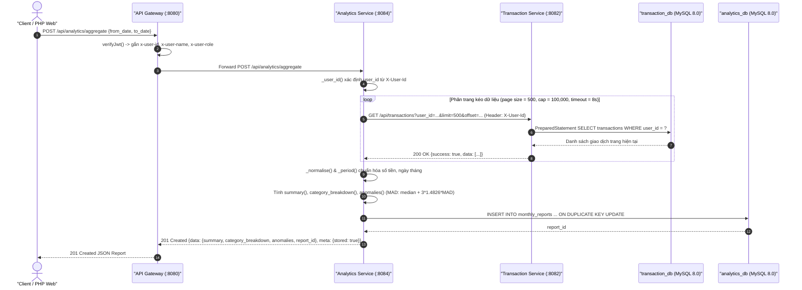

*(Mã nguồn sơ đồ: [docs/diagrams/05-sequence-and-state-diagrams.md](../diagrams/05-sequence-and-state-diagrams.md))*

*Hình 2-10: Biểu đồ Tuần tự Luồng Kéo Dữ liệu Phân tích Liên dịch vụ (Analytics → Transaction → `analytics_db`)*

**Phân tích chi tiết Hình 2-10:**
1. **Phân trang bảo vệ bộ nhớ (`limit=500`, `cap=100,000`):** Thay vì tải toàn bộ bảng `transactions` trong một truy vấn khổng lồ, `_fetch_transactions()` lặp tăng `offset` mỗi bước `500` dòng với ngưỡng ngắt cứng `100.000` giao dịch và `timeout = 8s`. Nếu Transaction Service không phản hồi, Analytics trả mã `502 Bad Gateway` rõ ràng.
2. **Tính lũy đẳng khi lưu báo cáo tháng (`ON DUPLICATE KEY UPDATE`):** Nếu người dùng bấm tổng hợp lại nhiều lần trong cùng một tháng (`user_id, year, month`), câu lệnh MySQL tự động cập nhật `report_json` và `generated_at` trên bản ghi hiện có thay vì sinh bản ghi trùng.

### Mô hình 2: Đẩy bất đồng bộ qua Worker Pool, Sweeper & Cảnh báo Realtime SSE

Để đảm bảo API tiếp nhận webhook ngân hàng phản hồi dưới vài mili-giây dù Transaction Service đang bận hoặc chậm, Integration Service tách đôi pha xử lý: tiếp nhận đồng thời tức thì tại HTTP Handler và đồng bộ nền bất đồng bộ qua Worker Pool (Hình 2-11).

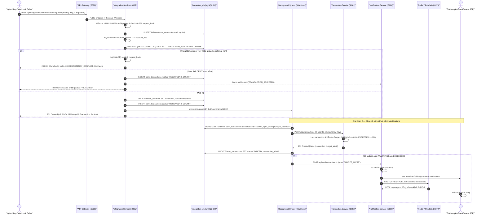

*(Mã nguồn sơ đồ: [docs/diagrams/05-sequence-and-state-diagrams.md](../diagrams/05-sequence-and-state-diagrams.md))*

*Hình 2-11: Biểu đồ Tuần tự Luồng Webhook Đồng thời, Đồng bộ Nền & Cảnh báo Realtime SSE*

**Phân tích chi tiết Hình 2-11:**
1. **Tách rời thời gian phản hồi Webhook (`201 Created` tức thì):** Ngay sau khi `COMMIT` số dư mới vào `linked_accounts` và lưu bản ghi `RECEIVED` vào `bank_transactions`, `handleBankWebhook` đẩy `txID` vào kênh đệm `queue` (dung lượng `2000`) rồi trả `201` về cho ngân hàng. Ngoài ra, nếu giao dịch bị từ chối do thiếu số dư (`REJECTED`) hoặc có giá trị lớn hơn hoặc bằng `LARGE_AMOUNT_ALERT` (mặc định 10.000.000 VND), Go tự động gọi bất đồng bộ `notifier.send()` với loại `TRANSACTION_REJECTED` hoặc `LARGE_TRANSACTION`.
2. **Giành bản ghi nguyên tử (*Atomic Claim*) & Phát cảnh báo ngân sách:** Bốn `worker` goroutine giành quyền xử lý từng `txID` bằng câu lệnh `UPDATE ... WHERE id = ? AND status IN ('RECEIVED','FAILED') AND sync_attempts < 5` (`RowsAffected() == 1` mới được xử lý), gửi `POST /api/transactions` sang PHP Transaction Service. Khi phản hồi có chứa bất kỳ đối tượng `budget_alert` nào (cả `WARNING` $\ge 80\%$ lẫn `EXCEEDED` $> 100\%$), `sync.go` chuyển tiếp ngay sang `Notification Service` với loại `BUDGET_ALERT` để đẩy sự kiện SSE tới trình duyệt.

### Máy trạng thái `bank_transactions.status` & Đảm bảo Tính nhất quán cuối cùng (Eventual Consistency)

Do giao dịch liên dịch vụ giữa Integration (Go) và Transaction (PHP) không dùng giao dịch phân tán 2 pha (*2PC*) gây nghẽn, hệ thống đảm bảo **Tính nhất quán cuối cùng (*Eventual Consistency*)** thông qua máy trạng thái 5 trạng thái và tiến trình `sweeper` tự phục hồi lỗi (Hình 2-12).

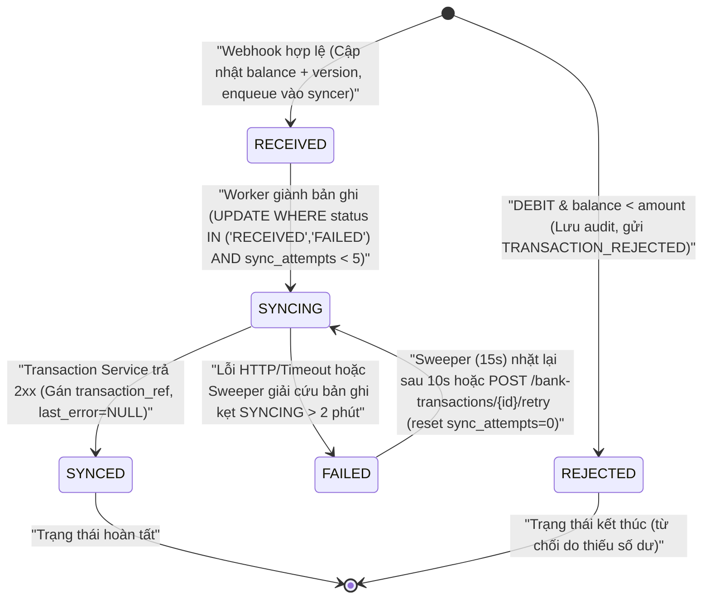

*(Mã nguồn sơ đồ: [docs/diagrams/05-sequence-and-state-diagrams.md](../diagrams/05-sequence-and-state-diagrams.md))*

*Hình 2-12: Biểu đồ Máy trạng thái Vòng đời Giao dịch Ngân hàng (`bank_transactions.status`)*

**Phân tích chi tiết Hình 2-12:**
1. **Hai trạng thái khởi đầu (`RECEIVED` và `REJECTED`):** Giao dịch hợp lệ đi vào hàng đợi ở trạng thái `RECEIVED`; giao dịch `DEBIT` vượt số dư đi thẳng vào trạng thái kết thúc `REJECTED` nhưng vẫn lưu đủ `idempotency_key` để lần gửi lại của ngân hàng vẫn nhận đúng câu trả lời cũ.
2. **Cơ chế tự giải cứu bản ghi kẹt (`sweeper` chạy mỗi 15 giây trong `sync.go`):**
   - Nếu container Go bị tắt đột ngột giữa lúc một bản ghi đang ở `SYNCING`, `sweeper` quét các bản ghi `SYNCING` có `updated_at < NOW() - INTERVAL 2 MINUTE` và đưa về `FAILED` với thông báo `'quá thời gian chờ đồng bộ'`.
   - Với các bản ghi `RECEIVED` hoặc `FAILED` tồn đọng quá `10 SECOND` và `sync_attempts < 5`, `sweeper` đẩy lại vào `queue` (tối đa `200` bản ghi/lượt). Nếu vượt quá 5 lần thất bại liên tiếp, quản trị viên hoặc người dùng vẫn có thể khôi phục thủ công qua `POST /api/integrations/bank-transactions/{id}/retry` (đặt lại `sync_attempts = 0`).
3. **Chiến lược chịu lỗi khởi động CSDL:** Vì `docker-compose.midterm.yml` chưa đặt `healthcheck`, các dịch vụ Asset (`10x1s`), Analytics (`30x2s`) và Integration (`20x2s` + `restart: on-failure`) tự cài đặt vòng lặp thử lại kết nối MySQL khi mới khởi động container.

---

# CHƯƠNG 3. ĐÓNG GÓI, TRIỂN KHAI (DOCKER) & KIỂM THỬ HỆ THỐNG

## 3.1. Đóng gói và điều phối bằng Docker Compose

Để bảo đảm môi trường vận hành đồng nhất trên mọi máy tính của sáu thành viên, toàn bộ 7 dịch vụ ứng dụng, 5 cơ sở dữ liệu MySQL 8.0 và 1 máy chủ Redis 7 được đóng gói thành **13 containers** trong tệp `docker-compose.midterm.yml`, kết nối qua mạng bridge cô lập **`cashflow-midterm-net`**. Riêng giao diện Web PHP (`frontend/`, cổng `3000`) chạy trực tiếp trên máy Host bằng `php -S 127.0.0.1:3000 -t frontend frontend/router.php` (qua `run-frontend.bat` hoặc `start-services.ps1`) để thuận tiện trình diễn song song cùng công cụ trình duyệt.

### Chiến lược tối ưu Image theo ngôn ngữ
- **Multi-stage Build cho nhóm ngôn ngữ biên dịch (Java, C#, Go):**
  - *Auth Service:* Biên dịch mã nguồn bằng `maven:3.9-eclipse-temurin-17`, sau đó chỉ sao chép tệp `.jar` và thư mục thư viện phụ thuộc sang image chạy gọn nhẹ `eclipse-temurin:17-jre-alpine`.
  - *Asset Service:* Dùng `mcr.microsoft.com/dotnet/sdk:10.0` để `dotnet publish` và chỉ đóng gói sang `mcr.microsoft.com/dotnet/runtime:10.0`.
  - *Integration Service:* Biên dịch nhị phân tĩnh với `CGO_ENABLED=0` trên `golang:1.22-alpine` rồi sao chép tệp thực thi duy nhất sang `alpine:3.19` (thiết lập `TZ=Asia/Ho_Chi_Minh`).
- **Alpine / Slim cho nhóm ngôn ngữ thông dịch (Node.js, PHP, Python):** Gateway và Notification dùng `node:20-alpine`; Transaction dùng `php:8.2-cli-alpine` (kèm extension `pdo`, `pdo_mysql`); Analytics dùng `python:3.11-slim` (cài `PyMySQL==1.1.1`, `cryptography` và sao chép sẵn `db/init-analytics-db.sql`).

Bảng 3.1 liệt kê đầy đủ cấu hình của 13 containers trong `docker-compose.midterm.yml`.

**Bảng 3.1: Danh mục 13 Containers trong `docker-compose.midterm.yml` và cấu hình cổng/volume/phụ thuộc**

| STT | Compose Service | Tên Container | Image / Ngữ cảnh Build | Cổng (Host:Container) | Phụ thuộc (`depends_on`) & Chính sách Restart |
|---|---|---|---|---|---|
| 1 | `gateway` | `cashflow-gateway-service` | `./gateway/midterm` (`node:20-alpine`) | `${GATEWAY_PORT:-8080}:8080` | `auth`, `transaction`, `asset`, `analytics`, `integration`, `notification` |
| 2 | `auth-service` | `cashflow-auth-service` | `./services/auth-service/midterm` | `${AUTH_SERVICE_PORT:-8081}:8081` | `auth-db` |
| 3 | `transaction-service` | `cashflow-transaction-service` | `./services/transaction-service/midterm` | `${TRANSACTION_SERVICE_PORT:-8082}:8082` | `transaction-db` |
| 4 | `asset-service` | `cashflow-asset-service` | `./services/asset-service/midterm` | `${ASSET_SERVICE_PORT:-8083}:8083` | `asset-db` |
| 5 | `analytics-service` | `cashflow-analytics-service` | `./services/analytics-service` (`midterm/Dockerfile`) | `${ANALYTICS_SERVICE_PORT:-8084}:8084` | `analytics-db`, `transaction-service` (`restart: always`) |
| 6 | `integration-service` | `cashflow-integration-service` | `./services/integration-service/midterm` | `${INTEGRATION_SERVICE_PORT:-8085}:8085` | `integration-db`, `transaction-service`, `notification-service` (`restart: on-failure`) |
| 7 | `notification-service` | `cashflow-notification-service` | `./services/notification-service/midterm` | `${NOTIFICATION_SERVICE_PORT:-8086}:8086` | `redis` |
| 8 | `auth-db` | `cashflow-auth-db` | `mysql:8.0` | `3307:3306` | Mount `:init-auth-db.sql` vào `/docker-entrypoint-initdb.d/init.sql` |
| 9 | `transaction-db` | `cashflow-transaction-db` | `mysql:8.0` | Nội bộ `:3306` | Mount `:init-transaction-db.sql` vào `/docker-entrypoint-initdb.d/init.sql` |
| 10 | `asset-db` | `cashflow-asset-db` | `mysql:8.0` | Nội bộ `:3306` | Mount `:init-asset-db.sql` vào `/docker-entrypoint-initdb.d/init.sql` |
| 11 | `integration-db` | `cashflow-integration-db` | `mysql:8.0` | `3310:3306` | Mount `:init-integration-db.sql` vào `/docker-entrypoint-initdb.d/init.sql` |
| 12 | `analytics-db` | `cashflow-analytics-db` | `mysql:8.0` | Nội bộ `:3306` | Named volume `analytics_midterm_db_data:/var/lib/mysql` (`restart: always`) |
| 13 | `redis` | `cashflow-redis-notification` | `redis:7-alpine` | `6379:6379` | Kênh Pub/Sub `cashflow:notifications` |

Kiến trúc triển khai vật lý và ánh xạ mạng được thể hiện tại Hình 3-1.

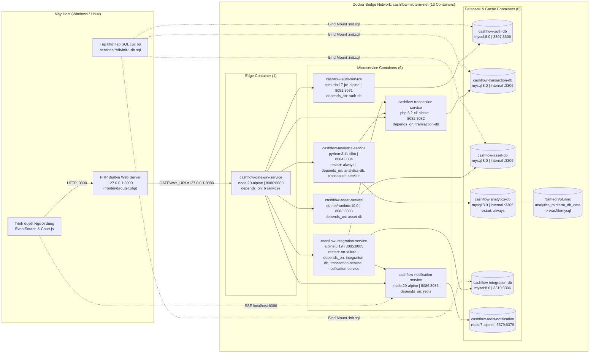

*(Mã nguồn sơ đồ: [docs/diagrams/01-architecture-and-deployment.md](../diagrams/01-architecture-and-deployment.md))*

*Hình 3-1: Biểu đồ Triển khai Vật lý Docker Compose (`cashflow-midterm-net` — 13 Containers & Host Web `:3000`)*

**Phân tích chi tiết Hình 3-1:**
1. **Cô lập mạng & Ánh xạ cổng chọn lọc:** Mọi dịch vụ bên trong giao tiếp qua DNS nội bộ của Docker bridge `cashflow-midterm-net` (ví dụ `http://transaction-service:8082`, `auth-db:3306`). Nhằm giảm bề mặt tấn công, chỉ `auth-db` (`3307:3306`) và `integration-db` (`3310:3306`) được ánh xạ cổng ra máy Host để phục vụ kiểm tra đối soát dữ liệu; ba CSDL còn lại chỉ mở nội bộ cổng `3306`.
2. **Chiến lược khởi tạo dữ liệu:** Bốn CSDL (`auth_db`, `transaction_db`, `asset_db`, `integration_db`) gắn trực tiếp tệp `init-*-db.sql` vào `/docker-entrypoint-initdb.d/init.sql` (chạy tự động khi volume trống), trong khi `analytics-db` dùng Named Volume `analytics_midterm_db_data` và giao việc khởi tạo bảng `monthly_reports` cho hàm `_init_database()` của Analytics Service.

> 📸 **[VỊ TRÍ CHÈN HÌNH 3-2: Danh sách 13 Containers Docker đang vận hành (`docker ps`)]**
> - **URL / Lệnh thực thi:** Chạy lệnh `docker compose -f docker-compose.midterm.yml up -d --build` và sau đó chạy `docker compose -f docker-compose.midterm.yml ps` (hoặc `docker ps --format "table {{.Names}}\t{{.Status}}\t{{.Ports}}"`).
> - **Dữ liệu nhập mẫu / Thao tác:** Đợi khoảng 20 giây để các container MySQL 8.0 hoàn tất nạp `init.sql` và các dịch vụ phụ thuộc khởi động ổn định.
> - **Điểm nhấn cần thấy trên màn hình:** Cả 13 containers (`cashflow-gateway-service`, 6 microservice containers, 5 MySQL containers, `cashflow-redis-notification`) đều hiển thị trạng thái `Up` với đúng các cổng `8080..8086`, `3307`, `3310`, `6379`.

Ảnh chụp Hình 3-2 chứng minh toàn bộ hạ tầng đa ngôn ngữ đã được đóng gói và vận hành đồng thời thành công trên cùng mạng Docker bridge `cashflow-midterm-net`.

---

## 3.2. Các vấn đề thực tế khi triển khai & Cách khắc phục

Trong quá trình tích hợp liên thông 7 dịch vụ đa ngôn ngữ giữa môi trường Windows cục bộ và Docker Linux container, nhóm thực hiện gặp và xử lý triệt để sáu sự cố kỹ thuật thực tế được tổng hợp tại Bảng 3.2.

**Bảng 3.2: Tổng hợp 6 sự cố triển khai thực tế và giải pháp khắc phục**

| STT | Sự cố phát sinh | Nguyên nhân gốc rễ | Giải pháp đã áp dụng trong mã nguồn |
|---|---|---|---|
| 1 | `Asset Service` C# báo lỗi quyền `Access Denied` hoặc không nhận request từ container Gateway. | `System.Net.HttpListener` không chấp nhận tiền tố `http://0.0.0.0:8083/` (chỉ dùng `+` hoặc `*` trên Linux container, và `localhost` nếu chạy không quyền Admin trên Windows). | `Program.cs:10-11` ánh xạ `0.0.0.0` hoặc chuỗi rỗng sang `+`; `Dockerfile` đặt `LISTEN_HOST=+`, `docker-compose.midterm.yml` đặt `LISTEN_HOST=*`, còn `start-services.ps1` đặt `LISTEN_HOST=localhost`. |
| 2 | Độ trễ ~200ms–300ms mỗi request từ PHP Frontend tới Gateway trên Windows. | Tên miền `localhost` trên Windows ưu tiên phân giải IPv6 (`::1`) trước khi thất bại và quay về IPv4 (`127.0.0.1`). | Chuẩn hóa `GATEWAY_URL=http://127.0.0.1:8080` trong `frontend/includes/config.php:33` và `127.0.0.1` trong `start-services.ps1`, triệt tiêu độ trễ bắt tay TCP. |
| 3 | Service ứng dụng khởi động trước khi MySQL 8.0 sẵn sàng hoặc giữ schema cũ trong volume. | `depends_on` ở Docker Compose bản Giữa kỳ chưa có `healthcheck`; volume cũ không chạy lại `/docker-entrypoint-initdb.d/init.sql`. | Cài đặt vòng lặp retry kết nối MySQL trong Asset (`10x1s`), Analytics (`30x2s`), Integration (`20x2s` + `restart: on-failure`), và dùng `docker compose down -v` khi đổi schema. |
| 4 | Lỗi bắt tay xác thực `Public Key Retrieval is not allowed` hoặc lỗi font tiếng Việt MySQL 8.0. | MySQL 8.0 mặc định dùng `caching_sha2_password` và từ chối kết nối non-SSL không bật `allowPublicKeyRetrieval`. | Thêm `useSSL=false&allowPublicKeyRetrieval=true&serverTimezone=UTC` trong `DatabaseConfig.java`, bật `AllowPublicKeyRetrieval=True;SslMode=None` trong `Database.cs` và ép `SET NAMES utf8mb4`. |
| 5 | Kênh thông báo Realtime SSE tự ngắt sau 15 giây hoặc bị đệm gói tin (*buffering*). | HTTP proxy mặc định đóng kết nối nhàn rỗi sau timeout chuẩn (`15000ms`) và bộ đệm proxy giữ gói tin nhỏ. | Gateway `proxy.js:42` gán `timeout: 0` riêng cho `/api/notifications/stream`; `sse.js` gắn `X-Accel-Buffering: no`, `Cache-Control: no-cache, no-transform` và gửi `: keep-alive ping` mỗi 25s. |
| 6 | Đăng nhập bằng tài khoản seed (`admin` / `member1`) báo sai mật khẩu dù nhập đúng `password123`. | Dữ liệu seed SQL ban đầu dùng chuỗi hash giả hoặc BCrypt không khớp với `PBKDF2WithHmacSHA256` (`210000` vòng lặp) trong Java `PasswordUtil`. | Sinh lại đúng chuỗi `210000:aYagp9baQD0LZ9O/sVLxPQ==:3+Pmnd0JLerckR8Jj1a2iHsMw/3xz4TllUi4Z5NsU9g=` cho `password123` trong `init-auth-db.sql` và `scripts/seed-data.sql`. |

---

## 3.3. Kiểm thử tích hợp API qua Swagger UI tập trung & Tự động hóa

### Kiến trúc Swagger UI tích hợp ngay trên Native Gateway (`gateway/midterm/src/docs.js`)

Không sử dụng thư viện `swagger-ui-express`, nhóm tự hiện thực mô-đun `docs.js` đọc và hợp nhất động 6 tệp đặc tả **OpenAPI 3.0.3** (`gateway/midterm/src/openapi/{auth,transaction,asset,analytics,integration,notification}.json`) qua hàm `buildMergedSpec()`, phục vụ tại `/docs`, `/swagger`, `/docs/{service}` và `/openapi.json`. Giao diện còn tích hợp **Thanh Đăng nhập nhanh** (cung cấp sẵn tài khoản seed `admin` / `member1` để gọi `POST /api/auth/login` và tự động nạp `Authorization: Bearer <token>` vào Swagger UI).

> 📸 **[VỊ TRÍ CHÈN HÌNH 3-3: Giao diện Swagger UI tập trung tại Gateway `:8080/docs` và Thanh Đăng nhập nhanh]**
> - **URL / Lệnh thực thi:** Mở trình duyệt tại `http://localhost:8080/docs`.
> - **Dữ liệu nhập mẫu / Thao tác:** Chọn dịch vụ ở menu thả xuống trên thanh điều hướng, bấm nút đăng nhập nhanh với tài khoản `member1` (`password123`) hoặc `admin` (`password123`).
> - **Điểm nhấn cần thấy trên màn hình:** Danh sách đầy đủ API của cả 6 microservices hợp nhất trên một trang, thanh trạng thái hiển thị JWT Token đã tự động nạp (`Authorize` chuyển sang trạng thái khóa đã mở).

### Kịch bản kiểm thử 5 luồng nghiệp vụ trọng tâm & Kiểm thử tự động

Bảng 3.3 tóm tắt 5 kịch bản kiểm thử tích hợp trọng tâm bao phủ đầy đủ xác thực, nghiệp vụ tài chính, xử lý đồng thời và tự động hóa.

**Bảng 3.3: Kịch bản kiểm thử tích hợp 5 luồng nghiệp vụ trọng tâm và kết quả kỳ vọng**

| Luồng | Mục tiêu kiểm thử | Thao tác / API thực thi | Kết quả kỳ vọng |
|---|---|---|---|
| **Luồng 1** | Xác thực JWT `HS256`, lưu `PBKDF2` và bảo vệ `ADMIN` | `POST /api/auth/login` (`admin`/`password123`), truy vấn bảng `auth_db.users`, thử gọi `GET /api/admin/users` bằng token `member1` (`USER`). | Đăng nhập trả `200` + `accessToken` + `refreshToken`; DB lưu `210000:...` (`PBKDF2WithHmacSHA256`); user thường gọi `/api/admin/users` bị chặn `403`. |
| **Luồng 2** | Tạo giao dịch `EXPENSE` & Kích hoạt `budget_alert` | `POST /api/transactions` với `category_id: 3`, `type: "EXPENSE"`, `amount` đẩy tổng chi vượt `80%` hoặc `100%` hạn mức trong `budgets`. | Trả `201 Created`, trường `data.budget_alert.status` xuất hiện `WARNING` ($\ge 80\%$) hoặc `EXCEEDED` ($> 100\%$). |
| **Luồng 3** | Khấu hao tuyến tính, Trả góp EMI & Net Worth | `POST /api/assets/depreciation`, `POST /api/loans/calculate`, `GET /api/assets/net-worth`. | Trả `200 OK` đúng công thức toán học (EMI trả góp đều và `NetWorth = Tổng tài sản - Tổng dư nợ ACTIVE`). |
| **Luồng 4** | Benchmark Đồng thời & Idempotency (`safe` vs `unsafe`) | `POST /api/integrations/simulate` chạy 2 lượt cùng thông số (ví dụ `account_id: 1, events: 200, workers: 40, duplicate_rate: 0.3`): lượt 1 `mode: "unsafe"`, lượt 2 `mode: "safe"`. | Chế độ `unsafe` xuất hiện `difference != 0` và `consistent: false` do race condition; chế độ `safe` đạt `difference: 0` và `consistent: true` tuyệt đối. |
| **Luồng 5** | Kiểm thử tự động hồi quy & tải lớn | Chạy Newman CLI với `docs/api-docs/Postman_Collection_All_Services.json`, Go `tools/loadtest/main.go` hoặc `scripts/concurrency-test-k6.js`. | Newman pass toàn bộ các bộ kiểm thử API; Go `loadtest` ghi nhận 0 sai lệch số dư và 0 giao dịch trùng trong `integration_db`. |

> 📸 **[VỊ TRÍ CHÈN HÌNH 3-4: Kết quả Luồng 1 — Đăng nhập JWT & Kiểm tra `password_hash` PBKDF2 trong `auth_db`]**
> - **URL / Lệnh thực thi:** Thực thi `POST /api/auth/login` trên Swagger UI (`:8080/docs`), đồng thời chạy `docker exec -it cashflow-auth-db mysql -uroot -proot_password -e "SELECT id, username, role, LEFT(password_hash, 45) AS pbkdf2_prefix FROM auth_db.users;"`.
> - **Dữ liệu nhập mẫu / Thao tác:** `{"username": "admin", "password": "password123"}`.
> - **Điểm nhấn cần thấy trên màn hình:** Phản hồi `200 OK` có `accessToken`, `refreshToken`, `expiresIn: 3600` và cột `pbkdf2_prefix` bắt đầu bằng `210000:aYagp9baQD0LZ9O/sVLxPQ==:...`.

> 📸 **[VỊ TRÍ CHÈN HÌNH 3-5: Kết quả Luồng 2 — Tạo giao dịch chi tiêu kích hoạt `budget_alert` (`WARNING`/`EXCEEDED`)]**
> - **URL / Lệnh thực thi:** Thực thi `POST /api/transactions` qua Swagger UI (`:8080/docs`) với tài khoản `admin` (`user_id = 1`, đã có sẵn ngân sách mẫu cho `category_id = 3`).
> - **Dữ liệu nhập mẫu / Thao tác:** `{"category_id": 3, "amount": 4800000, "type": "EXPENSE", "description": "Test vuot ngan sach", "transaction_date": "2026-10-15 12:00:00"}`.
> - **Điểm nhấn cần thấy trên màn hình:** HTTP `201 Created`, trong JSON trả về xuất hiện đối tượng `data.budget_alert` có `status: "EXCEEDED"`, `over_amount` và thông báo cảnh báo tiếng Việt rõ ràng.

> 📸 **[VỊ TRÍ CHÈN HÌNH 3-6: Kết quả Luồng 3 — Tính toán Khấu hao, Trả góp EMI & Net Worth trên Asset Service]**
> - **URL / Lệnh thực thi:** Gọi `POST /api/loans/calculate` và `GET /api/assets/net-worth` trên Swagger UI (`:8080/docs`).
> - **Dữ liệu nhập mẫu / Thao tác:** `{"principal_amount": 120000000, "interest_rate": 9.5, "term_months": 24}`.
> - **Điểm nhấn cần thấy trên màn hình:** Kết quả trả `200 OK` hiển thị `monthly_payment` làm tròn 2 chữ số thập phân và `total_net_worth` bằng `VND` khớp công thức `SUM(assets) - SUM(active loans)`.

> 📸 **[VỊ TRÍ CHÈN HÌNH 3-7: Kết quả Luồng 4 — Chạy Benchmark `/api/integrations/simulate` đối chiếu `safe` và `unsafe`]**
> - **URL / Lệnh thực thi:** Gọi `POST /api/integrations/simulate` hai lần liên tiếp trên Swagger UI (`:8080/docs`) với `mode: "unsafe"` và `mode: "safe"`.
> - **Dữ liệu nhập mẫu / Thao tác:** `{"account_id": 1, "events": 200, "workers": 40, "duplicate_rate": 0.3, "mode": "unsafe", "sync": false}` rồi lặp lại với `"mode": "safe"`.
> - **Điểm nhấn cần thấy trên màn hình:** Ảnh chụp so sánh kết quả của hai lần gọi: `unsafe` có `difference != 0` (`consistent: false`), còn `safe` có `difference: 0` (`consistent: true`), `balance_after == expected_balance`.

> 📸 **[VỊ TRÍ CHÈN HÌNH 3-8: Kết quả Luồng 5 — Kiểm thử tự động với Newman CLI và công cụ Go `loadtest`]**
> - **URL / Lệnh thực thi:** Chạy hai lệnh trong terminal:
>   1) `newman run docs/api-docs/Postman_Collection_All_Services.json -e docs/api-docs/Postman_Environment.json`
>   2) `go run ./services/integration-service/midterm/tools/loadtest -url http://localhost:8080/api/integrations/webhooks/banking -workers 40 -events 200` (hoặc `k6 run scripts/concurrency-test-k6.js`).
> - **Dữ liệu nhập mẫu / Thao tác:** Thực thi bộ sưu tập Postman đầy đủ 6 dịch vụ và công cụ bắn webhook đồng thời bằng Go.
> - **Điểm nhấn cần thấy trên màn hình:** Bảng tổng kết Newman hiển thị tỷ lệ assertions đạt và đầu ra CLI của Go `loadtest` xác nhận không có lỗi sai lệch số dư.

Các ảnh chụp kiểm thử từ Hình 3-3 đến Hình 3-8 chứng minh đầy đủ khả năng hoạt động chính xác của từng API đơn lẻ cũng như sự ổn định của toàn hệ thống dưới áp lực đồng thời cao.

---

## 3.4. Kiểm thử trên Giao diện Web iBanking

Giao diện Web (`frontend/`, phục vụ tại `http://127.0.0.1:3000`) được xây dựng theo kiến trúc **Backend-for-Frontend (BFF) bằng PHP thuần**, tuyệt đối không kết nối trực tiếp vào MySQL. Toàn bộ JWT (`access_token`, `refresh_token`) được lưu kín trong `$_SESSION` phía máy chủ PHP (`frontend/includes/config.php`); trình duyệt không bao giờ tiếp cận trực tiếp JWT.

### Các kỹ thuật tối ưu & bảo mật trên Frontend PHP
1. **Làm mới Access Token ngầm (`api()` trong `config.php:102-107`):** Khi gọi xuống Gateway nhận mã `401`, hàm `api()` tự động gọi `refreshAccessToken()` (`POST /api/auth/refresh`) một lần để lấy token mới và thực thi lại yêu cầu gốc mà người dùng không bị gián đoạn phiên làm việc; chỉ chuyển hướng `login.php?expired=1` nếu refresh token cũng hết hạn.
2. **Gọi song song đa dịch vụ bằng `curl_multi` (`apiAll()` trong `config.php:117-150`):** Trang tổng quan Dashboard (`index.php`) cần dữ liệu từ nhiều dịch vụ cùng lúc (Transaction, Budget Progress, Net Worth, Analytics Summary, Linked Accounts). Hàm `apiAll()` mở nhiều kết nối cURL đồng thời giúp tổng thời gian tải trang chỉ xấp xỉ yêu cầu chậm nhất thay vì cộng dồn tuần tự.
3. **Proxy AJAX chống CSRF (`frontend/api.php`):** Các thao tác động từ JS (`CF.api`) gửi qua `api.php?path=/api/...` với kiểm tra biểu thức chính quy whitelist đường dẫn `/api/...` và đối chiếu token `X-CSRF` bằng `hash_equals()`.
4. **Lắng nghe thông báo thời gian thực (`frontend/assets/js/app.js:122-145`):** Hàm `initRealtime()` kết nối `new EventSource(window.CASHFLOW.sseUrl)` tới `:8086/api/notifications/stream?user_id=<uid>`, tự động hiển thị thông báo nổi (*toast*) và tăng số đếm `#notifBadge` khi có sự kiện `event: notification`.

> 📸 **[VỊ TRÍ CHÈN HÌNH 3-9: Giao diện Web iBanking: Đăng nhập & Dashboard Tổng hợp (`curl_multi`)]**
> - **URL / Lệnh thực thi:** Khởi chạy `run-frontend.bat` và truy cập `http://127.0.0.1:3000/login.php`, đăng nhập với `admin` / `password123` để vào `index.php`.
> - **Dữ liệu nhập mẫu / Thao tác:** Nhập tài khoản `admin`, mật khẩu `password123` rồi bấm Đăng nhập.
> - **Điểm nhấn cần thấy trên màn hình:** Thẻ Hero FinTech hiển thị tổng số dư, tài sản ròng (`Net Worth`), biểu đồ dòng tiền tổng hợp và danh sách giao dịch gần đây tải song song từ nhiều dịch vụ.

> 📸 **[VỊ TRÍ CHÈN HÌNH 3-10: Giao diện Web iBanking: Quản lý Giao dịch, Ngân sách & Tài sản/Khoản vay]**
> - **URL / Lệnh thực thi:** Truy cập lần lượt `http://127.0.0.1:3000/transactions.php`, `budgets.php` và `assets.php`.
> - **Dữ liệu nhập mẫu / Thao tác:** Thêm mới một giao dịch `EXPENSE` qua modal `tx_modal.php` và mở công cụ tính khấu hao / trả góp EMI trên `assets.php`.
> - **Điểm nhấn cần thấy trên màn hình:** Thanh tiến độ ngân sách đổi màu cảnh báo khi vượt 80%/100%, bảng giao dịch và kết quả tính toán khấu hao/EMI hiển thị chính xác.

> 📸 **[VỊ TRÍ CHÈN HÌNH 3-11: Giao diện Web iBanking: Phân tích Dòng tiền, Liên kết Ngân hàng & Thông báo Realtime SSE]**
> - **URL / Lệnh thực thi:** Truy cập `http://127.0.0.1:3000/analytics.php`, `banking.php`, `notifications.php` (và `users.php` với quyền `ADMIN`).
> - **Dữ liệu nhập mẫu / Thao tác:** Trên `banking.php`, kích hoạt một webhook nạp/rút tiền hoặc bấm tổng hợp báo cáo trên `analytics.php`.
> - **Điểm nhấn cần thấy trên màn hình:** Biểu đồ Chart.js phân bổ danh mục & xu hướng 3 tháng, danh sách biến động số dư `SYNCED`, thông báo toast bật lên tức thời qua kênh SSE và số lượng chưa đọc trên biểu tượng chuông tự động tăng.

Các màn hình thực nghiệm từ Hình 3-9 đến Hình 3-11 xác nhận toàn bộ luồng nghiệp vụ đầu–cuối từ trình duyệt đến tầng lưu trữ phân tán hoạt động trơn tru trên giao diện Web iBanking.

---

# CHƯƠNG 4. ĐÁNH GIÁ KẾT QUẢ & KẾ HOẠCH GIAI ĐOẠN TIẾP THEO

## 4.1. Tổng kết những gì đã đạt được

Phiên bản Giữa kỳ đã hoàn thành 100% các mục tiêu kỹ thuật và nghiệp vụ đề ra trên nền tảng mã nguồn thuần đa ngôn ngữ, như đối chiếu tại Bảng 4.1.

**Bảng 4.1: Ma trận đánh giá mức độ hoàn thành các mục tiêu Phiên bản Giữa kỳ**

| Nhóm mục tiêu | Nội dung đã hoàn thành trong mã nguồn thực tế | Trạng thái |
|---|---|---|
| **Kiến trúc & API Gateway** | Gateway Node.js 20 thuần (`:8080`) với IP Sliding Window Rate Limit (300/phút), JWT `HMAC-SHA256` (`timingSafeEqual`), Anti-IDOR xóa/gắn 3 header tin cậy, Streaming Pipe Proxy, SSE `timeout: 0`, Swagger UI gộp 6 specs OpenAPI 3.0.3. | Hoàn thành 100% |
| **Bảo mật & Định danh (Java)** | Auth Service (`:8081`) dùng `PBKDF2WithHmacSHA256` (210.000 vòng lặp, salt 16 byte), `HS256` JWT + Refresh Token 7 ngày, cập nhật hồ sơ/đổi mật khẩu và CRUD quản trị `ADMIN`. | Hoàn thành 100% |
| **Giao dịch & Ngân sách (PHP)** | Transaction Service (`:8082`) PSR-4 MVC thuần, PDO chống SQL Injection (`ATTR_EMULATE_PREPARES=false`), `Auth::forbiddenFor()` chống IDOR và cảnh báo `budget_alert` (`WARNING` $\ge 80\%$, `EXCEEDED` $> 100\%$). | Hoàn thành 100% |
| **Tài sản, Vay & Đầu tư (C#)** | Asset Service (`:8083`) `.NET 10 HttpListener`, tính khấu hao tuyến tính, trả góp EMI an toàn chia 0, danh mục đầu tư và tính Tài sản ròng (*Net Worth*). | Hoàn thành 100% |
| **Phân tích thống kê (Python)** | Analytics Service (`:8084`) kéo dữ liệu phân trang từ Transaction (`500`/trang), dự báo trượt 3 tháng, phát hiện bất thường theo ngưỡng MAD và upsert JSON vào MySQL 8.0 (`analytics_db.monthly_reports`). | Hoàn thành 100% |
| **Tích hợp & Đồng thời (Go)** | Integration Service (`:8085`) với khóa 2 tầng (`keyedLocker` + `SELECT ... FOR UPDATE`), Idempotency 3 lớp (`SHA-256 request_hash` + 2 `UNIQUE KEY`), kiểu tiền `int64`, Worker Pool + Sweeper tự phục hồi và mô phỏng `safe` vs `unsafe`. | Hoàn thành 100% |
| **Thông báo Realtime (Node.js)** | Notification Service (`:8086`) cài đặt SSE heartbeat 25s và giao thức Redis `RESP` qua Raw TCP `node:net`. | Hoàn thành 100% |
| **Triển khai & Frontend Web** | Đóng gói 13 containers trên `cashflow-midterm-net`; Frontend PHP (`:3000`) dùng BFF Session, CSRF `hash_equals`, `curl_multi` và `EventSource` realtime. | Hoàn thành 100% |

---

## 4.2. Hạn chế còn tồn tại

Bên cạnh việc chứng minh tính đúng đắn của các nguyên lý tầng thấp, việc xây dựng hoàn toàn bằng mã nguồn thuần ở phiên bản Giữa kỳ vẫn tồn tại tám hạn chế kỹ thuật khách quan đã được ghi nhận trực tiếp từ mã nguồn:

1. **Chưa có Connection Pool chuyên dụng ở Java và C#:** Trong `DatabaseConfig.java` (Auth) và `Database.cs` (Asset), mỗi yêu cầu HTTP đều mở và đóng một kết nối TCP/MySQL mới (`DriverManager.getConnection()` và `new MySqlConnection()` kèm `Thread.Sleep(1000)` khi retry), dễ gây cạn kiệt cổng hoặc quá tải bắt tay kết nối dưới tải đồng thời cao.
2. **PHP Built-in Server đơn luồng (`php -S`):** Container Transaction Service và máy chủ Frontend chạy trên `php -S` chỉ xử lý tuần tự từng kết nối trên một tiến trình duy nhất, dễ xảy ra nghẽn hàng đợi (*head-of-line blocking*) khi có nhiều Worker Go hoặc `curl_multi` gọi tới đồng thời.
3. **Tin cậy hoàn toàn vào Gateway (Thiếu xác thực JWT đa lớp nội bộ):** Năm trên sáu dịch vụ nghiệp vụ mặc nhiên tin tưởng tiêu đề `x-user-id` / `x-user-role` (hoặc rơi về `?user_id=` / `1` nếu gọi trực tiếp bỏ qua Gateway), chưa có lớp xác thực JWT thứ hai hoặc cơ chế bảo mật nội bộ giữa các dịch vụ.
4. **Kho lưu trữ thông báo chỉ nằm trên RAM (`store.js`) & tự lặp tin Redis:** Danh sách thông báo tại Notification Service sẽ mất sạch khi khởi động lại container; bộ phân tích cú pháp `redisClient.js` tách chuỗi `\r\n` thủ công thiếu khả năng xử lý gói tin lớn bị phân mảnh TCP, và `POST /api/notifications/send` vừa phát SSE cục bộ vừa phát lên kênh Redis chung mà chưa lọc trùng theo định danh instance.
5. **Thiếu `healthcheck` cứng trong `docker-compose.midterm.yml`:** Chỉ thị `depends_on` mới chỉ kiểm tra container đã bật chứ chưa đợi MySQL sẵn sàng nhận truy vấn, buộc các service phải tự nhúng vòng lặp chờ thủ công (trong khi Auth và Transaction có thể thất bại ngay nếu MySQL khởi tạo lâu ở lần chạy đầu).
6. **Chưa có quy trình xác thực OTP 6 số & Thiếu khử trùng `Idempotency-Key` ở Transaction Service:** Dù Integration Worker đã gửi tiêu đề `Idempotency-Key` sang Transaction Service, phía PHP Giữa kỳ chưa lưu/kiểm tra khóa này ở DB; đồng thời các thao tác tài chính nhạy cảm chưa được bảo vệ bằng quy trình OTP 6 số.
7. **Trình duyệt kết nối trực tiếp tới `:8086` cho kênh SSE:** Do `EventSource` của trình duyệt không đính kèm được header `Authorization`, Frontend đang mở kết nối thẳng sang `localhost:8086?user_id=...`, đi vòng qua lớp kiểm soát Rate Limit và JWT của API Gateway.
8. **Bảng `asset_history` chưa được khai thác & Trùng lặp mã nguồn xử lý HTTP:** Bảng `asset_history` đã tạo sẵn trong `asset_db` nhưng chưa có handler C# đọc/ghi trong bản Giữa kỳ; tại Auth Service, logic đọc JWT thủ công còn lặp lại giữa `ProfileHandler` và `AdminUserHandler`.

---

## 4.3. Hướng phát triển cho báo cáo cuối kỳ

Để khắc phục toàn bộ tám hạn chế nêu trên và đáp ứng các tiêu chuẩn khắt khe về khả năng chịu tải, bảo mật chiều sâu (*Defense-in-Depth*) và tự động hóa kiểm thử ở giai đoạn Cuối kỳ, nhóm đề xuất lộ trình nâng cấp toàn diện lên **7 Frameworks chuẩn công nghiệp** như trình bày tại Bảng 4.2.

**Bảng 4.2: Lộ trình nâng cấp từ Phiên bản Giữa kỳ (Native) lên Phiên bản Cuối kỳ (Full Frameworks)**

| Thành phần | Phiên bản Giữa kỳ (Native) | Đích nâng cấp Phiên bản Cuối kỳ (Frameworks) | Cải tiến kỹ thuật trọng tâm |
|---|---|---|---|
| **API Gateway** | Node.js `http` thuần (`:8080`) | **Express 4** + `http-proxy-middleware` v3 + `express-rate-limit` + `jsonwebtoken` | Bổ sung `X-Request-Id` (*Distributed Tracing*), `GET /health/services` tổng hợp trạng thái 6 dịch vụ và hỗ trợ WebSocket Upgrade (`/socket.io`) đi qua Gateway. |
| **Auth Service** | Java 17 `HttpServer` + `DriverManager` | **Spring Boot 3.5** + Spring Security + Spring Data JPA + Nimbus JOSE + HikariCP | Quản lý bể kết nối HikariCP, băm `SHA-256` cho Refresh Token lưu DB, chống *Timing Attack* đăng nhập bằng `dummyHash` và kiểm thử tự động JUnit 5 / MockMvc. |
| **Transaction Service** | PHP 8.2 `php -S` + PDO thuần | **Laravel 12** + Query Builder (`DB::table`) + Migrations + Seeder | Tách CSDL `transaction_final_db` (cô lập `categories` theo `user_id`), dùng `DB::transaction()` + `lockForUpdate()`, tính toán tiền tệ chính xác bằng `BCMath`, đẩy `BUDGET_ALERT` và viết test PHPUnit. |
| **Asset Service** | C# `.NET 10 HttpListener` | **ASP.NET Core 8** + Entity Framework Core 8 + Swagger | Xác thực `JwtBearer` độc lập (`ClockSkew=0`), mức cô lập `RepeatableRead`, kích hoạt bảng `asset_history` với API định giá (`/valuation`), lịch trả nợ (`/schedule`) và báo cáo đầu tư (`/summary`). |
| **Analytics Service** | Python 3.11 `ThreadingHTTPServer` | **FastAPI** + Uvicorn + **Pydantic v2** | Xác thực dữ liệu đầu vào chặt chẽ bằng Pydantic v2, quản lý vòng đời qua `lifespan` và chuẩn hóa OpenAPI tự động tại `/docs`. |
| **Integration Service** | Go 1.22 `ServeMux` + `database/sql` | **Go Gin + GORM** | Dùng `clause.Locking{Strength: "UPDATE"}`, `gorm.Expr("version + 1")`, `WaitGroup` Graceful Shutdown và chạy kiểm thử race/tải lớn (`go test -race`, 500 goroutines). |
| **Notification Service** | Node.js `http` + `net.Socket` + SSE | **Express + Socket.io 4 + `ioredis` + OTP 6 số** | Đóng gói kênh realtime **kép (Socket.io WS qua Gateway + SSE)**, thư viện `ioredis` ổn định và bổ sung **quy trình xác thực OTP 6 số** (`crypto.randomInt`, TTL 300s, dùng 1 lần, khóa sau 3 lần nhập sai). |
| **Hạ tầng & CI/CD** | `docker-compose.midterm.yml` (chưa `healthcheck`) | **`docker-compose.final.yml` + GitHub Actions CI** | Trang bị `healthcheck` (`condition: service_healthy`) cho 5 MySQL & Redis (kèm `/health/services` tại Gateway), chạy non-root cho Auth & Asset (`USER 10001` / `USER app`), 6 Named Volumes và kiểm thử tự động k6 / Newman. |

---

# PHỤ LỤC PHÂN CHIA CÔNG VIỆC CHI TIẾT (6 THÀNH VIÊN)

1. **Nguyễn Văn Duy — MSSV: `52400010`** *(Nhóm trưởng)*
   - **Tỷ lệ đóng góp:** `20%`
   - **Kiến trúc tổng thể & API Gateway (`gateway/midterm/`):** Thiết kế kiến trúc 4 tầng và mô hình *Database-per-Service*; hiện thực API Gateway bằng Node.js 20 thuần gồm Sliding Window Rate Limiter (`rateLimitMap`), xác thực JWT `HMAC-SHA256` hằng thời gian (`crypto.timingSafeEqual`), cơ chế Anti-IDOR xóa/gắn `x-user-id`/`x-user-name`/`x-user-role`, Streaming Reverse Proxy (`pipe`) với `timeout: 0` cho SSE và mô-đun Swagger UI gộp 6 đặc tả OpenAPI 3.0.3 (`docs.js`).
   - **Notification Service (`services/notification-service/midterm/`) & DevOps / Frontend Web (`frontend/`):** Xây dựng máy chủ SSE với heartbeat 25 giây (`sse.js`), cài đặt giao thức Redis `RESP` qua Raw TCP `node:net` (`redisClient.js`), cấu hình `docker-compose.midterm.yml` (13 containers trên `cashflow-midterm-net`), viết script khởi động `start-services.ps1` và phát triển giao diện PHP Web iBanking (`:3000`) với `curl_multi`, làm mới token ngầm và bảo vệ CSRF.
   - **Chữ ký xác nhận:** `Nguyễn Văn Duy`

2. **Nguyễn Trọng Phúc — MSSV: `52400028`**
   - **Tỷ lệ đóng góp:** `16%`
   - **Auth & Profile Service (`services/auth-service/midterm/`):** Hiện thực máy chủ HTTP đa luồng bằng Java 17 `HttpServer` (`Main.java`), tổ chức kiến trúc OOP 4 lớp gồm 6 Handler (`RegisterHandler`, `LoginHandler`, `RefreshHandler`, `ValidateHandler`, `ProfileHandler`, `AdminUserHandler`), lớp nghiệp vụ `AuthService` và hai Repository JDBC (`UserRepository`, `RefreshTokenRepository`).
   - **Bảo mật mật mã & CSDL `auth_db`:** Thiết kế lược đồ `auth_db` (`users`, `refresh_tokens`) trong `init-auth-db.sql`, cài đặt thuật toán băm mật khẩu `PBKDF2WithHmacSHA256` (210.000 vòng lặp, salt 16 byte) kết hợp so sánh hằng thời gian `MessageDigest.isEqual`, ký/kiểm chứng JWT `HS256` (`JwtUtil`) và phát hành Refresh Token 48 byte (`RefreshTokenUtil`).
   - **Chữ ký xác nhận:** `Nguyễn Trọng Phúc`

3. **Lê Văn Quý — MSSV: `52400153`**
   - **Tỷ lệ đóng góp:** `16%`
   - **Transaction & Budget Service (`services/transaction-service/midterm/`):** Hiện thực dịch vụ PHP 8.2 thuần chuẩn PSR-4 OOP (`spl_autoload_register` trong `index.php`), xây dựng Singleton `Database` PDO tắt giả lập prepared statements (`ATTR_EMULATE_PREPARES => false`) kèm cơ chế fallback `127.0.0.1` và bộ điều khiển `TransactionController`, `BudgetController`, `CategoryController`.
   - **Nghiệp vụ ngân sách, Anti-IDOR & CSDL `transaction_db`:** Thiết kế 3 bảng (`categories`, `transactions`, `budgets`) trong `init-transaction-db.sql`, cài đặt kiểm tra quyền sở hữu `Auth::forbiddenFor()` và thuật toán kiểm tra ngưỡng chi tiêu sinh cảnh báo `budget_alert` (`WARNING` $\ge 80\%$, `EXCEEDED` $> 100\%$).
   - **Chữ ký xác nhận:** `Lê Văn Quý`

4. **Lê Tiến Đạt — MSSV: `52400105`**
   - **Tỷ lệ đóng góp:** `16%`
   - **Asset & Investment Service (`services/asset-service/midterm/`):** Xây dựng dịch vụ C# `.NET 10` thuần sử dụng `System.Net.HttpListener` (`Program.cs`) và bộ định tuyến bất đồng bộ `Router.DispatchAsync`, các nhóm Handler (`AssetHandler`, `LoanHandler`, `InvestmentHandler`, `AnalyticsHandler`) và 5 DTO bất biến kiểu `record` với cấu hình `SnakeCaseLower`.
   - **Giải thuật tài chính & CSDL `asset_db`:** Thiết kế 4 bảng (`assets`, `loans`, `investments`, `asset_history`) trong `init-asset-db.sql`, cài đặt vòng lặp thử lại kết nối MySQL (`10x1s`), giải thuật khấu hao tuyến tính, công thức trả góp đều EMI xử lý an toàn trường hợp lãi suất `0%` và tính Tài sản ròng (*Net Worth*).
   - **Chữ ký xác nhận:** `Lê Tiến Đạt`

5. **Lê Khải Hoàn — MSSV: `52400114`**
   - **Tỷ lệ đóng góp:** `16%`
   - **Analytics Service (`services/analytics-service/midterm/`):** Hiện thực máy chủ đa luồng Python 3.11 `ThreadingHTTPServer` (`src/main.py`) và lớp bọc kết nối `_DatabaseConnection` trên `PyMySQL` kèm cơ chế thử lại khởi tạo schema (`30x2s`).
   - **Thuật toán phân tích & CSDL `analytics_db`:** Thiết kế bảng `monthly_reports` (`report_json JSON`, `UNIQUE (user_id, year, month)`), cài đặt luồng kéo dữ liệu phân trang từ Transaction Service (`limit=500`, giới hạn `100.000`), thuật toán dự báo dòng tiền trượt 3 tháng (`trends()`) và thuật toán phát hiện chi tiêu bất thường bằng độ lệch tuyệt đối trung vị MAD (`anomalies()`).
   - **Chữ ký xác nhận:** `Lê Khải Hoàn`

6. **Trần Hữu Long — MSSV: `52400138`**
   - **Tỷ lệ đóng góp:** `16%`
   - **Integration & Concurrency Service (`services/integration-service/midterm/`):** Hiện thực dịch vụ bằng Go 1.22 `http.NewServeMux` và `database/sql`, xây dựng kiểu tiền tệ `money` (`int64` đơn vị `1/100 VND`), khóa 2 tầng (`keyedLocker` theo tài khoản + `READ COMMITTED` `SELECT ... FOR UPDATE`), cơ chế Idempotency 3 lớp (`Idempotency-Key`, `(provider, external_ref)`, `SHA-256 request_hash`) và retry deadlock MySQL `1213`/`1205`.
   - **Đồng bộ nền, CSDL `integration_db` & Kiểm thử tải:** Thiết kế 4 bảng (`exchange_rates`, `linked_accounts`, `bank_transactions`, `external_webhooks`), hiện thực Worker Pool (`syncer`) + `sweeper` tự phục hồi mỗi 15 giây, endpoint benchmark `safe` vs `unsafe` (`/api/integrations/simulate`), unit test `main_test.go` và công cụ CLI `tools/loadtest/main.go`.
   - **Chữ ký xác nhận:** `Trần Hữu Long`

---

# TÀI LIỆU THAM KHẢO

| STT | Tài liệu tham khảo |
|---|---|
| [1] | Internet Engineering Task Force (IETF), *RFC 7519: JSON Web Token (JWT)*, IETF Datatracker, https://datatracker.ietf.org/doc/html/rfc7519. |
| [2] | National Institute of Standards and Technology (NIST), *NIST Special Publication 800-132: Recommendation for Password-Based Key Derivation (PBKDF2)*, U.S. Department of Commerce, https://csrc.nist.gov/publications/detail/sp/800-132/final. |
| [3] | Redis Ltd., *Redis Serialization Protocol (RESP) Specification*, Redis Documentation, https://redis.io/docs/latest/develop/reference/protocol-spec/. |
| [4] | Oracle Corporation, *MySQL 8.0 Reference Manual — InnoDB Locking, Transaction Isolation Levels and JSON Data Type*, MySQL Documentation, https://dev.mysql.com/doc/refman/8.0/en/innodb-locking.html. |
| [5] | OpenAPI Initiative, *OpenAPI Specification v3.0.3*, Linux Foundation, https://spec.openapis.org/oas/v3.0.3. |
| [6] | WHATWG, *HTML Living Standard — Server-Sent Events (EventSource API)*, WHATWG, https://html.spec.whatwg.org/multipage/server-sent-events.html. |
| [7] | Chris Richardson, *Microservices Patterns: With Examples in Java (Database-per-Service & Eventual Consistency)*, Manning Publications, https://microservices.io/patterns/data/database-per-service.html. |
| [8] | OWASP Foundation, *OWASP API Security Top 10 (API1:2023 Broken Object Level Authorization / Anti-IDOR)*, OWASP, https://owasp.org/API-Security/. |
| [9] | The Go Authors, *Go 1.22 Standard Library (`net/http`, `database/sql`, `sync`) Documentation*, Go Dev, https://pkg.go.dev/std. |
| [10] | Docker Inc., *Compose Specification & Multi-stage Builds Best Practices*, Docker Docs, https://docs.docker.com/compose/. |
