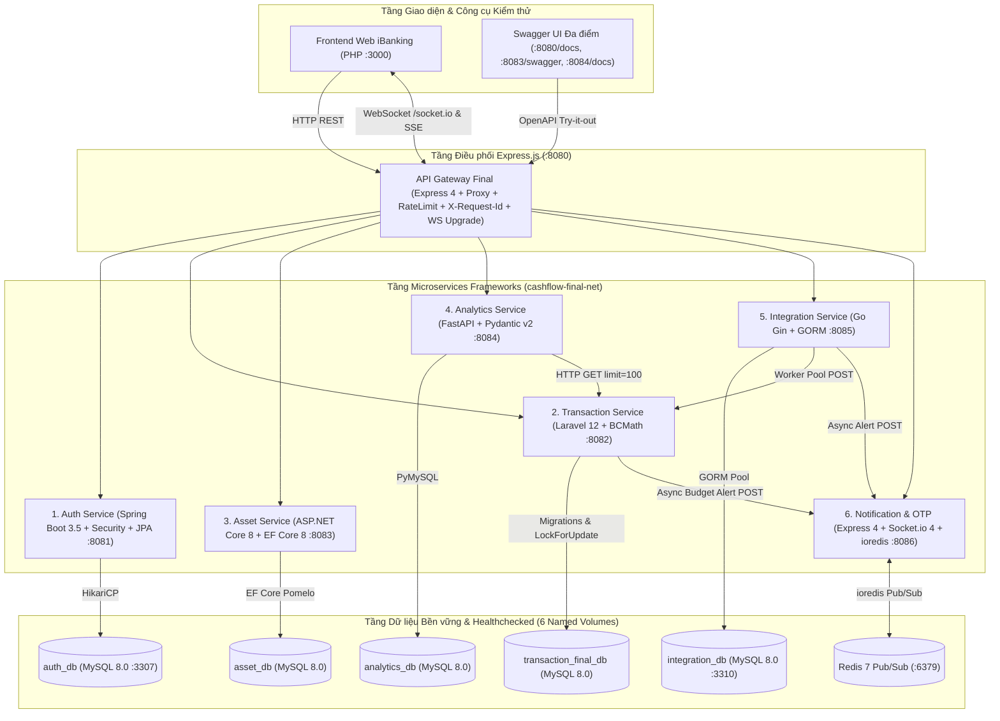

# Kế hoạch Biên soạn Báo cáo Cuối kỳ & Hệ thống Sơ đồ Nâng cấp (Final — Full Frameworks)

## 1. Mục tiêu & Định hướng Thực hiện (Goal Description)

Kế thừa văn phong học thuật chuẩn TDTU từ `BaoCao.pdf` và cấu trúc chặt chẽ của [plan_gk.md](file:///d:/3.1.%20SOA/SOA-CashFlow/plan_gk.md), bản kế hoạch này định hình toàn bộ nội dung cho **Báo cáo Cuối kỳ (`docs/reports/Bao-Cao-Cuoi-Ky.md`)** cùng **Bộ sơ đồ thiết kế bản Final (`docs/diagrams/final-*.md`)**, bám sát tuyệt đối mã nguồn thực tế trong `gateway/final/`, `services/*/final/`, [docker-compose.final.yml](file:///d:/3.1.%20SOA/SOA-CashFlow/docker-compose.final.yml) và [.github/workflows/ci.yml](file:///d:/3.1.%20SOA/SOA-CashFlow/.github/workflows/ci.yml).

### Điểm khác biệt cốt lõi của Báo cáo Cuối kỳ so với Báo cáo Giữa kỳ (`plan_gk.md`):
1. **Làm nổi bật sự tiến hóa kiến trúc (Native → Industrial Frameworks):** Không lặp lại lý thuyết cơ bản của giữa kỳ, mà tập trung phân tích cách 7 Frameworks (**Express 4**, **Spring Boot 3.5**, **Laravel 12**, **ASP.NET Core 8**, **FastAPI**, **Go Gin + GORM**, **Express + Socket.io + `ioredis`**) giải quyết triệt để các hạn chế của phiên bản Code thuần (Connection Pooling HikariCP/GORM, ORM & Migrations tự động, Dependency Injection, Middleware Pipeline, Stateless Security Filter & Defense-in-Depth JWT).
2. **Đáp ứng trọn vẹn các tiêu chí nâng cao mức điểm 9.0 – 10.0 của Rubric Cuối kỳ:**
   - **Quy trình xác thực giao dịch bằng OTP 6 số** (`POST /api/notifications/otp/generate` & `/verify`: sinh mã mật mã học `crypto.randomInt`, TTL 5 phút, *Single-use* chống Replay Attack, khóa mã sau 3 lần nhập sai, đẩy tức thời qua cả **WebSocket Socket.io** và **SSE**).
   - **Xử lý Giao dịch, Đồng thời (Concurrency) & Lũy đẳng (Idempotency) đa dịch vụ:** Khóa 2 tầng `KeyedLocker` + GORM `FOR UPDATE` (`READ COMMITTED`) tại Go Integration; `DB::transaction` + `lockForUpdate()` + số học dấu phẩy tĩnh `BCMath` tại Laravel Transaction; khóa bi quan `findForUpdate` khi xoay vòng Refresh Token băm `SHA-256` tại Spring Boot Auth; `ConcurrencyToken` + giao dịch `RepeatableRead` tại ASP.NET Core Asset.
   - **Quan sát hệ thống & Kiểm thử tự động (Observability & Automated Testing):** Truy vết phân tán xuyên dịch vụ qua `X-Request-Id` & JSON Structured Logging, kiểm tra sức khỏe tổng hợp `GET /health/services`, bộ kiểm thử tự động thực tế (`JUnit 5 + MockMvc`, `PHPUnit Feature Tests`, `Go Race Tests`, `Go Loadtest` 600 requests đồng thời, `Newman`, `k6`) và điều phối `docker-compose.final.yml` với `service_healthy` + Non-root Containers + GitHub Actions CI.
3. **Thống nhất quy ước trình bày như bạn đã duyệt ở `plan_gk.md`:**
   - Xuất file nội dung chuyên môn chi tiết tại **`docs/reports/Bao-Cao-Cuoi-Ky.md`** (không tạo trang bìa/lời cảm ơn hành chính để bạn ghép trực tiếp vào mẫu Word/PDF).
   - Chèn sẵn mã nguồn sơ đồ `mermaid` ngay trong báo cáo kèm phân tích chi tiết sau mỗi hình (`Hình X-Y`), đồng thời đặt các khung `> 📸 **[VỊ TRÍ CHÈN HÌNH X-Y: ...]**` hướng dẫn rõ URL/lệnh cần chụp màn hình thực nghiệm.

---

## 2. Điểm cần Xác nhận Nhanh (User Review Required)

> [!NOTE]
> Tôi đã áp dụng sẵn toàn bộ quy ước trình bày từ phản hồi trước của bạn (lưu báo cáo tại `docs/reports/Bao-Cao-Cuoi-Ky.md`, tách riêng bộ sơ đồ bản Final trong `docs/diagrams/final-*.md` để không ghi đè sơ đồ giữa kỳ, chèn sẵn Mermaid và note rõ vị trí chụp ảnh).
> - Nếu bạn muốn tôi thực hiện **riêng phần Cuối kỳ** ngay bây giờ (hoặc thực hiện **cả hai bản báo cáo Giữa kỳ + Cuối kỳ** cùng lúc), hãy cho tôi biết hoặc nhấn **Proceed** để tạo trọn bộ nội dung Cuối kỳ theo kế hoạch này.

---

## 3. Danh mục Tệp Tạo mới & Cấu trúc Chi tiết (Proposed Changes)

### Thành phần 1: Bộ Sơ đồ Kỹ thuật Phiên bản Cuối kỳ (`docs/diagrams/`)

Tạo 5 tệp sơ đồ chuyên biệt mang tiền tố `final-` (song hành gọn gàng bên cạnh bộ sơ đồ giữa kỳ):

#### [NEW] [final-01-architecture-and-deployment.md](file:///d:/3.1.%20SOA/SOA-CashFlow/docs/diagrams/final-01-architecture-and-deployment.md)
- **`Hình 1-1` — Kiến trúc Tổng thể Hệ thống SOA CashFlow Bản Cuối kỳ (Full Frameworks):** Thể hiện rõ Express Gateway (`:8080`, Rate Limit, `X-Request-Id`, `/health/services`, WS Upgrade), 6 Framework Services (`:8081..8086`), 5 MySQL 8.0 độc lập (`auth_db`, `transaction_final_db`, `asset_db`, `analytics_db`, `integration_db`) và Redis 7 (`cashflow:notifications` & `cashflow:events`), cùng kênh kép **Socket.io WebSocket + SSE**.
- **`Hình 3-1` — Biểu đồ Triển khai Hạ tầng Docker Compose Production (`Deployment Diagram`):** Minh họa mạng `cashflow-final-net`, 6 Named Volumes bền vững, cơ chế `healthcheck` (`condition: service_healthy`), tiến trình auto-migrate/seed của Laravel và các container chạy quyền non-root (`USER 10001`, `USER app`).

#### [NEW] [final-02-usecase-and-otp.md](file:///d:/3.1.%20SOA/SOA-CashFlow/docs/diagrams/final-02-usecase-and-otp.md)
- **`Hình 1-2` — Biểu đồ Use Case Tổng quát Bản Cuối kỳ (Mermaid & PlantUML `.puml`):** Bổ sung đầy đủ các ca sử dụng nâng cao của bản Final: *Sinh & Xác thực mã OTP thanh toán 6 chữ số*, *Định giá sổ sách tài sản theo ngày (`Valuation`) & Xem lịch sử biến động giá trị (`Asset History`)*, *Lập bảng kế hoạch trả góp khoản vay (`Amortization Schedule`)*, *Tổng hợp P/L & ROI danh mục đầu tư*, và *Giám sát sức khỏe tập trung (`/health/services`)*.

#### [NEW] [final-03-class-diagrams-frameworks.md](file:///d:/3.1.%20SOA/SOA-CashFlow/docs/diagrams/final-03-class-diagrams-frameworks.md)
- **Bộ 7 Biểu đồ Lớp & Kiến trúc Thành phần theo Framework (`Hình 2-2` → `Hình 2-8`):**
  1. **Express Gateway:** `app.js` → `requestTracer`, `authGuard` (`jsonwebtoken`), `docsRoutes`, `createProxyMiddleware` (`wsProxies`).
  2. **Spring Boot Auth (`com.cashflow.auth`):** `AuthController`, `ProfileController`, `AdminUserController` → `SecurityConfig`, `JwtAuthenticationFilter`, `AccessTokens` (Nimbus JOSE), `LegacyPasswordEncoder` → `AuthService`, `UserService` → `UserRepository`, `RefreshTokenRepository` (`JPA`) → `User`, `RefreshToken`, `ApiErrors`.
  3. **Laravel 12 Transaction (`App\Http`):** `ResolveUser` Middleware → `CashflowController` (lớp cơ sở `owned()`, `moneyRule()`) ← `TransactionController`, `BudgetController`, `CategoryController` + `DatabaseSeeder`.
  4. **ASP.NET Core 8 Asset (`AssetService.Final`):** `ExceptionMiddleware` + `JwtBearer` → `AssetsController`, `LoansController`, `InvestmentsController`, `HealthController` → `CurrentUser`, `AssetManager`, `LoanService`, `InvestmentService`, `NetWorthService`, `FinanceMath` → `AssetDbContext` (`Asset`, `Loan`, `Investment`, `AssetHistory`).
  5. **FastAPI Analytics:** `FastAPI(lifespan)` → `CORSMiddleware` + Exception Handlers (`AnalyticsError`, `RequestValidationError`) → Pydantic `TransactionInput`, `AggregateRequest` → các endpoint & hàm phân tích `_summary`, `_trends`, `_anomalies`, `_save_report`.
  6. **Go Gin + GORM Integration (`internal/`):** `handlers.Server` (`SetupRouter`) → `locker.KeyedLocker`, `services.Syncer` (`WaitGroup` Graceful Shutdown), `services.Notifier` → `database.Open` (`*gorm.DB`) → `models.LinkedAccount`, `models.BankTransaction`, `models.Money`.
  7. **Express + Socket.io Notification & OTP:** `app.js` → `notificationController`, `otpController` → `otpService` (`otpStore`, `createOtp`, `verifyOtp`), `socket.js` (Socket.io Rooms `user:<id>`), `sse.js`, `redis.js` (`ioredis` `redisPub`/`redisSub`), `store.js`.

#### [NEW] [final-04-erd-database-per-service.md](file:///d:/3.1.%20SOA/SOA-CashFlow/docs/diagrams/final-04-erd-database-per-service.md)
- **`Hình 2-9` — Mô hình ERD Chuẩn hóa Bản Cuối kỳ (5 MySQL 8.0 + Redis & OTP Store):** Cập nhật chính xác các nâng cấp schema của bản Final:
  - `transaction_final_db` (Laravel Migration): Bảng `categories` bổ sung `user_id` + `UNIQUE (user_id, name, type)` cô lập danh mục riêng cho từng người dùng; `budgets` có `UNIQUE (user_id, category_id, period, start_date)` với `period` `MONTHLY | QUARTERLY` và khóa ngoại `RESTRICT ON DELETE`.
  - `asset_db` (`services/asset-service/final/db/init-asset-db.sql`): Bổ sung hệ thống `CHECK CONSTRAINT` chặt chẽ ở tầng MySQL (`ck_assets_values`, `ck_loans_values`, `ck_investments_values`, `ck_history_value`) và bảng `asset_history` gắn liền với nghiệp vụ cập nhật giá trị tài sản.
  - `auth_db`: Bảng `refresh_tokens.token` lưu chuỗi băm `sha256:<hex>`.

#### [NEW] [final-05-sequence-and-state-final.md](file:///d:/3.1.%20SOA/SOA-CashFlow/docs/diagrams/final-05-sequence-and-state-final.md)
- **3 Biểu đồ Tuần tự Nâng cao (`Sequence Diagrams`):**
  - *`Hình 2-1` (Defense-in-Depth Auth & Tracing):* Luồng đăng nhập Spring Boot (PBKDF2 + `dummyHash` + `SHA-256` Refresh Token) và luồng gọi API đi qua Express Gateway (`X-Request-Id` + `authGuard`) xuống ASP.NET Core / Spring Boot (xác thực lại chữ ký JWT lần 2 độc lập).
  - *`Hình 2-10` (Quy trình Xác thực Giao dịch bằng OTP & Dual Realtime Push):* Client yêu cầu sinh OTP (`POST /api/notifications/otp/generate`) → `otpService` sinh mã 6 số `crypto.randomInt`, đặt TTL 300s → Phát đồng thời qua **Socket.io Room `user:<id>`**, **SSE** và **Redis Pub/Sub** → Client gửi `POST /api/notifications/otp/verify` → Kiểm tra TTL, số lần thử ($\le 3$) & cờ `isUsed` → Hủy mã ngay lập tức (*Single-use*) và phát sự kiện `otp:verified`.
  - *`Hình 2-11` (Luồng Đồng bộ Ngân hàng Gin/GORM → Laravel `lockForUpdate` → Cảnh báo Ngân sách Kép):* Webhook → Go Gin khóa `KeyedLocker` + GORM `FOR UPDATE` → Background `Syncer` đẩy sang Laravel 12 → Laravel chạy `DB::transaction` + `lockForUpdate` + `BCMath` phát hiện vượt hạn mức → Cảnh báo đẩy tức thời tới Notification Service → Socket.io/SSE.
- **`Hình 2-12` — Biểu đồ Máy trạng thái Vòng đời Mã OTP (`State Diagram`):** Minh họa rõ các trạng thái và điều kiện chuyển tiếp của mã OTP (`GENERATED / ACTIVE` → nhập sai lần 1..2 giảm `remainingAttempts` → nhập sai lần 3 chuyển sang `LOCKED / REVOKED`; quá 300s chuyển sang `EXPIRED`; nhập đúng chuyển sang `VERIFIED & CONSUMED`, mọi lần gọi lại bị từ chối `OTP_ALREADY_USED`).

---

### Thành phần 2: Tài liệu Báo cáo Chi tiết Cuối kỳ (`docs/reports/`)

#### [NEW] [Bao-Cao-Cuoi-Ky.md](file:///d:/3.1.%20SOA/SOA-CashFlow/docs/reports/Bao-Cao-Cuoi-Ky.md)

Nội dung chi tiết được biên soạn theo kết cấu 4 Chương học thuật chuẩn mực:

---

### PHẦN MỞ ĐẦU CHUYÊN MÔN
- **Tóm tắt Báo cáo Cuối kỳ** (khái quát lộ trình chuyển đổi toàn diện sang 7 Frameworks, giải pháp OTP, Concurrency/Idempotency, Observability và Kiểm thử tự động).
- **Danh mục Hình ảnh** (`Hình 1-1` → `Hình 3-13`) & **Danh mục Bảng biểu** (`Bảng 1.1` → `Bảng 4.2`).

---

### CHƯƠNG 1: TỔNG QUAN NÂNG CẤP HỆ THỐNG & KIẾN TRÚC CUỐI KỲ

#### 1.1. Động lực chuyển đổi từ Code thuần (Giữa kỳ) sang Frameworks (Cuối kỳ)
- Nhìn lại những nút thắt kỹ thuật của phiên bản Native giữa kỳ (quản lý kết nối CSDL thủ công, boilerplate routing/validation lớn, thiếu Migration phiên bản hóa schema, bảo mật phụ thuộc biên Gateway, thiếu WebSocket hai chiều & quy trình xác thực OTP).
- Mục tiêu trọng tâm của giai đoạn Cuối kỳ: Chuẩn hóa kiến trúc bằng các Framework công nghiệp đầu bảng trên 6 ngôn ngữ mà **vẫn giữ tương thích 100% hợp đồng giao tiếp với Frontend Web iBanking hiện hữu**.

#### 1.2. Kiến trúc tổng thể phiên bản Cuối kỳ (Final Architecture Overview)
- Sơ đồ kiến trúc tổng thể (`Hình 1-1`) & Biểu đồ Use Case mở rộng (`Hình 1-2`) kèm phân tích chi tiết từng tầng.
- Mô hình **Database-per-Service** nâng cấp (5 MySQL 8.0 độc lập với `transaction_final_db` của Laravel + 1 Redis 7 Alpine) và ma trận giao tiếp đa giao thức (REST HTTP + `X-Request-Id`, WebSocket `Socket.io` nâng cấp qua Gateway, `SSE`, Redis Pub/Sub 2 kênh `cashflow:notifications` & `cashflow:events`).

#### 1.3. Đối chiếu Công nghệ Giữa kỳ → Cuối kỳ, Cấu hình Bảo mật & Phân công Nhiệm vụ
- **Bảng 1.1:** Đối chiếu trực diện từng thành phần giữa Giữa kỳ (Native) và Cuối kỳ (Framework, ORM/Driver, Bảo mật, Kiểm thử tự động).
- **Bảng 1.2:** Quy chuẩn biến môi trường Production (`JWT_SECRET` ≥ 32 bytes bắt buộc cho Spring Boot `prod` & ASP.NET Core, `DB_ALLOW_PUBLIC_KEY_RETRIEVAL=true`, `LARAVEL_APP_KEY`, `OTP_TTL_SECONDS=300`).
- **Bảng 1.3:** Phân công nhiệm vụ giai đoạn Cuối kỳ của 6 thành viên trong nhóm.

---

### CHƯƠNG 2: THIẾT KẾ & HIỆN THỰC CHI TIẾT CÁC DỊCH VỤ BẰNG FRAMEWORKS

#### 2.1. API Gateway nâng cao với Express.js ([app.js](file:///d:/3.1.%20SOA/SOA-CashFlow/gateway/final/src/app.js), [authGuard.js](file:///d:/3.1.%20SOA/SOA-CashFlow/gateway/final/src/middleware/authGuard.js), [requestTracer.js](file:///d:/3.1.%20SOA/SOA-CashFlow/gateway/final/src/middleware/requestTracer.js))
- Phân tích chuỗi Middleware Express 10 bước: CORS → **Distributed Tracing (`X-Request-Id` + Structured JSON Logging đo bằng `process.hrtime.bigint()`)** → Rate Limiting (`express-rate-limit` 600 req/phút, miễn trừ stream SSE) → **Aggregated Healthcheck (`GET /health/services` quét song song 6 dịch vụ với `AbortController` 3s)** → Swagger UI → **JWT Auth Guard (`jsonwebtoken` xóa header giả mạo, hỗ trợ cả Bearer Header và query token cho SSE)** → **`http-proxy-middleware` v3** (giữ nguyên luồng stream body bằng cách không parse `express.json()` trước proxy, đồng thời bắt sự kiện `server.on('upgrade')` chuyển tiếp WebSocket `/socket.io`).
- Kèm `Hình 2-1` (Sequence Bảo mật & Tracing) và `Hình 2-2` (Biểu đồ cấu trúc Gateway Final).

#### 2.2. Chi tiết Hiện thực 6 Microservices Nghiệp vụ trên nền tảng Frameworks
*(Mỗi mục đều có Biểu đồ Lớp Framework `Hình 2-3` → `Hình 2-8`, bảng API mở rộng, thiết kế ORM/DB và trích đoạn code giải thích kỹ thuật cốt lõi)*:

- **2.2.1. Auth & Profile Service — Java 17 + Spring Boot 3.5 ([SecurityConfig.java](file:///d:/3.1.%20SOA/SOA-CashFlow/services/auth-service/final/src/main/java/com/cashflow/auth/config/SecurityConfig.java), [AuthService.java](file:///d:/3.1.%20SOA/SOA-CashFlow/services/auth-service/final/src/main/java/com/cashflow/auth/service/AuthService.java)):**
  - Stateless `SecurityFilterChain`, bộ lọc `JwtAuthenticationFilter` kết hợp giải mã Nimbus JOSE `HS256` với truy vấn đối chiếu trạng thái `ACTIVE` & `role` trực tiếp từ MySQL (thu hồi quyền tức thì).
  - `LegacyPasswordEncoder` tương thích 100% mật khẩu seed PBKDF2 (`210.000` vòng lặp) + kỹ thuật băm giả `dummyHash` khi không tìm thấy username để chống tấn công dò tài khoản theo thời gian (*Timing Attack*).
  - Băm `SHA-256` Refresh Token trước khi lưu DB (vẫn hỗ trợ đọc token giữa kỳ) kết hợp khóa bi quan `users.findForUpdate` trong `@Transactional(isolation = READ_COMMITTED)` ngăn chặn race condition khi đăng nhập/làm mới token đồng thời; quản lý kết nối bằng bể **HikariCP**.

- **2.2.2. Transaction & Budget Service — PHP 8.2 + Laravel 12 ([TransactionController.php](file:///d:/3.1.%20SOA/SOA-CashFlow/services/transaction-service/final/app/Http/Controllers/TransactionController.php), [BudgetController.php](file:///d:/3.1.%20SOA/SOA-CashFlow/services/transaction-service/final/app/Http/Controllers/BudgetController.php)):**
  - Quản lý schema tự động bằng **Laravel Migrations** & **Idempotent `DatabaseSeeder`** trên `transaction_final_db`; nâng cấp cô lập bảng `categories` theo từng `user_id` và hỗ trợ ngân sách theo Quý (`QUARTERLY`) với `CarbonImmutable`.
  - Middleware `ResolveUser`, lớp cơ sở `CashflowController::owned()` chống truy cập chéo (IDOR).
  - Tính toán số dư (`/api/balance`) và tỷ lệ ngân sách bằng số học thập phân chính xác **`BCMath` (`bcadd`, `bcsub`, `bcmul`, `bcdiv`)**; bọc cập nhật trong `DB::transaction` kèm **`lockForUpdate()` trên bản ghi danh mục** để chặn race condition tạo trùng ngân sách hoặc xung đột danh mục khi đồng bộ; chủ động bắn cảnh báo vượt ngân sách sang Notification Service qua `Http::timeout(2)->post(...)`.

- **2.2.3. Asset & Investment Service — C# .NET 8 + ASP.NET Core Web API & EF Core 8 ([Program.cs](file:///d:/3.1.%20SOA/SOA-CashFlow/services/asset-service/final/Program.cs), [AssetManager.cs](file:///d:/3.1.%20SOA/SOA-CashFlow/services/asset-service/final/Services/AssetManager.cs), [FinanceMath.cs](file:///d:/3.1.%20SOA/SOA-CashFlow/services/asset-service/final/Services/FinanceMath.cs)):**
  - **Bảo mật chiều sâu (Defense-in-Depth):** Tự xác thực chữ ký JWT Bearer `HS256` độc lập ngay tại service (`ClockSkew = TimeSpan.Zero`), lớp `CurrentUser.Resolve()` chỉ tin tưởng Claims đã ký và chặn nghiêm ngặt hành vi truy cập trái phép (`403 Forbidden`).
  - **EF Core 8 & Optimistic Concurrency:** Cấu hình `AssetDbContext` với `.IsConcurrencyToken()` trên `current_value`, ghi tự động snapshot vào bảng `asset_history` nguyên tử trong cùng `SaveChangesAsync()`.
  - **Nghiệp vụ tài chính mở rộng:** Định giá giá trị sổ sách theo số ngày thực tế (`/api/assets/{id}/valuation`), xuất bảng khấu trừ gốc & lãi từng tháng cân bằng kỳ cuối (`/api/loans/{id}/schedule`), thống kê lãi/lỗ & ROI danh mục đầu tư (`/api/investments/summary`), và tính Net Worth đa bảng trong giao dịch **`IsolationLevel.RepeatableRead`** ([NetWorthService.cs](file:///d:/3.1.%20SOA/SOA-CashFlow/services/asset-service/final/Services/NetWorthService.cs)).

- **2.2.4. Analytics Service — Python 3.11 + FastAPI, Uvicorn & Pydantic v2 ([main.py](file:///d:/3.1.%20SOA/SOA-CashFlow/services/analytics-service/final/src/main.py)):**
  - Khởi tạo schema an toàn qua `@asynccontextmanager lifespan` (retry 30 lần × 2s), kiểm tra ràng buộc dữ liệu đầu vào tự động bằng **Pydantic v2** (`TransactionInput`, `AggregateRequest`) và chuẩn hóa JSON lỗi qua `@app.exception_handler`.
  - Đồng bộ giao dịch từ Laravel qua HTTP phân trang `limit=100`, thực thi thuật toán phát hiện bất thường **MAD (`median + 3 * 1.4826 * mad`)**, dự báo trung bình trượt 3 tháng, lưu trữ báo cáo JSON (`ON DUPLICATE KEY UPDATE`) và tự sinh tài liệu OpenAPI tại `:8084/docs`.

- **2.2.5. Integration & Concurrency Service — Go 1.22 + Gin & GORM ([webhook.go](file:///d:/3.1.%20SOA/SOA-CashFlow/services/integration-service/final/internal/handlers/webhook.go), [syncer.go](file:///d:/3.1.%20SOA/SOA-CashFlow/services/integration-service/final/internal/services/syncer.go), [main.go](file:///d:/3.1.%20SOA/SOA-CashFlow/services/integration-service/final/cmd/server/main.go)):**
  - Kiến trúc phân gói chuẩn Go (`cmd/server`, `internal/handlers`, `internal/services`, `internal/database`, `internal/models`, `internal/pkg/locker`), định tuyến & middleware trên **Gin**, bể kết nối CSDL tối ưu trên **GORM** (`MaxOpenConns=30`, `MaxIdleConns=10`).
  - Kết hợp `KeyedLocker` trong bộ nhớ với giao dịch GORM `READ COMMITTED` + khóa bi quan **`clause.Locking{Strength: "UPDATE"}`** + cập nhật nguyên tử `gorm.Expr("version + 1")` + retry tự động khi gặp lỗi MySQL `1213`/`1205`; duy trì chốt chặn Idempotency 3 lớp và kiểu tiền tệ số nguyên `models.Money`.
  - Bổ sung cơ chế **Graceful Shutdown** (`httpSrv.Shutdown` + `syncer.Wait()` bằng `sync.WaitGroup`) đảm bảo không rớt bất kỳ tác vụ đồng bộ nền nào khi dừng/khởi động lại container.

- **2.2.6. Notification & OTP Service — Node.js 20 + Express 4, Socket.io 4 & `ioredis` ([otpService.js](file:///d:/3.1.%20SOA/SOA-CashFlow/services/notification-service/final/src/services/otpService.js), [socket.js](file:///d:/3.1.%20SOA/SOA-CashFlow/services/notification-service/final/src/socket.js), [redis.js](file:///d:/3.1.%20SOA/SOA-CashFlow/services/notification-service/final/src/redis.js)):**
  - **Cơ chế phát sóng thời gian thực kép (Dual Realtime):** Đồng thời đẩy thông báo qua phòng **WebSocket Socket.io (`user:<userId>`)** cho ứng dụng hiện đại và kênh **SSE (`text/event-stream`)** cho Web PHP.
  - **Event-Driven với `ioredis`:** Tách bạch cặp kết nối `redisPub` / `redisSub` lắng nghe 2 kênh sự kiện, tự động kết nối lại với backoff và hỗ trợ fallback In-Memory mượt mà.
  - **Hiện thực Quy trình OTP Thanh toán 6 số:** Phân tích chi tiết thuật toán sinh mã an toàn mật mã `crypto.randomInt(100000, 999999)`, quản lý vòng đời TTL `300s`, cơ chế **Single-use** xóa mã ngay sau khi xác thực thành công chống phát lại (*Replay Attack*), và cơ chế đếm số lần thử khóa hủy mã ngay ở lần nhập sai thứ 3 (`MAX_ATTEMPTS_EXCEEDED`).

#### 2.3. Thiết kế CSDL Toàn hệ thống (ERD & Data Dictionary), Giao tiếp Liên dịch vụ & Tính nhất quán
- Mô hình ERD toàn hệ thống bản Final (`Hình 2-9`) & Bảng từ điển dữ liệu cho các bảng/ràng buộc nâng cấp (`categories` mới, `budgets` mới, `asset_history`, `refresh_tokens`, cấu trúc `otpRecord`).
- Phân tích sâu chuỗi sự kiện liên dịch vụ (`Hình 2-10` Sequence OTP, `Hình 2-11` Sequence Webhook → Laravel → Notification, `Hình 2-12` State Machine vòng đời OTP) và cơ chế lan truyền mã truy vết `X-Request-Id`.

---

### CHƯƠNG 3: ĐÓNG GÓI DOCKER PRODUCTION, CI/CD & KIỂM THỬ TOÀN DIỆN

#### 3.1. Đóng gói Container chuẩn Production, Điều phối Healthcheck & Pipeline CI/CD
- Phân tích kỹ thuật đóng gói nâng cao trong 7 `Dockerfile` bản Final:
  - Chạy kiểm thử tự động ngay trong pha build (`RUN mvn -B -ntp verify` ở Auth Service — nếu test sai thì chặn tạo image!).
  - Vận hành với tài khoản phi đặc quyền (**Non-root User**: `USER 10001:10001` trên Spring Boot, `USER app` trên ASP.NET Core).
  - Tự động hóa khởi tạo schema & dữ liệu mẫu (`php artisan migrate --force && php artisan db:seed --force` trên Laravel).
- Phân tích [docker-compose.final.yml](file:///d:/3.1.%20SOA/SOA-CashFlow/docker-compose.final.yml): Mạng `cashflow-final-net`, 6 Named Volumes bền vững, đặc biệt là cơ chế **Healthcheck tầng hạ tầng (`condition: service_healthy`)** cho cả 5 MySQL + Redis khắc phục triệt để bài toán race condition khởi động của giữa kỳ (kèm `Hình 3-1` Deployment Diagram & ghi chú chụp `docker ps` thấy trạng thái `(healthy)`).
- Tự động hóa kiểm tra cấu hình qua **GitHub Actions CI** ([ci.yml](file:///d:/3.1.%20SOA/SOA-CashFlow/.github/workflows/ci.yml)).

#### 3.2. Các vấn đề thực tế khi tích hợp đa Framework & Giải pháp khắc phục
Trình bày 6 kinh nghiệm xử lý sự cố thực chiến trong quá trình nâng cấp lên bản Final:
1. **Ràng buộc khóa bí mật `JWT_SECRET` ≥ 32 bytes trên Spring Boot `prod` & ASP.NET Core:** Khóa ngắn hoặc khóa mặc định giữa kỳ bị từ chối khởi động → Chuẩn hóa khóa 51 ký tự đồng bộ xuyên suốt Gateway – Auth – Asset.
2. **Lỗi `Public Key Retrieval is not allowed` trên MySQL 8.0 với HikariCP/JDBC:** Cơ chế xác thực `caching_sha2_password` của MySQL 8 chặn kết nối không SSL nội bộ → Cấu hình tường minh `DB_ALLOW_PUBLIC_KEY_RETRIEVAL=true`.
3. **Treo request POST/PUT khi đặt `express.json()` trước `http-proxy-middleware` & Ngắt kết nối WebSocket:** Middleware đọc mất luồng stream khiến proxy không còn dữ liệu gửi đi → Gỡ body-parser trước proxy và đăng ký `server.on('upgrade', proxy.upgrade)` cho `/socket.io`.
4. **Bất đồng hợp đồng dữ liệu liên dịch vụ (Go – Laravel – FastAPI):** Khác biệt giới hạn `limit`, định dạng ngày `YYYY-MM-DD` vs `Y-m-d H:i:s`, truyền tên `category` thay vì `category_id` và tên trường `budget_alert` vs `budget_alerts` → Chuẩn hóa tương thích hai chiều ở cả 3 dịch vụ.
5. **Xung đột cổng & Tên CSDL khi chuyển đổi giữa Midterm và Final:** Tách biệt hoàn toàn tên container (`-final`), mạng (`cashflow-final-net`), 6 Named Volumes riêng và DB `transaction_final_db`.
6. **Đảm bảo giao dịch chính không gãy khi dịch vụ phụ trợ gián đoạn (Graceful Degradation):** Bọc lời gọi đẩy cảnh báo sang Notification bằng timeout ngắn (2–3s) và bắt ngoại lệ an toàn; `ioredis` tự chuyển sang chế độ In-Memory khi mất kết nối Redis.

#### 3.3. Kiểm thử Tự động Đa tầng, Swagger UI, OTP Workflow & Concurrency Loadtest
- **Tầng 1 — Unit & Integration Tests nội bộ từng Framework:**
  - *Java Spring Boot:* Bộ test `AuthApiTest` & `ApiErrorsTest` (JUnit 5 + MockMvc + H2 MySQL Mode) kiểm chứng đăng ký, chuẩn hóa email, chặn tự nâng quyền `ADMIN`, khóa tài khoản, xoay vòng Refresh Token.
  - *PHP Laravel 12:* Bộ test `CashflowTest` (PHPUnit + `RefreshDatabase`) kiểm chứng CRUD giao dịch, số dư chính xác từng xu, biên ngân sách Quý/Năm nhuận, cô lập dữ liệu chéo giữa 2 user và chặn xóa danh mục đang tham chiếu (`409`).
  - *Go Gin + GORM:* Bộ test `integration_test.go` kiểm chứng `KeyedLocker` dưới tải 500 goroutines song song, chạy song song khóa khác nhau và độ chính xác số học tiền tệ `Money`.
- **Tầng 2 — Kiểm thử Tích hợp qua Hệ thống Swagger UI Đa điểm & Kịch bản Demo Trọng tâm:**
  - Swagger UI tổng hợp tại Gateway (`http://localhost:8080/docs`), Swagger riêng của ASP.NET Core (`:8083/swagger`) và FastAPI (`:8084/docs`).
  - Kịch bản thực nghiệm có **khung ghi chú chụp màn hình chi tiết**:
    1. Kiểm tra sức khỏe tổng hợp `GET /health/services` (`ALL_SERVICES_UP`).
    2. Đăng nhập nhận JWT, kiểm tra header `X-Request-Id` và soi bảng `users` + `refresh_tokens` (`PBKDF2` & `sha256:` digest).
    3. Thực nghiệm trọn vẹn **Quy trình OTP 6 số** (`generate` → nhận thông báo realtime → `verify` thành công → gọi lại lần 2 bị chặn `OTP_ALREADY_USED` → thử sai 3 lần bị khóa `MAX_ATTEMPTS_EXCEEDED`).
    4. Thực nghiệm API mới của Asset Final (`/valuation`, `/history`, `/loans/{id}/schedule`, `/investments/summary`).
- **Tầng 3 — Kiểm thử Tải Đồng thời (Concurrency & Idempotency Loadtest) & Newman CLI:**
  - Bắn tải thực tế bằng công cụ Go `tools/loadtest` (`200 giao dịch × 3 bản sao = 600 requests`, `50 workers` song song) đối chiếu `expected_balance == balance_after` (sai lệch `0` đồng), kết hợp kịch bản `k6` và Newman HTML Report.

#### 3.4. Kiểm thử Tích hợp trên Giao diện Web iBanking (`:3000`)
- Phân tích khả năng thay thế nóng toàn bộ tầng Backend từ Native sang 7 Frameworks mà giao diện Web PHP hoạt động mượt mà không cần sửa đổi giao thức (*Backward-compatible API Contract*).
- Đặt hệ thống **khung ghi chú chụp màn hình minh chứng trên Web UI** kết hợp đối chiếu dữ liệu ghi xuống 5 container `cashflow-*-db-final` qua phpMyAdmin / CLI.

---

### CHƯƠNG 4: ĐÁNH GIÁ TỔNG KẾT ĐỒ ÁN & HƯỚNG PHÁT TRIỂN

#### 4.1. Tổng kết kết quả đạt được & Đối chiếu Tiêu chí Chấm điểm Cuối kỳ (Rubric 10.0)
- **Bảng 4.1:** Ma trận đối chiếu chi tiết từng tiêu chí chấm điểm cuối kỳ và các điều kiện giới hạn điểm (chứng minh hệ thống vượt qua toàn bộ ngưỡng chặn điểm và đáp ứng đầy đủ các kỹ thuật nâng cao của mốc 9.5 – 10.0).

#### 4.2. Đánh giá Kỹ thuật (Ưu điểm nổi bật & Hạn chế còn tồn tại)
- **Ưu điểm:** Kiến trúc Polyglot Microservices chuẩn mực trên 7 Frameworks hiện đại, bảo mật nhiều lớp (PBKDF2 + JWT HS256 Defense-in-Depth + SHA-256 Refresh Token + OTP Single-use), xử lý Concurrency/Idempotency chặt chẽ bằng khóa CSDL và số học chính xác (`BCMath`, `int64 Money`, `decimal`), có Tracing `X-Request-Id`, Healthcheck đồng bộ và bộ Automated Tests thực chất.
- **Hạn chế còn tồn tại:** Kho lưu OTP và lịch sử Notification hiện đặt trên RAM của container Notification (nếu chạy nhiều replica Notification thì cần chuyển `otpStore` sang Redis `SET key value EX 300 NX` và lưu lịch sử xuống MySQL/MongoDB); khóa `KeyedLocker` của Go đang khóa theo tiến trình (dù đã có chốt chặn `SELECT FOR UPDATE` dưới MySQL bảo vệ khi chạy đa instance, vẫn có thể nâng lên Redis Redlock để giảm tải kết nối chờ trên DB).

#### 4.3. Hướng phát triển lên Kiến trúc Cloud-Native quy mô lớn
- Lưu trữ bền vững OTP bằng Redis Atomic Lua Script & gửi Email/SMS thật qua hàng đợi BullMQ / RabbitMQ.
- Bổ sung bộ thu thập chỉ số tập trung OpenTelemetry + Prometheus + Grafana & ELK Stack gom log theo `X-Request-Id`.
- Chuyển đổi từ Docker Compose đơn máy chủ sang cụm điều phối **Kubernetes (Helm Charts, Horizontal Pod Autoscaler, Ingress Controller)**.

---

### PHỤ LỤC & TÀI LIỆU THAM KHẢO
- **Phụ lục Phân chia Công việc Chi tiết Giai đoạn Cuối kỳ (6 Thành viên):** Mô tả mạch lạc đóng góp mã nguồn Framework, thiết kế CSDL, viết Unit Test và đóng gói Docker của từng thành viên (theo đúng mẫu Chương 9 của `BaoCao.pdf`).
- **Tài liệu Tham khảo Học thuật & Kỹ thuật Chính thống:** Spring Boot 3.5 & Spring Security Documentation, Laravel 12 Documentation, Microsoft ASP.NET Core 8 & EF Core Documentation, FastAPI & Pydantic v2 Documentation, Gin & GORM Documentation, Socket.io v4, RFC 7519 (JWT), OWASP Password Storage Cheat Sheet, MySQL 8.0 InnoDB Locking Manual.

---

## 4. Kế hoạch Kiểm chứng Chất lượng Tài liệu (Verification Plan)

1. **Kiểm tra chéo tự động với mã nguồn Final (`Automated Cross-check`):** Chạy script Node.js đối chiếu toàn bộ tên class, middleware, tên bảng/cột SQL (`transaction_final_db`, `asset_history`, `refresh_tokens`...), tên container (`cashflow-*-final`), biến môi trường và các endpoint API trong báo cáo đều khớp 100% với mã nguồn thực tế trong `*/final/` và `docker-compose.final.yml`.
2. **Kiểm tra cú pháp Sơ đồ Mermaid & Liên kết nội bộ:** Quét tự động toàn bộ khối sơ đồ `mermaid` trong `docs/reports/Bao-Cao-Cuoi-Ky.md` và 5 tệp `docs/diagrams/final-*.md` đảm bảo render sạch sẽ không lỗi cú pháp và không có liên kết gãy.
