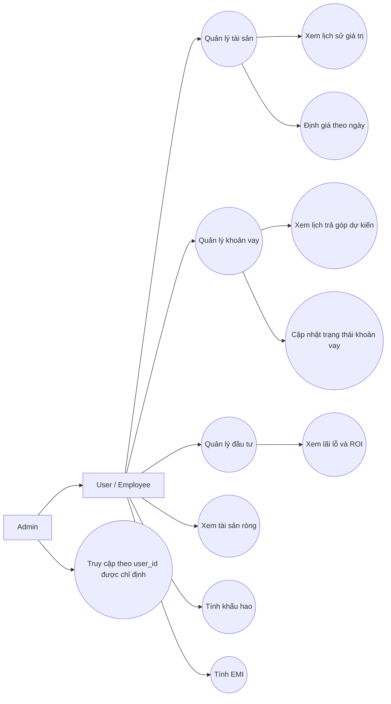
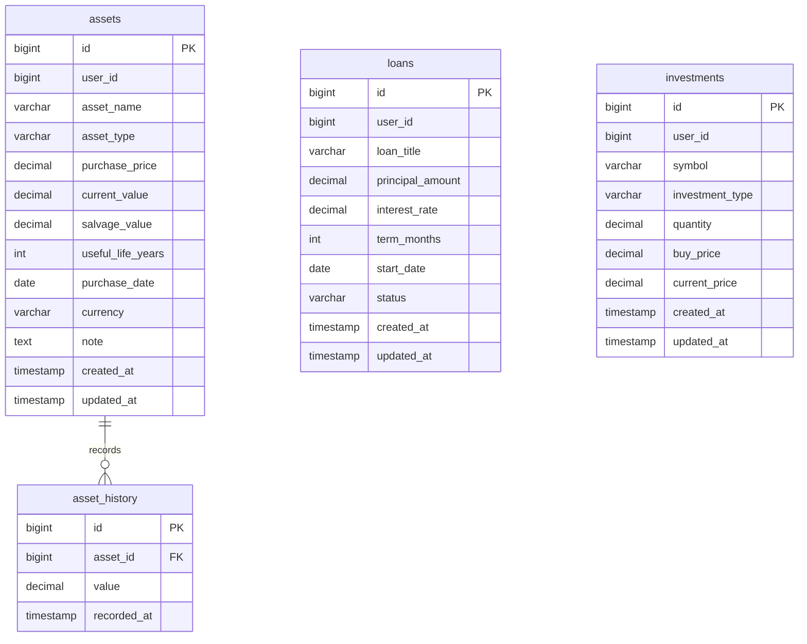
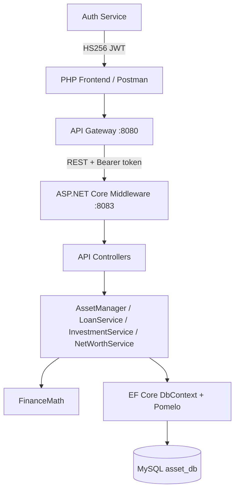

# Thiết kế Asset & Investment Service (Final)

## Use case

Admin có thể chọn user_id khác; user/employee chỉ được thao tác bản ghi của mình. Auth Service cấp JWT; Asset Service kiểm tra chữ ký, thời hạn và định danh.

## ERD (schema thực tế)

`user_id` là tham chiếu logic đến Auth Service, không có FK xuyên DB. Quan hệ assets-history là 1:N, cascade delete. Constraints và seed nằm trong `db/init-asset-db.sql`.

## Kiến trúc phân lớp

## Đối chiếu midterm → final

| Midterm | Final |
|---|---|
| Program.cs + HttpListener | Program.cs + Kestrel |
| Router.cs | Controllers (attribute routing) |
| Common/HttpHelper.cs | JSON snake_case, model binding, JWT, CurrentUser, exception middleware |
| Common/Database.cs | Data/AssetDbContext.cs, EF Core async LINQ |
| Handlers/AssetHandler.cs | AssetManager, FinanceMath, AssetsController |
| Handlers/LoanHandler.cs | LoanService, FinanceMath, LoansController |
| Handlers/InvestmentHandler.cs | InvestmentService, InvestmentResponse, InvestmentsController |
| Handlers/AnalyticsHandler.cs | NetWorthService |
| Models/*Models.cs | DTOs/Requests.cs, DTOs/Responses.cs, Models/Entities.cs |

Ghi lịch sử tài sản cùng SaveChanges: EF Core sử dụng transaction cho nhiều lệnh ghi; current_value là concurrency token, cập nhật xung đột trả 409. Đây không thay thế các bài test concurrency/idempotency bắt buộc của Transaction và Integration Service toàn nhóm.
